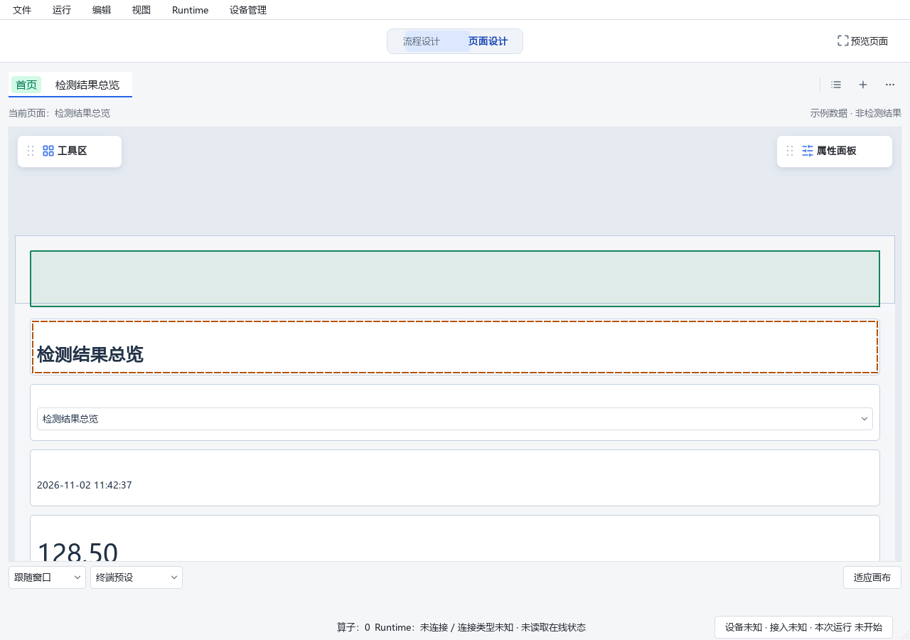
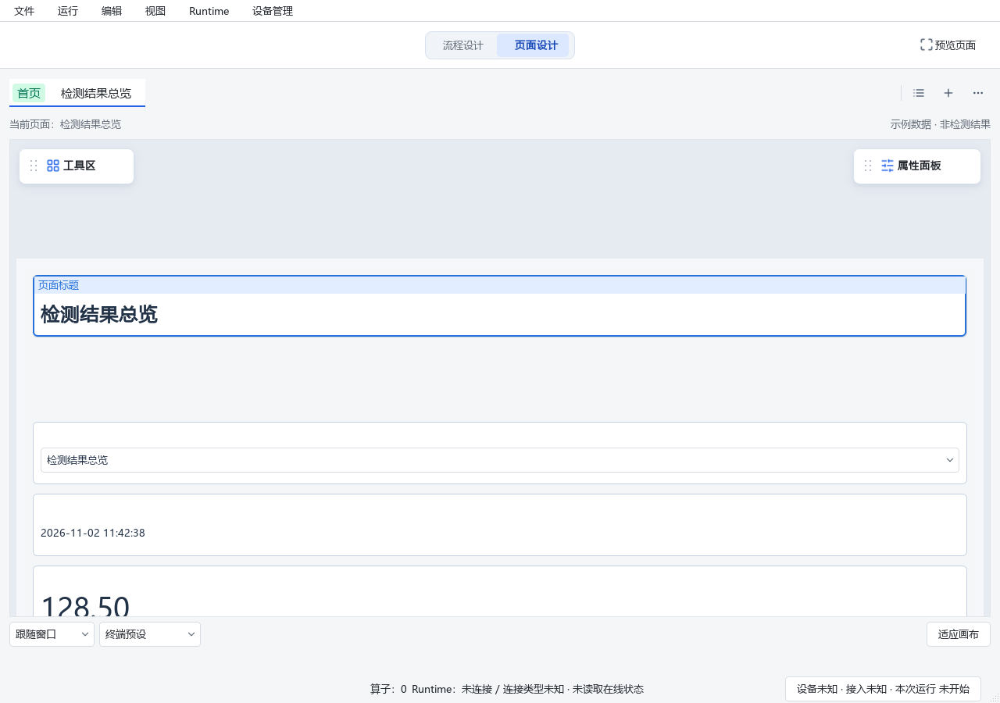

# 页面向上扩展画布：实现与验证

用户最终确认：**标题能落在原边界上方，扩展后的画布范围保留**。
本记录取代前一阶段临时48px“放在页面最前”辅助区的产品语义；旧112项测试记录仍保留为历史，
不用于证明本次实现。此次范围是响应式根页面上方扩展，不增加横向绝对定位，不修改现场工程。

## 源码与行为

- Designer：`D:/jsdfhasuh/documents/my_project/emo_master_designer`，分支`codex/designer-resize-zoom-fix`，
  HEAD `8df8599fc026c424a49e87cc53fb45f6b371f16f` **加未提交工作区修改**。
- Web：`D:/emo-web-review-b1ca6d3`，分支`codex/logging-and-designer-improvements`，
  HEAD `b89826b0841c6b4ef7f9c5f11ac938c6008934c7` **加未提交工作区修改**。
- 本次未创建分支、提交、推送、合并主分支或部署。文件摘要见[证据索引](evidence.json)。

页面保存`canvasTop`，根组件保存`responsive.canvasOffsetY`；普通响应式流仍决定宽高和换行。
向上拖动时预览真实范围，第一项也能上移；停在视口顶边时持续平移查看并扩大候选范围。
松手只提交一次历史，Esc/离开取消恢复模型与查看位置。橙色虚线为原位置，绿色实线为目标，
灰色轮廓仅标其他受影响组件。标题移回正常流或复制/编组后，已有扩展边界仍保留。

跟随窗口编辑增加画布高度；固定终端宽高保持用户输入，新增范围成为可滚动内容。
页面上方扩展不会增加弹性空白块可分配高度。Qt实际布局、候选测量、纯求解器和Web使用相同语义。
旧2.8/1.1响应式页面显式执行扩展时，在同一可撤销事务升级2.9/1.2；打开旧工程不自动升级。

同时修正两个直接关联路径：组件库的尺寸原型不携带画布偏移；拖到已上移标题旁边形成新组时，
标题回归组内正常流，避免非法根偏移进入嵌套组件。之前的浮动标题条、属性紧凑排列修改保留。

## 已执行检查

| 层次 | 结果与边界 |
| --- | --- |
| 核心/Qt定向回归 | **257 passed**，包含模型、发布、SDK、纯布局、原生布局、空白块、候选/移动/尺寸拖动、属性及视口 |
| 最后反馈绘制修改后的复测 | **35 passed**；与上行覆盖重叠，不相加当成独立覆盖 |
| 新增持久扩展路径 | 75/100/150%缩放×跟随/固定终端×提交/Esc，保存重开、撤销重做、顶边连续扩展、复制/分组相关合同 |
| Web完整后端 | unittest共150项：**148通过，2个opt-in跳过**，使用独立target安装的交付wheel |
| Web前端 | **63 tests passed**；TypeScript检查与Vite生产构建通过 |
| Chrome实际浏览器 | headless系统Chrome，**14个布局场景通过**，包含原空白块场景和宽窄窗口的扩展/边界保留；无pageerror |
| 静态检查 | Designer全src/tests Ruff通过，mypy **607 source files**通过；两工作区diff检查通过。Web所查文件的7处E701/E702与HEAD逐项一致，无新增；不记为Web全量lint通过 |
| 生成产物 | SDK1.3.0由脚本生成，模型/保存重读/编译/normalCapture通过；Web校验完整ZIP/manifest/wheel与内嵌fixtures一致 |
| Designer入口与画面 | 临时设置、模拟客户端，通过MainWindow实际打开SDK示例；Qt离屏捕获拖动前候选和落地画面 |
| 真实鼠标、Windows100/150%显示缩放、冻结安装包、CI | **NOT_RUN**，不能由上述结果替代 |

最后补充复制边界断言后的核心复测为 **10 passed**（同样与257项覆盖重叠）；启动脚本`--check`通过，未启动窗口或Job。

Qt使用Python3.10/PySide2及`QT_QPA_PLATFORM=offscreen`。测试不连接真实相机/PLC，
不操作用户正在运行的Designer。首次离屏截图脚本在切换工程时未处理自己的临时未保存草稿，
进入确认对话框后异常退出，记录保留在本机`build/canvas-expansion-visual.txt`；
脚本明确结束临时草稿后复跑成功，见`build/canvas-expansion-visual-final.txt`。未修改产品确认逻辑。

## 复测入口

运行`D:/jsdfhasuh/documents/my_project/emo_master_designer/start_designer.cmd`。
已有Designer进程不会自动加载源码；由用户保存当前工作后自行重启。
使用临时工程或SDK样例副本，按[Dot验收清单](../2026-11-02-designer-space-dot-acceptance.md)第5、9、10项复测。
展开后的画布会保留；通过撤销本次扩展恢复原范围。后续正常重排标题不会隐式缩回页面。

