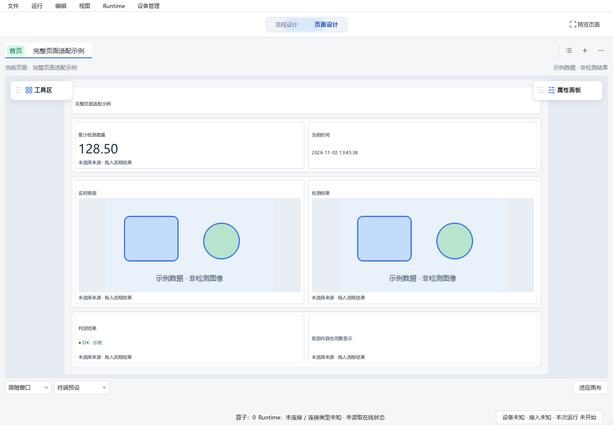
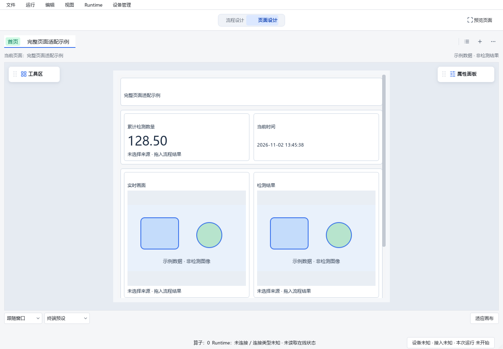

# 默认编辑整页适配与内部滚动条修正

用户截图显示：跟随窗口模式点击“适应画布”后，底部内容仍被裁剪，右侧整页滚动条仍在。
源码核对为 Designer HEAD `8df8599fc026c424a49e87cc53fb45f6b371f16f` 加既有未提交修改；
本次继续在 `D:/jsdfhasuh/documents/my_project/emo_master_designer` 的
`codex/designer-resize-zoom-fix` 实施。未提交、推送、合并或部署，没有操作现场工程或正在使用的窗口。

## 根因与修正

旧实现按中央编辑区宽高固定页面框，再缩放这个框；更长内容仍在内部QScrollArea滚动，
外层缩放无法呈现被框裁剪的底部。默认编辑无需这一层整页滚动。

现在跟随窗口模式按编辑区宽度计算布局，并按完整内容测量高度（旧网格同时保留必要宽度）；
页面框容纳全部内容，因此内部滚动范围为0。适应画布/Home将整页边界等比缩放居中。
缩放只改变显示比例，不改组件字段或工程历史。放大后可沿用现有滚轮缩放和空白处拖动平移。

固定终端逻辑宽高、独立预览和桌面Runtime继续保留真实溢出及浮动滚动条。
“跟随窗口→固定终端→跟随窗口”会重新计算页面框，内部滚动位置自然归零。
普通内容修改/刷新只更新画布范围，不自动重置缩放或居中；窗口变化、切页、切模式和显式适配
沿用已有自动查看规则。拖动时推迟页面尺寸更新，候选测量和实际画布共用同一内容尺寸函数，
避免长页编组后候选仍沿用旧高度而落地缩短。

本轮没有增加“向下拖出原边界并持久保存”的功能，没有改工程/SDK契约或Web代码。

## 验证

- 新增反例修前 **3 failed**：响应式长页仍有1008px内部滚动范围、旧网格有820px，切回跟随窗口仍保留滚动。
- 修后相关回归 **150 passed**，包括完整页面可见/无内部条、固定终端真实溢出、查看状态、候选/落地一致、
  顶部扩展、缩放后尺寸拖动、Esc、撤销、保存重开、旧网格和空白块。修前XML保留在本机`build/canvas-fit-before.xml`。
- 两项原有“滚动后操作保持滚动位置”的测试明确切入固定终端后继续执行原断言；
  编组缩短长页的测试同时覆盖跟随窗口/固定终端。没有删掉滚动恢复校验。
- 定向Ruff、mypy全部607个源码文件、`git diff --check`通过；本记录不表示整仓pytest、CI、冻结包或真实鼠标/DPI人工验收已经通过。
- Qt离屏截图使用临时设置、模拟客户端和内存示例页面；整页适配比例约81.3%，页面框1398×854，
  编辑视口1414×710，内部滚动范围0；固定768×640时实际纵向滚动范围190。
- Dot真实鼠标与Windows100%/150%显示缩放：**NOT_RUN**。步骤见[Dot验收清单](../2026-11-02-designer-space-dot-acceptance.md)第3项。

完整验证证据及当前相关源码摘要见[evidence.json](evidence.json)。同一工作区前序未提交修改保留。
启动仍使用[当前工作区启动脚本](../../../start_designer.cmd)，已有进程由用户保存工作后重新打开以加载新代码。

