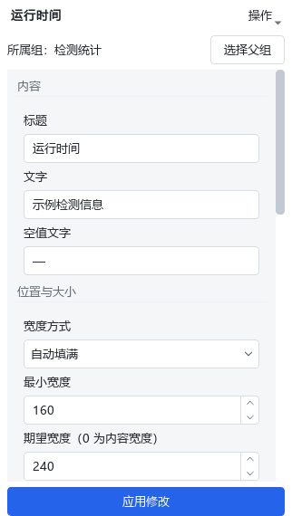
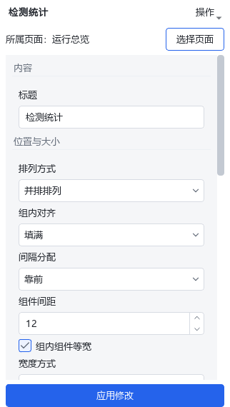

# 组件属性中的父组入口

用户要求从子控件属性直接进入所属组设置。本次在Designer工作区
`D:/jsdfhasuh/documents/my_project/emo_master_designer` 实施，分支
`codex/designer-resize-zoom-fix`，HEAD `8df8599fc026c424a49e87cc53fb45f6b371f16f`
加既有未提交修改。未提交、推送或合并，未操作现场工程或现有Designer进程。

属性面板标题下新增所属名称和导航按钮。子控件显示“所属组”和“选择父组”，
根组件显示“所属页面”和“选择页面”；容器可以逐级上选。页面属性没有更上一级，
隐藏这一行。未命名组使用“未命名容器”，长名称复用ElidedLabel省略并提供全名提示。

导航复用既有选择、待应用输入验证及画布选中轮廓；不产生工程历史，不重置画布缩放。
切换后属性表单回到顶部，直接呈现组的排列、间距及等宽设置。
产品改动仅为 `page_designer/tools.py`，不新增工程字段。

验证共 **20 passed**：新增父级导航及原有待应用选择测试9项，属性布局和工作区回归11项。
检查嵌套逐级选择、页面选择、父组属性应用与撤销、合法/非法未应用输入、跨组移动后入口更新，
以及长名称和原有属性面板布局。Ruff、mypy和`git diff --check`通过。
源文件摘要与JUnit记录见[evidence.json](evidence.json)。

截图使用临时设置、模拟客户端和内存页面，采用Designer实际样式；Qt offscreen下通过
QWindow输入点击按钮，确认进入组属性且模型未变。真实桌面鼠标、Windows显示缩放、
冻结包和CI本轮 **NOT_RUN**。人工检查见[Dot清单](../2026-11-02-designer-space-dot-acceptance.md)第1项。

