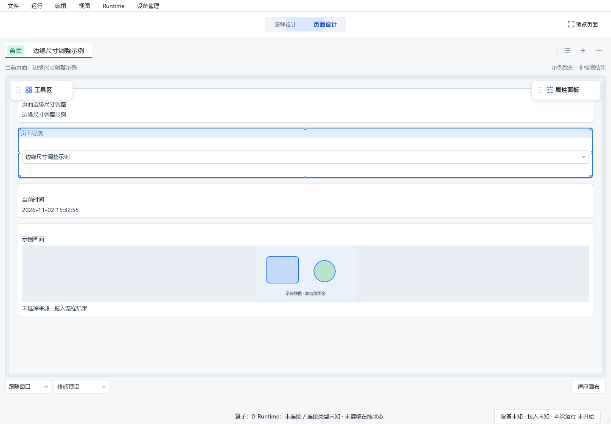

# 响应式组件边缘尺寸调整

用户截图中选中了“页面导航”，鼠标放在左边界却没有尺寸调整提示。
原实现仅在右下角放置一个14逻辑像素的手柄，其他边缘没有尺寸调整接收区域，也没有对应光标。

本次基于Designer HEAD `8df8599fc026c424a49e87cc53fb45f6b371f16f` 加既有未提交修改，
工作区为 `D:/jsdfhasuh/documents/my_project/emo_master_designer`，分支为
`codex/designer-resize-zoom-fix`。未提交或推送；保留同一工作区的前序修改。

## 修正

- 单选响应式组件后，四边和四角均可调整尺寸。四边整段命中，角点优先；显示小手柄、对应方向的双向光标和中文悬停提示。
- 左右边只改期望宽度，上下边只改期望高度，角点同时调整两者。没有相关方向的位移时不改模型、不产生历史。
- 继续复用既有响应式求解、候选轮廓、吸附、一次提交、取消和撤销流程；鼠标仍由Graphics Proxy捕获，保留缩放坐标修复。
- 尺寸变化仍由响应式布局定位，不引入任意X/Y位置或固定对边坐标的自由布局规则。多选仍使用原有移动、编组等操作，没有新增整体拉伸。
- 属性提交导致页面刷新时保留当前接收鼠标的手柄，其余七个手柄正常恢复。
- 100%画布缩放时边缘命中带6逻辑像素、角点10逻辑像素；放大时缩小逻辑命中尺寸，避免视觉热区变大。缩小时限制向内扩张，保留标题移动区域。可见标记约5逻辑像素起，不用大色块遮住控件。

本轮产品修改位于 `src/emo_master/apps/designer/page_designer/responsive_tools.py`，不改工程格式、Web或SDK。

## 验证与边界

- 修前新增反例 **22 failed、3 passed**；通过的三项只有既有右下角入口，其余边缘/待应用属性恢复均失败，见[before.xml](before.xml)。
- 首轮修复后尺寸调整相关 **61 passed**。进一步回归发现50%缩放下左上命中区域覆盖标题移动入口，保留[intermediate-regression.xml](intermediate-regression.xml)的 **1 failed、91 passed**；随后收紧命中区域，保留原标题拖动测试断言。
- 最终相关回归 **157 passed，0 failed，0 skipped**；源码摘要见[evidence.json](evidence.json)，测试记录见[regression.xml](regression.xml)。覆盖四边/四角在50%、100%、150%缩放下的实际视口光标、QWindow输入和代理捕获、轴向尺寸变化、无关方向移动、待应用属性、Esc、单次提交及撤销；同时覆盖原有选择、移动、编组、候选布局、顶部扩展和整页适配。
- 定向Ruff、mypy全部607个源码文件、`git diff --check`通过。
- 测试平台为Qt offscreen，QTest通过QWindow发送输入并检查视口光标；这不等于真实桌面鼠标或Windows显示缩放验收。后两项及CI、冻结包仍为 **NOT_RUN**。
- 下图来自临时设置、模拟客户端和内存示例页面的Designer截图；未打开或修改现场工程，也未操作已有Designer进程。截图不包含操作系统鼠标光标，光标由自动化断言验证。

真实鼠标检查见[Dot步骤](../2026-11-02-designer-space-dot-acceptance.md)第5项。
使用当前工作区的[start_designer.cmd](../../../start_designer.cmd)；已经运行的进程需要保存工作后重新打开才能加载新源码。

