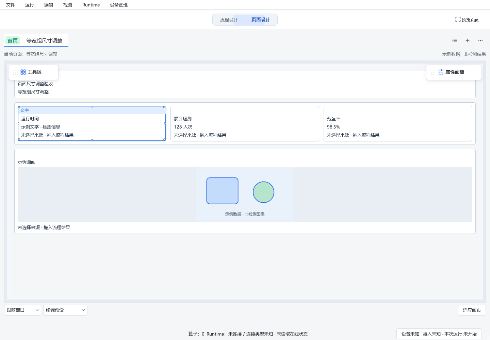
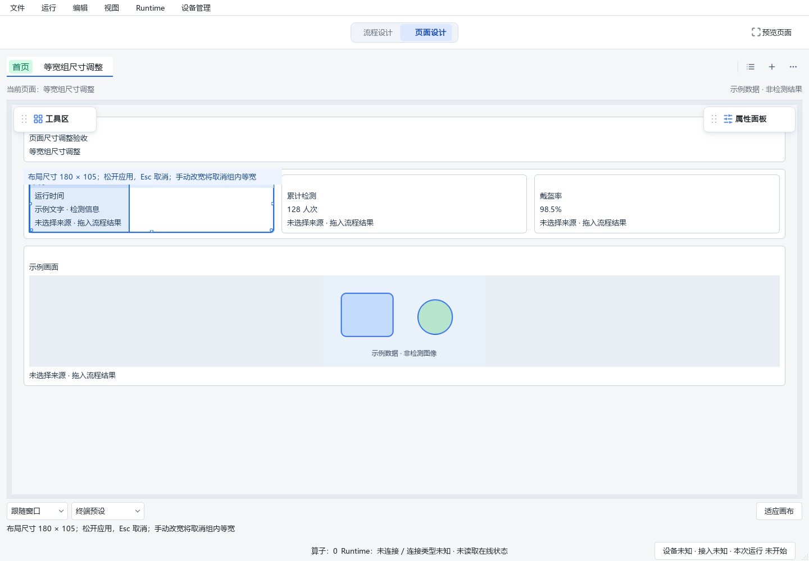
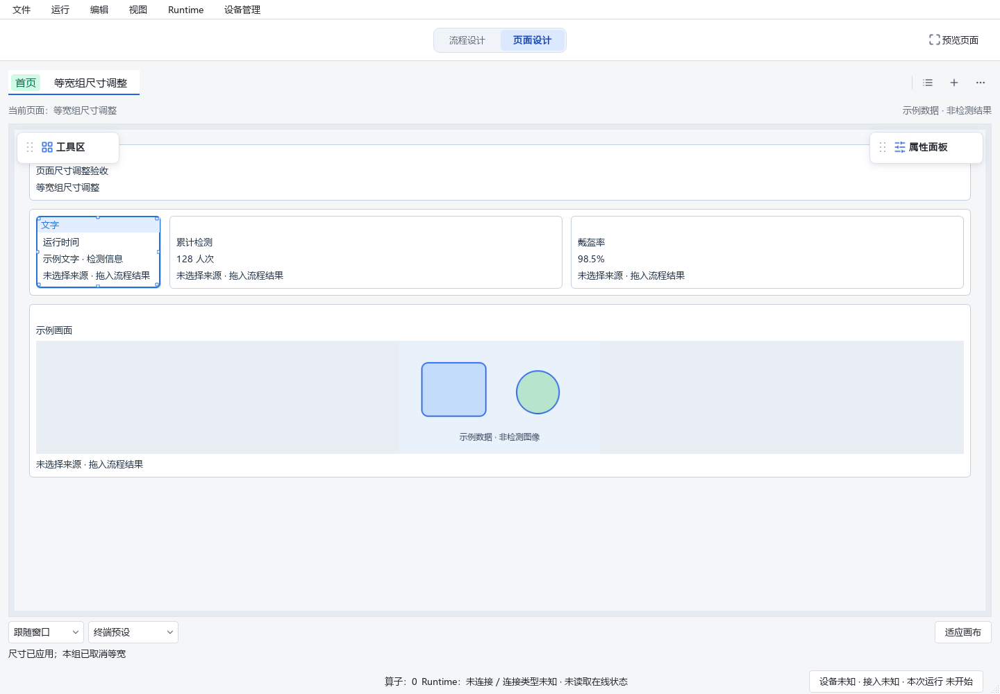

# 拖动尺寸被父组布局覆盖的修正

用户截图中提示“期望大小180×96”，但控件仍然很宽。基于Designer HEAD
`8df8599fc026c424a49e87cc53fb45f6b371f16f` 加本工作区既有未提交修改复现：
`D:/jsdfhasuh/documents/my_project/emo_master_designer`，分支 `codex/designer-resize-zoom-fix`。
本次未提交、推送、合并或部署，未操作现场工程、设备或正在使用的Designer窗口。

## 根因与修改

1. 手动拖动原来只修改子组件的preferredWidth与width=content，而横排/换行父组的equalWidth
   优先于子组件宽度，会继续均分行宽。数据虽然保存，最终控件没有达到手动尺寸。
2. 只拖动高度时，继承的stretch又可能将控件拉回同一行最大高度。
3. 原提示显示期望值，未显示布局求解后的尺寸。之前的缩放拖动测试主要断言模型变化、
   鼠标捕获和历史，漏掉等宽组中预览及最终控件几何；不能用先前通过数证明这一场景正确。

现在横向手动调整普通组件时，将当前父组退出强制等宽，兄弟组件字段保持不变；
空白块仍沿用原有等宽豁免。仅调整高度时只解除该组件必要的行高拉伸，宽度及组等宽保持。
候选布局与提交使用相同规则，组设置和尺寸一起提交、取消及撤销。
提示显示实际布局尺寸；自然内容高度不足以容纳时仍保留内容，并说明高度限制。
松手/取消后清除“松开应用”的过期状态，分别显示已应用、已取消或未改变。

产品修改仅在 `src/emo_master/apps/designer/page_designer/responsive_tools.py`。
复用既有工程字段及渲染合同，没有模型、SDK或Web源码变更。

## 验证

- 新增第一轮反例 **11 failed、2 passed**，见[before.xml](before.xml)。失败包括根页面与嵌套
  容器、horizontal/wrap、75%/150%缩放，以及行高拉伸、实际保存重开；取消路径原本通过。
- 最终分四个独立进程顺序执行 **43 + 36 + 39 + 53 = 171 passed，0 failed，0 skipped**，
  测试记录与源码摘要见[evidence.json](evidence.json)。新断言直接比较预览边框和最终
  QWidget的尺寸，核对未选组件字段、组设置、一次历史、取消/回到原点、撤销重做、保存重开。
  另覆盖自然内容高度限制、完成状态提示，以及原有缩放、选择、移动、编组、整页适配等回归。
- 测试通过菜单关闭吸附，与实际编辑偏好同步；不以直接修改瞬时工具字段假定吸附已永久关闭。
- Ruff、mypy和`git diff --check`通过。离屏视觉复现中，文字控件原宽437，拖动预览和松手后
  宽度均为180；自然内容高度105得到保留，没有用期望高度96虚报实际结果。
- 一轮合并离屏执行在创建画布代理时出现Qt原生access violation并中断；未完成轮次不计通过。
  调用栈摘录和后续分进程复核说明见[interrupted-run.txt](interrupted-run.txt)。原生异常根因未定位，
  不声称本次尺寸修复解决了这个异常。
- Qt离屏截图来自临时设置、模拟客户端和内存示例页面；真实桌面鼠标、Windows显示缩放、
  冻结包及CI本轮未执行。真实鼠标步骤已加入[Dot清单](../2026-11-02-designer-space-dot-acceptance.md)第5项。

已有运行进程需要保存工作后重新打开当前工作区[start_designer.cmd](../../../start_designer.cmd)以加载源码。

