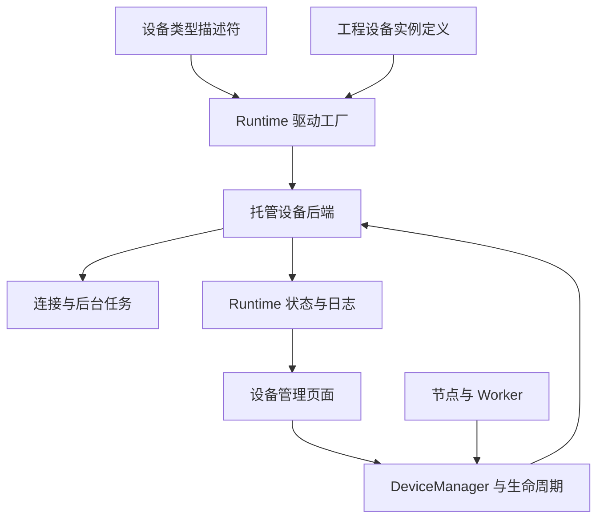

# TCP 通信纳入设备管理实施计划

- 日期：2026-10-20。
- 实施状态更新：2026-10-21。
- 版本：**v1.5；主体架构及正常工程链已实现，当前收尾状态见下方与 §12.1**。
- 仓库：`jsdfhasuh/emo_master`；分支：`agent/runtime-workflow-architecture-v1`。
- 原始设计审查基线：`59f3f63b653d6c021ceb7c33700bdfcd3e7e4e6a`。
- 技术栈：Python 3.10、PySide2、Qt QWidget；沿用现有 Designer、Runtime、Worker、设备管理窗口和配置发布机制。
- 原始设计状态（2026-10-20）：计划修订与静态代码审查。下文原有“当前／拟新增”等时态及 [S01]—[S96] 固定依据保留用于追溯，不代表最新代码仍待实施。

**当前实施状态（2026-10-21）：** TCP 注册、Runtime 生命周期、节点绑定、设备状态日志、首次及选中发布、三类包流转和第三方设备链已实现。F01—F11 的实施与限制见[第一轮收尾](../testing/2026-10-21-tcp-device-closure.md)；R01—R03 的冻结日志身份、发布定位和多 owner 展示见[第二轮审核](../testing/2026-10-21-tcp-device-review-round2.md)。

最后一轮以 `31b5de4a604e4facdf636ad39795da0869d908d4` 为问题审查基线，修复 TCP 日志截断字段、在线 Server 草稿端点测试及连接表单焦点。最新固定源码、实际软件链与原生 Qt 结果见[最后一轮收尾报告](../testing/2026-10-21-tcp-device-final-closure.md)。软件实现与验证结论不替代真实设备、人工完整桌面、冻结 EXE 或跨机器验收。

## 1 新基线、操作路径与范围

### 1.1 以三笔已提交改动为准

已核对父子关系：`ef5af506 → b7e6e142 → 6c3779b8 → 59f3f63b`。旧 v1.4 基于前一个 `ef5af506`；本版固定到三笔提交之后，并结合本次截图核对布局。源码通过目标提交的文件内容读取，变更源码和测试文件逐一核对 Git blob 摘要；没有把旧本地 HEAD 当成新提交。

| 提交 | 已完成的基线 | 对本计划的约束 |
| --- | --- | --- |
| [b7e6e142](https://github.com/jsdfhasuh/emo_master/commit/b7e6e14210d9ebcb5434319e5ccd0f01ade0228d) | 主编辑器隐藏时，启动入口独立显示；编辑器可见时保留父窗口关系 | 延续窗口归属和正常启动流程；不重做入口对话框 |
| [6c3779b8](https://github.com/jsdfhasuh/emo_master/commit/6c3779b8d6ff9fdf5953269a525dbd81bc41af4f) | 菜单归属、设备管理布局、空 Runtime 首次写入、校验反馈、当前／候选连接展示、已提交后连接失败提示 | TCP 接入现有表单、配置事务与反馈出口；这些不再作为待开发功能 |
| [59f3f63b](https://github.com/jsdfhasuh/emo_master/commit/59f3f63b653d6c021ceb7c33700bdfcd3e7e4e6a) | 计划、指南、验证记录、原始证据和证据换行保护 | 使用其描述的操作边界；后续追加本轮证据，不覆盖历史记录 |

现有菜单和设备窗口的归属由 `WorkspaceChrome`、`PageCoordinator`、`DeviceWorkspace` 共同完成，不只在 MainWindow 内。[S78] [S69] [S13] 截图是未选择设备的空列表；选中设备后的详情页签以源码核对结果为准。

### 1.2 保留今天的界面，在原位置扩展 TCP

| 现有界面位置／行为 | 本轮接入内容 |
| --- | --- |
| 主菜单“文件／运行／编辑／视图／Runtime／设备管理”；工具栏仅工作区切换 | 沿用 QAction 和菜单归属；设备管理仍为独立窗口 |
| Runtime → 连接 Runtime… | 沿用当前连接与候选目标分区；为同一 Runtime 接入设备状态／日志观察 |
| Runtime → 写入 Runtime… | 沿用统一 ProjectConfigurationDialog；让新设备、通道绑定及 2.7 工程进入首次／后续写入 |
| 设备窗口左侧类型树、中间设备表、右侧详情 | 类型树注册三类 TCP；设备表显示监听或事务状态，详情编辑所选设备 |
| 详情上半区“基本信息／连接／工作参数／策略” | 通道表放“连接”；继承参数放“工作参数”；启动方式放“策略” |
| 详情下半区“节点引用／在线状态／诊断日志” | 显示 channelId 引用、实际监听／客户端状态、按设备归属的 Runtime 日志 |
| 属性旁“应用到草稿／放弃当前修改”与底栏“保留草稿并关闭” | 使用现有校验及原子草稿提交，TCP 通道必须参与相同保存过程 |
| 详情动作“测试连接／连接或断开／诊断／更多” | 按设备声明与在线 availableControls 显示；server 主动作显示“启动服务／停止服务” |
| 校验通过但未写入、失败弹窗、已提交后异常提示 | 保留现有文案分层和去重；增加 TCP 字段位置、逐设备连接结果及提交后短期只读观察 |

设备管理窗口保持设备级职责。整工程保存继续从“文件”执行；整工程比较、校验与发布继续从“Runtime”执行。设备窗口不增加整工程写入按钮或隐藏发布链接。[S13] [S78] [S84] [S88]

### 1.3 一条正常工程主路径

**启动／新建工程 → 设备管理中新建设备 → 编辑连接与通道 → 应用到草稿／保留草稿并关闭 → 节点选择设备与通道 → 保存并重开 → Runtime 菜单首次校验及写入 → 运行菜单启动并按策略完成所需服务准入 → 执行流程 → 查看设备状态与日志 → 导出、导入后再运行。**

保存与写入是独立操作：用户可以保存后继续，也可以沿今天已实现的首次写入入口直接提交有效的当前草稿；后者不会替用户保存磁盘文件。设备管理窗口关闭后，Runtime 中已启动的服务继续运行。首次校验不连接、不监听；配置正式提交后可按 `on_project_open` 激活设备，但不创建 Job 或执行业务节点。[S66] [S79] [S41] [S85]

本机空 Runtime 使用已有首次写入；远程空 Runtime 先在执行端导入完整运行包／工程，再从 Designer 连接、比较、上传资源及写入更新。现有首次接口传递本机资源根目录，不能当作跨机器安装协议；loopback 也以共享本机文件系统为前提。[S79] [S91]

### 1.4 本轮范围

目标是让 TCP 成为普通工程设备：可创建、绑定、继承参数、随设备包和流程包流转；实际连接与持续监听由 Runtime 托管，节点与后台事件进入设备日志；第三方同类设备通过**设备类型注册描述符 `DeviceType` 与驱动实现**接入。

| 保留 | 不列入本轮交付 |
| --- | --- |
| 当前相机、PLC、TCP 的正常功能、参数继承和工程链路 | 旧工程自动升级、历史 TCP 参数迁移、旧包往返 |
| 当前内置驱动统一更新到新接口 | LegacyDriverAdapter、旧驱动 API 兼容分支 |
| 当前新工程和新包完整保存、校验、导入导出 | 历史描述符摘要保真、旧会话值兼容读取 |
| 普通停止、取消、释放、一次连接失败和常规并发 | 压力／全平台／强杀／故障组合矩阵、跨独立 Runtime 独占 |
| 六组连续正常使用验收 | 将今天 UI-01—UI-16、VF／RC 清单全部复制成新的验收门槛 |

今天已有的旧格式“升级草稿并重新校验”属于历史入口的现状，本轮新建／保存直接生成目标 2.7，不扩建旧 TCP 迁移，也不把只升到 2.6 的旧工具伪装成新契约迁移器。保留现有文件和历史证据，源码改动只覆盖本次主路径。

本轮审查仍确认：旧 TCP 编译校验、只识别两个算子的桥创建条件、会话端口版本、禁用设备副本、选中发布、操作端和失败日志都必须同步。结合新提交，还需补齐 **2.7 的新增首次写入版本门、通道表参与草稿提交、首次激活 future 进入回执、COMMITTED 后连接结果观察**。这些是正常工程操作的衔接，不是新增测试专项。

## 2 名称、连接与线程

### 2.1 名称沿用现有代码

| 名称 | 代码 | 含义 |
| --- | --- | --- |
| 设备类型注册描述符，简称设备类型描述符 | `DeviceType`；`device_types/<name>.json` | 注册一种设备的配置结构、能力、驱动入口和运行方式 |
| 工程设备实例定义 | `DeviceDefinition` | 工程中的具体配置，可保存和导出 |
| 工程设备目录 | `ProjectDevices.definitions` | `deviceId → DeviceDefinition`；deviceId 当前是字典键 |
| 设备槽位需求 | `DeviceRequirement` | 算子 manifest 中某个 slot 要求什么设备 |
| 节点设备绑定 | `DeviceBinding` | slot 绑定哪个 deviceId 和静态子资源 |
| 设备参数值绑定 | `DeviceValueBinding` | 工作参数从变量或输入取值 |
| 算子注册描述符 | `PluginDescriptor` | 算子 manifest、类与编辑器资源的注册结果 |
| 托管设备后端实例 | `DeviceManager.drivers[deviceId]` | Runtime 持有的驱动对象及其实际资源 |
| 操作所有者 | `ownerId` | Job 或管理诊断会话的访问范围；多个操作所有者可以调用同一受管后端 |
| 在线配置协调器 | `ConfigurationCoordinator` | 已提交配置、写入回执及 owner/cycle 快照；不另建同义管理类 |

以上名称对应当前模型与协调器；不再创建 DeviceDescriptor、ProjectConfigurationManager 等同义类。[S01] [S02] [S34] [S35] [S52]

### 2.2 每台设备的独立资源，不等于固定一条线程

**一台设备由一个受管后端持有其连接／会话，多节点绑定它时复用该后端。** 连接数量由设备类型的实际含义决定，线程是实现连接与动作的执行方式，两者不是同一对象。

| 设备 | 正常资源形态 | 本轮线程安排 |
| --- | --- | --- |
| PLC | 每台 PLC 一个受管协议会话，连接后复用 | 该设备自己的串行执行线程 |
| 相机 | 每台相机一个受管 SDK 会话，IMV 由现有专用 Host 持有 | 沿用设备执行器与相机 Host，不复制 SDK 连接 |
| TCP server | 一个本地监听 socket；每个已接入通道一条客户端业务连接 | 复用现有 accept 线程与各 Peer 读取线程；发送走来访 IPC 线程 |
| TCP client_once | 每次事务建立一条客户端连接，结束关闭 | 该设备自己的串行执行线程，不维持空闲连接 |
| TCP receive_once | 本次临时监听，接入一个客户端后收取报文并关闭 | 该设备自己的串行执行线程；监听 socket 本身不是一条已建立的业务连接 |

当前 TCP server 的 _accept 按 channel 保存 Peer；同一通道已有连接时拒绝第二个，acquire 返回现有连接的会话引用。[S05] 一个通道配置对应一条当前业务连接；多节点拿到引用不等于新建多个连接。相机由 SDK／Host 管理的资源也不应简单说成项目自己创建的一条 TCP 连接。[S31]

设备类型注册只读取描述符。Runtime 加载设备后创建驱动、生命周期和执行器；驱动在激活时创建所需资源。当前 DeviceExecutor 构造时确实会启动一个空闲框架线程，但这不等于注册时连接设备或启动 TCP 监听。[S01] [S04] [S17]

## 3 相机、PLC 的串行与业务顺序

### 3.1 串行作用于每台设备

当前 DeviceManager.load 为每个 deviceId 分别创建 DeviceExecutor；execute 选择 `self.executors[deviceId]` 提交，在退出 Manager 锁后等待。相机 A 和 PLC B 各有自己的队列，没有一个覆盖全部设备的全局 FIFO。[S04] [S17]

相机曝光或等待图像，不会因为占用相机队列而阻止另一个 Job 向 PLC 提交合法动作。多个 Job 使用同一 PLC 时，才在这台 PLC 的队列中排队。这里保证单次设备调用串行，不保证不同设备或不同 Job 的业务先后顺序。

### 3.2 拍照完成后通知 PLC

将正常流程明确连为：**相机取图成功 → 图像处理／判定 → PLC 写结果或完成信号**。

当前 WorkflowRunner 按拓扑顺序同步调用节点，DeviceProxy.call 也是同步请求应答；相机节点返回后，流程才继续执行后面的 PLC 节点。连线表达真实依赖，不靠不同设备队列的偶然先后。[S44] [S15] [S36]

这条正常流程不需要新增跨设备锁。PLC 写入仍可能等该 PLC 已有的请求，但不会与相机操作争用同一个连接。

### 3.3 由 PLC 发硬触发时的边界

若 PLC 按自身工艺独立产生触发，相机节点可以等待外部图像。若触发请求由同一工作流后续的 PLC 节点发出，不能编排成“相机等待触发 → 后续 PLC 发这个触发”，因为后一个同步节点走不到。

也不能仅把 PLC 触发移到采集节点前就宣称一定正确：当前 IMV connect 只连接会话，首次 capture 的 _prepare 才打开并配置采集。因此“连接成功”不等于“已准备接收硬触发”。由软件控制的硬触发顺序必须依据实际采集就绪与 PLC 握手安排：相机准备好 → 允许／请求触发 → 获得图像 → 回传结果。[S45]

本轮保留当前相机触发行为，不顺带新增相机 arm／trigger／wait 接口或通用跨设备事务框架。这一使用边界写入说明；普通“拍完后通知 PLC”按 3.2 实现。

### 3.4 同一 PLC 的共享地址

设备 FIFO 只保证每次 read/write 不同时交织。两个 Job 分别“读 D100 → 加一 → 写 D100”，仍可能都读到 10、都写 11。不同 Job 修改同一业务值时，应明确寄存器职责，或由 PLC 程序完成相应原子工艺操作；不要把单次请求串行描述成跨节点事务保证。

## 4 目标架构与所有权

工程定义、编译计划和周期快照继续管理参数。DeviceManager 管资源身份、唯一 owner、权限、准入、生命周期和替换；注册驱动维护具体协议、线程、socket／SDK；页面提供配置、控制与观察；节点经代理调用设备。[S03] [S04] [S36]



同一个需要独占的物理资源或监听端点，在一个 Runtime 及其 Worker／Host 内只有一个实际后端 owner。`physicalIdentity(definition)` 返回稳定的独占键或 None；SDK 整体独占时返回稳定 SDK 独占域，内部子资源可通过 selectors 表达。本轮不增加多个独立 Runtime 之间的占用协调。

server 与 receive_once 采用同一类本地 listener 独占键，不能因设备类型不同绕过同端点冲突；常用 IPv4 通配监听地址与具体地址的同端口重叠也在连接前给出明确提示。client_once 的远端 host/port 本身不是本 Runtime 的独占资源，返回 None，允许两台客户端设备访问同一远端。特殊协议若要求远端唯一访问，由该驱动明确声明独占身份。

执行队列、线程名称和后端代次仍按非空 deviceId 管理，不能把可空独占键直接传入当前 `DeviceExecutor` 的字符串线程名。[S17] 独占键为 None 时也不参与测试连接的“借用已有物理 owner”查找。

**禁用配置副本可以保存和编辑；启用和实际操作时检查独占。** 当前 Runtime `_validatedDefinitions` 与 Designer `matchingDevices` 都会把禁用副本算入重复身份，这会阻止正常导入后编辑，应一并修正。[S04] [S47] 保留启用设备的重复声明检查；同身份定义切换时，将旧定义设为禁用（可纳入同次配置发布），确认实际资源退出后，再启用／激活目标定义。Designer 的 `xDeviceIdentity` 只作离线提示，实际 Runtime 再做权威检查。显式 deviceId 测试优先定位该后端；按身份借用时选择实际资源 owner，不任意取第一个同身份的禁用定义。

已有 camera_host 继续承担相机专项；普通第三方服务在 Runtime 中运行，不能仅填一个 executionLocation 就获得未实现的通用隔离进程能力。页面关闭、Worker 结束或请求超时，不等于底层资源已经释放。

工程加载 scope 由 RuntimeService 为一次装载／切换统一准备：候选 PreparedConfiguration 携带同一 scope，工厂据此向后端注入上下文，成功安装后作为当前 scope。后端在正式提交之前保持无设备 I/O。每台 TCP 后端不能自行生成不同的 projectLoadGeneration。普通配置发布保持工程 scope；仅在实际后端替换或恢复重建时更新设备代次，显示名称和允许的周期参数更新不换后端代次。这样会话、设备状态、日志和两端页面使用同一套工程身份。

## 5 目标统一契约与注册方式

### 5.1 描述符与运行版本

本轮直接使用一套目标契约：工程 2.7、设备类型描述符 1.1、driverApiVersion 1.1、流程包 1.4。当前内置驱动、描述符、示例和消费入口同步更新，不保留 API 1.0 适配通道。

DeviceType.version 表达类型发布版本，DeviceDefinition.driverVersion 必须与它匹配；schemaVersion 表达文件格式，driverApiVersion 表达驱动调用契约。保留版本字段方便声明与校验，不实现历史版本分流。

| DeviceType 字段 | 用途 |
| --- | --- |
| 现有 connectionSchema/defaultsSchema/policiesSchema | 连接、默认工作参数与策略的闭合配置结构 |
| 现有 overridePaths/dynamicPaths/nextCyclePaths | 参数覆写、动态来源与周期生效规则 |
| driverEntry、driverApiVersion | 驱动入口及本轮统一接口版本 |
| capabilities、actionSchemas | 业务动作及闭合参数 schema；新增 TCP 动作 |
| operationScheduling | serial 或 managed_service |
| connectionLifetime | persistent 或 per_operation |
| controlCapabilities | 支持的标准设备控制 |
| bindingSelectors | 稳定子资源声明，例如 TCP channelId |
| managementActions，可选 | 允许从设备页调用的业务动作子集，必须有 actionSchemas |

注册器只做元数据校验；运行工厂才导入、检查并实例化驱动。完整算子注册已有算子类导入一致性检查，不能将整个 PluginRegistry 笼统描述为不导入 Python。[S01] [S35]

capabilities 从当前固定动作 Literal 扩为受声明约束的动作名；业务动作必须有闭合 actionSchemas，控制动作只由 controlCapabilities 声明。第三方自定义动作只需注册声明和驱动，无须加入 DeviceManager 的类型分支。工厂按调度方式与已声明能力检查所需方法，在实际运行前指出缺失的接口；不会要求每个 per_operation 驱动提供持续连接能力。

调度与生命周期组合限定为 serial/persistent、serial/per_operation、managed_service/persistent；由驱动类型声明，页面不让用户随意组合。

### 5.2 绑定和参数

DeviceRequirement 保留精确 deviceTypeId，增加 requiredCapabilities、selectorSchema。requiredCapabilities 表达兼容性要求，本轮不把它另解释为逐节点动作权限白名单。

DeviceBinding 增加 selectors。例：

```json
{
  "deviceBindings": {
    "tcp": {
      "deviceId": "tcp-robot",
      "selectors": {"channelId": "front"}
    }
  }
}
```

bindingSelectors 的本轮结构固定为“选择器名称 → 静态候选集合描述”。例如 channelId 声明 `itemsPath="connection.channels"`、`valueField="channelId"`、`labelField="name"`；候选只从工程设备定义读取，不连接设备查询。注册时检查 itemsPath 指向设备配置 schema 中的数组、valueField 与 labelField 存在，且槽位 selectorSchema 字段属于目标类型已声明的选择器。DeviceRequirement.selectorSchema 是闭合对象 schema，决定该槽位必须提供哪些选择器。session 要求 channelId；session_send 使用 `selectors={}`，其 selectorSchema 为 properties 为空的闭合对象，通道仅来自已校验的输入 session。无子资源的既有槽位保持空 selectors。

提取一个纯 `validateDeviceBinding` helper，统一检查槽位类型、requiredCapabilities、selectorSchema、选择器名称及候选值存在性。DeviceCatalogEditor、节点向导、Compiler、流程包复用和选中发布使用同一规则。CompiledNode.devicePlans 在现有 deviceId、definition、declaration、overrides、bindings 之外完整保存 selectors，不在后续阶段从节点旧参数反推。[S03] [S29]

`core/project/tcp_dependencies.py::validateCommunicationNode` 当前仍读取 project.communication 与 node.params.serviceId/channelId，Compiler 会继续调用它。[S46] 新路径必须改用上述绑定规则；Designer 的 `_validateCommunicationConfiguration`、`_nodeEditorSchema` 同步退出旧配置查找。不能只让新 DeviceBinding 通过，然后又被旧 TCP 校验拒绝。[S61]

设备选择是静态引用；报文和允许变化的工作参数继续走输入、deviceOverrides、deviceValueBindings。编译器保留完整 binding，OperatorExecutor 根据本次计划解析“设备默认值 → 明确覆写 → 动态值”，Runtime 再按当前声明、owner、周期和动作 schema 校验。算子 arguments 不能覆盖编译好的设备身份、selectors 或来源。

动态输入类型检查统一使用现有端口规范化与标量兼容规则，覆盖 SourceEditor、DeviceCatalogEditor._validateNode 和 Compiler._devicePlans。当前三处直接将端口值与字符串比较，会漏掉合法的 `{type: integer, required: true}` 描述符式端口；不能让界面可选而编译拒绝，或反过来。[S14] [S29] [S03] [S54]

Runtime 的本次绑定校验复用 ConfigurationCoordinator 已保留的 owner/cycle 快照：增加只读取该 lease.snapshot.payload 的入口，从其 workflow/node/slot 校验 deviceId/selectors，复制冻结操作上下文。不要用最新 current 反查旧周期，不创建第二个计划账本，也不在 Runtime 重读最新变量覆盖 Worker 本次解析结果。[S52]

### 5.3 驱动 API

拟新增 `core/contracts/device_driver.py`，定义 DeviceDriverProtocol、DeviceRuntimeContext、DeviceOperationContext 和 DeviceEventSink。沿用当前 connect/execute 的取消函数和绝对 deadline，不再创建另一套计时规则。

| 接口 | 契约 |
| --- | --- |
| `__init__(definition)`、`physicalIdentity(definition) -> str \| None` | 纯创建／身份计算；None 表示不声明跨设备独占；不连接、不启动监听 |
| `bindRuntime(context)` | 每后端一次，注入长期身份与事件入口，不执行设备 I/O |
| `connect(params, cancelled, deadline)`，persistent 必需 | 连接或启动服务，返回时已就绪，重复调用幂等；per_operation 不走此接口 |
| `validateAction(action, arguments)` | 纯业务参数检查 |
| `execute(action, params, cancelled, deadline, *, arguments, operationContext)` | 执行已声明动作，返回实际结果，不遗留未追踪的后台发送 |
| `revokeOwner(ownerId)` | 撤销该 owner 的租约／等待，不停整个服务 |
| `requestStop(reason)` | 线程安全、非阻塞地设置停止信号并唤醒，不 join |
| `close(deadline)` | 可逆停止，实际释放资源、完成后台任务退出 |
| `dispose(deadline)` | 最终清理并禁止再次激活 |
| `snapshot()` | 有界缓存状态，明确 ready、ownsResources，不进行设备 I/O |
| `testConnection(params, cancelled, deadline)`，按声明提供 | 实际连接／端点可用性测试，有限时限，不发业务报文 |

connect 的 cancelled/deadline 只约束本次启动动作；驱动的持续监听使用自身由 requestStop 控制的停止信号，不能把某个 Job 的取消令牌当成服务的终身开关。

per_operation 不提供持续 connect/disconnect 控制；execute 创建资源并在 finally 释放。close 后回到无资源的事务待命状态，下一次 execute 使用新的本次取消状态。persistent 在下一次 connect 建立新启动周期。dispose 才永久禁止后续使用。

DeviceLifecycle.admit/connect 与 Manager.perform 必须按 connectionLifetime 分支：单次设备跳过持续连接和 manual-connect 门槛，直接执行事务；其描述符和表单不提供没有意义的持续连接／空闲释放策略。persistent 保留当前相机／PLC 连接策略。[S04] [S18]

统一工厂覆盖 load、测试连接、PreparedDevices、recover；每次都完整注入上下文。当前模拟相机、SLMP、IMV 直接改接口及调用点，保留 frameBytes、FrameStore、相机 Host、resourceLeasePath、诊断参数、连接保持及现有 connect-only 有界重试等正常功能。[S04] [S30] [S31] [S37]

条件接口一并写清：声明 capture 的当前图像驱动提供 frameBytes(params)，遵守普通图像返回与 camera_host 的图像／元数据返回约定，保留 captureDevice 和 FrameStore 归属；声明连接重试时提供 connectionRetryCodes 与 resetConnection，由工厂检查并沿用 connectWithRecovery。单次业务发送不包入连接重试循环。[S04] [S48]

recover 由 Runtime 协调，先确认旧后端退出，再用工厂创建新 generation，保持原准入意图；不自动重连、恢复 Job 或重发业务。接口改造不赋予 Python 强制安全终止任意阻塞线程的能力：清理未完成时保留资源占用，不能提前重建第二个 owner。

## 6 TCP 定义、算子与数据通路

### 6.1 三种设备与四个算子

| 设备类型 | 算子 ID | 绑定与动作 |
| --- | --- | --- |
| device.tcp.server | communication.tcp.session | 绑定 server + channelId，调用 acquire_session |
| device.tcp.server | communication.tcp.session_send | 绑定 server，通道来自有效输入 session，调用 send |
| device.tcp.client_once | communication.tcp.client | 绑定客户端设备，执行单次 send/exchange |
| device.tcp.receive_once | communication.tcp.receive_once | 绑定单次接收设备，执行原分帧接收与 ACK |

session_send 不再强制选择静态 channelId，保留多通道会话汇入同一发送节点的正常用法。纯格式化算子不要求设备绑定。

server connection 保存监听地址、端口、channels；defaults 保存可覆写的工作参数；policies 保存启动、释放及服务级限制。决定底层连接或统一传输预算的参数不能被某个节点任意改写。单次类型的端点在 connection，本次工作参数与报文按实际语义分到 defaults 和 arguments。

四个算子的 manifest、内置类参数 schema、默认值和设备向导同步更新，避免注册器比对不一致或节点仍显示第二份连接表单。server 的监听地址、端口、通道属于 connection；服务启动方式、统一发送限制属于 policies；会话等待时间属于可继承工作参数。client_once／receive_once 的端点属于 connection，超时、分帧、编码、换行、ACK 配置及大小限制按既有语义放入 defaults；本次发送内容和 session 引用属于 arguments。节点的动作选择、格式化和输出选择保留在算子参数，使用 xDeviceActionFields 明确可保留字段。连接参数不能继续出现在节点参数中，也不为旧节点转换它们。[S11] [S12] [S73] [S74]

新工程有效通信配置只在 devices.definitions；移除项目 communication 的独立写入／运行拥有路径。内部仍可由设备定义派生 CommunicationSettings 给现有后端使用，但不再保存第二份有效配置。

### 6.2 复用现有后端

拟新增 `apps/runtime/devices/tcp.py`：ManagedTcpServer、ManagedTcpClientOnce、ManagedTcpReceiveOnce。

ManagedTcpServer 包装现有 CommunicationManager：connect→start，close→stop，dispose→永久关闭；新增可逆 beginStop／requestStop，保留 accept、Peer、发送锁与会话校验。单次驱动复用 transport helper 的连接、分帧、编码、换行、半关闭、ACK 和结果语义，贯穿取消及 deadline。[S05] [S11] [S12]

每个 server 后端只接收自身 DeviceDefinition 派生的 CommunicationSettings，并使用 Runtime 注入的工程 scope；保留内部短 serviceId，外部以 deviceId 区分设备。原 CommunicationManager 的项目装载、Worker 桥、配置保存预约不再独立拥有一条主链，资源替换由 DeviceManager／现有配置协调器调用。其 socket、Peer、租约、读取线程与报文记录逻辑可继续复用。

TCP 设备定义的纯校验适配复用 `TcpServerSettings/TcpChannelSettings`：IPv4 规范化、通道 ID 唯一、通道内及跨通道 allowedIps 不重复、启用前至少一个通道。设备编辑、编译／发布及 Runtime 派生配置共用同一适配函数，错误定位到具体设备与字段；仅搬入通用 JSON schema 不足以保留这些跨字段规则。[S28]

纯适配函数放在 `core/project/communication.py`，DeviceType.validateDefinition 完成通用 schema 校验后调用，Runtime 派生配置时复用。上述 IPv4／通道规则针对 server；client_once 保留原主机名语义。适配只处理数据，不导入 Runtime 驱动或执行 I/O，也不把它扩成通用 Python 注册回调系统。

连接测试复用当前实际 owner；无 owner 时临时创建并清理。client_once 做 connect/close，receive_once 做 bind/release；已运行 server 不再为测试开第二个 listener。页面如报告端点可用，应明确这是端点测试，不假装已验证外部客户端。

测试沿用既有 `DeviceNetworkCommand(test_connection)` 草稿入口，内部按驱动 testConnection 执行；它测试当前表单草稿。在线 connect/resume 等控制针对已发布定义，二者的来源和返回文案明确区分。测试不能靠永久修改现有后端定义来试一份草稿。[S41]

### 6.3 保留 TCP 的正常传输能力

统一 executeDevice 是调用门面。保留 TCP 的有界数据桥，不能将原 16 MiB 业务报文能力强塞进现有 3 MiB 通用设备 IPC。TCP 当前桥预算为 24 MiB；双向每份报文只携带一次 Base64 原始数据及有界元数据，text／hex 等输出在 Worker 恢复，避免重复扩容。[S15] [S16]

每 Job 一条带 deviceId 的 TCP 桥，按统一授权路由到设备后端。`JobProcessSpec`、`RuntimeService._startJob`、`JobSupervisor.startJob/_startRunGroup` 按实际引用的三类 TCP 设备推导桥需求；不能继续只通过 session/session_send 两个算子 ID 判定。保留子流程、循环及 Dispatch 各消费者的设备依赖遍历，只有 client_once 或 receive_once 的 Job 同样得到代理。[S46] [S50] [S51]

Worker 入口接收设备代理与 TCP 数据代理，OperatorExecutor 的 executeDevice 根据已编译槽位选择传输方式；两者最终都进入 DeviceManager 的相同授权、参数校验与生命周期。普通第三方服务继续使用通用设备代理；TCP 的数据预算不暴露为用户需要选择的模式。[S36] [S70]

桥身份只绑定 Runtime、工程加载代次和 owner。当前 WorkerBridge 绑定的 executionIdentity 含单个服务的 generation/configRevision，应从桥寿命判定移到每次目标设备／会话校验；否则重建一台设备会使整个 Job 的桥失效。[S16] 单设备停止只撤销该设备的动作及租约，Job 退休才关闭整条桥；后端不再各自创建一份 Worker IPC 表。

请求 deadline 按本次有效设备参数与动作预算计算，不沿用另一台设备上次回复的超时。在 `core/contracts/tcp_service.py` 提供共享纯预算函数，返回 queueWaitMs 与 actionBudgetMs，Worker 和 Runtime 使用同一规则：

| 动作 | 动作预算，沿用当前阶段语义 |
| --- | --- |
| client send | connectTimeoutMs + responseTimeoutMs；后者也是发送时限 |
| client exchange | connectTimeoutMs + 2 × responseTimeoutMs；包含发送与响应 |
| receive_once | acceptTimeoutMs + readTimeoutMs；有 ACK 时再加 readTimeoutMs 作为 ACK 发送时限 |
| server acquire_session | 本次有效 timeoutMs |
| server send | 已发布服务的 sendTimeoutMs |

TCP 动作提交 DeviceExecutor 时直接使用 actionBudgetMs，ServiceExecutor 同样采用它，不再经 connectionBudget 或默认 5 秒裁剪。请求总绝对上限包含队列等待与动作预算，每阶段取本阶段截止和总截止的较早者。否则 receive_once 原默认 5 秒接入加 1 秒读取就可能被截短。[S73] [S74] 现有无限相机等待仍按声明与取消契约处理，不把 TCP 事务改成无限等待。

请求路由明确区分 device_action、framework_operation 和管理 RPC 的 device_control；Worker 不能发管理控制，业务动作只进入 execute，不反射为任意驱动方法。Runtime 冻结并校验本次设备／节点来源。

TcpSessionRef／TcpSendReceipt 更新为当前 1.1，加入 deviceId；只支持本轮当前运行值。发送时验证绑定设备、owner、会话与连接代次；连接已失效就返回错误，不自动改发到重连后的客户端。保留 receipt、bytesSent 与未知发送结果，不因取消、输出失败或重复查询而再发业务报文。

这次版本更新同时覆盖 `core/contracts/communication.py` 与 `port_types.py`：当前二者的通信载荷版本集合只有 1.0，仅更新 TcpValue 会导致成功返回的 session／receipt 被输入或输出校验拒绝。[S53] [S54] 按语义类型维护版本规则：session／receipt 使用 1.1，现有 tcpMessage、PLC collection／write receipt 继续其 1.0；解析器与 manifest 的端口声明一致，不整体抬升所有通信载荷版本。

原 serviceId 与新 deviceId 的长度和含义不同，若内部保留 serviceId，仅作为受控内部标识，不直接复制任意 deviceId。RX 诊断表示原始字节块，不作为工作流消息接收队列。

### 6.4 错误、回执与再次使用

统一设备错误放入新的设备驱动契约，携带 code、message、outcome、unhealthy 和有界 diagnostics，现有 DeviceError 调用点同步使用它。TCP 驱动将 TcpServiceError／TcpIoError 在边界转换；不能让正常 TCP 业务异常直接漏进现有 DeviceExecutor 的“未知异常即隔离”分支。[S17] [S71]

连接拒绝、等待客户端超时、已清理的单次事务失败和单个 Peer 断开，应有明确错误与可再次使用的出口。服务端仍在监听时，单个 Peer 失败不能把整个 server 标成不可用；只有资源尚未退出或后端确实不可用时才设置 unhealthy。恢复准入不会自动重发业务。

TCP 回执沿驱动 → DeviceManager → IPC → Proxy → 算子结果／异常 → failureDiagnostics 完整传递。当前通用设备 IPC 只传 code/message/outcome，必须增加 diagnostics；已发送、部分发送或结果未知的回执在取消及后续输出校验失败后仍可查看。[S15] [S36] 请求已经被调用方放弃而后端稍后退出时，最终结果写入设备诊断，不靠再次执行原动作获取结果。

## 7 调度、控制与资源退出

### 7.1 保留独立设备队列，增加服务动作分支

普通相机、PLC 和单次 TCP 继续各自的 DeviceExecutor。managed_service 保留同设备的 DeviceExecutor 作为串行控制通道，拟新增 ServiceExecutor 在现有来访 IPC 线程内同步执行服务动作，不建立新线程池。

这一分支解决正常场景“通道 A 等连接时，已连接通道 B 仍需发送”。两个执行器共用同一后端、generation 和设备 gate；同一 Peer 发送仍用现有 sendLock。不会为每个节点或 Job 复制设备连接。

在同一短临界区完成状态校验和 inFlight 登记，实际驱动调用在锁外执行。服务启动就绪后再开放业务，不能让已登记的等待动作反过来挡住自身所需的启动控制。

### 7.2 标准控制与启动策略

| 控制 | 含义 |
| --- | --- |
| connect | 连接／启动服务，仅 persistent |
| disconnect | 可逆停止，并暂停自动准入 |
| maintenance | 进入维护，处理受影响动作并保持暂停 |
| resume | 只恢复准入，不连接、不监听、不清除故障 |
| recover | 实际退出后重建后端代次 |
| test_connection | 有界连接／端点测试 |

描述符使用 controlCapabilities，运行状态给出其子集 availableControls；页面分别决定动作是否可见及当前能否执行，Runtime 再校验当前身份和版本。server 的“启动／停止”只是 connect/disconnect 的显示名称。per_operation 不提供持续 connect/disconnect，维护后依靠 resume 恢复事务准入。

**server 启动方式只保存在 `DeviceDefinition.policies.connect`。** 本轮 server 描述符提供 `manual / on_project_open / on_project_run`，默认 `on_project_run`；持续监听的释放策略使用 `on_project_close`，仍可显式停止。相机／PLC 保留其已声明的 `on_first_use / on_project_open / on_project_run / manual` 和正常连接保持方式。单次 TCP 不暴露持续连接／空闲释放策略。[S01] [S18]

| 策略／动作 | 激活时机与真实入口 |
| --- | --- |
| Designer 打开、编辑、保存、设备／流程包导入、校验或状态刷新 | 处理草稿或读取状态，不创建 listener |
| on_project_open | Runtime 成功安装／装载当前在线工程后，经 DeviceManager.activate 排队激活；包含新首次写入及执行端装载，不是 Designer 打开草稿 |
| on_project_run | 正式运行准入通过后幂等激活；当前运行依赖的服务就绪后才交给 Worker |
| manual | 从设备页“启动服务”明确激活；未启动时节点给出具体设备提示 |
| resume | 恢复准入；随后仍按所选连接策略使用，不暗中改变 manual 的含义 |
| Runtime 工程关闭或更换 | 经 owner 退休、资源退出后销毁；关闭设备窗口不触发此动作 |

首次写入今天已经有 `_prepareInitialProjectConfiguration → store.initialize → _publishProjectConfiguration → activate`。本次接入 TCP 要在持久化提交之后、设备准备预约释放之后激活，并将异步结果附到原回执，见 §9.3—§9.4。配置锁内不等待网络，初次提交不创建 Job、取图或执行业务发送。[S41] [S52] [S85]

旧 `CommunicationSettings.startupPolicy` 仅接受 manual/on_project_run；设备里的 on_project_open 不能原样塞入该旧字段。TCP 包装后端派生旧传输参数时固定其内部策略为 manual，由 DeviceManager 决定何时显式 start；旧 CommunicationManager 不再执行独立 preflight 启动和项目级自动启动判断。[S28] [S05]

正式运行准入落在 `RuntimeService._startJob` 与 RunGroup 路径：先完成配置／绑定及父流程、Dispatch 消费者的整体容量检查，再激活 enabled、声明 connect、策略为 on_project_run 的常驻服务。该规则覆盖未被当前流程绑定、但明确设为随工程运行的第三方服务；未被本次 Job 依赖的服务启动失败只影响该设备，不拒绝无关 Job。当前运行必需服务失败时，不让该 Job／RunGroup 进入半启动状态。[S38] [S51]

现有 `DeviceManager.openWorker` 会为所用设备排队 on_project_run 连接，须与上述服务启动入口去重，保留当前普通设备行为。服务控制通道只产生一次有效启动意图，不在每个 Worker 附着时重复创建 listener；不同 Job 复用已就绪后端。[S04]

可选 managementActions 走既有诊断 owner／配置周期／业务动作路由，实际退出后退休 owner。没有真实 Job 或节点时保持真实管理来源，不伪造身份。recover 与恢复连接分开，恢复重建不自动重发业务或恢复 Job。

### 7.3 日常停止和更换设备必须可靠

单 Job 停止：关闭该 owner 准入、置取消，在锁外 revokeOwner、唤醒并等其动作退出；listener 和其他 Job 继续。

设备停止：关闭新准入 → 取消并 requestStop 唤醒 → 等业务实际退出 → close／join → 核对 generation 和控制意图后提交状态。最终销毁、恢复重建或配置替换放弃旧后端时使用 dispose。

requestStop 必须能促成有界退出，不能把唯一唤醒动作留到等待之后的 close。清理控制在普通业务被隔离时仍可达；驱动清理完成后，协调者再关闭控制线程，不在线程内 join 自己。SDK 固定线程要求由驱动／既有 Host 遵守。

当前 load、recover、close、PreparedDevices.close 等持锁清理点改为“锁内预约，锁外等待，锁内核对并提交”。保留已有配置事务，不新建全局任务平台。[S04] [S37] [S38]

统一活动查询同时覆盖 FIFO 和服务动作：endCycle 仅等本 owner/cycle；Job 退休仅等本 owner；替换等本设备动作和资源。常驻 listener 不属于某个 Job 的周期。控制队列空也不意味着服务可以 idle release。

`RuntimeService._onJobTerminal/_onJobRetired/close`、JobSupervisor 和配置转换里现有 communication/devices 双重收尾同时收敛。装载工程先准备纯定义／工厂并接入配置快照，再交接旧资源；关闭工程时先撤销并退休 Job／诊断 owner，再 dispose 后端，最后关闭事件写入入口。服务最终清理日志不能在日志入口关闭后才产生。

这些是点击停止、再次启动、改配置会直接走到的正常实现要求；不另展开各种强杀、崩溃和超时排列组合的验收项目。

## 8 依托新设备窗口接入表单、控制、状态与日志

### 8.1 现有布局与具体接法

`DeviceWorkspace` 继续作为 `WindowModal` 对话框，左树／中表／右详情及正文滚动沿用现状；底栏保留“保留草稿并关闭”。新 TCP 分类从注册结果生成，无须另建工作区或全局配置菜单。[S13] [S78]

| 区域 | TCP 的实际呈现 |
| --- | --- |
| 基本信息 | 名称、说明、启用、deviceId；隐藏不适用的相机型号、序列号、MAC 行 |
| 连接 | server 的 Runtime 监听 IPv4、端口、通道；单次设备的相应本地／远端地址 |
| 工作参数 | 超时、编码、分帧、ACK 等设备默认参数；保留节点继承与明确覆写 |
| 策略 | 按类型支持的 `policies.connect` 及释放方式；单次设备隐藏持续连接策略 |
| 节点引用 | workflow／node／slot、参数来源与所用 channelId；保留定位入口 |
| 在线状态 | server 的监听状态、实际端点、通道和对端；单次设备的事务状态、最近结果 |
| 诊断日志 | 当前设备的节点、后台和控制事件；按需展开通道、UTF-8／HEX 和回执 |
| 所选设备动作 | server 的启动／停止；单次的端点测试、维护／恢复准入；已有相机／PLC 专项诊断 |

Runtime 连接窗口中的“当前连接”指 Designer 与 Runtime 的控制连接；设备页的“监听中／客户端已接入”指该 Runtime 中某台 TCP 设备的业务状态。两处不能互相代替。server 已监听但无客户端是“监听中，等待客户端”，不是启动失败；per_operation 没有 socket 时可为“事务就绪”，不能假装持续在线。

### 8.2 通道编辑必须进入现有表单提交链

从 `communication_panel.py::CommunicationSettingsDialog` 提取现有通道编辑组件，共用稳定 channelId、新增／删除行与 allowedIps 编辑。由设备连接表单工厂供 `DeviceWorkspace`、`DeviceDefinitionDialog` 及节点向导内“新建设备”使用。[S14] [S67]

**提取组件同时适配表单契约。** 当前 `_formValue()` 从 `forms[section].getValues()` 收集配置，`validateDeviceDefinition()` 使用 `validationMessage()/getValues()`；`_showDetails()` 还调用 `setSchema()` 并访问 `_controls`。沿用并扩展 `device_wizard.configurationForm()` 为共用工厂，根据类型和 section 选择组合连接表单；组合表单与普通表单统一提供 `setSchema/getValues/validationMessage/focusField/setFieldEnabled`。调用者使用后两个公开方法，收敛直接访问 `_controls` 的假定。禁止只嵌入一个不参与取值和校验的 QTableWidget。`setSchema`／取值／校验消息／字段聚焦必须在两个创建入口一致，关闭、切换设备和导出前的 `commitPending()` 才能包含 channels。[S13] [S14] [S97]

通道 ID 创建后不随名称改变；显示名称可改。新建／换绑设备时，节点的通道下拉框显示名称、保存 ID，并重新检查候选存在性。删除仍被引用的通道时在同一草稿操作中给出引用位置，保留输入供改绑或撤销；不能先保存一半、关闭后再发现引用丢失。session_send 只绑定 server，通道由输入 session 决定。

沿用现有“字段无效 → 定位相应页签／字段 → 保留输入”和“一次有效编辑 → 一次草稿事务”的行为。`SchemaParamForm` 当前对 array 的默认呈现为 JSON 文本框；TCP 通道采用上述专用表格，第三方普通结构仍使用通用 schema 表单。本轮不增加通用第三方 Qt 面板插件系统。

### 8.3 设备绑定与动作入口

移除当前 deviceBindingSince=2.6 的历史分流：算子声明 deviceRequirements 后，当前新工程必须经设备绑定向导创建和编辑，Compiler 同样强制检查。内置 manifest、PluginManifest／validator、ListOperators、Designer runtime_client、operator_catalog_controller 和 MainWindow 菜单判断一起更新；RPC 不再发送／消费旧字段，原 protobuf tag 保留不用。[S03] [S34] [S35] [S38] [S61]

表单测试入口根据 controlCapabilities 提供，在线管理动作再受 availableControls 约束。当前 `_showDetails()` 仍从 connect/read/write/capture 推断按钮，`control()` 只有 connect/disconnect/maintenance，`_updateOnlineActions()` 主要识别 CONNECTED；这些是本次改动点，而不是重新做动作布局。[S13]

补齐 resume，并保持 recover 的现有专用恢复入口与 IMV `hardwareSynchronized` 条件。server 的按钮文字“启动／停止服务”分别路由 connect/disconnect，不新增另一组协议名。DeviceDefinitionDialog 的测试按钮也按类型决定，不能仅凭 RuntimeClient 存在就使能。可选 managementActions 经 Runtime 诊断 owner 调用；没有声明的动作不出现。

**测试当前草稿，在线控制已发布定义。** `DeviceNetworkCommand(test_connection)` 使用经校验的表单候选；connect/disconnect 等操作使用对应 Runtime 的已发布设备。未写入的新设备显示“仅工程草稿／尚未写入 Runtime”，在线找不到 deviceId 不标成物理故障。用户保留草稿并关闭后，从主界面 Runtime → 写入 Runtime… 完成发布。窗口不增加整工程比较或发布链接。[S13] [S41] [S66] [S84]

状态刷新、控制结果和测试失败均不覆盖正在编辑的连接字段。测试端点成功不能写成业务握手或外部客户端已验证；已运行 server 测试复用同一后端，不能为测试额外打开 listener。

### 8.4 日志挂钩与历史归属

DeviceRuntimeContext 保存后端长期 Runtime／工程／设备身份、device generation 和 events；DeviceOperationContext 保存本次 owner、可选 Job／节点、cycle、planRevision、slot、selectors 与操作身份。日志不能依靠一个会被并发调用覆盖的“当前节点”全局变量。

**设备类型注册描述符负责声明；后端工厂负责在创建时挂设备日志；每次节点执行再挂本次槽位来源。** 后端先 `bindRuntime(context)`、后允许激活，首次 listen 成功／失败也有设备身份。单槽算子自动关联设备，多槽使用 `getDeviceLogger(context, slot)`；现有无设备算子日志继续工作。[S06] [S23] [S36]

同时覆盖 `OperatorExecutor._operatorForNode/disposeOperators` 的生命周期 logger：使用实例创建时的静态绑定；执行 logger 使用本次冻结计划。执行结束关闭本次槽位子 logger，最终生命周期结束再关闭生命周期 logger。普通 disconnect/close 与重连保留后端 hook；最终 dispose 确认资源退出、记录结果后解绑。

当前 `DeviceWorkspace.showDiagnostics()` 使用 MainWindow.logEntries，并按节点**当前**引用筛选；`recordDiagnostic()` 还在 Designer 本地生成控制日志。这两个数据来源需要改接 Runtime，不需要重建已存在的“诊断日志”页签。[S13]

日志复用现有设施：

- `node.log` 经 EventStore 提交后发布，原 JSONL 写一次；设备视图投影执行时的 deviceId／slot，不按节点当前绑定倒推历史。
- `node.failed` 附本轮编译计划的设备绑定快照；已知动作 slot 时精确关联，调用前参数错误显示为关联流程错误，不直接把物理设备变为故障。
- 后端 `device.*` 带真实设备来源；无 Job 的监听、连接、断开、RX、控制事件进入设备索引及同一异步 JSONL writer，不建伪 Job。
- writer 放行有界设备事件，设备诊断 cursor 不参与 Job sequence 的完成进度；Runtime 控制结果只记录一次，Designer 本地提示不重复生成设备成功日志。[S24] [S25] [S44]

失败投影仍是必要出口：当前 TCP 算子不一定主动调用 logger，等待客户端失败也未必有后端记录，最终可能只有 node.failed。框架应保证第三方算子即使没有手工重复记录，设备页也能定位调用失败。[S11] [S05] [S44]

新增 `GetDeviceDiagnostics`，按 runtimeInstanceId、projectId、projectLoadGeneration、deviceId、cursor 增量查询。先采用每设备 512 条／1 MiB、工程合计 8192 条／16 MiB、单条预览 1 KiB、每页最多 128 条的有界缓存，显示截断／丢弃信息。这是实现容量限制，不增设日志压力验收。

### 8.5 状态响应和窗口观察

`GetDeviceStates` 外层由 Runtime 提供 generation、controlRevision、准入、占用和 availableControls，驱动专有快照放入 driverState，替换当前 `update(driver.snapshot())` 的平铺合并。ready、ownsResources、连接保持与当前业务状态分别表达；后台 Peer 断开不等于 listener 已停止。[S38]

使用当前 Qt 后台请求、两秒状态刷新和 scope 校验，增加设备诊断 cursor。主线程批量更新在线区域，保留属性表单与滚动位置，不额外创建重复订阅。窗口隐藏／关闭停止本窗口观察，重新打开从当前设备状态和 cursor 继续；Runtime 中后端及日志持有者不依赖窗口存活。[S13] [S68] [S69]

初次提交后的连接结果观察属于统一配置窗口，详见 §9.4；设备窗口只展示已发布设备状态。工程或 Runtime 切换后，旧结果不再更新新上下文。

### 8.6 旧通信界面和操作端如何收敛

只提取 `CommunicationPanel` 中的通道状态表、筛选和 UTF-8／HEX／回执呈现组件。**不能把含“项目设置／同步已保存配置／独立启停”及单例状态判断的整个旧面板嵌进设备窗口。** 组件接收所选 deviceId 的数据，不持有配置保存或设备后端。[S67]

Designer 的“运行 → 通信服务…”和状态栏 TCP 快捷入口统一改为定位设备管理的 TCP 分类或用户已选设备；没有选中设备时只显示分类，摘要按 TCP 设备汇总。移除独立 Dock 的有效配置／启停链，不默认选择第一台 server。`MainWindow._communicationProject/_saveCommunicationConfig`、旧 CommunicationController 和 `PageCoordinator.attachRuntime` 的旧观察特判同步退出新主路径。[S61] [S69] [S78]

拟新增 `clients/runtime/devices.py::DeviceManagementClient`，作为无 Qt、无 Designer 依赖的设备 RPC 薄客户端。Designer runtime_client 委托它；操作端 `main.py` 替换 `_communicationProject/_ensureCommunication` 对单例通信后端的依赖，直接使用相同 deviceId、状态、控制及诊断。操作端提供已发布设备的选择、控制与只读详情，不导入工程编辑器。[S59] [S60] [S79]

`RuntimeConnectionDialog` 保留当前连接与候选探测分离，`attachRuntime()` 成功后再切换设备目录、状态和日志观察 scope。候选失败不替换当前 client；关闭候选或设备窗口只释放相应观察资源，不调用 DeviceManager.close，不关闭原内嵌 Runtime owner。[S68] [S69]

## 9 从草稿、首次发布到包交付的完整链路

### 9.1 新建、保存直接使用目标版本

| 对象 | 本轮安排 |
| --- | --- |
| 工程 | 直接新建／保存 2.7；设备节点要求完整绑定，通信只保存设备定义 |
| 设备类型描述符／驱动 API | 统一当前 1.1，内置实现与声明一起更新 |
| 设备目录容器 | 现有 1.0 结构足够，保持 |
| 设备包 | 保持 1.0 结构，只保证本轮新产物按当前声明校验 |
| 流程包 | 当前写入／使用 1.4，完整绑定和资源 |
| 完整运行包 | 面向当前 2.7 工程，保留当前类型与资源依赖校验 |
| TCP 会话／回执 | 当前 1.1，不做历史值读取适配 |

特别修正正常保存路径：WorkflowStore.toPayload 当前会按字段推回 2.1—2.6；ProjectEditSession 初始化和页面启用仍经过历史迁移；ProjectDocument.serializeVersion 会按旧版本集合删除页面、资源、生产配置或变量。[S19] [S42] [S43] 这些必须直接支持当前 2.7 完整结构，不能只改模型 Literal 后导致新工程保存丢字段。Compiler、页面／运行包构建等相关 `==2.6` 判断一并转入新路径。

版本判断逐项处理，不能机械替换数字。下面是本次核对的关键闭合入口：

| 当前入口 | 新 2.7 的处理 |
| --- | --- |
| ProjectController.loadProjectDirectory／saveProjectToDirectory；MainWindow._syncRuntimeProjectBeforeRun | 保持离线草稿打开、正常另存为及运行前显式发布；不得因版本不在旧集合而直接装载 Runtime 或调用旧通信释放 |
| ProjectConfigurationDialog._formatFeedback／_requireFormat；InitializeProjectConfiguration | 今天新增入口仍明确只接受2.6；同步支持目标2.7，正确显示当前格式，不误提示降回2.6或调用旧迁移 |
| RuntimeService._loadInitialProject／InitializeProjectConfiguration／运行／诊断；project_config.rpc 的 _validateInitialProjectConfiguration／_validateProjectConfiguration／prepare | 初次及后续校验使用同一目标模型、Compiler与DeviceManager；已发布payload、实际资源根和设备目录一致 |
| MainWindow._syncRuntimeProjectBeforeRun；PageCoordinator／WorkspaceChrome | 2.7沿用今天已实现的首次发布及选中写入；保留主窗口配置对话框、运行菜单、在线监视与正常停止观察 |
| dispatch_contracts.dispatchPorts；workflow.validation 的 loop 契约和 cycleBoundary | 新工程保留当前 Dispatch/Join、循环及周期边界能力 |
| presentation.normal_capture.freezeNormalCapture | 正常运行显示采集的执行快照保留 devices 和 globalVariables |
| runtime_package 的 manifest 读取与 _devices 校验 | 接受当前 projectSchema 2.7，写入并校验当前依赖 |
| workflow_package._validateWorkflowPackage | 当前 1.4 对应内部 2.7 校验工程；不遗漏版本映射，也不重新塞入独立 communication |
| package_builder.buildPackage；snapshots.freezeProjectSnapshot；test_delivery.portableDocument | 新设备工程继续拒绝进入现有不支持托管设备的旧归档／页面测试包路径，并导向现有受管运行入口 |

依据：[S62] [S61] [S38] [S41] [S66] [S69] [S78] [S80] [S83] [S55] [S56] [S57] [S21] [S08] [S63] [S64] [S65]。只更新仍服务于当前新建和运行的消费路径，不开发历史数据迁移。

诊断分流同样按当前设备能力处理：OpenPlcDebugSession 保持 deviceId＋definitionRevision → ManagedSlmpDebug → DeviceManager；StartJob 保留 legacyOnly 的诊断清理语义。旧相机 preview 和私有算子调试不得因版本变成 2.7 而重新放行设备连接。operator_debug.contracts 接受新工程用于纯算法调试，但声明设备需求的算子（包括尚未填写绑定的节点）均引导到设备诊断；同时检查已加载工程与请求草稿，不因缺少在线工程而放行私有连接。rpc 的保护及调试能力展示从 PLC／IMV 硬编码改为当前 deviceRequirements，包含四个 TCP 算子。本轮不新增托管设备算子的通用单节点调试器。[S38] [S76] [S77]

新路径只承诺当前2.7格式。今天已有的旧格式升级逻辑不能仅改文案就当成2.7迁移；不在新路径显示无法兑现的升级承诺。保留的内部初始化工具若仍被当前新建调用，必须确保不降版或清空设备目录；无需顺带清理全部历史入口。

### 9.2 三类新包

设备包导出实例定义、TCP 通道和已声明资源。导入按当前类型／版本校验，新建 deviceId，默认 disabled，不连接；地址和 allowedIps 保留，显式 siteBindings 按现有复用语义处理。没有新增字段需求，不仅为了识别旧文件而升级设备包结构。[S07]

导入结果和设备页列出显式 siteBindings 清空后需要填写的字段，并能定位到设备。Designer 可保存待配置的禁用草稿；本轮沿用 Runtime 的严格有效配置校验，不新增半有效设备托管模型。导入后的正常顺序是补齐现场字段 → 确认启用 → 显式发布／运行。写入前给出具体 deviceId／参数路径，不能只有笼统“无效工程”；未发布草稿不影响已有 Runtime。[S07] [S58]

流程包导出实际绑定设备和资源；导入复制完整 binding 后仅重映射 deviceId，保留 selectors。一个源设备只创建／复用一次；复用 server 时校验所用 channelId 和映射，不能仅凭相同 defaults 就认定兼容。设备向导二次保存也不能重建成仅含 deviceId 的对象。[S08] [S14]

1.4 serializer 完整保留 devices、globalVariables、resources、resourceData、siteBindings 和绑定；当前按旧版本删除字段的分支直接更新为当前结构。[S08]

完整运行包保留 enabled、端点和启动策略；包文件读取校验不连接设备，执行端正式装载后按设备策略激活；按当前描述符 1.1 生成 requiredDeviceTypes 的版本与摘要，并在读取时校验目标 Runtime 的当前声明。新增 API／动作字段进入当前摘要即可，不保旧摘要投影；资源内容和路径仍校验。[S21]

文件打开、目录打开、Runtime 配置准备与完整包处理复用 `runtime_directory.prepareRuntimeProject`，按真实工程根物化设备及节点覆写的文件、资源和 siteBindings，不直接把打包前的相对路径交给驱动。[S58]

操作端 CLI `--export-package/--install-package` 当前未传注册结果，会落到 runtime_package 的仅内置插件缺省扫描；需从应用配置的受信插件根生成一致的算子／设备类型快照并显式传入。[S59] [S21] GUI 安装已有同类参数传递，继续复用。包记录并校验依赖，目标环境缺插件时列出类型／算子与版本，不能假定导入工程就安装了驱动；不建设新的插件安装框架。包只携带定义和声明资源，不携带驱动对象、线程、socket、运行中的 session 或日志；这些由目标 Runtime 重新建立。

### 9.3 接入今天已完成的首次写入

统一入口仍是主界面 `Runtime → 写入 Runtime…`，由 `PageCoordinator.configureRuntime()` 打开归主窗口所有的 `ProjectConfigurationDialog`。设备窗口不承担工程配置发布。[S69] [S78]

真实调用顺序固定如下；前半段为已实现机制，本轮将新设备契约接进去：

1. `refresh()` 读取在线快照；仅 `E_CONFIG_NOT_LOADED` 进入 `_showInitial()`。网络不可达或其他在线工程不伪装为空 Runtime。
2. `_writeInitial(validate=True)` → `RuntimeClient.initializeProjectConfiguration()` → `InitializeProjectConfiguration(validate_only=True)`，完整检查当前候选、插件／设备声明、绑定、资源和编译问题。保留现有 ValidationIssue 的 workflowId／nodeId／fieldPath；TCP 通道错误在 message 中说明 deviceId，fieldPath 使用完整设备配置路径或节点 selector 绑定路径，沿用现有字段结构。
3. 校验通过只显示“尚未写入”；不创建设备资源、不连接、不监听。草稿 checkpoint 或 Runtime scope 改变后，沿用今天的校验失效处理。
4. 使用已有一次影响确认后，沿用校验取得的 runtimeInstanceId，为本次正式写入生成 requestId，后续查询、取消和连接观察复用该 requestId。沿用 `ConfigurationCoordinator.start(operation='initialize')` 的查询、取消和单写入者；不另发 LoadProject。
5. `_prepareInitialProjectConfiguration()` 物化资源，准备统一设备后端与执行器、先绑定 DeviceRuntimeContext；只做准备，不运行设备 I/O。TCP 一起进入 PreparedDevices，退出独立 `communicationToken/prepareReplacement` 预约。
6. `ConfigurationStore.initialize()` 原子提交在线配置及 COMMITTED 回执；保留真实来源文件与资源根，既不把草稿写回磁盘，也不改成丢失相对资源来源的临时工程。
7. `_publishProjectConfiguration()` 安装准备好的设备／配置，采用统一工程 scope，释放准备预约，再排队 on_project_open 连接；将 future 交给 §9.4 的结果观察。准备放弃时按原 discard 路径清理候选；SQLite 提交后异常保留已提交事实。
8. 用户从运行菜单启动在线版本；`_syncRuntimeProjectBeforeRun()` 继续走今天的显式发布检查，不能因 schema 变成 2.7 掉回旧保存＋LoadProject 分支。[S66] [S79] [S38] [S41] [S52] [S82] [S61]

Job 启动前等待其必需且应预先启动的常驻服务就绪；普通设备的 on_first_use 与单次事务仍在相应动作时执行，manual 设备未就绪时给出明确提示。监听失败不把配置回执改成 FAILED。排除端口占用、对端未启动等问题后，可按已发布定义再次明确控制；若修改连接字段，先保留草稿并通过 Runtime 菜单发布，再按新定义操作，不靠重复初始化解决连接问题。

### 9.4 保留已提交事实，补齐异步连接结果

今天的 `_notify()`／`poll()` 已能合并 `publicationError/cleanupError/exportError/connectionError` 和 `connections[目标]` 中的 `FAILED:`，保留 COMMITTED 并对相同错误去重。本轮复用这套反馈。[S66] [S86]

静态审查发现两处实际衔接需要补齐：当前 `activate()` 丢弃 `_connectEvent()` 的 operation，首次异步连接结果未进入回执；配置窗口收到 COMMITTED 后停止写入轮询，晚到连接结果目前依靠用户手动“查询写入结果”。现有晚到失败测试也是手动再次查询，不能当作自动观察已完成。[S04] [S41] [S66] [S85] [S86]

**Runtime 增量：复用现有连接 future 观察，不增加回执平台。**

- `DeviceManager.activate()` 返回按 deviceId 标识的已排队连接句柄；普通加载仍可只消费状态，配置发布用这些句柄附加结果。
- 从 `DeviceTransition.finish()` 提取现有 PENDING → future 完成 → `recordTransition()` 模式供首次激活、后续显式更新的连接恢复共用。注册观察前填 `connections[deviceId]='PENDING'`，明确完成后记录 `CONNECTED`、`LISTENING`、`FAILED: ...` 或 `SUPERSEDED`。清理、导出、软件安装错误继续使用其原字段。
- 连接意图执行前核对设备后端代次与 controlRevision；尚未执行且已被后续控制取代的意图记为 SUPERSEDED。完成回调把该动作的真实结果附到原 requestId，防止旧回调覆盖新后端当前状态；不能仅因版本后来变化，把已经发生的成功／失败改写为 SUPERSEDED。不启动新写入、不重放发送。共享回执字段和 `ConfigurationStore.recordTransition()`，不新建数据库或另一份权威状态。
- COMMITTED 始终保留；网络启动在配置提交之后异步完成，实际设备状态与日志不依赖 UI。工程重新加载时，普通 on_project_open 激活仍按该装载的真实 scope 记录状态；没有发布请求就不伪造一个回执。[S10] [S82]

**UI 增量：使用原窗口计时器做有界只读观察。** 第一次 COMMITTED 只刷新一次在线快照；若 connections 仍有 PENDING，用原 requestId、scope 和观察截止时间继续调用 `getProjectWriteStatus()`。复用现有 QTimer、后台 reader 与单 pending 请求，增加 `connectionObserve` 分支只更新连接摘要及 `_notify()` 去重，避免不断刷新整个差异窗口。

观察最多 30 秒；全部连接终态、窗口关闭、scope 变化或开始新的写入时结束。达到时限显示“已提交，设备连接结果待查看”，保留原请求手动查询和设备状态入口。这是有限 UI 观察时间，不是驱动的连接超时。`writePending` 不因连接尚未完成而重新设为 true；结束观察不调用 CancelProjectWrite，不取消已提交后的连接动作。读回结果中的明确失败继续用今天的“配置已提交，但后续操作异常”提示。[S66] [S86]

观察 RPC 读取失败时仍保留 COMMITTED，只提示连接结果暂时无法读取；期限内可按原 requestId 继续只读查询，结束后保留手动查询。新增 connectionObserve 分支单独处理读取错误，不进入“写入结果未知／写入失败”的文案，也不重发写入。

本节只需补一条正常异步监听失败的衔接验证：首次提交之后连接动作实际失败，原回执、设备状态与既有警告可以互相对应。放在 A4，不另扩故障矩阵。

### 9.5 后续选中发布与资源替换

沿用本地保存、显式发布和配置周期快照。设备／通道名称改变不重建传输；地址、端口、路由和 allowedIps 改变时处理受影响请求并更换后端；允许的工作参数按 nextCyclePaths 生效。当前 CommunicationManager 传输摘要含名称、requiresReplacement 比较完整 connection，这两处要剔除纯显示字段。[S05] [S28] [S37]

收敛 `PreparedConfiguration.communicationToken`、独立 communication prepare/configure/abort、DeviceTransition 的单例监听 stop/restart 及回执中的 `connections['communication']`。TCP 与其他设备统一由 PreparedDevices、Manager 活动查询、DeviceTransition 和逐 deviceId 连接结果处理；活动判断覆盖服务动作，不能只看旧 FIFO。[S09] [S10] [S41]

`ValidateProjectWrite` 和 `_showEffects()` 不再用单个 communicationRestart 布尔表示全项目 TCP 影响；在现有受影响对象区域列出具体设备、连接改变和需要重新监听的设备。原“停止受影响／等待受影响退出”的确认与发布机制继续使用，不要求停止全部无关 Job，也不创建 TCP 专用发布窗口。[S41] [S66]

`configuration.requiredProjectChanges()` 在 deviceId 依赖之外检查 selectors。若草稿为现有 server 新增通道，而本次只选择发布节点绑定，返回精确 `/devices/definitions/<id>/connection/channels` 依赖，复用“加入必要依赖”展示与确认。channels 数组按现有差异器作为整体变更，展示其全部通道差异；不能悄悄带入其他设备参数或整份草稿。删除仍被引用通道时列出 workflow/node/slot，允许改绑或撤销。[S49] [S66]

### 9.6 本机首次使用与远程交付

| 目标状态 | 正常入口 |
| --- | --- |
| 本机内嵌 Runtime，或经 localhost／127.0.0.1／::1 连接并共享本机文件系统的 Runtime 尚无工程 | Runtime 菜单首次完整校验、确认写入、按设备策略激活 |
| Runtime 已有同一工程 | 比较当前草稿与在线版本，选择变更／必要依赖，校验影响后写入 |
| Runtime 已有不同工程 | 沿用完整工程替换及其资源／任务影响确认；不当作首次空写入 |
| 远程 Runtime 尚无工程 | 执行端先导入完整 Runtime 包／工程，Designer 再连接该实例，走已有比较、资源上传和后续写入 |

`RuntimeClient.initializeProjectConfiguration()` 现有 `E_CONFIG_INITIAL_REMOTE` 边界保留；本轮不建设远程空实例安装协议。连接 Runtime 只建立控制连接，不等于工程已下发，更不等于某台 TCP 设备已连接。包在执行端的驱动依赖和资源根按 §9.2 验证；软件联调可使用隔离的本机执行端模拟此交付顺序，不宣称已验证真实跨机器部署。[S79] [S59] [S91]

## 10 文件与关键函数实施清单

以下路径相对于仓库根。现有名称按审查 SHA；新增文件明确标注。不新增第二个设备目录、通用线程注册中心或历史兼容层。

| 路径／入口 | 具体改动 |
| --- | --- |
| `src/emo_master/core/plugin/devices.py`：DeviceType、DeviceRequirement、validateDeclaration、validateDefinition | 当前1.1描述符、能力／控制、调度、生命周期、selectors、参数约束 |
| `src/emo_master/core/plugin/`：models.py、registry.py、validator.py | 算子槽位和设备类型一致校验，退出 deviceBindingSince 历史分流，保留类型扫描与算子类导入的区别 |
| 拟新增 `src/emo_master/core/contracts/device_driver.py` | 单一驱动契约、长期／本次上下文和事件入口 |
| `src/emo_master/core/project/`：devices.py、models.py；`src/emo_master/core/workflow/compiler.py` 的 _devicePlans | selectors、纯绑定校验、当前2.7完整结构、完整devicePlan及动态输入类型规范化 |
| `src/emo_master/core/project/`：tcp_dependencies.py、device_identity.py、communication.py | 依赖从设备绑定解析；禁用副本／实际独占分开；TCP纯配置校验及派生 |
| `src/emo_master/core/workflow/`：dispatch_contracts.py、validation.py | 当前2.7继续支持已有Dispatch/Join、循环及周期边界 |
| `src/emo_master/apps/designer/state/`：workflow_store.py 的 toPayload、project_edit_session.py；当前新建入口 | 新工程直接2.7，不降回旧版、不清空设备／页面／变量／资源 |
| `src/emo_master/apps/runtime/devices/drivers.py` | 保留动态 resolveDriver，统一当前API工厂和条件接口检查，覆盖所有创建／重建入口；加入三类TCP的内置导入边 |
| `src/emo_master/apps/runtime/devices/`：simulated.py、slmp.py、imv_host.py 及诊断调用点 | 当前内置驱动直接升级；保留采集、帧、PLC动作和Host正常能力 |
| `src/emo_master/apps/runtime/devices/manager.py`：load、testConnection、execute、openWorker、activate、_connectEvent、revoke、retire、beginControl、recover、close | 单一owner、调度／控制、统一活动查询；activate返回逐设备连接句柄，服务运行启动与openWorker去重；锁外等待真实退出 |
| `src/emo_master/apps/runtime/devices/`：lifecycle.py、executor.py、recovery.py；拟新增 service_executor.py | 每设备FIFO保留；单次跳过持续连接；服务使用来访线程；统一错误、resume、清理及连接重试条件接口 |
| `src/emo_master/apps/runtime/devices/replacement.py`：requiresReplacement、PreparedDevices | 当前驱动工厂、服务繁忙判断、显示字段剔除、真实资源交接 |
| 拟新增 `src/emo_master/apps/runtime/devices/tcp.py`；`src/emo_master/apps/runtime/communication/manager.py`；`src/emo_master/plugins/builtins/_tcp_transport.py` | 三类后端、可逆停止、后台任务维护、取消与deadline |
| `src/emo_master/plugins/builtins/`：拟新增 tcp_session/device_types/server.json、tcp_client/device_types/client_once.json、tcp_receive_once/device_types/receive_once.json；四算子manifest与 _managed_tcp.py、_communication_operators.py | 元数据与类schema同步；当前统一设备槽位、参数归属和动作，节点经executeDevice调用 |
| `src/emo_master/apps/runtime/`：communication/ipc.py、devices/ipc.py、jobs/models.py、jobs/supervisor.py、jobs/worker_main.py | 从三类TCP设备依赖创建桥，逐请求路由；桥与设备代次分开；统一预算／诊断回执；退出范围按owner/cycle |
| `src/emo_master/apps/runtime/execution/operator_executor.py`；`src/emo_master/core/contracts/`：tcp_service.py、communication.py、port_types.py | 本次参数／选择器／来源冻结；按载荷类型校验1.1会话和1.0消息；共享TCP纯预算函数 |
| `src/emo_master/apps/runtime/project_config/coordinator.py`：_write、status及周期快照；store.py：initialize、recordTransition | 沿用首次／后续写入及COMMITTED回执；复用逐设备连接结果持久化；只读已有owner/cycle快照，不新建账本 |
| `src/emo_master/apps/runtime/events/`：operator_logger.py、event_store.py、jsonl_writer.py；`src/emo_master/apps/runtime/workflow/runner.py`；拟新增 `src/emo_master/apps/runtime/devices/diagnostics.py` | 执行与生命周期日志、node.failed绑定快照投影、后台device事件、有界索引与查询 |
| `proto/runtime.proto` 及生成代码；`src/emo_master/apps/runtime/grpc_server/service.py` 的 InitializeProjectConfiguration／GetDeviceStates／ListDeviceTypes；`src/emo_master/apps/designer/services/runtime_client.py` | 当前2.7首次入口、类型／绑定契约、driverState、availableControls及诊断RPC；保留已有Initialize请求字段和本机资源边界 |
| `src/emo_master/apps/designer/ui/`：device_workspace.py的DeviceWorkspace.__init__／_showDetails／_formValue／commitPending／_updateOnlineActions／showDiagnostics；device_wizard.py的configurationForm／DeviceDefinitionDialog／DeviceNodeDialog／SourceEditor；`src/emo_master/apps/designer/state/device_catalog.py` | 原三栏与两组tabs中接入TCP；表单校验／草稿提交、完整binding、动态类型、禁用副本、能力控制及Runtime日志数据源 |
| 拟新增 `src/emo_master/apps/designer/ui/tcp_device_form.py`；现有param_form.py与device_wizard.configurationForm | 提取TCP通道组合表单；统一setSchema/getValues/validationMessage/focusField/setFieldEnabled，完整进入现有草稿提交，不增加表单插件系统 |
| `src/emo_master/apps/designer/controllers/`：project_controller.py、operator_catalog_controller.py；`src/emo_master/apps/designer/ui/main_window.py` | 新2.7离线打开、保存和显式运行前发布；旧通信快捷入口定位设备管理；移除独立通信保存与旧绑定版本分流 |
| `src/emo_master/ui/`：communication_panel.py、communication_controller.py；`src/emo_master/apps/operator_runtime/main.py` | 两端按deviceId选择详情与控制；操作端不依赖单例communicationManager；CLI显式传当前插件注册快照 |
| 拟新增 `src/emo_master/clients/runtime/devices.py`；`src/emo_master/clients/runtime/communication.py`；Designer的ui/runtime_connection.py、page_designer/coordinator.py及chrome.py | 共用设备RPC客户端；attachRuntime切换设备观察scope；沿用当前／候选连接及菜单归属，关页只解除观察 |
| `src/emo_master/apps/runtime/operator_debug/`：rpc.py、contracts.py；RuntimeService的PLC诊断及相机preview入口；`src/emo_master/apps/runtime/communication/rpc.py` | 当前2.7纯算法调试与受管设备诊断；设备算子不落入旧私有连接；旧独立通信控制退出 |
| `src/emo_master/apps/designer/state/`：device_package.py、workflow_package.py 的 serializeVersion/_importDevices/_compatibleDevice | 当前新包往返，完整binding与资源保真，通道复用校验 |
| `src/emo_master/core/project/runtime_package.py` 的 _devices 及读写；Runtime的project_config/rpc.py、impact.py、transition.py | 当前摘要／资源校验；首次prepare/publish和后续替换统一PreparedDevices；提取既有连接future观察；逐设备影响替换communicationRestart |
| `src/emo_master/core/project/`：runtime_directory.py、configuration.py；Designer的ui/project_configuration.py：_formatFeedback／_requireFormat／_writeInitial／_showEffects／poll | 真实资源根及ValidationIssue保留；当前2.7校验；selector必要依赖；COMMITTED后复用计时器只读观察连接并用已有反馈 |
| `src/emo_master/apps/runtime/presentation/normal_capture.py`；`src/emo_master/core/project/`：package_builder.py、snapshots.py、test_delivery.py | 正常显示快照保留设备／变量；旧非托管归档及页面测试包继续导向受管入口 |
| 文档和最小第三方服务示例 | 更新设备目录契约、注册说明和正常用法；描述符＋驱动＋消费算子证明通用接入 |

今天已完成的project_entry_dialog窗口归属、WorkspaceChrome菜单划分、RuntimeController正常停止观察、ProjectConfigurationDialog反馈布局和RuntimeConnection当前／候选分区按既有行为保留；只有上表列出的TCP／版本／观察衔接进入实施。相关测试见§11.3。

第三方示例只需一个小型非TCP后台服务，展示自定义动作、一个后台状态／事件及停止，不单独建设示例框架。当前元数据示例没有可运行驱动，不能拿它充当该验证。[S39]

## 11 实施顺序与六组正常验收

### 11.1 四个连续阶段

| 阶段 | 实施重点 | 阶段出口 |
| --- | --- | --- |
| 1. 契约与新工程可用 | DeviceType／驱动 API、selectors、当前内置驱动、2.7 创建保存与所有消费版本门；TCP 连接表单接入现有草稿事务 | 在今天的设备窗口创建、绑定、保存并重开真实工程；从 Runtime 菜单通过完整候选校验，校验不监听 |
| 2. 打通首次发布与实际执行 | 统一工厂、三类 TCP、服务调度、数据桥、启动／退出；COMMITTED 后激活回执与设备日志；保留相机和 PLC | 同一个工程首次写入后按策略启动，从真实运行入口执行四个 TCP 算子，日志和停止均有结果 |
| 3. 完成更新、两端管理和包流转 | 原布局中的能力控制、逐设备状态／诊断、选中通道依赖、受影响替换、操作端共享客户端、三类包和第三方示例 | 正常更新后再运行，导入新目录／执行端后再运行；两端观察同一后端 |
| 4. 定向验证与交付 | 复用现有相关测试、隔离 Runtime／回环设备和一条 Qt 用户操作链，修复实际阻断并更新指南 | 下述六组结果有固定源码、实际工程和日志依据；明确尚未执行的硬件／环境项目 |

优先形成可运行的完整纵向流程，再扩展其余类型和包路径。阶段 1、2 不以模型解析或直接调用驱动代替正式 UI／编译／配置／Job 入口。阶段 3 不以“压缩包可解开”代替导入后的实际运行。

### 11.2 六组正常路径

**A1—A5 使用同一个真实保存的最小工程及其导出产物。** A1 建立文件，A2/A3 从该工程运行，A4 更新后再运行，A5 导入新目录后继续运行；A6 只增加一个小型第三方服务。既有子流程／循环／Dispatch 规则复用受影响源码测试，不扩展结构排列组合。

| 编号 | 正常用户操作链 | 通过依据 |
| --- | --- | --- |
| A1 创建与首次写入 | 正常启动／新建 → 设备管理创建 TCP → 连接及通道编辑 → 保留草稿并关闭 → 节点绑定 → 文件保存重开 → Runtime 菜单校验、首次写入 | 新 2.7 通过所有版本门；通道、绑定、参数及资源不丢；表单非法输入可定位；校验无 I/O，提交后遵循所选策略且无 Job；现有菜单与底栏职责保持 |
| A2 相机与 PLC | 相机取图 → 处理／判定 → PLC 写结果或完成信号 | 每设备独立队列，流程依赖保证先后；图像帧与结果正确；相机／PLC 新接口正常，不增加统一触发框架 |
| A3 TCP 实际运行 | 同一工程经正式运行使用四个 TCP 算子；两个 Job 使用同一 server 的不同通道 | 三类设备均有正确代理；一次等待不阻挡另一通道发送；连接复用、单次收发、分帧、ACK、会话／回执端口正常 |
| A4 日常控制与更新 | 两端查看／控制 → 停 Job、停设备／维护、恢复 → 发布一次通道及节点绑定更新 → 再运行 | 停 Job 不误关监听；设备释放后可再用；单次设备可恢复准入；选中发布包含必要通道且不带无关草稿；一次端口占用或连接失败可定位，COMMITTED 后原请求得到实际连接结果和去重反馈 |
| A5 包交付后运行 | 导出设备包、流程包、完整运行包 → 导入新目录／隔离执行端 → 补现场字段及依赖 → 从正式入口再运行 | 新 ID、selectors、共享设备、变量和资源完整；复用包禁用副本可编辑、运行包保留启用策略；目标注册依赖可校验；远程空实例遵循执行端先导入的既有路径 |
| A6 第三方持续服务 | 描述符与驱动注册 → 节点调用 → 查看在线状态与日志 → 关闭重开设备窗口 | 无 DeviceManager 类型特判也可接入；后台事件、节点日志和未主动打日志的调用失败均可定位；窗口关闭不影响服务，重开不重复挂钩 |

连接不上、端口已被占用、等待时点击停止属于日常情况，在相关组内验证明确结果与正常出口即可。未知发送结果不重发、已取消动作不补执行、正在使用的资源不提前释放继续作为实现要求；不展开网络抖动、进程强杀或多故障组合。

### 11.3 复用今天的测试和证据，不扩大验收矩阵

| 既有测试入口 | 本轮补充方向 |
| --- | --- |
| `tests/designer/test_runtime_menu_publication.py`、`test_device_workspace_usability.py` | TCP 沿用菜单与草稿边界、空 Runtime 下可创建编辑；不出现设备窗口整工程发布按钮 |
| `tests/designer/test_device_workspace.py`、`test_device_workspace_sizing.py` | 通道进入原子草稿取值；保留输入、scope、滚动和固定底栏，使用既有正常尺寸覆盖 |
| `tests/runtime/test_initial_project_configuration.py` | 当前 2.7／资源实际首次写入，校验无连接；提交后实际异步监听结果进入原回执 |
| `tests/designer/test_runtime_validation_feedback.py` | TCP 字段位置、COMMITTED＋PENDING 的只读观察、晚到 FAILED 的现有去重警告，不重写或重发 |
| `tests/designer/test_runtime_connection_ui.py`、`test_project_configuration_ui.py` | 当前／候选连接仍隔离；TCP 设备观察跟随 scope，selector 依赖与受影响设备显示 |
| 现有 devices／TCP／worker／package／configuration 测试 | 更新当前格式夹具，保留真正的设备动作、帧归属、取消、代理及包导入后执行断言 |

这些是对应实施点的定向回归入口，不要求额外复制一份今日 UI 全量验收清单。当前格式夹具与行为断言随契约更新；不为旧格式测试继续通过而补回用户已取消的兼容层。

验证方式为相关源码测试、本机 TCP／PLC 模拟端及一条原生 Qt 用户操作路径。真实相机／PLC 有条件时做一次正常联调；没有硬件则如实记录未验证。真实桌面／冻结产品按项目既有发布方式处理，不因此并行增加多平台、高 DPI 或性能专项。

计划编写时已阅读当日提交中的验证记录与原始日志：菜单／首次写入复审记录 `393 passed in 211.79s`，后续校验反馈与连接失败修正记录 `538 passed in 315.13s`。这是不同测试快照的受影响范围结果，不相加；记录明确区分软件模拟、Qt 控件逻辑与真实桌面／设备。**这些数字是设计时的历史证据，不作为后续 TCP 实施验收的通过数；当前结果见首页链接与 §12.1。** [S92] [S93] [S94] [S95]

实施交付记录固定源码 SHA、真实样例工程位置、模拟或硬件方式、六组结果、最后一次包导入后运行的 Job 与关键设备日志。新增证据使用独立目录，沿用仓库既有原始证据换行保护；保留首次失败和修正说明，不覆盖今天的证据。[S96]

## 12 完成定义

完成后，用户能在今天的设备管理窗口创建 TCP，按节点槽位绑定设备／通道，保存并重开；从既有 Runtime 菜单校验、首次写入和后续更新；在正式运行入口执行相机、PLC 与四个 TCP 算子；在设备页控制长期服务、查看准确状态和日志；导入新包后继续运行；第三方描述符与驱动可以走同一机制。

交付架构为：**工程定义管理参数和绑定；ConfigurationCoordinator 管理在线配置及周期归属；Runtime DeviceManager 管理独占后端、生命周期和调用准入；驱动维护实际连接／监听任务；现有页面提供配置、控制和观察。** 一台受管设备独立持有自身资源，普通设备各自串行，常驻服务只对必要业务动作并发；跨设备业务先后仍由流程依赖决定。

本文件保留统一修订后的设计和完成定义。后续维护先核对实际最新交付与本文件各轮记录的差异，复用已经实现的功能，保留现有工作区和用户数据；`59f3f63b` 继续作为原始设计审查基线，不作为重新实施的起点。

### 12.1 当前完成记录与验收边界

四阶段软件实现已落实到统一设备通路；原六组正常验收继续作为验证结构，不另建一套场景矩阵。最后一轮固定源码为 `325f60e4fe7b9210eaf50abddc13d0b2086e8bcb`，文档与证据提交不再改变该源码及测试。各轮报告保留各自被测 SHA 和原始结果，不能将历史通过数累加为最新结果。

本轮最终独立快照：A1—A6 连续链及既有补充 **50 passed**，受影响回归 **219 passed、2 deselected**，受改文件静态检查和协议一致性通过。两个排除项仍仅为范围外的旧迁移分支；R01—R03 回归保持通过，三个局部问题均已关闭。

本轮补齐三处普通使用缺口：大于诊断元数据阈值的 TCP 日志仍按通道筛选并显示准确字节预览；同端点 Server 草稿测试复用实际 owner，不发布通道变化；连接校验按结构化字段定位，保留输入和草稿边界。指南同时明确 session_send 的会话通道来源，以及相机硬触发就绪与 PLC 握手边界。

以[最后一轮报告](../testing/2026-10-21-tcp-device-final-closure.md)及其[固定源码验证记录](../evidence/2026-10-21-tcp-device-final-closure/final/validation.json)中的实际结果判断软件完成状态。真实硬件、人工完整 UI、冻结产品、Linux 和跨机器验证未执行，分别保留 NOT_RUN；不将 v1.5 标记为所有环境和产品形态全部验收通过。

## 13 代码依据

以下源码、测试及文档链接均固定到本计划 2026-10-20 的审查 SHA，用于追溯当时的实现与设计增量；当日的两份 UI 计划和使用指南用于核对界面边界。[S89] [S90] [S91] 原静态审查不替代实施后的六组验收，最新实施证据见首页与 §12.1。

| 编号 | 源码主题 |
| --- | --- |
| [S01] | 设备类型和注册纯声明 |
| [S02] | 设备定义与绑定模型 |
| [S03] | 设备计划编译 |
| [S04] | 设备管理器 |
| [S05] | TCP 服务管理器 |
| [S06] | 算子日志 |
| [S07] | 设备包 |
| [S08] | 流程包 |
| [S09] | 受影响对象分析 |
| [S10] | 配置转换 |
| [S11] | 托管 TCP 算子 |
| [S12] | 旧 TCP 与 PLC 算子 |
| [S13] | 设备管理与日志界面 |
| [S14] | 设备绑定向导 |
| [S15] | 设备 IPC |
| [S16] | TCP IPC |
| [S17] | 串行设备执行器 |
| [S18] | 设备生命周期 |
| [S19] | 工程模型及版本 |
| [S21] | 完整 Runtime 包 |
| [S23] | 算子日志协议 |
| [S24] | 提交后发布与日志 sink |
| [S25] | JSONL 写入与投影 |
| [S28] | 旧通信配置与传输摘要字段 |
| [S29] | 设备编辑、节点引用及参数来源校验 |
| [S30] | 内置与第三方驱动解析 |
| [S31] | 受管理相机 Host |
| [S34] | 算子 manifest 与注册描述符 |
| [S35] | 注册结果与算子类一致性导入 |
| [S36] | 本次设备参数与执行上下文 |
| [S37] | 设备准备替换与实际资源释放 |
| [S38] | 设备元数据、状态和控制 RPC |
| [S39] | 既有设备目录与驱动契约 |
| [S41] | 配置准备、准入和资源恢复 |
| [S42] | 工程保存版本与完整字段 |
| [S43] | 工程编辑初始化 |
| [S44] | 工作流同步执行顺序 |
| [S45] | 相机连接与实际采集准备 |
| [S46] | TCP依赖与旧通道检查 |
| [S47] | 离线设备身份与重复定义检查 |
| [S48] | 当前连接重试与预算 |
| [S49] | 选中发布候选与必要依赖 |
| [S50] | JobProcessSpec与代理需求 |
| [S51] | Job及RunGroup启动与Worker代理 |
| [S52] | 已发布配置及owner/cycle快照 |
| [S53] | 通信载荷版本与解析 |
| [S54] | 端口描述符与运行值校验 |
| [S55] | Dispatch/Join版本与端口契约 |
| [S56] | 循环与周期边界校验 |
| [S57] | 正常显示采集的执行配置 |
| [S58] | 当前工程资源与现场字段准备 |
| [S59] | 操作端设备入口与运行包CLI |
| [S60] | 原单服务共享通信客户端 |
| [S61] | Designer通信入口与设备绑定菜单 |
| [S62] | 工程离线打开与另存为 |
| [S63] | 旧归档入口的受管工程边界 |
| [S64] | 旧页面快照边界与参数校验 |
| [S65] | 旧页面测试交付边界 |
| [S66] | 显式发布与加入必要依赖界面 |
| [S67] | 通道编辑与服务状态详情 |
| [S68] | Runtime连接切换与观察 |
| [S69] | 页面协调器的Runtime附着 |
| [S70] | Worker入口及代理注入 |
| [S71] | TCP会话、回执及错误 |
| [S73] | 当前TCP客户端参数与端口 |
| [S74] | 当前单次接收参数与端口 |
| [S76] | 调试草稿版本及设备隔离边界 |
| [S77] | 设备算子的调试准入与能力 |
| [S78] | 今日Runtime菜单、设备管理入口与状态摘要 |
| [S79] | 当前连接描述与本机首次写入客户端 |
| [S80] | 今日正常运行停止与终态观察 |
| [S81] | 启动入口的窗口归属 |
| [S82] | 首次原子提交、回执和连接观察持久化 |
| [S83] | 当前首次写入与设备RPC协议 |
| [S84] | 新菜单、空Runtime与首次草稿发布测试 |
| [S85] | 实际首次配置、资源和连接策略测试 |
| [S86] | 校验反馈、已提交后连接结果及去重测试 |
| [S87] | 现有设备窗口滚动与固定底栏测试 |
| [S88] | 设备动作归属和草稿交互测试 |
| [S89] | 今日菜单与设备管理布局计划 |
| [S90] | 今日反馈与连接展示计划 |
| [S91] | 当前设备与在线配置使用指南 |
| [S92] | 菜单与首次写入验证记录 |
| [S93] | 反馈与连接失败修正验证记录 |
| [S94] | 菜单复审393项原始日志 |
| [S95] | 连接反馈修正538项原始日志 |
| [S96] | 今日原始证据换行保护 |
| [S97] | 当前通用表单与数组校验呈现 |

[S01]: https://github.com/jsdfhasuh/emo_master/blob/59f3f63b653d6c021ceb7c33700bdfcd3e7e4e6a/src/emo_master/core/plugin/devices.py "设备类型和注册纯声明"
[S02]: https://github.com/jsdfhasuh/emo_master/blob/59f3f63b653d6c021ceb7c33700bdfcd3e7e4e6a/src/emo_master/core/project/devices.py "设备定义与绑定模型"
[S03]: https://github.com/jsdfhasuh/emo_master/blob/59f3f63b653d6c021ceb7c33700bdfcd3e7e4e6a/src/emo_master/core/workflow/compiler.py "设备计划编译"
[S04]: https://github.com/jsdfhasuh/emo_master/blob/59f3f63b653d6c021ceb7c33700bdfcd3e7e4e6a/src/emo_master/apps/runtime/devices/manager.py "设备管理器"
[S05]: https://github.com/jsdfhasuh/emo_master/blob/59f3f63b653d6c021ceb7c33700bdfcd3e7e4e6a/src/emo_master/apps/runtime/communication/manager.py "TCP 服务管理器"
[S06]: https://github.com/jsdfhasuh/emo_master/blob/59f3f63b653d6c021ceb7c33700bdfcd3e7e4e6a/src/emo_master/apps/runtime/events/operator_logger.py "算子日志"
[S07]: https://github.com/jsdfhasuh/emo_master/blob/59f3f63b653d6c021ceb7c33700bdfcd3e7e4e6a/src/emo_master/apps/designer/state/device_package.py "设备包"
[S08]: https://github.com/jsdfhasuh/emo_master/blob/59f3f63b653d6c021ceb7c33700bdfcd3e7e4e6a/src/emo_master/apps/designer/state/workflow_package.py "流程包"
[S09]: https://github.com/jsdfhasuh/emo_master/blob/59f3f63b653d6c021ceb7c33700bdfcd3e7e4e6a/src/emo_master/apps/runtime/project_config/impact.py "受影响对象分析"
[S10]: https://github.com/jsdfhasuh/emo_master/blob/59f3f63b653d6c021ceb7c33700bdfcd3e7e4e6a/src/emo_master/apps/runtime/project_config/transition.py "配置转换"
[S11]: https://github.com/jsdfhasuh/emo_master/blob/59f3f63b653d6c021ceb7c33700bdfcd3e7e4e6a/src/emo_master/plugins/builtins/_managed_tcp.py "托管 TCP 算子"
[S12]: https://github.com/jsdfhasuh/emo_master/blob/59f3f63b653d6c021ceb7c33700bdfcd3e7e4e6a/src/emo_master/plugins/builtins/_communication_operators.py "旧 TCP 与 PLC 算子"
[S13]: https://github.com/jsdfhasuh/emo_master/blob/59f3f63b653d6c021ceb7c33700bdfcd3e7e4e6a/src/emo_master/apps/designer/ui/device_workspace.py "设备管理与日志界面"
[S14]: https://github.com/jsdfhasuh/emo_master/blob/59f3f63b653d6c021ceb7c33700bdfcd3e7e4e6a/src/emo_master/apps/designer/ui/device_wizard.py "设备绑定向导"
[S15]: https://github.com/jsdfhasuh/emo_master/blob/59f3f63b653d6c021ceb7c33700bdfcd3e7e4e6a/src/emo_master/apps/runtime/devices/ipc.py "设备 IPC"
[S16]: https://github.com/jsdfhasuh/emo_master/blob/59f3f63b653d6c021ceb7c33700bdfcd3e7e4e6a/src/emo_master/apps/runtime/communication/ipc.py "TCP IPC"
[S17]: https://github.com/jsdfhasuh/emo_master/blob/59f3f63b653d6c021ceb7c33700bdfcd3e7e4e6a/src/emo_master/apps/runtime/devices/executor.py "串行设备执行器"
[S18]: https://github.com/jsdfhasuh/emo_master/blob/59f3f63b653d6c021ceb7c33700bdfcd3e7e4e6a/src/emo_master/apps/runtime/devices/lifecycle.py "设备生命周期"
[S19]: https://github.com/jsdfhasuh/emo_master/blob/59f3f63b653d6c021ceb7c33700bdfcd3e7e4e6a/src/emo_master/core/project/models.py "工程模型及版本"
[S21]: https://github.com/jsdfhasuh/emo_master/blob/59f3f63b653d6c021ceb7c33700bdfcd3e7e4e6a/src/emo_master/core/project/runtime_package.py "完整 Runtime 包"
[S23]: https://github.com/jsdfhasuh/emo_master/blob/59f3f63b653d6c021ceb7c33700bdfcd3e7e4e6a/src/emo_master/core/contracts/operator_logging.py "算子日志协议"
[S24]: https://github.com/jsdfhasuh/emo_master/blob/59f3f63b653d6c021ceb7c33700bdfcd3e7e4e6a/src/emo_master/apps/runtime/events/event_store.py "提交后发布与日志 sink"
[S25]: https://github.com/jsdfhasuh/emo_master/blob/59f3f63b653d6c021ceb7c33700bdfcd3e7e4e6a/src/emo_master/apps/runtime/events/jsonl_writer.py "JSONL 写入与投影"
[S28]: https://github.com/jsdfhasuh/emo_master/blob/59f3f63b653d6c021ceb7c33700bdfcd3e7e4e6a/src/emo_master/core/project/communication.py "旧通信配置与传输摘要字段"
[S29]: https://github.com/jsdfhasuh/emo_master/blob/59f3f63b653d6c021ceb7c33700bdfcd3e7e4e6a/src/emo_master/apps/designer/state/device_catalog.py "设备编辑、节点引用及参数来源校验"
[S30]: https://github.com/jsdfhasuh/emo_master/blob/59f3f63b653d6c021ceb7c33700bdfcd3e7e4e6a/src/emo_master/apps/runtime/devices/drivers.py "内置与第三方驱动解析"
[S31]: https://github.com/jsdfhasuh/emo_master/blob/59f3f63b653d6c021ceb7c33700bdfcd3e7e4e6a/src/emo_master/apps/runtime/devices/imv_host.py "受管理相机 Host"
[S34]: https://github.com/jsdfhasuh/emo_master/blob/59f3f63b653d6c021ceb7c33700bdfcd3e7e4e6a/src/emo_master/core/plugin/models.py "算子 manifest 与注册描述符"
[S35]: https://github.com/jsdfhasuh/emo_master/blob/59f3f63b653d6c021ceb7c33700bdfcd3e7e4e6a/src/emo_master/core/plugin/registry.py "注册结果与算子类一致性导入"
[S36]: https://github.com/jsdfhasuh/emo_master/blob/59f3f63b653d6c021ceb7c33700bdfcd3e7e4e6a/src/emo_master/apps/runtime/execution/operator_executor.py "本次设备参数与执行上下文"
[S37]: https://github.com/jsdfhasuh/emo_master/blob/59f3f63b653d6c021ceb7c33700bdfcd3e7e4e6a/src/emo_master/apps/runtime/devices/replacement.py "设备准备替换与实际资源释放"
[S38]: https://github.com/jsdfhasuh/emo_master/blob/59f3f63b653d6c021ceb7c33700bdfcd3e7e4e6a/src/emo_master/apps/runtime/grpc_server/service.py "设备元数据、状态和控制 RPC"
[S39]: https://github.com/jsdfhasuh/emo_master/blob/59f3f63b653d6c021ceb7c33700bdfcd3e7e4e6a/docs/guides/device-catalog-contract-v1.md "既有设备目录与驱动契约"
[S41]: https://github.com/jsdfhasuh/emo_master/blob/59f3f63b653d6c021ceb7c33700bdfcd3e7e4e6a/src/emo_master/apps/runtime/project_config/rpc.py "配置准备、准入和资源恢复"
[S42]: https://github.com/jsdfhasuh/emo_master/blob/59f3f63b653d6c021ceb7c33700bdfcd3e7e4e6a/src/emo_master/apps/designer/state/workflow_store.py "工程保存版本与完整字段"
[S43]: https://github.com/jsdfhasuh/emo_master/blob/59f3f63b653d6c021ceb7c33700bdfcd3e7e4e6a/src/emo_master/apps/designer/state/project_edit_session.py "工程编辑初始化"
[S44]: https://github.com/jsdfhasuh/emo_master/blob/59f3f63b653d6c021ceb7c33700bdfcd3e7e4e6a/src/emo_master/apps/runtime/workflow/runner.py "工作流同步执行顺序"
[S45]: https://github.com/jsdfhasuh/emo_master/blob/59f3f63b653d6c021ceb7c33700bdfcd3e7e4e6a/src/emo_master/apps/runtime/devices/imv_capture.py "相机连接与实际采集准备"
[S46]: https://github.com/jsdfhasuh/emo_master/blob/59f3f63b653d6c021ceb7c33700bdfcd3e7e4e6a/src/emo_master/core/project/tcp_dependencies.py "TCP依赖与旧通道检查"
[S47]: https://github.com/jsdfhasuh/emo_master/blob/59f3f63b653d6c021ceb7c33700bdfcd3e7e4e6a/src/emo_master/core/project/device_identity.py "离线设备身份与重复定义检查"
[S48]: https://github.com/jsdfhasuh/emo_master/blob/59f3f63b653d6c021ceb7c33700bdfcd3e7e4e6a/src/emo_master/apps/runtime/devices/recovery.py "当前连接重试与预算"
[S49]: https://github.com/jsdfhasuh/emo_master/blob/59f3f63b653d6c021ceb7c33700bdfcd3e7e4e6a/src/emo_master/core/project/configuration.py "选中发布候选与必要依赖"
[S50]: https://github.com/jsdfhasuh/emo_master/blob/59f3f63b653d6c021ceb7c33700bdfcd3e7e4e6a/src/emo_master/apps/runtime/jobs/models.py "JobProcessSpec与代理需求"
[S51]: https://github.com/jsdfhasuh/emo_master/blob/59f3f63b653d6c021ceb7c33700bdfcd3e7e4e6a/src/emo_master/apps/runtime/jobs/supervisor.py "Job及RunGroup启动与Worker代理"
[S52]: https://github.com/jsdfhasuh/emo_master/blob/59f3f63b653d6c021ceb7c33700bdfcd3e7e4e6a/src/emo_master/apps/runtime/project_config/coordinator.py "已发布配置及owner/cycle快照"
[S53]: https://github.com/jsdfhasuh/emo_master/blob/59f3f63b653d6c021ceb7c33700bdfcd3e7e4e6a/src/emo_master/core/contracts/communication.py "通信载荷版本与解析"
[S54]: https://github.com/jsdfhasuh/emo_master/blob/59f3f63b653d6c021ceb7c33700bdfcd3e7e4e6a/src/emo_master/core/contracts/port_types.py "端口描述符与运行值校验"
[S55]: https://github.com/jsdfhasuh/emo_master/blob/59f3f63b653d6c021ceb7c33700bdfcd3e7e4e6a/src/emo_master/core/workflow/dispatch_contracts.py "Dispatch/Join版本与端口契约"
[S56]: https://github.com/jsdfhasuh/emo_master/blob/59f3f63b653d6c021ceb7c33700bdfcd3e7e4e6a/src/emo_master/core/workflow/validation.py "循环与周期边界校验"
[S57]: https://github.com/jsdfhasuh/emo_master/blob/59f3f63b653d6c021ceb7c33700bdfcd3e7e4e6a/src/emo_master/apps/runtime/presentation/normal_capture.py "正常显示采集的执行配置"
[S58]: https://github.com/jsdfhasuh/emo_master/blob/59f3f63b653d6c021ceb7c33700bdfcd3e7e4e6a/src/emo_master/core/project/runtime_directory.py "当前工程资源与现场字段准备"
[S59]: https://github.com/jsdfhasuh/emo_master/blob/59f3f63b653d6c021ceb7c33700bdfcd3e7e4e6a/src/emo_master/apps/operator_runtime/main.py "操作端设备入口与运行包CLI"
[S60]: https://github.com/jsdfhasuh/emo_master/blob/59f3f63b653d6c021ceb7c33700bdfcd3e7e4e6a/src/emo_master/clients/runtime/communication.py "原单服务共享通信客户端"
[S61]: https://github.com/jsdfhasuh/emo_master/blob/59f3f63b653d6c021ceb7c33700bdfcd3e7e4e6a/src/emo_master/apps/designer/ui/main_window.py "Designer通信入口与设备绑定菜单"
[S62]: https://github.com/jsdfhasuh/emo_master/blob/59f3f63b653d6c021ceb7c33700bdfcd3e7e4e6a/src/emo_master/apps/designer/controllers/project_controller.py "工程离线打开与另存为"
[S63]: https://github.com/jsdfhasuh/emo_master/blob/59f3f63b653d6c021ceb7c33700bdfcd3e7e4e6a/src/emo_master/core/project/package_builder.py "旧归档入口的受管工程边界"
[S64]: https://github.com/jsdfhasuh/emo_master/blob/59f3f63b653d6c021ceb7c33700bdfcd3e7e4e6a/src/emo_master/core/project/snapshots.py "旧页面快照边界与参数校验"
[S65]: https://github.com/jsdfhasuh/emo_master/blob/59f3f63b653d6c021ceb7c33700bdfcd3e7e4e6a/src/emo_master/core/project/test_delivery.py "旧页面测试交付边界"
[S66]: https://github.com/jsdfhasuh/emo_master/blob/59f3f63b653d6c021ceb7c33700bdfcd3e7e4e6a/src/emo_master/apps/designer/ui/project_configuration.py "显式发布与加入必要依赖界面"
[S67]: https://github.com/jsdfhasuh/emo_master/blob/59f3f63b653d6c021ceb7c33700bdfcd3e7e4e6a/src/emo_master/ui/communication_panel.py "通道编辑与服务状态详情"
[S68]: https://github.com/jsdfhasuh/emo_master/blob/59f3f63b653d6c021ceb7c33700bdfcd3e7e4e6a/src/emo_master/apps/designer/ui/runtime_connection.py "Runtime连接切换与观察"
[S69]: https://github.com/jsdfhasuh/emo_master/blob/59f3f63b653d6c021ceb7c33700bdfcd3e7e4e6a/src/emo_master/apps/designer/page_designer/coordinator.py "页面协调器的Runtime附着"
[S70]: https://github.com/jsdfhasuh/emo_master/blob/59f3f63b653d6c021ceb7c33700bdfcd3e7e4e6a/src/emo_master/apps/runtime/jobs/worker_main.py "Worker入口及代理注入"
[S71]: https://github.com/jsdfhasuh/emo_master/blob/59f3f63b653d6c021ceb7c33700bdfcd3e7e4e6a/src/emo_master/core/contracts/tcp_service.py "TCP会话、回执及错误"
[S73]: https://github.com/jsdfhasuh/emo_master/blob/59f3f63b653d6c021ceb7c33700bdfcd3e7e4e6a/src/emo_master/plugins/builtins/tcp_client/manifest.json "当前TCP客户端参数与端口"
[S74]: https://github.com/jsdfhasuh/emo_master/blob/59f3f63b653d6c021ceb7c33700bdfcd3e7e4e6a/src/emo_master/plugins/builtins/tcp_receive_once/manifest.json "当前单次接收参数与端口"
[S76]: https://github.com/jsdfhasuh/emo_master/blob/59f3f63b653d6c021ceb7c33700bdfcd3e7e4e6a/src/emo_master/apps/runtime/operator_debug/contracts.py "调试草稿版本及设备隔离边界"
[S77]: https://github.com/jsdfhasuh/emo_master/blob/59f3f63b653d6c021ceb7c33700bdfcd3e7e4e6a/src/emo_master/apps/runtime/operator_debug/rpc.py "设备算子的调试准入与能力"

[S78]: https://github.com/jsdfhasuh/emo_master/blob/59f3f63b653d6c021ceb7c33700bdfcd3e7e4e6a/src/emo_master/apps/designer/page_designer/chrome.py "今日Runtime菜单、设备管理入口与状态摘要"
[S79]: https://github.com/jsdfhasuh/emo_master/blob/59f3f63b653d6c021ceb7c33700bdfcd3e7e4e6a/src/emo_master/apps/designer/services/runtime_client.py "当前连接描述与本机首次写入客户端"
[S80]: https://github.com/jsdfhasuh/emo_master/blob/59f3f63b653d6c021ceb7c33700bdfcd3e7e4e6a/src/emo_master/apps/designer/controllers/runtime_controller.py "今日正常运行停止与终态观察"
[S81]: https://github.com/jsdfhasuh/emo_master/blob/59f3f63b653d6c021ceb7c33700bdfcd3e7e4e6a/src/emo_master/apps/designer/ui/project_entry_dialog.py "启动入口的窗口归属"
[S82]: https://github.com/jsdfhasuh/emo_master/blob/59f3f63b653d6c021ceb7c33700bdfcd3e7e4e6a/src/emo_master/apps/runtime/project_config/store.py "首次原子提交、回执和连接观察持久化"
[S83]: https://github.com/jsdfhasuh/emo_master/blob/59f3f63b653d6c021ceb7c33700bdfcd3e7e4e6a/proto/runtime.proto "当前首次写入与设备RPC协议"
[S84]: https://github.com/jsdfhasuh/emo_master/blob/59f3f63b653d6c021ceb7c33700bdfcd3e7e4e6a/tests/designer/test_runtime_menu_publication.py "新菜单、空Runtime与首次草稿发布测试"
[S85]: https://github.com/jsdfhasuh/emo_master/blob/59f3f63b653d6c021ceb7c33700bdfcd3e7e4e6a/tests/runtime/test_initial_project_configuration.py "实际首次配置、资源和连接策略测试"
[S86]: https://github.com/jsdfhasuh/emo_master/blob/59f3f63b653d6c021ceb7c33700bdfcd3e7e4e6a/tests/designer/test_runtime_validation_feedback.py "校验反馈、已提交后连接结果及去重测试"
[S87]: https://github.com/jsdfhasuh/emo_master/blob/59f3f63b653d6c021ceb7c33700bdfcd3e7e4e6a/tests/designer/test_device_workspace_sizing.py "现有设备窗口滚动与固定底栏测试"
[S88]: https://github.com/jsdfhasuh/emo_master/blob/59f3f63b653d6c021ceb7c33700bdfcd3e7e4e6a/tests/designer/test_device_workspace_usability.py "设备动作归属和草稿交互测试"
[S89]: https://github.com/jsdfhasuh/emo_master/blob/59f3f63b653d6c021ceb7c33700bdfcd3e7e4e6a/docs/plans/2026-10-20-device-manager-layout-runtime-entry-plan.md "今日菜单与设备管理布局计划"
[S90]: https://github.com/jsdfhasuh/emo_master/blob/59f3f63b653d6c021ceb7c33700bdfcd3e7e4e6a/docs/plans/2026-10-20-runtime-validation-feedback-connection-state-plan.md "今日反馈与连接展示计划"
[S91]: https://github.com/jsdfhasuh/emo_master/blob/59f3f63b653d6c021ceb7c33700bdfcd3e7e4e6a/docs/guides/device-dispatch-online-configuration.md "当前设备与在线配置使用指南"
[S92]: https://github.com/jsdfhasuh/emo_master/blob/59f3f63b653d6c021ceb7c33700bdfcd3e7e4e6a/docs/testing/2026-10-20-runtime-menu-device-layout.md "菜单与首次写入验证记录"
[S93]: https://github.com/jsdfhasuh/emo_master/blob/59f3f63b653d6c021ceb7c33700bdfcd3e7e4e6a/docs/testing/2026-10-20-runtime-validation-feedback.md "反馈与连接失败修正验证记录"
[S94]: https://github.com/jsdfhasuh/emo_master/blob/59f3f63b653d6c021ceb7c33700bdfcd3e7e4e6a/docs/evidence/2026-10-20-runtime-menu/review-fixes/acceptance-regression.log "菜单复审393项原始日志"
[S95]: https://github.com/jsdfhasuh/emo_master/blob/59f3f63b653d6c021ceb7c33700bdfcd3e7e4e6a/docs/evidence/2026-10-20-runtime-validation-feedback/connection-failure-fix/acceptance-regression.log "连接反馈修正538项原始日志"
[S96]: https://github.com/jsdfhasuh/emo_master/blob/59f3f63b653d6c021ceb7c33700bdfcd3e7e4e6a/.gitattributes "今日原始证据换行保护"
[S97]: https://github.com/jsdfhasuh/emo_master/blob/59f3f63b653d6c021ceb7c33700bdfcd3e7e4e6a/src/emo_master/apps/designer/ui/param_form.py "当前通用表单与数组校验呈现"
