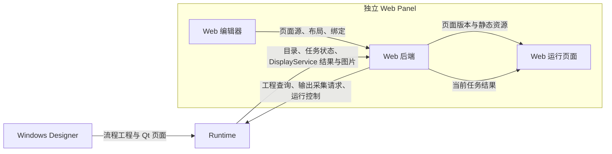

# EmoMaster 独立 Web 页面编辑器设计与实施计划

日期：2026 年 11 月 3 日。状态：设计方向已确认，本版整理实施范围与验收要求；以下目标功能尚待开发，不代表已经实现。

本次新增独立 Web 页面编辑能力。**Web 页面由 Web 编辑器管理，Qt 页面由 Windows Designer 管理。** 当前没有使用 Web 页面的现场工程，本期从新建 Web 页面开始，不安排历史 Web 页面迁移。

Web 的实时预览和正式运行展示使用现有 **DisplayService 检测结果通道**。Web 后端将控件绑定自动转换为与界面无关的输出采集请求；Runtime 校验并采集这些输出，提供同一次检测的结果与图片。页面布局、控件、草稿、发布版本和页面资源始终由 Web Panel 管理。

用户只需选择“工作流 → 算子节点 → 输出引脚”。不增加需要人工勾选、命名和维护的“对外数据定义”清单。

## 一、目标与分工

工程师使用 Designer 完成流程、算子、设备、调试及 Qt 页面设计；通过独立 Web Panel 编辑浏览器运行页面。操作员在浏览器中查看检测结果，使用已有任务选择、启动和停止入口。

| 部分 | 负责的内容 |
| --- | --- |
| Windows Designer | 工程与流程编辑、算子参数、设备配置、调试、节点结果查看、流程发布、Qt 页面编辑与预览 |
| Runtime | 工程执行、任务与设备管理、工程及输出目录查询、输出采集请求校验、检测结果与图片服务、运行控制 |
| Web 编辑模式 | 新建页面、添加控件、直接绑定输出、布局和属性编辑、草稿保存、预览、发布 |
| Web 后端与运行页面 | 页面源、静态资源、发布包与版本管理；生成输出采集请求；接入 Runtime；通过浏览器呈现结果 |

编辑模式与运行页面属于同一个 Web Panel 应用，编辑功能按需加载。工程师通过独立地址、浏览器书签或独立程序入口打开编辑器。Designer 不启动或管理 Web 编辑器，也不增加外部编辑器快捷入口。

沿用现有 Python/FastAPI 后端、React 前端及 Panel SDK。Web 后端作为普通 gRPC 客户端访问 Runtime，不依赖正在运行的 Designer，也不引入 Qt、设备驱动和推理包。局域网连接继续使用现有受控 LAN 的普通 gRPC 模型。

## 二、明确使用哪条数据通道

当前 Runtime 同时有节点检查和页面结果两类能力。本期按下表复用，不将“可查看节点”理解成“所有原始输出均可完整回读”。

| 场景 | 本期使用的能力 |
| --- | --- |
| 编辑时选择工作流、节点和输出 | 查询当前 Runtime 工程及受信任的算子输出目录 |
| Web 实时预览、正式运行页面 | DisplayService 的结果订阅、快照、采集覆盖信息和图片读取 |
| 启动、停止、任务状态 | 现有 Runtime 任务控制与查询接口 |
| Designer 点击节点查看输入、输出和检查图 | 保留原有节点检查通道，不作为 Web 正式页面的数据主通道 |

DisplayService 负责把选定的图片、数值和判定关联到同一次检测。它不负责字体、颜色、控件位置或浏览器渲染。页面采集也不改变算子的正常计算：算子仍按工作流执行，输出仍交给后续节点。

**新增 Web 接口只向 Runtime 提交输出来源、调用范围和结果范围，不提交页面或控件定义。** 当前 Qt 采集入口仍从工程 presentation 派生采集计划；本期保留这条入口，将可复用的采集构造整理为公共能力，供 Qt 入口和新的通用输出请求共同使用。

## 三、工程师的使用流程

### 1. 选择 Runtime 与工程

工程师在 Designer 中完成流程并将其加载或发布到 Runtime，再独立打开 Web 编辑器。编辑器显示当前 Runtime、工程身份和工程版本，并读取已经在目标 Runtime 生效的流程目录。

Designer 尚未发布的本地修改不进入此目录。切换 Runtime 或工程时，页面草稿、来源目录和任务选择同步切换；界面保留明确的当前目标。

### 2. 新建页面并添加组件

没有草稿时创建空白 Web 页面，自动生成页面和组件 ID，第一张页面设为首页。新页面使用当前 Presentation 1.2 和响应式布局，并明确设置 targets=["web"]。

首期完成以下两页：

| 页面 | 内容 |
| --- | --- |
| 检测页 | 结果图片、数量、OK/NG、任务状态 |
| 详情页 | 检测结果表格或数值详情，与检测页互相切换 |

首期组件包括结果图片、静态图片、文本、数值、判定指示、运行状态、结果表格、导航按钮，以及必要的标题、容器和空白布局组件。组件名称与 Windows 页面设计器一致。

### 3. 直接绑定算子输出

用户在控件属性中选择来源，也可从“流程结果”区拖到控件上绑定。例如：

| 控件 | 来源示例 |
| --- | --- |
| 结果图片 | 检测流程 → 推理节点 → result_image |
| 数量 | 检测流程 → 推理节点 → count |
| 结果表格 | 检测流程 → 推理节点 → detections |
| OK/NG | 检测流程 → 判定节点 → result |

上述端口名仅为示例，实际选项以目标工程和算子声明为准。类型不兼容的选项说明原因。任务运行状态使用现有状态能力，产品 OK/NG 使用业务输出。

绑定继续使用 DataSource、ResultScope 和现有调用路径表达。普通独立流程保持简洁；同一子流程有多个调用位置时，沿用现有 Windows 选项中的入口、调用位置及结果范围提示，避免选择歧义。重命名节点不改变其身份；删除并重建节点需要重新核对来源。

### 4. 保存与预览

保存只更新 Web 草稿，不改变正式页面或 Runtime 当前采集请求。

| 预览方式 | 行为 |
| --- | --- |
| 示例预览 | 使用明确标注的示例数据查看当前草稿布局，无需启动任务 |
| 实时预览 | 选择明确的真实任务，通过 DisplayService 读取其已经采集的结果 |
| 草稿新增了任务未采集的来源 | 显示“当前任务未采集此输出；先发布，再明确启动新任务” |

首期不另建一套草稿调试运行入口。实时预览先复用已有任务；需要新来源时，发布后通过已有运行控制明确启动新任务。打开预览、保存、发布和切换页面本身均不触发检测。

### 5. 发布并运行

点击发布后，Web 后端完成页面校验、页面包生成和输出采集请求更新，成功后启用对应 Web 页面版本。运行中的任务继续使用原采集配置；新增来源在下一次明确启动的任务中生效。

操作员继续使用现有任务选择、启动和停止入口。开始命令被接受不等于任务已经完成；停止命令被接受不等于任务已经终止，状态以 Runtime 返回为准。

## 四、编辑器界面与首期操作

沿用 Windows 页面设计器的区域组织和操作习惯，Web 重新实现交互。

| 区域 | 首期功能 |
| --- | --- |
| 独立工具栏 | 当前 Runtime、工程与版本、草稿状态、保存、示例预览、实时预览、发布 |
| 顶部页面标签 | 新建、切换、重命名、复制、排序、设为首页、删除 |
| 左侧可折叠工具区 | “组件”和“流程结果”两个页签；组件搜索、添加、来源选择与拖放绑定 |
| 中间画布 | 选中、移动、调整尺寸、复制、删除、容器布局、撤销与重做 |
| 右侧可折叠属性区 | 内容、布局、外观、数据来源及组件适用的设置 |
| 画布底部 | 跟随窗口或固定终端预览、终端尺寸预设、适应画布、状态提示 |

使用已有网格与响应式布局语义，提供可直接使用的默认值。首期组件从现有 Web 渲染器支持范围中选取，不把“沿用 Windows 习惯”理解成一次复制全部 Windows 编辑功能。

SQLite 历史查询、历史记录关联图片、任意网页代码编辑、通用低代码插件和复杂自由编组不进入首期必做清单。它们不影响两页检测闭环，后续按实际需求增加。

## 五、页面源、资源与版本归属

### 1. Web 管理完整编辑源

Web 后端保存完整 Presentation、Component、属性、布局、绑定、导航和页面静态资源，关联 Runtime 目标与 projectId。页面源使用稳定的 pageId、componentId、sourceId、scopeId，纯布局修改不重新生成数据源身份。

新建页面遵循 presentation.schemaVersion="1.2"，targets=["web"]。这是 Web 页面源，不另造一份流程工程。需要生成示例 .emoproj 时，按照工程规范使用 schemaVersion="2.9"、页面 1.2 及完整默认结构，并完成模型校验、保存重读和工作流编译。

编辑状态以完整页面源为准。现有渲染器使用的显示模型由页面源单向派生，不将归一化显示对象反写成编辑源。页面校验和可共用规则应通过轻量协议包或 Runtime 查询复用，Web 后端不直接导入整个 emo_master 或 Qt 编辑器模块。

### 2. 发布包与草稿分别保存

.emoweb 继续作为运行页面和静态资源的发布产物。Web 保留生成它的页面源版本，支持再次编辑和回退；不依赖从 .emoweb 反向恢复完整编辑源。

| 数据 | 管理位置 |
| --- | --- |
| Web 草稿、控件绑定、页面资源 | Web 后端 |
| Web 页面源版本、.emoweb、当前启用版本 | Web 后端 |
| 页面版本与目标请求配置修订的关联记录 | Web 后端 |
| Qt 页面及其编辑内容 | Designer 工程及现有 Qt 发布链路 |
| 与界面无关的输出采集请求、请求配置修订 | Runtime |
| 每个任务实际冻结的采集配置与结果 | Runtime |

静态图片和图标通过浏览器上传到 Web 管理的资源存储，使用资源 ID 引用并随页面包交付。业务结果图片继续从 DisplayService 获取。浏览器本机路径不能直接当成 Runtime 文件路径。

### 3. 流程更新与交付

Designer 更新流程时不写入或覆盖 Web 页面源，Web 发布也不改动 Qt 页面。流程变化后，Web 刷新目录并显示受影响绑定。

现场备份按关联的工程身份保存流程工程与 Web 交付资料。Web 资料包含可继续编辑的页面源、静态资源、发布包和版本信息；Runtime 不承担 Web 草稿备份。换电脑后恢复 Web 资料、选择目标 Runtime，并重新校验和登记输出请求，不直接沿用旧机器实例身份。

## 六、Runtime 接入：通用输出采集请求

### 1. 请求由 Web 自动生成

Web 后端根据正式页面集的全部绑定生成一份输出请求，多页需求一起计算。该请求沿用现有来源与作用域表达，至少包含：

| 信息 | 用途 |
| --- | --- |
| 目标工程身份、预期工程修订、当前 Runtime 实例 | 保证请求作用于用户选择的目标工程 |
| 稳定的来源 ID、工作流、节点、端口、字段路径、预期类型 | 指定需要获取的输出 |
| 入口工作流、调用路径、结果作用域 | 区分调用位置，并关联同一次检测 |
| 预期请求配置修订、请求 ID | 检查更新冲突并查询一次提交的结果 |

Runtime 接收的请求不包含 pageId、componentId、控件类型、布局、页面资源、.emoweb 或 Web 发布版本。用户不需要编辑这份请求。

### 2. Runtime 保存的是采集配置

Runtime 按工程保存当前有效的外部输出请求及请求配置修订，供后续任务使用。它不保存 Web 页面版本，也不决定哪个页面包在浏览器启用。

保存这份请求，是为了让从 Designer、本机运行端或 Web 发起的新任务采用相同的外部采集需求；Runtime 重启后仍能恢复该需求，不要求浏览器或 Web 服务先上线。Web 的发布记录负责把页面版本与已确认的请求配置修订关联起来。

请求配置修订用于发布冲突检查和页面发布记录。每个任务按工作流筛选并合并 Qt 需求后，另行生成实际 capturePlanRevision。页面能否查看该任务，按来源及作用域覆盖判断，不要求这两种修订相等。

请求更新仅改变后续任务使用的采集配置，不替换流程、设备、算子参数或 Qt 页面。它需要独立于现有“整份工程执行配置变更”的准入判断，同时复用已有版本校验、持久化和明确提交语义。

### 3. 复用现有采集与结果服务

将现有逻辑整理为两个局部层次：

- Qt 适配入口继续从原工程 presentation 提取需求，保留现有 Qt 页面与资源校验。
- 通用采集构造接收输出请求，只验证工程来源、输出类型、调用范围和采集能力，生成现有采集器需要的来源、作用域及修订。

新 Web 请求直接使用第二层；后续 attachNormal、ResultCollector、DisplayService、图片资源寿命和结果身份机制继续复用。当前 DisplayService 的 Prepare/Start 属于既有调试准备链路，不能当成 Web 正式页面发布接口直接使用；新接口的名称和协议字段在第一步实施时确定。

### 4. 在任务启动时冻结

Runtime 在正常 StartJob 路径中按本次工作流选择外部输出请求；需要 Qt 页面采集时，同时合并已有 Qt 需求。稳定的来源和作用域 ID 不互相覆盖，重复来源按现有规则处理；校验按任务合并后的实际额度进行。

外部请求的启用不依赖 Designer 本地是否存在 Web 页面。即使客户端没有请求 Qt 页面采集，已登记的外部请求仍会在新任务中生效。Web、Designer 和本机自动启动沿用同一服务端规则。

任务开始后固定本次来源和采集修订。页面切换、布局修改、浏览器连接数及后续发布不改变当前任务的采集范围。已有并行任务按各自任务身份处理；同一页面中的图片、数量与判定使用相同结果身份。

### 5. 能力与额度

编辑器读取 Runtime 的实际能力。当前正常采集实现包含每任务最多 16 个来源、16 个作用域、2 种不同图片源及相应字节额度；这些是现有实现边界，不是本计划新增限制。

发布前核对本次请求和相关 Qt 需求合并后的能力，给出具体来源与原因。首期复用既有额度；真实页面需求超过时，针对实际采集实现评估调整，不通过丢来源或隐式缩图伪装满足要求。

## 七、发布、更新与回退

### 1. 正常发布顺序

1. Web 保存候选页面源和静态资源，生成并校验页面包。
2. 读取目标 Runtime 的工程修订、请求配置修订及能力，生成不含 UI 信息的输出请求。
3. Runtime 按预期修订校验并保存请求，返回可查询的提交结果和请求配置修订。
4. Web 记录页面版本与请求配置修订的关联，再启用对应页面版本。
5. 界面显示页面发布状态，并根据所选任务的实际覆盖情况说明哪些数据已经可用。

纯布局修改且输出请求不变时，核对当前采集配置仍匹配后，可以只发布 Web 页面版本。新绑定或删除绑定则更新后续任务请求。现有浏览器视图继续使用其已选版本，用户明确刷新或切换后采用新页面。

### 2. 正常失败与重连

Runtime 拒绝请求时，候选页面保留为草稿或未启用版本，当前页面继续可用，并显示工程变化、类型不符或能力不足等具体原因。

一次断连造成提交结果不明时，查询原请求或实际请求配置修订，不盲目重放写入。Runtime 已保存请求但 Web 启用尚未完成时，显示“采集配置已更新，页面启用待完成”，允许继续完成原发布；这一期间新启动的任务可能已采用新采集请求。

两端成功状态必须如实显示。保持现有显式启动、取消不补执行和未知副作用不自动重放的规则，不引入跨服务通用事务或后台补偿平台。

### 3. 修改如何生效

| 修改或操作 | 生效方式 |
| --- | --- |
| 保存草稿 | 只更新 Web 编辑源 |
| 修改文字、颜色、位置、尺寸 | 发布新页面版本，刷新或切换后显示 |
| 新页面绑定仍被当前任务的采集覆盖 | 校验来源和作用域后，可查看当前任务结果 |
| 新增当前任务未采集的输出 | 发布请求后，在下一次明确启动的任务中采集 |
| 删除控件或来源 | 后续任务使用更新后的需求；当前任务保持原配置 |
| 切换页面 | 只改变展示内容和导航上下文 |
| 切换 Runtime 或工程 | 切换目录、草稿关联、请求配置修订与任务上下文 |

页面发布不自动停止或重启生产任务。发布后新增来源未生效时，显示“页面已发布，当前任务未采集该来源，需明确启动新任务”，不将无数据误报为检测失败。

### 4. 流程变化与失效绑定

Designer 正常更新流程后，Runtime 重新核对外部输出请求。节点重命名保持绑定；节点删除、端口变化或调用路径失效时，保留原来源定义和诊断，供 Web 显示具体失效控件。

外部请求中的失效来源通过请求诊断和任务覆盖信息明确标为不可用；仍有有效结果作用域时，可在该结果中携带来源不可用状态。其余有效来源继续按本次任务采集规则工作，不因失效来源意外阻断正常检测；作用域已不存在时不伪造检测结果。失效结果不能显示为有效的实时图片或 OK/NG。该处理只针对新外部请求，不顺带放宽现有 Qt 页面、设备或流程执行的必要校验。

工程师刷新目录、重新绑定并发布后恢复。对正在运行的旧任务，按该任务自身的工程和采集快照解释数据，并显示对应版本。

### 5. 回退

Web 从保存的旧页面源版本重新生成输出请求，针对目标 Runtime 当前工程校验，按同一发布流程提交并启用。回退同时处理后续任务需要的数据，不能只切换 .emoweb 而遗漏采集配置。

旧页面依赖的节点已经不存在时，列出失效来源并保留当前正式页面，修正后再发布。回退不会停止现有任务或改写其采集快照。

## 八、源码基础与本期改动

本版源码依据为固定提交 [d92ffd37960e8b8f527136151ab9ccb80054e78f](https://github.com/jsdfhasuh/emo_master/commit/d92ffd37960e8b8f527136151ab9ccb80054e78f)。该提交已有下列基础，不代表本计划的新功能已经实现。开发开始前核对后续提交及工作区差异，避免重复实现。

| 部分 | 已有基础 | 本期改动 |
| --- | --- | --- |
| 输出目录 | buildOutputCatalog、outputChoices、算子声明与调用路径规则 | 提供独立 Web 可调用的工程与可绑定来源查询 |
| 页面模型 | Presentation、Component、DataSource、ResultScope、页面 1.2 | 用于新 Web 页面源；轻量共享校验和类型 |
| Web 显示 | PanelRenderer、页面包归一化、结果和图片接入 | 增加编辑状态和从草稿派生预览的适配 |
| 页面编辑 | Windows 页面标签、工具区、属性、布局命令 | 复用交互规则，用 Web 实现首期操作 |
| 正常结果采集 | freezeNormalCapture、attachNormal、ResultCollector | 提取通用输出请求构造，加入外部请求与统一启动处理 |
| 数据输出 | DisplayService 快照、订阅、覆盖信息和图片读取 | 复用，并补齐外部请求诊断及来源失效表现 |
| 页面发布 | .emoweb 生成、导入、启用及回退 | Web 管理完整源版本，衔接输出请求更新与发布状态 |
| Designer 的 Web 入口 | Web 目标、Web 预览和导出相关入口 | 独立编辑闭环完成后移除 Web 专用入口，保留 Qt 页面和共用模型 |

主要代码入口：

- [工程格式规范](https://github.com/jsdfhasuh/emo_master/blob/d92ffd37960e8b8f527136151ab9ccb80054e78f/docs/project-json-spec.md)
- [输出目录 catalog.py](https://github.com/jsdfhasuh/emo_master/blob/d92ffd37960e8b8f527136151ab9ccb80054e78f/src/emo_master/core/presentation/catalog.py)
- [调用来源与编辑规则 editing.py](https://github.com/jsdfhasuh/emo_master/blob/d92ffd37960e8b8f527136151ab9ccb80054e78f/src/emo_master/apps/designer/page_designer/editing.py)
- [页面与绑定模型 models.py](https://github.com/jsdfhasuh/emo_master/blob/d92ffd37960e8b8f527136151ab9ccb80054e78f/src/emo_panel_protocol/models.py)
- [正常采集入口 normal_capture.py](https://github.com/jsdfhasuh/emo_master/blob/d92ffd37960e8b8f527136151ab9ccb80054e78f/src/emo_master/apps/runtime/presentation/normal_capture.py)
- [结果采集器 collector.py](https://github.com/jsdfhasuh/emo_master/blob/d92ffd37960e8b8f527136151ab9ccb80054e78f/src/emo_master/apps/runtime/presentation/collector.py)
- [Runtime 与 DisplayService 契约](https://github.com/jsdfhasuh/emo_master/blob/d92ffd37960e8b8f527136151ab9ccb80054e78f/proto/runtime.proto)
- [页面包生成 web_panel.py](https://github.com/jsdfhasuh/emo_master/blob/d92ffd37960e8b8f527136151ab9ccb80054e78f/src/emo_master/core/project/web_panel.py)
- [Web 显示模型适配 packages.py](https://github.com/jsdfhasuh/emo_master/blob/d92ffd37960e8b8f527136151ab9ccb80054e78f/web_panel/backend/emo_web_panel/packages.py)
- [Web 渲染器 PanelRenderer.tsx](https://github.com/jsdfhasuh/emo_master/blob/d92ffd37960e8b8f527136151ab9ccb80054e78f/web_panel/frontend/src/renderer/PanelRenderer.tsx)

## 九、实施顺序与阶段产物

### 第一步：确定数据契约并打通最小结果链路

提供工程与来源目录查询；定义通用输出请求的读取、校验、提交和状态查询接口；补齐请求配置修订、任务采集修订与实际能力返回。整理 Qt 适配与通用采集构造，保留 Qt 正常行为。

使用临时模拟工程和最小 Web 页面源，验证请求提交后能通过正常 StartJob 运行，并经 DisplayService 取得图片、数量和判定。覆盖从 Web 与 Designer/本机端发起的启动。先完成这条链路，再扩展完整编辑交互。

产物：协议及轻量 SDK 更新、Runtime 接入、Web 后端适配、最小两页结果演示和对应自动检查。

### 第二步：完成页面源管理与首期编辑器

实现空白页面创建、草稿读写、资源上传、页面管理、基础组件、直接绑定、布局和属性编辑、撤销重做、示例预览。页面源保存后重开仍可继续编辑。

产物：可独立打开的 Web 编辑模式，稳定的页面源格式与两页编辑流程。

### 第三步：完成发布与实时运行闭环

接通页面版本、.emoweb 和输出请求更新，完成实时预览、覆盖提示、运行中发布、布局更新、新来源下次启动生效、流程变化后的失效处理及回退。

产物：完整的新建、保存、发布、运行、修改、再次发布流程；明确的失败与重连出口。

### 第四步：独立部署、备份与 Designer 入口收敛

交付 Runtime、Web 后端、已构建前端和必要 SDK；提供本机与局域网启动说明、页面源和发布产物备份方式。目标电脑无需安装 Node 来运行已构建前端。

验证独立 Web 编辑闭环后，移除 Designer 面向 Web 的编辑、预览、导出及启动接入，不替换为外部编辑器快捷入口。Qt 页面编辑、预览、运行和仍被使用的共用代码继续保留。

产物：可独立启动的 Web 交付包、恢复说明、Designer 入口调整及范围内回归记录。

## 十、正常使用验收

以下为待执行验收项，不是当前已通过结果。软件验证使用模拟数据、临时工程和本机 Runtime；真实设备与现场部署按实际条件另行记录，不混同为源码测试通过。

| 编号 | 正常操作 | 验收要求 |
| --- | --- | --- |
| W01 | 独立打开编辑器、选择 Runtime 工程 | Designer 不必运行；目录和显示的工程版本一致 |
| W02 | 新建两页并保存，关闭浏览器后重开 | 页面、布局、绑定、静态资源可继续编辑；新页面为 1.2/Web 目标 |
| W03 | 绑定图片、数量、判定和表格 | 目录来自实际声明；类型错误可定位；来源身份稳定 |
| W04 | 打开示例预览、实时预览或切页 | 不自动执行检测；真实预览明确任务，缺失来源不伪装为可用 |
| W05 | 发布并明确启动任务 | 通过 DisplayService 显示同次结果的图片、数量和判定，详情页正常切换 |
| W06 | 当前任务运行时修改布局或新增绑定并发布 | 不停止、不重启当前任务；已有来源按覆盖显示；新来源在下一任务生效 |
| W07 | 从 Designer、本机运行端或 Web 启动 | 使用同一份有效外部采集请求；Qt 页面行为保持可用 |
| W08 | Designer 更新流程，删除或替换被绑定节点 | Web 页面源保留；具体来源标为不可用；有效结果可展示；修正发布后恢复 |
| W09 | 提交时一次断连，随后查询或重连 | 显示真实提交状态，能继续完成原发布，不盲目重放或误报成功 |
| W10 | 回退到保存的页面版本 | 同时核对后续任务采集请求；不能满足当前工程时列明原因 |
| W11 | 关闭编辑器、浏览器或 Web 服务；随后恢复 | 既定 Runtime 任务继续；恢复后可重新订阅原任务的可用结果，已释放结果明确提示；新任务按已保存请求采集 |
| W12 | 正常重启 Runtime，再从本机入口启动 | 恢复对应工程的有效采集请求，无需先打开 Web 编辑器 |
| W13 | Designer 入口调整与独立交付 | Web 专用入口移除，Qt 页面仍可编辑和运行；构建产物可独立启动 |

记录中分别标明源码自动检查、浏览器实际操作、原生 Qt 操作、打包后验证和现场设备验收。没有执行的项目保留为未执行，不以模拟结果代替现场通过。

第一阶段以这套两页闭环为完成标准。后续组件、复杂布局和历史数据页面根据实际使用需求安排。
