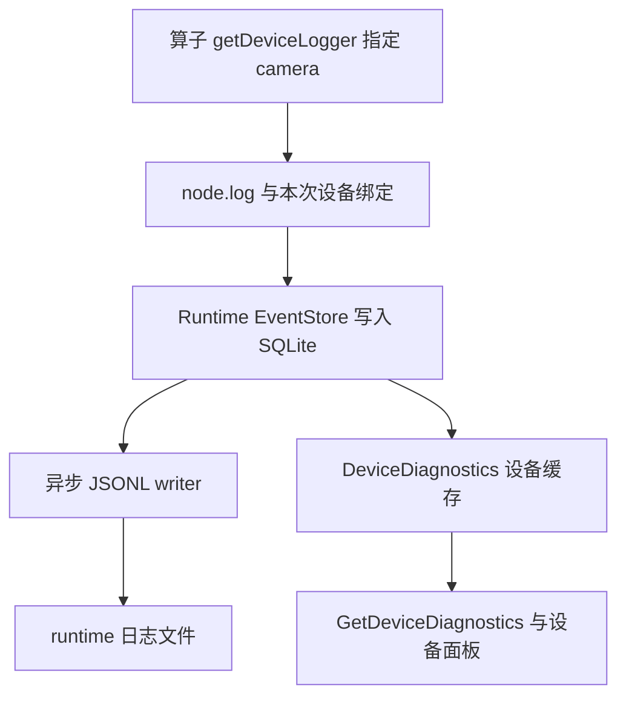
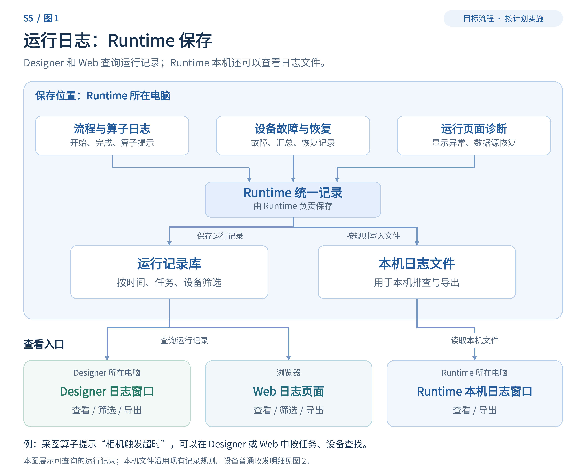
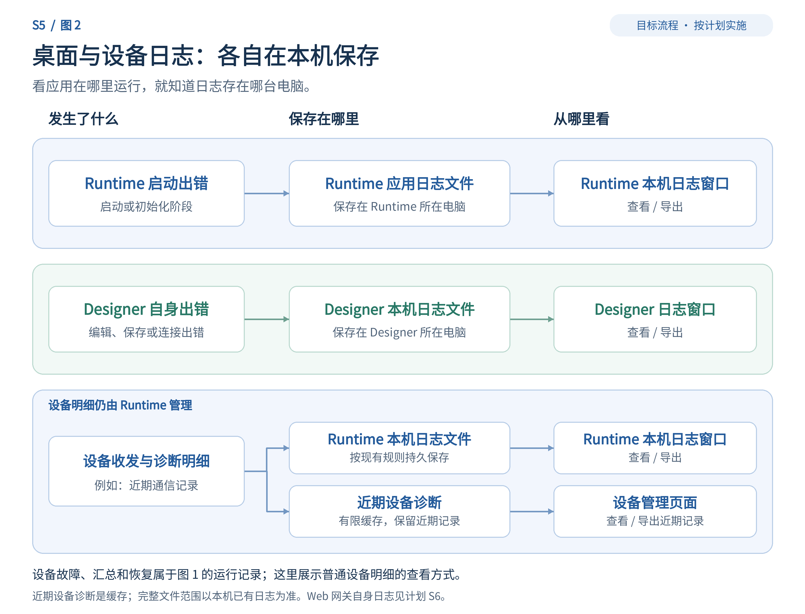

# emo_master 日志体系实现计划

日期：2026-11-03

版本：v3.5，实施完成状态及桌面/CI 交接

状态：S1—S6 实施和 F01—F08 修复完成，必要自动化与集成验证完成，独立复审通过；完整可见人工桌面走查待补，冻结 EXE 与 CI 编译由后续交接继续。提交及推送状态以 Git 和交付记录为准。

本版本仅更新完成状态并保留实施要求；下文基线能力、拟新增位置及 v3.4 以前的复审文字属于实施前记录，不表示当前功能仍未实现。实现与验收证据见仓库 `docs/testing/2026-11-03-logging-consolidation/README.md`，后续交接见同目录 `dot-handoff.md`。仓库同步保存本计划及说明图，便于远端执行者直接读取。

## 1. 实施基线与目标

本稿以最新 `main` 为基线，固定提交为 [`940994b3420b47ff0add8766ccce5a4f2686a02a`](https://github.com/jsdfhasuh/emo_master/commit/940994b3420b47ff0add8766ccce5a4f2686a02a)。该提交于 **2026-11-03 11:15:23（北京时间）**合入 PR #8，包含会话恢复与操作反馈修复。SDK 1.3.0、Designer 与 Web 工作均已在当前 main 中。

本次已获取远端 main，并与上一版基线 [`f65968651ce8494eba4b2c2b56b6d757d481a4a0`](https://github.com/jsdfhasuh/emo_master/commit/f65968651ce8494eba4b2c2b56b6d757d481a4a0) 比较：两者的文件树均为 `cd3305408d6281b32f3ed4a3587434a4f180d48c`，源码 diff 为空。分支合并没有新增日志实现，现有修改位置和 S1—S6 主体继续适用；本轮进一步补明确启动重试、各应用本机历史归属、设备连接发布位置及 Web 查询接入。各部分结论见文末复审记录。

先前针对旧 `main` 的“没有 Web、Designer 没有本机日志”等判断不再作为实施依据。本稿直接使用当前 main 已有能力，修改位置均相对于这个固定提交；表中的行号仅用于定位函数入口。

**实施前先落实源码基线。** v3.4 复核时，远端 `main` 为上述 `940994b3420b47ff0add8766ccce5a4f2686a02a`，本机工作区 HEAD 仍为 `2b0033a4a26b5213d0b3ae627d7ca19508b9dba7`，工作区干净。获取远端提交不会自动更新当前检出的源码；后一个提交尚不包含本计划依赖的 Web 会话恢复改动。执行者应从计划固定提交创建 `codex/` 实现分支；若采用更新提交，先核对与本基线的差异并记录实际 SHA，避免重复实现已有修复。实施时重新检查工作区，保留已有未提交修改，不擅自回退、合并或发布。

**路径约定。** 文中的代码路径均相对 emo_master 仓库根目录；现有源码、测试与文档链接指向上述固定提交，不依赖本计划所在的外部目录。标注“拟新增”的文件是待实现位置，不表示基线中已经存在。两张说明图继续通过本计划旁的 `assets/logging/` 引用。

目标是让用户能明确回答三件事：**哪一个应用产生了日志、哪个模块发生了什么、这条记录与哪个任务或设备有关**。执行、算子、设备、页面运行诊断归 Runtime；Designer 保留编辑和客户端自身日志；Web 保留网关自身日志，通过同一 Runtime 查询接口显示运行日志。

| 日志归属 | 记录内容 | 持久化和查看入口 |
| --- | --- | --- |
| Runtime 服务 | Job、工作流、算子、设备故障摘要、页面运行诊断、服务存储异常 | 复用 SQLite `jobEvents` 与 `runtime-*.jsonl`；新增统一历史查询供 Designer/Web 使用 |
| Runtime 应用 | 应用启动、初始化、操作员界面及服务建立前的错误 | `runtime_app-*.jsonl`；复用 Runtime 本机日志窗口 |
| Designer | 编辑、页面设计、连接/请求失败、Designer 启动 | 已有 `designer-*.jsonl`；复用 Designer 本机日志与导出 |
| Web | 网关启动、请求错误、连接 Runtime 失败 | Web 数据目录内独立 JSONL；管理员查看。操作审计继续走现有审计入口 |

Runtime 日志窗口显示的远端事件保留原始归属；查看者是 Designer 或 Web，不改变事件的 `originApp`。

## 2. 最新代码已经完成什么，还缺什么

| 部分 | 代码中已有 | 本轮实际补齐 |
| --- | --- | --- |
| Runtime 持久化 | EventStore 先持久化再发布，Worker 支持批量提交，JSONL writer 支持前缀与投影 | 应用/模块/实例字段贯通；保留事件产生时间；增加跨 Job 查询 |
| 算子 | `getOperatorLogger()`、`getDeviceLogger()`、调用级 logger、冻结设备绑定、级别和大小限制 | 统一使用说明；补查询展示字段及工作流调试中的 payload 传递 |
| 设备 | 诊断缓存、运行日志投影、故障汇总、恢复日志、关闭时 flush | 修复完成日志丢字段、调用上下文缺失、TCP 失败级别和连接恢复归属 |
| 页面运行 | `PresentationLog` 已发布到 EventStore | 纳入统一分类与查询，不新增一套页面日志通道 |
| Designer | 本机 writer、系统日志订阅、JSON 树详情、JSON/JSONL/TXT 导出 | writer 提前到启动入口；历史查询取代所选 Runtime 日志表的数据源；导出完整选定范围 |
| Runtime 本机界面 | 文件选择、tail 阅读和有界缓存 | 初始化失败也有文件；区分应用/服务文件；历史导出不受 tail 缓存限制 |
| Web | Runtime 连接、按 Job 事件查看、会话权限、管理员操作审计 | 结构化详情、跨 Job 历史、统一查询导出、网关自身日志；同步 SDK 版本信息 |

依据：[EventStore](https://github.com/jsdfhasuh/emo_master/blob/940994b3420b47ff0add8766ccce5a4f2686a02a/src/emo_master/apps/runtime/events/event_store.py)、[JSONL writer](https://github.com/jsdfhasuh/emo_master/blob/940994b3420b47ff0add8766ccce5a4f2686a02a/src/emo_master/apps/runtime/events/jsonl_writer.py)、[设备诊断](https://github.com/jsdfhasuh/emo_master/blob/940994b3420b47ff0add8766ccce5a4f2686a02a/src/emo_master/apps/runtime/devices/diagnostics.py)、[页面运行日志](https://github.com/jsdfhasuh/emo_master/blob/940994b3420b47ff0add8766ccce5a4f2686a02a/src/emo_master/apps/runtime/presentation/operational_log.py)、[Designer 本机日志](https://github.com/jsdfhasuh/emo_master/blob/940994b3420b47ff0add8766ccce5a4f2686a02a/src/emo_master/apps/designer/services/local_log.py)、[现有导出](https://github.com/jsdfhasuh/emo_master/blob/940994b3420b47ff0add8766ccce5a4f2686a02a/src/emo_master/apps/designer/services/log_export.py)、[Runtime 文件阅读器](https://github.com/jsdfhasuh/emo_master/blob/940994b3420b47ff0add8766ccce5a4f2686a02a/src/emo_master/apps/operator_runtime/log_reader.py)、[Web Runtime 客户端](https://github.com/jsdfhasuh/emo_master/blob/940994b3420b47ff0add8766ccce5a4f2686a02a/web_panel/backend/emo_web_panel/runtime_client.py)。

## 3. 统一记录规范

### 3.1 字段与模块

在 `RuntimeEvent`、SQLite、proto `JobEvent`、`RuntimeEventDTO`、JSONL 和界面条目中追加三个字段。字段追加在现有数据结构末尾，保留原来字段顺序、事件类型、Job 内 `sequence` 和业务 payload 语义。

| 字段 | 约定 |
| --- | --- |
| `originApp` | `runtime` / `designer` / `web`，表示实际产生日志的应用 |
| `component` | 模块类别，采用下面的固定映射；来源能明确指定时直接填写 |
| `runtimeInstanceId` | 由当前 Runtime 启动尝试产生的实例 ID；Designer/Web 自身日志没有关联 Runtime 时允许为空 |

| 来源 | `component` | 说明 |
| --- | --- | --- |
| `job.*`、节点生命周期、调度执行 | `execution` | 包括节点开始、完成、失败；不把所有 `node.*` 都归算子自定义日志 |
| `node.log` | `operator` | 算子主动输出；可同时携带设备槽位与绑定 |
| `device.*` | `device` | 设备操作、连接、故障摘要与恢复 |
| `presentation.*` | `presentation` | 页面运行时的数据源、导出和恢复诊断 |
| SQLite 写入、日志落盘与清理诊断 | `storage` | 依据现有事件名称做明确映射 |
| Runtime 应用启动及其他应用级记录 | `application` | 无法细分的现有 Runtime 记录也使用此类别 |
| Designer 编辑、流程设计、页面设计、客户端 | `editor` / `flow_designer` / `page_designer` / `runtime_client` | 保留现有设计区域标签和导航；来源不明的本机记录使用 `application` |
| Web 网关 | `gateway` | 请求、连接和启动；管理员业务审计保持原有模型 |

新增一个小型纯映射模块 `src/emo_master/core/contracts/diagnostic_logging.py`，供生产者和显示转换复用；不建立 logger 注册中心。006 迁移为旧 SQLite 运行事件补 `originApp=runtime`，按已知事件类型补 `component`，无法识别的使用 `application`，使显示分类与 SQL 筛选一致；历史 `runtimeInstanceId` 保持为空。旧 JSONL 只在读取时根据文件来源和事件类型补显示类别，不重写文件，也不伪造历史实例 ID。

`timestampMs` 使用事件产生时间，跨 Job 分页使用 SQLite 全局 `eventId`。原 SQLite 文本 `timestamp` 保持现有入库时间用途，不为本轮再增加一组时间字段。查询回复的全局 ID 仅放在 `StoredLogEvent(eventId, event)` 包装中，写入方法仍返回原有 Job sequence。

### 3.2 算子如何输出

沿用现有公开接口，不增加另一套算子日志 API：

```python
from emo_master.core.contracts.operator_logging import getOperatorLogger, getDeviceLogger

logger = getOperatorLogger(context)
logger.info("定位完成", code="LOCATE_DONE", payload={"count": count})

# 选择本次执行的 camera 设备绑定，日志由 Runtime 保存。
device_logger = getDeviceLogger(context, "camera")
device_logger.warning("相机触发等待超时", code="CAMERA_TRIGGER_TIMEOUT")
```

任务、工作流、节点、运行身份和冻结的设备绑定由现有执行器注入；算子只提供级别、消息、稳定 code 和小型诊断 payload。每次执行使用当前 context 中的 logger，不跨执行缓存。图片、张量和完整输出通过现有结果/资源机制传递。

`ERROR` 日志表示发生了错误，不单独决定 Job 失败；Job 结果仍由现有执行异常和结果规则决定。正常业务 NG 不自动升级成系统错误。生命周期日志和每次执行日志沿用现有分工；保留已有级别、大小和频率限制。调试预览只显示本次调试日志，不写成正式生产历史。

依据：[算子日志合同](https://github.com/jsdfhasuh/emo_master/blob/940994b3420b47ff0add8766ccce5a4f2686a02a/src/emo_master/core/contracts/operator_logging.py)、[算子日志测试](https://github.com/jsdfhasuh/emo_master/blob/940994b3420b47ff0add8766ccce5a4f2686a02a/tests/runtime/test_operator_logging.py)。同步更新已有 [算子开发说明](https://github.com/jsdfhasuh/emo_master/blob/940994b3420b47ff0add8766ccce5a4f2686a02a/docs/operator-development-guide.md)、[插件注册说明](https://github.com/jsdfhasuh/emo_master/blob/940994b3420b47ff0add8766ccce5a4f2686a02a/docs/plugin-registration-flow.md)、[Runtime 事件流程](https://github.com/jsdfhasuh/emo_master/blob/940994b3420b47ff0add8766ccce5a4f2686a02a/docs/runtime-event-flow.md)，不新建一套并行规范。

#### 3.2.1 设备 logger 的含义与存入路径

第二段表示“算子输出一条明确关联 camera 槽位所绑定设备的日志”。`camera` 是槽位名，实际 `deviceId` 从本次执行的冻结绑定取得；例如 camera 槽绑定 camera_front，记录就关联 camera_front。这个调用不向相机发送日志或指令，也不直接调用设备驱动的事件入口。

当前正式执行路径已经存在：`getDeviceLogger()` 调用 `OperatorLogger.forDevice()`，子 logger 只保留指定槽位的绑定；随后仍以 `node.log` 输出，包含真实 Job/工作流/节点和 payload 中的 `operatorId`、`phase`、`data`、`deviceBindings`。其中设备绑定保存 deviceId、selectors、scope 和 deviceGeneration。Worker 将事件交给 Runtime，EventStore 先持久化，成功后通知日志 writer 和设备诊断投影。



同一条 node.log 在 SQLite `jobEvents` 中保存一次，并由现有异步 writer 写入 `runtime-*.jsonl`。`DeviceDiagnostics.projectEvent()` 另外调用 `append(write=False)`，只把设备相关内容投影到有界内存缓存，供设备面板查看；这一步不会再次写库、再次写文件，也不参与原生设备故障汇总和恢复计数。

现有绑定规则必须说明清楚：普通 `getOperatorLogger()` 在恰好只有一个设备绑定时，会自动携带该绑定；没有绑定或有多个绑定时，普通日志不携带设备绑定。多个设备时需要 `getDeviceLogger(context, slot)` 指定实际槽位，不将一条日志关联到全部设备。按本计划新增分类后，这类日志仍为 `originApp=runtime`、`component=operator`，同时可以按关联设备查询；原生设备事件使用 `component=device`。

依据：[OperatorLogger.log / forDevice](https://github.com/jsdfhasuh/emo_master/blob/940994b3420b47ff0add8766ccce5a4f2686a02a/src/emo_master/apps/runtime/events/operator_logger.py)、[执行器 bindingSnapshot](https://github.com/jsdfhasuh/emo_master/blob/940994b3420b47ff0add8766ccce5a4f2686a02a/src/emo_master/apps/runtime/execution/operator_executor.py)、[Worker 事件发布](https://github.com/jsdfhasuh/emo_master/blob/940994b3420b47ff0add8766ccce5a4f2686a02a/src/emo_master/apps/runtime/jobs/worker_main.py)、[EventStore](https://github.com/jsdfhasuh/emo_master/blob/940994b3420b47ff0add8766ccce5a4f2686a02a/src/emo_master/apps/runtime/events/event_store.py)、[设备事件投影](https://github.com/jsdfhasuh/emo_master/blob/940994b3420b47ff0add8766ccce5a4f2686a02a/src/emo_master/apps/runtime/devices/diagnostics.py)。以上描述的是正式 Job 执行且日志级别、现有限额允许输出的路径；预览日志仍遵守前述调试范围。

### 3.3 设备日志的三个范围

| 范围 | 用途 | 查询与导出含义 |
| --- | --- | --- |
| 设备诊断缓存 | 最近收发、状态和详细调试 | 导出实际返回的缓存记录，界面明确其范围 |
| Runtime 运行记录 | 执行事件及设备故障、汇总、恢复等已进入 EventStore 的记录 | 可跨 Job 查询；不能声称包含每一条设备收发 |
| 本机 JSONL | 当前 writer 接收的运行记录与设备文件诊断 | 本机按文件查看和导出；直接文件记录未必存在 SQLite |

沿用现有故障聚合、动作隔离、恢复日志、取消级别及外部执行结果未知的表达。日志记录真实上下文；没有独立 `workflowRunId`/`nodeRunId` 的设备调用不补造这些身份。

#### 3.3.1 设备驱动自身怎样上报

设备驱动通过 `bindRuntime()` 取得 `DeviceRuntimeContext`，使用其中的 `events(eventType, message, **fields)` 上报驱动自身诊断。`DeviceManager.makeBackend()` 已将这个回调接到 `DeviceDiagnostics.append()`，并自动附带设备 ID、工程/实例范围和设备代次。驱动不用自行打开文件或操作 SQLite。

设备管理器已经在动作完成回调中产生 `device.action.completed` / `device.action.failed`；TCP 后端也已把事件 sink 接到同一入口。管理器负责记录的动作结果由它统一记录，驱动只上报其独有的诊断内容，算子无需为持久化重复输出同一个设备失败。连接结果的发布责任按 S2 处理。

| 日志来源 | SQLite `jobEvents` | Runtime JSONL | 设备诊断缓存 |
| --- | --- | --- | --- |
| 算子 `getDeviceLogger()` 输出 | 记录原始 node.log，属于实际 Job | 同一条 node.log | 从已提交事件投影，`write=False` |
| 原生设备普通记录，例如正常操作、收发明细 | 这条链路通常不写入 | 直接交现有 writer 异步写入 | 每条输入进入有界缓存 |
| 原生设备 WARN/ERROR 及后续匹配成功 | 经现有聚合产生首次故障、间隔摘要、恢复记录，写入 `__runtime__` 分区 | 由 EventStore 通知 writer，避免再直接写同一份 | 保存原始输入记录；不把汇总再循环灌入缓存 |

因此，算子调用 `device_logger.warning()` 可以在任务和设备两个视角看到，但不会增加原生设备故障汇总的计数。原生设备连续失败则走已有聚合：任务事件库和文件保存首次/摘要/恢复，设备缓存保留近期原始明细，不承诺每一次重复失败都单独持久化。

这些日志统一保存于 Runtime 一侧。当前使用 `runtime-*.jsonl`，默认目录由 Runtime 数据目录解析，也可由 `EMO_RUNTIME_LOG_DIR` 指定；本计划不另建每台设备一个文件或第二套设备日志表。设备诊断缓存不是长期存储，历史查询应读取实际已进入 SQLite 的记录，或在本机读取 JSONL。S4/S5 补齐统一设备历史查询与入口，不能把当前缓存接口当成已经具备该能力。

这里的“设备日志”指 Runtime 接收到的设备管理、驱动和通信事件；`getDeviceLogger()` 本身不读取相机/PLC 固件或厂商 SDK 的原始日志。需要接入这些额外来源时，应由相应驱动显式接入，当前日志整合计划不自动扩展为厂商日志采集器。

依据：[设备驱动合同](https://github.com/jsdfhasuh/emo_master/blob/940994b3420b47ff0add8766ccce5a4f2686a02a/src/emo_master/core/contracts/device_driver.py)、[DeviceManager.makeBackend / execute](https://github.com/jsdfhasuh/emo_master/blob/940994b3420b47ff0add8766ccce5a4f2686a02a/src/emo_master/apps/runtime/devices/manager.py)、[DeviceDiagnostics.append / _operationalRows / projectEvent](https://github.com/jsdfhasuh/emo_master/blob/940994b3420b47ff0add8766ccce5a4f2686a02a/src/emo_master/apps/runtime/devices/diagnostics.py)、[RuntimeService 日志接线与 GetDeviceDiagnostics](https://github.com/jsdfhasuh/emo_master/blob/940994b3420b47ff0add8766ccce5a4f2686a02a/src/emo_master/apps/runtime/grpc_server/service.py)。本节补充已有链路与规范说明，不新增日志入口或测试范围。

## 4. 实施顺序和修改位置

实施分为 S1—S6，按顺序交付可独立审阅的改动。S1 可以先验收；S2—S4 完成公共数据链路；S5、S6 使用同一查询合同。

### S1：先修设备完成日志丢信息

这一阶段只改两处生产文件，暂不扩散到界面或日志框架。

| 文件 / 基线入口 | 修改 |
| --- | --- |
| [devices/manager.py](https://github.com/jsdfhasuh/emo_master/blob/940994b3420b47ff0add8766ccce5a4f2686a02a/src/emo_master/apps/runtime/devices/manager.py)，`execute()` 220，`completed()` 362 | 在已有完成/失败记录上补入 `operationContext` 的 `jobId`、`workflowId`、`nodeId`、`planRevision`、`slot`；失败时从异常已有属性读取 `outcome`，有该属性才写入失败 payload，不自行推测或改变执行结果。当前已有 `action` 和取消 INFO，不重复建设 |
| [events/jsonl_writer.py](https://github.com/jsdfhasuh/emo_master/blob/940994b3420b47ff0add8766ccce5a4f2686a02a/src/emo_master/apps/runtime/events/jsonl_writer.py)，`_projectEvent()` 404 | `device.*.completed` 保留设备已整理好的紧凑 payload；其他 completed 仍去掉大输出，但保留已有运行关联字段和 `deviceBindings` |

完成后，设备成功记录中的设备 ID、动作、requestId、结果摘要与真实 Job/节点关联不会再被通用 `.completed` 投影删掉。不根据 `ownerId` 猜测 Job。

### S2：贯通分类、事件时间和设备连接责任

| 文件 / 基线入口 | 修改 |
| --- | --- |
| [events/models.py](https://github.com/jsdfhasuh/emo_master/blob/940994b3420b47ff0add8766ccce5a4f2686a02a/src/emo_master/apps/runtime/events/models.py)，`RuntimeEvent` 7 | 追加三个元数据字段，默认值兼容已有构造 |
| [events/event_store.py](https://github.com/jsdfhasuh/emo_master/blob/940994b3420b47ff0add8766ccce5a4f2686a02a/src/emo_master/apps/runtime/events/event_store.py)，构造 14、`append()` 27、`appendBatch()` 98 | 持久化和通知 sink 前统一补元数据；已有批量兼容分支同样传递字段，保持提交/发布次序 |
| [context/sqlite_store.py](https://github.com/jsdfhasuh/emo_master/blob/940994b3420b47ff0add8766ccce5a4f2686a02a/src/emo_master/apps/runtime/context/sqlite_store.py)，初始化 74、单条写 227、批量写 292、读取 388、孤儿任务处理 401 | 更新列与读写顺序；孤儿任务失败事件的直接 INSERT 一并补元数据，仍在原事务中完成 |
| 拟新增 `context/migrations/006_logging_metadata.sql` | 增加元数据列并一次性补齐旧行的应用/模块分类，历史实例 ID 留空。版本 5 已被 `initialize()` 中的变量迁移使用，不能重新使用 005 |
| [grpc_server/service.py](https://github.com/jsdfhasuh/emo_master/blob/940994b3420b47ff0add8766ccce5a4f2686a02a/src/emo_master/apps/runtime/grpc_server/service.py)，构造 104、实例生成 224 | 在 SQLite/EventStore 和启动恢复之前确定 `runtimeInstanceId`；允许入口传入该次启动的 ID |
| [jobs/worker_main.py](https://github.com/jsdfhasuh/emo_master/blob/940994b3420b47ff0add8766ccce5a4f2686a02a/src/emo_master/apps/runtime/jobs/worker_main.py)，`heartbeatLoop()` 279、`_put()` 346 | 事件入队前填 `timestampMs`；心跳直接入队的路径一起补齐 |
| [jobs/supervisor.py](https://github.com/jsdfhasuh/emo_master/blob/940994b3420b47ff0add8766ccce5a4f2686a02a/src/emo_master/apps/runtime/jobs/supervisor.py)，`_workerEventFields()` 266、批量消费 281 | 保留 Worker 时间，不再在批量消费时覆盖；心跳健康判断继续使用接收时间 |
| [devices/diagnostics.py](https://github.com/jsdfhasuh/emo_master/blob/940994b3420b47ff0add8766ccce5a4f2686a02a/src/emo_master/apps/runtime/devices/diagnostics.py)，`_event()` 175 | 直接 JSONL 路径也补分类和实例字段；沿用 `_operationalRows()`、`_publishRows()`、`flushOperational()` |
| [events/jsonl_writer.py](https://github.com/jsdfhasuh/emo_master/blob/940994b3420b47ff0add8766ccce5a4f2686a02a/src/emo_master/apps/runtime/events/jsonl_writer.py)，`_projectEvent()` 404 | 在固定输出字典中显式增加 `originApp`、`component`、`runtimeInstanceId`，继续使用 S1 的 payload 投影 |
| [core/contracts/execution.py](https://github.com/jsdfhasuh/emo_master/blob/940994b3420b47ff0add8766ccce5a4f2686a02a/src/emo_master/core/contracts/execution.py)，`RuntimeEventDTO` 19 | DTO 追加带默认值的字段；依赖新 proto 的客户端转换留到 S4，保证本批可以独立运行 |

设备连接日志再修一个实际闭环：自动连接失败之后，手动成功连接也应触发同一设备故障族的恢复。

| 文件 / 基线入口 | 修改 |
| --- | --- |
| [devices/lifecycle.py](https://github.com/jsdfhasuh/emo_master/blob/940994b3420b47ff0add8766ccce5a4f2686a02a/src/emo_master/apps/runtime/devices/lifecycle.py)，`connect()` 28 | 统一记录同步连接最终失败、普通设备真实连接成功；已经连接的直接返回不重复报成功 |
| [devices/manager.py](https://github.com/jsdfhasuh/emo_master/blob/940994b3420b47ff0add8766ccce5a4f2686a02a/src/emo_master/apps/runtime/devices/manager.py)，`_connectEvent()` 617 | 保留自动连接调度，移除与 lifecycle 重复的最终成功/失败记录；手动控制复用同一路径 |
| [communication/manager.py](https://github.com/jsdfhasuh/emo_master/blob/940994b3420b47ff0add8766ccce5a4f2686a02a/src/emo_master/apps/runtime/communication/manager.py)，`_record()` 85、`start()` 174、`_failService()` 248 | TCP 真实启动成功在服务线程启动后记录；后台失败使用 ERROR 和一致的 `device.connect.failed` 事件；同步失败的最终运行日志由 lifecycle 记录 |

TCP 本地通信记录继续保留。在当前通信类的 `_record()` 增加明确事件类型和是否发布运行日志的局部参数；`_failService()` 将该参数传到底层记录。`start()` 中同步启动线程失败的调用关闭运行事件发布，由 lifecycle 记录一次；后台线程失败的调用保持发布。所有连接成功/失败使用相同事件族和空 `action`，对应现有故障聚合键。内置 TCP server 的成功由通信管理器确认，lifecycle 不再重复记录。沿用已有清理、锁和连接状态，不增加异常“已记录”标志、状态机或健康轮询。

### S3：应用启动日志提前落盘，明确关闭责任

| 文件 / 基线入口 | 修改 |
| --- | --- |
| [designer/main.py](https://github.com/jsdfhasuh/emo_master/blob/940994b3420b47ff0add8766ccce5a4f2686a02a/src/emo_master/apps/designer/main.py)，`runDesigner()` 58 | 每次启动选项确定后、`prepareRuntime` 前创建本机 writer；重试前关闭上一轮 writer；将成功这一轮的 writer 和实际目录传入 MainWindow，入口 `finally` 关闭当前 writer |
| [designer/services/local_log.py](https://github.com/jsdfhasuh/emo_master/blob/940994b3420b47ff0add8766ccce5a4f2686a02a/src/emo_master/apps/designer/services/local_log.py)，目录 13、writer 20、资源关闭 45 | 支持当前启动选项的目录解析和薄启动记录入口；继续优先使用 `EMO_DESIGNER_LOG_DIR`。关闭函数尊重 writer 所有权 |
| [designer/ui/main_window.py](https://github.com/jsdfhasuh/emo_master/blob/940994b3420b47ff0add8766ccce5a4f2686a02a/src/emo_master/apps/designer/ui/main_window.py)，构造 739、目录 792、关闭 3088、持久化 4388 | 正常路径使用注入的 writer 和目录。只在独立创建窗口的现有路径自行创建并关闭 writer；统一关闭/destroyed 回调的所有权判断 |
| 拟新增 `src/emo_master/apps/runtime/events/app_log.py` | 薄封装现有 `RuntimeJsonlLogWriter`，写 `runtime_app-*.jsonl`，提供启动期间可直接调用的记录入口 |
| [operator_runtime/main.py](https://github.com/jsdfhasuh/emo_master/blob/940994b3420b47ff0add8766ccce5a4f2686a02a/src/emo_master/apps/operator_runtime/main.py)，初始化 136、诊断 161、失败提示 807、入口 906、工厂 981；[controller.py](https://github.com/jsdfhasuh/emo_master/blob/940994b3420b47ff0add8766ccce5a4f2686a02a/src/emo_master/apps/operator_runtime/controller.py)，`ProductionRuntime` 50 | controller 创建前已有 writer；诊断立即提交异步 writer；失败提示按实际 writer 状态和路径更新；工厂将同次启动 ID 传到 ProductionRuntime/RuntimeService；入口负责关闭 |
| [runtime/main.py](https://github.com/jsdfhasuh/emo_master/blob/940994b3420b47ff0add8766ccce5a4f2686a02a/src/emo_master/apps/runtime/main.py)，服务工厂 12、运行入口 60 | 无界面的 Runtime 启动同样使用薄应用日志入口；服务 writer 仍由 RuntimeService 管理 |

Designer 当前窗口先读旧 QSettings、启动成功后才保存新选项，不能据此决定本次 writer 目录。本轮直接使用用户本次选定的数据目录。启动入口已有“失败后返回设置并重试”的循环：每次继续重试前记完本轮错误并关闭其 writer，下一次根据重新选择的目录创建 writer；成功后只把当前 writer 交给窗口使用。这样覆盖正常换目录重试，同时保持关闭责任在入口，不增加资源管理框架。

Runtime 应用与服务 writer 分开：`runtime_app-*.jsonl` 和 `runtime-*.jsonl` 不互相匹配清理前缀，同次启动使用同一实例 ID；重新尝试启动生成新的 ID。应用启动错误不等服务建立就提交现有异步 writer，沿其既有写入和关闭流程完成落盘，不增加逐条同步写盘，也不在服务成功后回放进 EventStore。界面区分“已提交 writer”和实际写入状态，并显示对应目录；初始化失败提示不再固定写“未写入日志文件”。

### S4：增加一个跨 Job 日志查询接口

复用现有 `jobEvents`，增加只读 unary `QueryRuntimeLogs`。原 `StreamJobEvents` 保持任务控制和兼容用途；新日志表及历史导出使用全局 eventId。

| 合同内容 | 约定 |
| --- | --- |
| 请求身份 | `runtime_instance_id` 表示预期连接实例；首个请求可为空，服务返回当前 ID，之后携带该 ID；不匹配返回 `RESET_REQUIRED` |
| 筛选 | 可选 project、Job、device、component、levels、workflow、node、起止 `timestampMs`；时间使用起点含、终点不含。默认不限定当前工程或当前实例产生的记录 |
| 分页 | `after_event_id`、可选 `upper_event_id`、`limit`；上界需区分未提供与明确为 0。默认 200 条，最大 1000 条 |
| 回复 | `ok/code/message`、当前 `runtime_instance_id`、固定 `upper_event_id`、`next_event_id`、`has_more`、`StoredLogEvent(eventId, event)` 列表 |
| 排序与大小 | 按全局 eventId 升序，完整回复 `ByteSize()` 不超过 4 MiB；保留现有通道 9 MiB 接收/服务发送设置 |
| 默认内容 | 排除明确的内部心跳；日志落盘和清理失败事件可查询，不能误用 writer 的防递归过滤将它们排除 |

分页执行约定：

1. 首次历史请求捕获全局最大 eventId 为上界。后续翻页和导出固定上界及筛选条件，期间新增记录留给下一轮。
2. 所有筛选在分页前执行；回复截断时游标停在最后一条实际返回记录。只有确认上界内没有更多匹配记录时，才将游标推进到上界。
3. 实时初次连接用无业务筛选、limit=1 的请求取得当前上界，只建立起点，不把这条旧记录插入实时表；之后每轮从已消费游标读取到本轮上界，逐页读完再进入下一轮。
4. 普通断线、隐藏再打开保留同一目标和筛选的游标。目标、Runtime 实例或筛选改变时取消旧请求并开始新查询，已有请求代次机制拦住旧结果。
5. 查询只对读出事件副本做紧凑投影，复用 writer 的纯 payload 投影规则；不改数据库原 payload，也不改变 `StreamJobEvents` 的语义。单条投影后仍超过预算时返回明确错误、保留游标并显示提示，不自动跳过或反复重试。

Job 和设备过滤有两个必须覆盖的现有存储细节：

- **按 Job：**包含直接属于该 Job 的记录，以及系统分区 `__runtime__` 中 payload 明确保留该 Job 的设备记录。SQL 条件为 `jobId = :jobId OR (jobId = '__runtime__' AND json_extract(payloadJson, '$.jobId') = :jobId)`。不修改系统事件原来的分区和 sequence。
- **按设备：**匹配 `payload.deviceId`，或通过 `EXISTS json_each(payload.deviceBindings)` 匹配算子携带的冻结绑定；如果事件明确指定 `diagnostics.deviceSlot`，只匹配对应槽位。每条事件只返回一次；选择设备不强制增加 `component=device`，以便看到关联算子记录。

设备汇总次数属于设备故障聚合，摘要携带的是其所保留具体记录的 Job，可能是聚合期间最后一次失败；恢复记录关联本次成功调用的 Job。因此 Job 查询中的设备摘要不能解释成该 Job 全部设备错误的逐次账本。详情直接显示已有 payload 中的关联 Job，不新增一套跨 Job 聚合索引。

| 文件 / 基线入口 | 修改 |
| --- | --- |
| [proto/runtime.proto](https://github.com/jsdfhasuh/emo_master/blob/940994b3420b47ff0add8766ccce5a4f2686a02a/proto/runtime.proto)，`JobEvent` 281 | 新字段使用 16/17/18；增加 `StoredLogEvent`、请求/回复和 `QueryRuntimeLogs` RPC |
| [context/sqlite_store.py](https://github.com/jsdfhasuh/emo_master/blob/940994b3420b47ff0add8766ccce5a4f2686a02a/src/emo_master/apps/runtime/context/sqlite_store.py)，现有事件读取附近 | 新增 `queryRuntimeLogs()`，使用现有数据库和全局 eventId，执行上述筛选与分页 |
| [grpc_server/service.py](https://github.com/jsdfhasuh/emo_master/blob/940994b3420b47ff0add8766ccce5a4f2686a02a/src/emo_master/apps/runtime/grpc_server/service.py)，`StreamJobEvents()` 846、`_toProtoEvent()` 2245 | 接入查询、身份校验、读投影和回复大小上限；更新公共事件转换 |
| [designer/services/runtime_client.py](https://github.com/jsdfhasuh/emo_master/blob/940994b3420b47ff0add8766ccce5a4f2686a02a/src/emo_master/apps/designer/services/runtime_client.py)，`_toEventDTO()` 1772 | 与新 proto 同批贯通三个字段，旧服务返回的新字段按 proto 默认值读取 |
| [grpc_server/aio_entry.py](https://github.com/jsdfhasuh/emo_master/blob/940994b3420b47ff0add8766ccce5a4f2686a02a/src/emo_master/apps/runtime/grpc_server/aio_entry.py)，`_adapter()` 222 | 将新 unary 纳入现有 SQLite 调用类别与线程适配，不堵塞 aio 事件循环 |
| [jobs/read_model.py](https://github.com/jsdfhasuh/emo_master/blob/940994b3420b47ff0add8766ccce5a4f2686a02a/src/emo_master/apps/runtime/jobs/read_model.py)，`GetRuntimeInfo()` 80 | 增加 capability `runtime_logs_query_v1` |
| [scripts/gen_proto.py](https://github.com/jsdfhasuh/emo_master/blob/940994b3420b47ff0add8766ccce5a4f2686a02a/scripts/gen_proto.py) 与 [SDK generated](https://github.com/jsdfhasuh/emo_master/tree/940994b3420b47ff0add8766ccce5a4f2686a02a/src/emo_panel_protocol/generated) | 由脚本生成唯一正式协议代码；Runtime 下的兼容 re-export 保持现有做法 |

日志查询只校验所连接实例，不调用 `presentation/history.py::_historyContext()`。后者要求当前工程和 historyDefinitionRevision，会挡住旧工程日志和未加载工程时的日志。当前回复实例 ID 与每条记录产生时的实例 ID 是两个用途，不能拿回复实例 ID 默认过滤历史行。

已有客户端可利用 GetRuntimeInfo 的能力列表；没有握手结果的入口可直接尝试一次查询。缺少 capability 或得到 UNIMPLEMENTED 时，当前连接显示“此 Runtime 不支持历史日志查询”，原有单 Job 日志入口仍可使用；其他请求错误正常展示。这个判断按连接实例保存，不在每一页反复切换协议。

SDK 从当前 1.3.0 升至计划版本 1.4.0，同步 [SDK pyproject](https://github.com/jsdfhasuh/emo_master/blob/940994b3420b47ff0add8766ccce5a4f2686a02a/packages/emo_panel_protocol/pyproject.toml)、[SDK __init__](https://github.com/jsdfhasuh/emo_master/blob/940994b3420b47ff0add8766ccce5a4f2686a02a/src/emo_panel_protocol/__init__.py)、[Web 依赖](https://github.com/jsdfhasuh/emo_master/blob/940994b3420b47ff0add8766ccce5a4f2686a02a/web_panel/pyproject.toml)、[wheel 校验](https://github.com/jsdfhasuh/emo_master/blob/940994b3420b47ff0add8766ccce5a4f2686a02a/web_panel/scripts/verify_wheel.py)。Web `app.py::health()` 和 `runtime_client.py` 的健康信息、contractStatus、导入错误提示仍有 1.1.1 字样，也须同步。使用现有 [build_panel_contract.py](https://github.com/jsdfhasuh/emo_master/blob/940994b3420b47ff0add8766ccce5a4f2686a02a/scripts/build_panel_contract.py) 生成合同交付物；不新建版本管理机制。

### S5：接通 Designer、Runtime 本机和设备查看/导出

下面两张图分别说明“运行日志从哪里看”和“本机日志保存在哪里”。图中展示本计划完成后的目标流程；接口名称和具体修改位置仍列在后面的实施清单中。

#### 图 1：运行日志由 Runtime 保存，Designer / Web 查询查看

蓝色区域表示 **Runtime 所在电脑上的保存过程**，下方是三个查看入口。流程、算子、设备故障与恢复、运行页面诊断，由 Runtime 统一记录；Designer 和 Web 查询运行记录，Runtime 本机窗口读取日志文件。数据库记录和文件内容沿用各自的记录规则，不要求每个算子重复输出两次。



例如，采图算子提示“相机触发超时”，用户可以在 Designer 或 Web 中按任务、设备查找对应运行日志。本图中的设备记录指已经进入运行记录库的内容；普通收发明细的范围见图 2。[可编辑矢量图](assets/logging/01-runtime-log-viewing.svg)。

#### 图 2：桌面与设备的本机日志，各自在本机保存

每一行按 **发生了什么 → 保存在哪里 → 从哪里看** 阅读。Runtime 启动日志留在 Runtime 所在电脑，Designer 自身日志留在 Designer 所在电脑；设备明细继续由 Runtime 保存。设备面板显示的近期诊断是有限缓存，本机文件则用于持久排查和导出。



“本机”指产生日志的应用所在电脑；Runtime 和 Designer 可以运行在同一台电脑，也可以分别部署。设备故障摘要与恢复属于图 1，普通设备明细按现有规则进入文件或近期缓存。Web 网关自身日志的实现见 S6。[可编辑矢量图](assets/logging/02-local-log-viewing.svg)。

#### 具体修改位置

| 文件 / 基线入口 | 修改 |
| --- | --- |
| [designer/services/global_logs.py](https://github.com/jsdfhasuh/emo_master/blob/940994b3420b47ff0add8766ccce5a4f2686a02a/src/emo_master/apps/designer/services/global_logs.py)，`RuntimeGlobalLogs` 13、`_read()` 39 | 在现有后台读取类中接入 QueryRuntimeLogs、游标和筛选，替代仅订阅 `__runtime__` 的表格数据源 |
| [designer/services/runtime_client.py](https://github.com/jsdfhasuh/emo_master/blob/940994b3420b47ff0add8766ccce5a4f2686a02a/src/emo_master/apps/designer/services/runtime_client.py) | 增加查询方法，复用当前连接和任务执行方式；转换新字段与 StoredLogEvent |
| [designer/ui/log_dialog.py](https://github.com/jsdfhasuh/emo_master/blob/940994b3420b47ff0add8766ccce5a4f2686a02a/src/emo_master/apps/designer/ui/log_dialog.py)，条目 21、转换 58、视图 185、导出 382 | 显示应用/模块及关联身份；保留 sequence，单独保存查询 eventId；复用 JSON 树与导航，增加实时/历史范围和分页 |
| [designer/ui/main_window.py](https://github.com/jsdfhasuh/emo_master/blob/940994b3420b47ff0add8766ccce5a4f2686a02a/src/emo_master/apps/designer/ui/main_window.py)，轮询 4422、转换 4454、事件追加 4489、清空 4507；[runtime_controller.py](https://github.com/jsdfhasuh/emo_master/blob/940994b3420b47ff0add8766ccce5a4f2686a02a/src/emo_master/apps/designer/controllers/runtime_controller.py)，事件入口 217 | 所选 Runtime 表只接受一个查询来源；任务订阅继续处理控制、状态和结果，停止重复向同一表追加。清空只清显示，不删除持久化日志 |
| [page_designer/runtime_logs.py](https://github.com/jsdfhasuh/emo_master/blob/940994b3420b47ff0add8766ccce5a4f2686a02a/src/emo_master/apps/designer/page_designer/runtime_logs.py)，`eventPayload()` 13；[preview.py](https://github.com/jsdfhasuh/emo_master/blob/940994b3420b47ff0add8766ccce5a4f2686a02a/src/emo_master/apps/designer/page_designer/preview.py)，轮询 504、追加 599 | 透传元数据；按实际数据源调整页面日志接入。当前代码已有 Job 排除，不能将它误判成现存重复记录；页面客户端自身错误仍写 Designer 日志 |
| [operator_runtime/log_reader.py](https://github.com/jsdfhasuh/emo_master/blob/940994b3420b47ff0add8766ccce5a4f2686a02a/src/emo_master/apps/operator_runtime/log_reader.py)，`read()` 76、`listLogFiles()` 147；[log_view.py](https://github.com/jsdfhasuh/emo_master/blob/940994b3420b47ff0add8766ccce5a4f2686a02a/src/emo_master/apps/operator_runtime/log_view.py)，切源 45、选文件 69、刷新 79 | Runtime 窗口只列出自己的 runtime_app/runtime 文件；保留 tail 阅读，另用顺序分页读取实现所选历史文件的完整范围导出 |
| [designer/ui/main_window.py](https://github.com/jsdfhasuh/emo_master/blob/940994b3420b47ff0add8766ccce5a4f2686a02a/src/emo_master/apps/designer/ui/main_window.py)，`openLogDialog()` 4323；[designer/services/local_log.py](https://github.com/jsdfhasuh/emo_master/blob/940994b3420b47ff0add8766ccce5a4f2686a02a/src/emo_master/apps/designer/services/local_log.py)，目录 13 | Designer 本机历史在自身窗口读取本次实际日志目录，无 Runtime 连接时也能查看/导出。可复用纯文件读取函数，不由 Runtime 查找 Designer 目录，也不把 Qt 窗口类跨应用引入 |
| [ui/communication_panel.py](https://github.com/jsdfhasuh/emo_master/blob/940994b3420b47ff0add8766ccce5a4f2686a02a/src/emo_master/ui/communication_panel.py)，`DeviceDiagnosticsView` 263 | 增加“当前设备运行日志”和诊断缓存导出操作；共享控件只发请求，保留现有 HEX/UTF8 和详情 |
| [designer/ui/device_workspace.py](https://github.com/jsdfhasuh/emo_master/blob/940994b3420b47ff0add8766ccce5a4f2686a02a/src/emo_master/apps/designer/ui/device_workspace.py)，面板创建 269、查询 505；[ui/device_management.py](https://github.com/jsdfhasuh/emo_master/blob/940994b3420b47ff0add8766ccce5a4f2686a02a/src/emo_master/ui/device_management.py)，创建 45、日志请求 154 | Designer 打开带 project/device 筛选的 Runtime 历史；Runtime 打开对应本机日志来源。缓存导出只导出实际已返回记录 |
| [runtime/workflow_debug/worker.py](https://github.com/jsdfhasuh/emo_master/blob/940994b3420b47ff0add8766ccce5a4f2686a02a/src/emo_master/apps/runtime/workflow_debug/worker.py)，日志收集 60；[designer/ui/workflow_debug_window.py](https://github.com/jsdfhasuh/emo_master/blob/940994b3420b47ff0add8766ccce5a4f2686a02a/src/emo_master/apps/designer/ui/workflow_debug_window.py)，完成处理 368 | 保留 `node.log` 的已有受限 payload，并在原调试结果窗口格式化/查看详情；不新增调试数据库 |
| [designer/services/log_export.py](https://github.com/jsdfhasuh/emo_master/blob/940994b3420b47ff0add8766ccce5a4f2686a02a/src/emo_master/apps/designer/services/log_export.py)，导出 9；拟新增 `src/emo_master/core/log_export.py` | 只抽取现有纯导出函数供桌面两端复用，原入口薄转发；增加记录迭代输入和实际导出条数累计，保留三种文件格式、临时文件与完成后替换逻辑 |

导出分成明确的三种操作：当前显示记录、固定筛选/上界的 Runtime 历史、选定本机文件范围。历史查询与导出复用同一条件，不能把 Designer 或 Runtime 的内存缓存称为“全部日志”；本机文件记录没有 SQLite eventId 时保持为空。

本机历史导出在开始时固定选定文件集合及各文件的结束字节位置，只导出该范围内的完整记录，不跟随活动文件的后续追加或轮转，也不把持续 tail 刷新当成完整历史导出。保持现有读取与脱敏规则；选定文件读取失败时明确报告，不能将缺失范围报成完整成功。不新增快照库、文件保留锁或持续监控。

当前缓存导出保留现有同步快照行为。历史查询和完整本机文件导出新增一个局部后台任务，沿用项目已有 `ThreadPoolExecutor` / `Event` 写法，在每页或文件块之间检查取消；不借用 `OperatorWindow.launch()` 的业务 `busy` 状态。纯导出函数只接收记录迭代、顺序写入并累计实际条数，不为计数预先读全量，也不把不存在的缓存总数写成历史总数。完成后沿用临时文件替换；取消或失败时清理临时文件，界面不显示成功。不建立通用任务执行器。

实际条数按导出格式表达，保留现有记录语义：

| 格式 | 实际条数与元信息 |
| --- | --- |
| JSON | 流式写完 `entries` 后，在同一对象中写入 `entryCount` 等元信息；保留现有字段语义，不预读全量 |
| JSONL | 每行仅一条日志记录，不添加统计尾行或伪日志；由导出结果返回实际条数，用于界面完成反馈 |
| TXT | 顺序写入记录，在末尾输出实际统计及适用的范围信息；历史导出不套用“全部缓存日志”或缓存总数 |

`appendRuntimeLog()` 继续作为现有 Designer 入口使用，不批量改名。`operator_debug/manager.py` 已透传嵌套日志事件，本轮不改其消费分支；工作流调试只补已确认丢失的 payload。

### S6：Web 使用同一查询，补网关自身日志

| 文件 / 基线入口 | 修改 |
| --- | --- |
| [backend/runtime_client.py](https://github.com/jsdfhasuh/emo_master/blob/940994b3420b47ff0add8766ccce5a4f2686a02a/web_panel/backend/emo_web_panel/runtime_client.py)，客户端 39、`job_events()` 142 | 增加直接 QueryRuntimeLogs 适配；保留结构化 payload、工作流/节点及关联身份。新历史接口不先调用 `run_state()` |
| [backend/app.py](https://github.com/jsdfhasuh/emo_master/blob/940994b3420b47ff0add8766ccce5a4f2686a02a/web_panel/backend/emo_web_panel/app.py)，`client_for()` 62、生命周期 72、审计 173、Job 事件路由 244 | 增加 Runtime 日志查询/导出路由，复用已有会话与 Runtime 查看权限；增加管理员网关日志读取入口；历史筛选不强制等于当前工程 |
| [frontend/RuntimeStatus.tsx](https://github.com/jsdfhasuh/emo_master/blob/940994b3420b47ff0add8766ccce5a4f2686a02a/web_panel/frontend/src/components/RuntimeStatus.tsx)，事件合并 6、组件 13 | 增加应用/模块、详情、实时/历史和分页；新查询使用 eventId 合并，不使用旧单 Job 的 sequence 去重或 `.slice(-100)` 截断历史页；历史入口不要求先选运行 |
| [frontend/data/api.ts](https://github.com/jsdfhasuh/emo_master/blob/940994b3420b47ff0add8766ccce5a4f2686a02a/web_panel/frontend/src/data/api.ts)、[contracts/types.ts](https://github.com/jsdfhasuh/emo_master/blob/940994b3420b47ff0add8766ccce5a4f2686a02a/web_panel/frontend/src/contracts/types.ts) | 增加查询 DTO、取消和导出调用；下载读取 Blob 并共用现有会话/401 处理，不能经过 `api()` 当前的 JSON 成功解析分支；HTTP 的 eventId、after/upper/next 游标及 sequence 使用十进制字符串 |
| [frontend/Admin.tsx](https://github.com/jsdfhasuh/emo_master/blob/940994b3420b47ff0add8766ccce5a4f2686a02a/web_panel/frontend/src/components/Admin.tsx)，组件内审计状态 12 | 增加小型网关诊断查看区域；原有操作审计继续单独展示 |
| [backend/main.py](https://github.com/jsdfhasuh/emo_master/blob/940994b3420b47ff0add8766ccce5a4f2686a02a/web_panel/backend/emo_web_panel/main.py)，入口 25；拟新增 `web_panel/backend/emo_web_panel/local_log.py` | 用标准 logging 与 JSONL formatter/轮转 handler 写网关日志；serve/preview 入口创建、传入 app、finally 关闭，不引入 Qt 或 emo_master 依赖 |

网关日志放在现有 `Config.data_dir/logs`，记录启动、请求失败、Runtime 连接异常；普通高频成功请求保持 DEBUG。请求记录使用方法、路径、状态和耗时，不写凭据、会话 token、请求体或 preview URL 的 token。每次 HTTP 失败在最终边界记录一次，不让适配器和路由重复报同一错误。管理员导出使用固定选定范围；Runtime 历史导出沿用 S4 的筛选、上界和分页。

日志查询在 HTTP 层保留 S4 的结构化合同：成功与业务失败均传递 `ok/code/message/runtimeInstanceId`，分页字段按 S4 的有效范围与游标规则返回；HTTP 字段使用前端 DTO 约定的 camelCase，64 位 ID 继续用十进制字符串。当前 `_ok()` 会将失败回复转成 `RuntimeRejected`，现有 `ValueError` 处理器又会仅返回 `detail` 文本，因此新查询适配必须保留错误码和当前实例身份，不能直接沿用这条丢字段的异常路径。

前端先判断查询成功，再合并记录和推进分页；失败不得伪装为空页或 `hasMore=false`。`RESET_REQUIRED` 按 S4 重建查询，其余失败保留已消费游标，单条超限不自动重试。gRPC `UNIMPLEMENTED` 映射为机器可读的同名 code，与缺 capability 一样按当前连接“不支持日志查询”处理，不循环重试；传输层没有返回实例身份时允许为空，不补造实例 ID。其他请求错误正常展示。JSON/Blob 请求的错误解码均保留结构化 code，不解析消息字符串；HTTP 401 继续复用已有会话失效处理。这些调整仅用于新日志入口，不改变其他业务接口的错误语义。

Web 当前 `RuntimeStatus` 的单 Job 分支要求 `runId`，按 sequence 合并，并拒绝不属于该 Job 的事件。这些约束继续服务原单 Job 入口；新增 Runtime 历史分支只要求选定 Runtime，使用独立筛选与全局 eventId。系统设备摘要保留原 `jobId=__runtime__`，详情显示 payload 中的关联 Job，不复制旧分支的逐条 `runId` 相等判断。当前工程变化也不能替换用户已经选定的历史工程筛选。

本轮 Web 日志下载先提供 JSONL；桌面已有 JSON/JSONL/TXT 保持。Web JSONL 同样每行仅一条日志记录，不把导出统计或查询错误写成日志行。下载与普通 API 调用共用现有请求头、取消及会话失效处理，只分开成功响应的 JSON/Blob 解码，不引入第二套会话逻辑或下载任务平台。

preview 仍使用其现有临时目录生命周期，本稿不把它描述成可跨 preview 会话保留的生产日志。保留最新提交已经修复的会话恢复、AbortController 和操作反馈，仅接入日志功能。现有 mock/fixture Runtime 适配器按新查询合同补少量演示数据，供正常页面开发使用，不另做一套协议或模拟平台。

## 5. 本轮改动边界

为了使改动容易实施和审阅，保留现有 EventStore、SQLite、JSONL writer、设备聚合及日志窗口。仅新增分类映射、薄应用日志入口、只读查询和实际复用的纯导出函数；Web 使用自己的轻量文件日志入口。

- 不整体搬迁 writer，不建立统一日志 provider、分布式日志服务或跨进程消息系统。
- 不批量重命名 `appendRuntimeLog()`，不捕获全部 stdout/root logger，不改算子执行结果语义。
- 不新增异常“已记录”标记、第二层截断摘要、`payloadTruncated` 标记、日志回放或兜底目录。
- 不建立历史查询租约、保留锁、额外快照库或自动补偿状态机。固定上界保证不混入后续新增记录，历史可用范围仍遵守当前数据保留策略。
- 不扩展设备 API 来补造不存在的运行身份，不把每一条 RX/TX 都塞进运行事件库。
- 不借本轮改工程格式、设备驱动、业务调度、Web 会话机制或日志以外的 UI 结构。

## 6. 验证范围

优先扩展现有测试文件和夹具，按新增行为补最少必要用例，不限定新增用例数量。查询主流程、旧库升级、RPC 与 HTTP 合同、启动 writer 生命周期和历史导出均按本次实际改动验证；可合并场景或参数化，不按每个按钮穷举，不扩展故障排列矩阵。下面是必要验证，不代表本轮已经执行。

| 验证 | 做法 |
| --- | --- |
| 完成日志投影 | 扩展 [test_jsonl_logging.py](https://github.com/jsdfhasuh/emo_master/blob/940994b3420b47ff0add8766ccce5a4f2686a02a/tests/runtime/test_jsonl_logging.py) 中 `testCompletedEventProjectionRemovesOutputsButKeepsOperationalSummary`；检查设备关联字段保留、其他算子大输出仍移除 |
| 批量持久化合同 | 扩展 [test_worker_event_batch_persistence.py](https://github.com/jsdfhasuh/emo_master/blob/940994b3420b47ff0add8766ccce5a4f2686a02a/tests/runtime/test_worker_event_batch_persistence.py) 中 `testBatchUsesOneFullCommitAndPersistsCompleteContext`；复用完整对象断言检查新字段和源时间。Worker 入队时间仍通过实际正常执行路径核对 |
| 查询主流程与 RPC 合同 | 扩展 [test_runtime_persistence_contract.py](https://github.com/jsdfhasuh/emo_master/blob/940994b3420b47ff0add8766ccce5a4f2686a02a/tests/runtime/test_runtime_persistence_contract.py)，使用 Job A/B、系统设备记录验证两页无重复/遗漏、固定上界排除新写入记录、下一轮可读及 Job/设备关联筛选；通过真实查询 RPC 入口核对元数据与包装、实例不符的 `RESET_REQUIRED`、按回复字节预算截断后的游标和单条超限的明确错误，可复用同组夹具参数化 |
| 旧库升级 | 使用临时 v5 数据库验证 006 迁移后的已知/未知事件分类、历史实例 ID 保持空值、原事件身份和 payload 保留；保存后重开验证迁移结果，不操作现场数据库 |
| 启动 writer 生命周期 | 扩展已有启动与本机日志测试，覆盖普通初始化失败后在本次目录找到记录、返回设置换目录重试、注入 writer 与独立窗口路径的关闭责任；按实际所有权验证一次关闭，不新建生命周期框架 |
| 桌面历史导出 | 扩展现有导出/读取夹具，验证完整历史超过 tail 缓存仍可导出、活动文件导出遵守开始时固定的文件范围、一次中途取消不替换目标文件且不报成功；核对 JSON/JSONL/TXT 的实际计数与行语义，JSONL 不含统计伪记录 |
| Web 查询与下载 | 扩展 [test_runtime_contract.py](https://github.com/jsdfhasuh/emo_master/blob/940994b3420b47ff0add8766ccce5a4f2686a02a/web_panel/tests/test_runtime_contract.py) 的 loopback gRPC 夹具及 [test_app.py](https://github.com/jsdfhasuh/emo_master/blob/940994b3420b47ff0add8766ccce5a4f2686a02a/web_panel/tests/test_app.py)，核对查询错误码/实例身份和 64 位 ID 的传递、新日志路由接入 Runtime 查看权限、网关日志仅管理员可读、一次正常 JSONL 下载；沿用前端现有夹具核对 Blob 下载仍使用相同的 401 与取消处理 |
| 现有断言适配 | 新字段导致完整字典比较变化的原测试同步更新；设备聚合/恢复、导出、桌面/Web 原测试继续复用，必要时补新增行为的直接断言，不为适配实现弱化原有正确断言 |
| 协议与独立包 | 生成 proto 并运行现有生成检查；在正常交付阶段运行已有合同打包与 wheel 校验，确认无 Qt/主应用依赖和版本错位 |

已有 [test_device_operational_logs.py](https://github.com/jsdfhasuh/emo_master/blob/940994b3420b47ff0add8766ccce5a4f2686a02a/tests/runtime/test_device_operational_logs.py) 覆盖失败投影、汇总/恢复、动作隔离和持久化一致性，直接复用。已有 [test_operator_logging.py](https://github.com/jsdfhasuh/emo_master/blob/940994b3420b47ff0add8766ccce5a4f2686a02a/tests/runtime/test_operator_logging.py)、[Designer 导出测试](https://github.com/jsdfhasuh/emo_master/blob/940994b3420b47ff0add8766ccce5a4f2686a02a/tests/designer/test_log_export.py)、[Runtime 日志视图测试](https://github.com/jsdfhasuh/emo_master/blob/940994b3420b47ff0add8766ccce5a4f2686a02a/tests/ui/operator_view/test_runtime_log_view.py) 继续承担各自职责，不另建日志测试框架。

最后做一次使用 mock 设备的桌面与 Web 正常流程走查：当前数据目录生效；可写目录中的普通初始化失败能找到应用文件，换目录重试使用新目录；运行一条流程看到模块和关联；同目标断线/重开后接续；切换 Runtime 后不混入旧返回；当前记录、历史、设备缓存三种导出范围正确，运行中导出及取消反馈符合实际结果；Web 能查旧工程日志并查看网关错误。正常发布时沿用已有打包门禁，不在每个阶段重复冻结打包。源码测试、原生 Qt 自动化、Web/人工 UI 走查和真实设备验收分别记录；未执行项保持未执行，不用静态审查或模拟通过替代。

不连接真实硬件，不构造磁盘损坏、极端队列/消息、罕见线程竞态或全平台故障矩阵；只有实现中出现具体问题，才增加对应必要验证。

## 7. 分批审阅与完成标准

| 批次 | 审阅重点 | 完成标准 |
| --- | --- | --- |
| S1 | 两处数据缺失修复 | 设备完成记录能保留已有上下文，失败 payload 保留异常已有 outcome，其他完成事件不恢复大输出 |
| S2 | 字段贯通、时间与设备连接责任 | 单条/批量/直接文件日志分类一致，旧库升级保留原记录并补齐分类，连接成功与失败各由明确位置记录 |
| S3 | 启动入口和 writer 生命周期 | 服务未建立也能查应用文件；Designer 采用本次目录；writer 各自关闭一次 |
| S4 | 查询和 SDK 合同 | 历史可跨 Job/工程；实例校验、游标、关联和回复大小正确；现有任务事件合同继续可用 |
| S5 | 桌面真实显示与导出范围 | 所选 Runtime 表只有一个来源，详情可追溯，三种导出范围表达准确；本机文件截止范围固定，JSONL 行语义保持，取消不报成功 |
| S6 | Web 接入与网关诊断 | 与桌面使用同一 Runtime 查询并保留结构化错误；新接口权限和 JSONL 下载正确接入；网关错误与管理员审计各有入口 |

实施时每批附实际修改文件、必要验证结果和剩余项。S1—S6 新增模块、RPC、SDK 1.4.0 和界面调整现已实现，F01—F08 独立审查问题已修复并通过复审。实施与修复的实际验证记录保存在仓库交付目录；提交不等同于合并或发布，完整可见人工桌面走查与冻结打包验收仍须分别补齐。

交给 6.1 sol 的执行要求：先核对固定源码 SHA 和工作区状态，按 S1—S6 实施；每批完成后运行对应检查、记录结果，通过后继续下一批。S4 先确定请求、回复、错误码及 SDK 合同，再接入 S5/S6，避免桌面和 Web 各自定义一套字段。新增行为按第 6 节补少量必要测试，不机械限制数量；不自行增加日志平台或通用任务框架。遇到影响合同或范围的实际问题，先记录证据和最小调整，不借机扩大实施范围。最终交付分开列出源码检查、桌面/Web 走查和未完成验收项。

## 8. 2026-11-03 最新 main 复审记录

审查基线：`main@940994b3420b47ff0add8766ccce5a4f2686a02a`。已核对远端提交、父提交、完整 Git tree，以及与上一版基线的源码 diff；两个版本文件树相同。本轮复查 Runtime/协议、设备与 TCP、桌面启动与导出、Web 查询接入四部分，属于静态代码审查和计划修订。

| 审查项 | 结论 | 本稿处理 |
| --- | --- | --- |
| 分支与文件位置 | 最新 main 已包含上一版全部代码，修改位置未漂移 | 基线改为 main 固定 SHA，不再称开发分支领先 main |
| S1、S2 元数据与 S4 查询主体 | 现有 eventId、006 迁移号、proto 16—18、Job/设备关联条件均可用 | 保留既定方案，不增加表、事件身份或日志框架 |
| TCP 连接发布 | 同步失败和后台失败共用 `_failService()`，需要把局部发布开关传完整 | 明确同步路径由 lifecycle 发布、后台路径由通信管理器发布；连接 `action` 一致 |
| 启动重试与异步写入 | 启动可返回设置换目录；writer 的 enqueue 只代表入队 | 补每次重试的关闭责任，并修正“同步落盘”表述和初始化失败提示位置 |
| 本机历史归属 | Designer 可使用独立日志目录，Runtime 本机目录不能代表它 | 两个应用各自读本机历史，仅复用纯读取函数 |
| 完整历史导出 | 当前缓存导出是同步调用，没有现成异步导出任务 | 保留缓存导出；历史增加局部后台任务，不占业务 busy，不新增通用执行器 |
| Web 历史接入 | 原界面要求 Job、按 sequence 合并并检查单 Job 身份 | 新查询按 eventId 处理，允许未选 Job，正确展示系统设备关联记录 |
| Web 文件下载 | 当前 `api()` 成功分支统一解析 JSON | 复用会话处理并增加 Blob 解码，本轮日志下载限 JSONL |

以上为 v3.3 及此前复审的记录；当时的测试措辞为既有用例扩展、一个查询主流程场景与正常人工走查。v3.4 已按第 6 节调整为复用现有夹具并覆盖新增行为，不再限制新增场景数量；这不扩大为新平台或极端容错设计。上述复审没有执行产品测试、真实桌面或硬件验收，没有修改业务代码、提交、推送或合并。

图示更新（v3.3）：将 S5 原来的综合技术图替换为两张中文说明图，分别标明 Runtime 运行日志的查询入口，以及桌面/设备本机日志的保存与查看位置。PNG 用于直接阅读，SVG 保留为可编辑源图；本次只调整说明和图示，不增加实施范围。

## 9. v3.4 实施交接补齐记录

本次根据固定基线的静态代码复核补齐交接文字，保留 S1—S6 主体及第 5 节边界：

| 补齐项 | 落入位置 |
| --- | --- |
| 本机 HEAD 与远端基线区分、实现分支与实际 SHA 要求；外部文档的源码链接改为固定提交链接 | 第 1 节及全文链接 |
| 从异常读取 outcome 并写入失败 payload，不改变执行结果语义 | S1 |
| 活动文件导出固定文件集合和截止位置，取消/失败不报完整成功 | S5 |
| 按格式表达实际条数，JSONL 保持一行一条日志 | S5、S6 |
| HTTP 保留查询错误码与实例身份，复用会话处理 | S6 |
| 移除新增测试数量上限，复用夹具覆盖迁移、查询、生命周期、导出和 Web 接入 | 第 6 节 |
| 分批验证后继续，先固定 S4 合同再接入两端，验收层次分别记录 | 第 7 节 |

本次仅更新计划文档，未实施业务代码、运行产品测试、进行桌面/Web/硬件验收或提交发布；文中的新增功能和验证结果仍须由后续实施实际完成。

## 10. v3.5 实施完成与后续交接记录

- 实现分支：`codex/logging-consolidation-20261103`；实现基线为 `940994b3420b47ff0add8766ccce5a4f2686a02a`。
- S1—S6 实施、F01—F08 修复及独立复审均已完成。源码、原生 Qt 自动化、实际软件 Runtime loopback、浏览器自动化及 SDK/Web wheel 验证证据保存在 `docs/testing/2026-11-03-logging-consolidation/`；不把交叠测试组条数相加。
- 用户已授权将当前实现与修复提交、推送，并交由 Dot 完整进行可见桌面鼠标/键盘走查、处理相关 CI/编译问题。使用当前分支后续实际提交，不重新从实现基线开始实施；不擅自合并或发布。
- 先前完整可见桌面走查因 `GetCursorPos failed / 0x80070005` 未完成；已完成的 QWidget/QTest 自动化不替代该项。SDK 样例实际 Designer 打开仍为 `DesignerOpen=NOT_RUN`，须实际打开后才能更新。
- 冻结 Designer/Runtime EXE 尚未验证；后续沿用已有不发布的构建/验收工作流。真实设备、跨机器 LAN 和现场部署不属于本次交接，不因软件验证通过改记为完成。
- 原测试时的基线 HEAD、未提交工作区清单、失败证据和 `sourceDirty=true` 产物来源均保留为历史事实；提交不会改变当时的验证身份，后续新构建应记录其实际 SHA。
