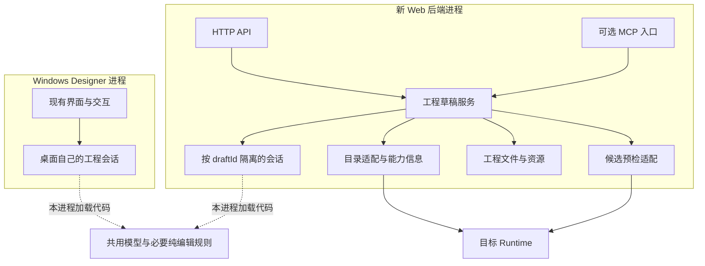
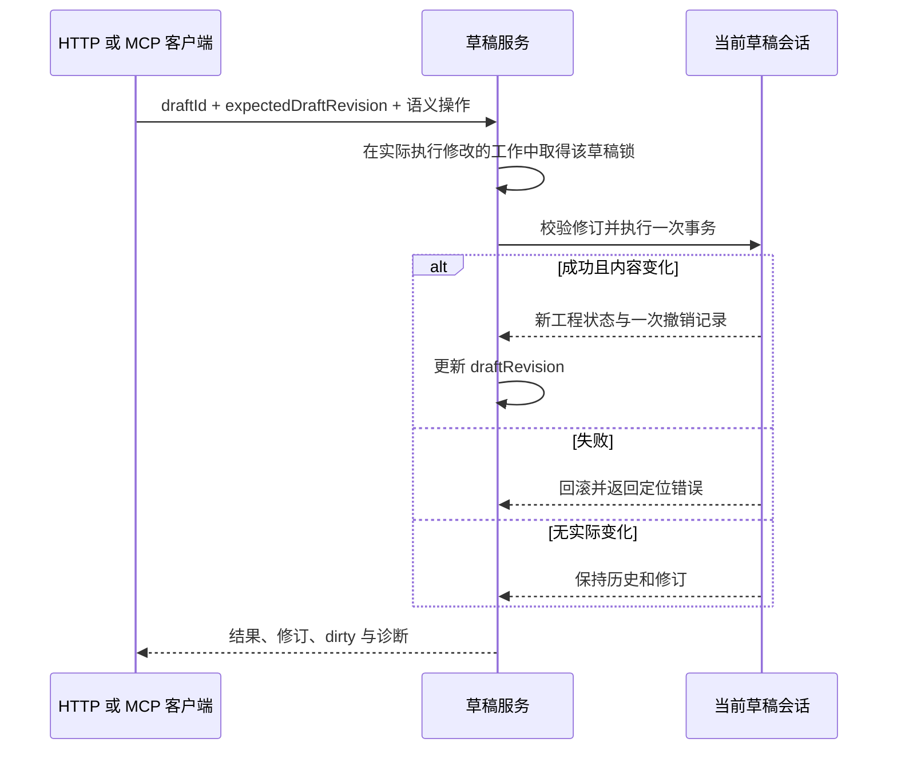
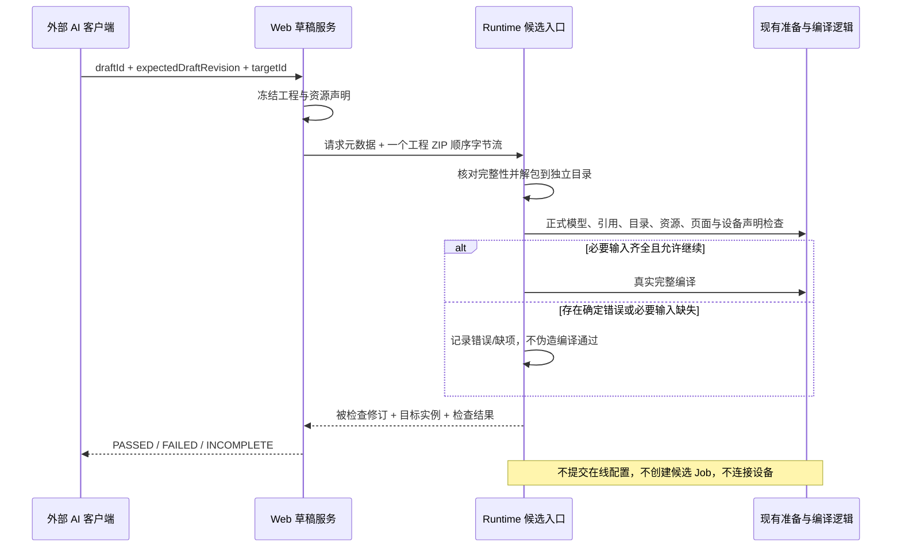

# 设计：独立运行、最小共用、能力可发现

## Context

v7 以已交付 v6 和随后对 `4a602120` / `f663c007` 的审查为输入。保留正式工程目标、五项能力、四阶段、七组验收及 F1–F6；本次只更新协议已完成部分、目录接通任务和实际版本测试约定，不增加生产执行权限、旧 Web 迁移或新管理系统。[U8–U9、P0–P4，见 sources.md]

参考基线为上轮已核对的 main `b61a96f6d8135497531eabf18245118de253ee03`。`4a602120` 已声明四个协议字段并更新 `src/emo_panel_protocol/generated/runtime_pb2.py`；`f663c007` 已修复 ROI 编辑器资源测试中的旧版本常量。该基线 `RuntimeService.ListOperators()` 尚未填写这四个字段；上轮读取的仓库记录也说明没有重新发布 SDK wheel。因此字段定义是已有基础，目录值到达 MCP 仍是待交付能力。本轮仅修订文档，不重新核验远端 HEAD、不运行项目或协议测试。

执行时读取实际工作区并合并后续变化，不回退参考提交。已存在的协议定义不是拟议接口；以下新 Web/MCP 工具、DTO 和候选 RPC 仍为待实施契约。v6 的 ROI/集合算子、页面快照及局部 Designer 适配要求继续保留；只作为历史归档的 v6 文件不改写。

## Goals / Non-Goals

**Goals**：无 Designer 进程也能查询能力、创建/编辑完整工程、保存、管理资源、预检和导出；导出物可由 Designer 正式打开继续编辑。复用真实声明与现有业务规则，保持两端工程语义一致。

**Non-Goals**：控制或远程启动 Designer；共享桌面当前内存草稿；整体重写桌面；兼容旧 Web 产品；本轮建设完整 Web 可视化流程画布；自动部署/启停生产工程；建立“算子支持百分比”或手工维护全量能力数据库。

## Decisions

### D1. 运行独立，代码可以共用



CORE 表示一份代码实现，不是网络服务或共享 Store。图中没有 Web → Designer 的控制连接。草稿之间及桌面与 Web 之间不共享撤销栈。Runtime 是第三个独立执行端。

首期单服务进程管理会话；不用 Redis/分布式锁。已有仓库 Web 代码可局部复用，但不是必须保留的旧产品。运行 HTTP/MCP 不加载 Qt 界面；独立安装依赖需实际检查，而不只看单个文件没有 Qt import。

### D2. Designer 只做必要的局部适配

优先顺序：直接复用已独立的函数/模型 → 解除真正阻挡无界面使用的依赖 → 提取本轮用到的业务规则，并替换同一桌面规则实现。

| 代码类型 | 做法 |
| --- | --- |
| 已可无界面使用的模型、会话、保存函数 | 直接调用；不因目录含 designer 就强制搬家 |
| 窗口中的参数/端口/绑定等业务判断 | 以明确工程、节点、声明为输入局部提取；桌面原入口调用同一函数 |
| 弹窗、选中、控件取值、画布刷新 | 留在 Designer，不引入 Web |
| Web 的修订、鉴权、HTTP/MCP 映射 | 留在新服务，不要求桌面调用 HTTP |

不强制建设通用命令框架，不强制新建独立发行的 `emo_project` 包。若依赖整理确需公共命名空间，可以采用它，但只迁移实际依赖闭包，并保留唯一模型实现；无须为了旧路径长期兼容另立项目。

**事务只有一个负责人。** 可先共用不负责开事务的校验/计算/修改辅助函数：桌面沿用自己的事务边界，Web 在同一语义操作外建立一次事务。若复用的方法本身已开事务，调用方不再包第二层。不要一律删除 `@draftCommand`，也不要一律在共享方法内部加事务。

每个受影响桌面操作，先确认它现有字段提交、画布捕获和 Store 同步时机。只调整必要调用；操作完成后旧画布不能覆盖新内容，失败后视图与回滚后的工程一致。**这不是所有 Web 请求都要执行的桌面流程。**

**跨阶段约束：**在 A/B/C/D 任一阶段提取了已有桌面规则，就在同一变更中调整对应 Designer 调用并执行直接受影响的回归，不能延后到 D 再接回。未提取的操作不要求迁移；任务 4.4 只是收尾核对。

**v6 已对齐的桌面代码不扩大 Web 范围。** ROI 的 `editor.py` / `canvas.py` / `point_editor.py`、通用 Qt 图像控件、编辑器应用提示和工作流调用链窗口仍属于桌面交互。MCP 用正式参数对象完成 ROI 配置，不导入这些 UI 类、不模拟拖画、不因桌面 `previewMode=pure` 而宣称已有 MCP 试运行工具。纯数据规则确需共用时仍按上面的最小提取原则执行。[N1、N5]

### D3. Web 编辑只操作自己的草稿



| 状态 | 约定 |
| --- | --- |
| draftId | 服务生成，定位独立工作目录；不是工程自身 ID |
| projectId | 正式工程身份，导入保留；同一 projectId 可以有多个草稿 |
| draftRevision | 不透明会话修订；编辑、undo/redo、save、资源提交检查期望值 |
| dirty / undo / redo | 使用已有工程会话语义，不再建第二份历史 |
| savedAt | 最后成功保存时间；读取不改变正式保存元数据 |
| targetId | 本次目录/预检目标，来自配置；不额外塞入正式工程格式 |

文件放在 `data_dir/project-drafts/<draftId>/project.emoproj` 及其相对资源目录。索引只存列表和定位必要元数据。断开 MCP 不删除草稿；服务重启读最后成功保存内容，生成新会话修订，不恢复未保存内容或全部内存历史。

修改会话的工作线程持锁到修改真正结束；外层请求取消不能提前释放它仍需的锁。短编辑中途断线后由客户端重新读取状态，不能假定已失败并自动重放。不建全套幂等账本。

预检和导出在锁内复制工程与资源声明，随后放锁处理；结果绑定快照修订。结果丢失不等于操作未完成。

### D4. 完整工程与编辑规则

沿用正式默认结构、模型、读写和工程版本；参考基线为工程 2.9、页面 1.2，执行时核对实际正式版本。保留流程、页面、资源、设备、变量及生产设置，不为了首期简单而生成删减格式。合法空工程可以保存。

最终能力范围：工程/流程名称、创建/复制/删除、入口和接口；普通节点创建/配置/复制/删除/移动、连线；Subflow/Loop/Dispatch/Join；设备定义与节点绑定；变量定义、初值及绑定；页面、控件、布局、终端、导航、输出绑定；资源与现场参数声明；正式 Runtime/ProductionSettings 配置。

需要明确的操作语义：

- 普通读取使用不更新保存元数据的、与会话分离的快照。仅读取页面时复用当前 `PresentationStore.snapshot()` 的页面部分校验，不为每个属性/控件重复构建完整工程；返回对象不能回写 Store，撤销/重做/重新加载后不能读取过期缓存。跨工作流输出目录确需完整文档时，在一次同步处理内构造后复用。完整工程加载、事务及保存边界继续按现有规则校验；导出/预检仍冻结完整快照，不能以性能优化为由删掉隔离或必要校验。不新增持久缓存、压力矩阵或固定耗时指标。[N4、N6]
- `node.configure.params` 完整替换；对象、数组及数组内对象按真实结构保留，不展平、不 JSON 字符串化、不浅合并，省略字段的默认处理遵循现有规则。ROI 的 `points`、`regions` 与 `regions[*].points` 均通过这条通用配置命令处理，无需专用绘图工具。`globalVariableBindings` 未传保留，传 `[]` 清空，并与参数在同一事务内应用。
- 连线是 `fromNode/fromPort/toNode/toPort`；位置保存到 workflow 的 `layout.nodePositions[nodeId]`。
- 模式适用端口与持久化端口分开；沿用现有不适用连线诊断、变量端口冲突拒绝和 Loop 合同处理规则，不另写解释器。
- 页面 `output_choices` 来自当前草稿及相应声明，不用在线工程节点替代，不新增一层对外变量别名系统。
- 命令携带明确 workflowId/nodeId；创建 ID 可接受显式值或由服务生成，实际 ID 必须返回。服务不猜“当前选中节点”。

### D5. 算子能力发现是阶段 A 的必做项

**支持信息拆为三层，不能合成一个 supported 布尔值或百分比：**

| 层次 | 信息来源 | 意义 |
| --- | --- | --- |
| 算子声明 | 指定 Runtime 的目录及对应版本的已提供元数据 | 功能、模式、参数、端口、设备/资源要求与已知限制 |
| 编辑服务能力 | 当前实际注册并完成实现的命令 | MCP 现在能创建/配置哪些对象，哪些操作尚未接入 |
| 工程检查结果 | 指定 draftRevision + 目标实例的预检 | 当前工程是否通过检查；不等于已执行或设备已连接 |

建议工具及行为：

| 工具 | 最小输入 | 结果 |
| --- | --- | --- |
| `get_authoring_capabilities` | 无 | 已配置目标、实际命令及输入结构、对象类型、导入/导出形式，以及已实现的 fileTransfer 约定；未支持操作明确说明 |
| `list_operators` | targetId；可选 query/category | ID、名称、版本、分类、summary；支持搜索；大目录按现有习惯分页，不静默截断 |
| `get_operator` | targetId、operatorId | 完整详情；不能只返回名字或一句简介 |
| `list_device_types` / `get_device_type` | targetId；详情加 typeId | 目标实际设备类型及配置声明；不触发设备扫描/连接 |

详情约定如下；字段名为建议 API DTO，原始值保持来源语义：

| 字段 | 规则 |
| --- | --- |
| operatorId/displayName/version/category/summary | 来自真实目录 |
| inputPorts/outputPorts | 完整端口 spec 对象，保留 type、required、nullable、schemaVersion 等；不要只用简化类型 map |
| paramSchema | 递归保留 properties/items、嵌套对象与数组、required、enum、default、description、标准限制及全部 x 扩展；包括 xEnabledWhen/xVisibleWhen/xValidateWhen/xModeOperator/xMinimum/xMaximum/xOdd，不只处理顶层字段 |
| deviceRequirements | 真实设备槽位和要求；资源文件含义从正式 schema/资源模型取得 |
| nextCycleParameterPaths | 解析现有 next_cycle_parameter_paths_json；空字符串为未提供，JSON 空数组为明确空列表；保留真实声明，不授权在线改参或生产写入 |
| minCoreVersion/maxCoreVersion、已知限制 | 映射已有 min_core_version/max_core_version；未提供时明确未知，不推断版本范围；补充文档只使用匹配版本且已随包提供的内容 |
| editorSpec/editorIssues 等 | 作为声明或诊断提供；不把 Qt 编辑器可用等同于 Web 已有同样的可视化编辑器，不执行其界面代码 |
| unavailableFields | 未获取/传输未支持的必要字段明确列出；未知不写成空数组或“完全支持” |
| targetId、runtimeInstanceId、observedAt、source | runtimeInstanceId 使用该次目录回复的真实 runtime_instance_id；未提供时标未知，不拿 targetId/主机名代替；仍标明观察时间及 live/cache 来源 |

#### D5.1 复用四个已声明字段，完成剩余映射

`4a602120` 已在 `proto/runtime.proto` 声明下表字段，并同步 protobuf Python 生成代码。沿用既有字段名、编号和保留声明，不重复新增同义字段、不改号、不手工编辑生成文件。原 `OperatorInfo` 的保留编号 17 及保留名称继续保持。[P1]

| 已有消息/字段 | 编号 | 剩余实现 | 对外值 |
| --- | --- | --- | --- |
| OperatorInfo.next_cycle_parameter_paths_json | 18 | Runtime 序列化真实 manifest.nextCycleParameterPaths，包括明确空列表 | nextCycleParameterPaths |
| OperatorInfo.min_core_version | 19 | Runtime 填入 manifest.minCoreVersion 的真实声明 | minCoreVersion |
| OperatorInfo.max_core_version | 20 | Runtime 填入 manifest.maxCoreVersion 的真实声明 | maxCoreVersion |
| ListOperatorsReply.runtime_instance_id | 3 | 使用该 Runtime 当前实例的既有身份；不创建查询专用身份 | runtimeInstanceId |

上述基线的 `ListOperators()` 还没有实际填值。[P3] 剩余链路为 **真实 manifest/实例身份 → Runtime 回复 → 实际客户端/SDK 协议解析 → 新 Web 目录 DTO → HTTP/MCP**；仅能构造含字段的 protobuf 消息，不能视为接入完成。任务 1.1 保持未完成，已存在的定义与生成工作在此记录，不再重复列为开发工作。

**普通空值约定：**

| 接收值 | 含义与对外处理 |
| --- | --- |
| next_cycle_parameter_paths_json 为空字符串或未提供 | 本回复没有提供元数据；对外省略该值或使用 null，并把 nextCycleParameterPaths 放入 unavailableFields |
| next_cycle_parameter_paths_json 为 JSON `[]` | 明确声明的路径列表为空；对外返回 `[]`，不列为未知 |
| next_cycle_parameter_paths_json 为有效非空 JSON 路径列表 | 原样保留实际路径，按来源语义输出；不把路径列表重新解释为在线操作权限 |
| min_core_version/max_core_version/runtime_instance_id 未提供 | 对应信息未知；不补默认 Core 版本，不制造实例 ID |

不能使用 `json.loads(value or "[]")` 把未知折叠为空列表。空字符串只证明本回复未提供，不足以判断目标一定是旧版本；协议已升级而服务未填值也会产生同样结果。格式错误按已有解析错误/定位诊断处理，不伪造成已知空列表；无需再建立字段兼容管理系统。

确认新 Web 实际导入的客户端/协议代码，而不只检查仓库生成文件。已有部署 wheel 尚未升级时按实际数据处理，不能假定包已发布；需要接入时沿用仓库现有依赖/构建方式，不把独立 SDK 发布扩成整个项目的前置任务。后续改 proto 时运行既有生成一致性检查，不另建新兼容测试矩阵。[P4]

现有摘要、完整端口、paramSchema、deviceRequirements 等映射继续复用；算子数据库只维护真实声明这一份。

`x*` 字段不自动等同标准 JSON Schema 约束：传输要保留，业务校验复用现有实现。需要依赖/平台信息却无真实来源时，返回未知；不能因算子在 `activeOperators` 中就认定资源、驱动、模型或硬件均可用。完整成功查询中未列出某算子，只表示目标目录未列出；目标不可达则返回查询失败，不能返回空目录伪装为不支持。

目录内部按目标缓存，明确是否缓存及观察时间；新建节点需有明确来源声明，不隐式套用上一个 Runtime 的目录。用已有保存声明可完成适用的离线编辑；目标兼容性仍待预检。**源码 main 更新不等于部署中的 Runtime 已更新**：真实工具结果使用目标返回的版本和字段，不能将本仓库新 manifest 冒充旧目标能力；新基线仅用于开发和对应源码环境的验证。

**Threshold 验收依据**：真实声明包含 fixed/otsu/triangle/adaptiveMean/adaptiveGaussian；blockSize 有 xOdd 和 xEnabledWhen；threshold 输出允许 nullable；nextCycleParameterPaths 来自 manifest。示例只验证字段未丢失，不硬编码整个算子库。[R2]

**新增源码对应的代表样例（不是手写支持矩阵）**：[N1–N3]

| v6 固定源码的代表算子（不是目标版本常量） | 已有能力 | MCP 接入含义 |
| --- | --- | --- |
| `vision.preprocess.roi` @ 1.2.0 | `roiType=regions`；嵌套区域数组，`purpose=keep/exclude`、enabled、name、几何参数与点集 | 目录递归返回，通用节点配置保留数组和对象；无需 Qt 绘图；只有实际接口验证后才能报该结构化配置可用 |
| `vision.collection.filter` @ 1.3.0 | `contourPointsEnabled`、`minContourPoints` 及对象类型/开关适用条件 | 使用真实 schema 和现有筛选规则，不仅凭字段类型作无条件校验 |
| `vision.analysis.minimum_enclosing_circle` @ 1.1.0 | `scope=perContour/allContours` 及语义说明 | 保留默认值、枚举与描述；allContours 不是平均圆心或合并多幅图像 |

#### D5.2 版本从注册和实际目标取得

`f663c007` 已修复 `tests/runtime/test_operator_editor_preview.py`：同一源码测试先用 manifest 校验目录返回版本，再用 `roiInfo.version` 或 `descriptor.manifest.version` 请求编辑器资源；不要重做这项修复，也不要把旧 `1.1.0` 替换为另一个永久常量。[P2]

同一源码环境的测试继续核对 manifest 与注册结果一致；远端集成以目标实际返回版本为请求依据，不能要求它等于开发机 manifest。上表版本仅描述固定基线样例。动态读取版本不减少 ROI regions/points、条件声明、预览尺寸、资源摘要和注册快照等原有功能断言；已有相关测试保留，MCP 的结构化配置另经公开入口验证。部署目标不具备新功能时明确说明限制，不能假报通过，也不因此新增旧产品迁移任务。

ROI 是在 G2 中补一个嵌套参数代表，不替换原 PNG/Threshold 贯通示例。过滤/求圆字段使用同一目录映射按真实源核对即可，不为三个算子分别创建全链路测试。`xVisibleWhen` 描述界面适用性，`xValidateWhen` 等处理沿用现有模式逻辑；不能把所有 x 字段统一当成标准 JSON Schema 约束，也不能只因存在 `customUi` 就认定算子不能用参数配置。


### D6. 资源、导入、导出是一条普通路径

上传 raw bytes 至临时文件 → 统计实际字节数和 SHA-256，核对声明长度及提供的摘要 → 取得草稿锁并比较修订 → 一次事务登记/更新声明及必要引用 → 返回 resourceId、新修订。接收失败不登记有效资源。文件名不直接决定服务器路径。具体请求、结果与配套命令统一见 [file-transfer.md](file-transfer.md)，不另建文件管理服务。

替换可保留逻辑 resourceId，但写新物理相对路径；撤销和在途快照仍能读取旧文件。补齐导入工程缺失资源使用同一操作，不做“字节恢复却不改变工程修订”的特例。不新增后台 GC；旧文件仍被使用时不能删除。

导入支持正式 `.emoproj` 和普通工程 ZIP，每次创建新 draftId；唯一主工程、相对路径、禁止解包越界和符号链接、声明资源大小/摘要检查是必要文件处理。按实际部署设置上传和解压总量上限，不引入复杂配额系统。未提供的资源是缺项，已提供但损坏的字节是错误。

| 输出形式 | 规则 |
| --- | --- |
| 单独 .emoproj | 可含待补资源，明确缺项；不宣称已运行或一定可直接保存 |
| 完整工程 ZIP | 正式文件 + 声明资源；资源不齐则拒绝“完整”交付并列出缺项 |
| 候选预检 ZIP | 同样布局，可缺未提供资源，由预检给出 INCOMPLETE |

导出冻结指定修订，复制声明输入，不递归带走日志、运行输出或历史数据库；使用正式保存后重读校验。导出不修改原会话保存点/dirty/undo。返回 exportId、draftId、draftRevision、filename、mediaType、sizeBytes、sha256，以及同源相对下载路径和所需认证方式；不返回真实凭据。重复下载读同一快照。没有做预检也可导出，但明确“目标预检未执行”；旧修订的报告不能附成当前版本已通过。

### D7. 本地校验、目标预检与实际执行分开

| 操作 | 所在位置及检查职责 | 明确不承担 |
| --- | --- | --- |
| validate_project_draft | 草稿服务侧；正式模型、结构/引用、页面/设备/变量绑定及本地已知资源；使用草稿保存的或本地已取得的对应声明 | 不强制访问在线 Runtime，不声称完成目标编译或真实运行 |
| precheck_project_draft | 指定 Runtime；固定草稿快照、目标真实声明和上传资源，条件具备时真实编译 | 不提交在线配置，不启动 Job，不将编译通过当成现场设备可用 |

本地校验即使 Runtime 离线也能完成可做的检查。缺必要声明或输入时返回 INCOMPLETE 与可定位缺项；确定错误优先为 FAILED；仅本地所需检查完成才为 PASSED，并明确 scope=local。不能只解析 JSON 就声称完成全部校验。结构合法但尚未配置完整的草稿仍允许保存；保存不以 validate/precheck 的 PASSED 为前提。

两个检查入口都要求 draftId、expectedDraftRevision 并检查对应快照；precheck 额外要求 targetId。结果使用 scope=local/target、draftId、draftRevision、status、compileStatus、executionStatus、errors/warnings/missingInputs。本地 compileStatus=not_run、executionStatus=not_run，不伪造目标实例；目标报告带 targetId/runtimeInstanceId。诊断条目见 D8.1。范围不足必须据实说明，不新增阶段审计系统。

#### 目标候选链路



建议新增 `ValidateCandidateProject` 接口：一次元数据（修订、目标实例、包大小）及一个 ZIP 流。复用已有上传工作池、资源准备、声明检查和编译器；不借用在线初始化/配置写入，不套用 Preview 专用上传消息。块长只限制上限；依据实际 gRPC 限制选值，参考 v3 的 256 KiB 仅为初始建议，不构造每资源 offset 状态机。

候选目录独立。输入参数只解析已上传资源；主机任意字面文件路径记为待补，不偷用 Runtime 本机其他文件。输出先检查原始配置及能确定的输入输出冲突，再只在候选副本中映射到临时位置；不写回草稿、不产生业务输出、不连接相机/PLC。

复用的检查如存在硬件或执行副作用，先隔离该调用，不能以“复用”为由违反无执行边界；不因此额外建设任意插件沙箱。无副作用完整编译暂无法完成时据实说明阻塞，不能把未检查项写成通过。

目标报告按 D7 约定返回 scope=target 及被检查修订、目标实例；errors/warnings/missingInputs 使用 D8.1 的可定位条目。目标报告也明确 executionStatus=not_run。

- 确定工程错误：FAILED。
- 无确定错误但必要输入不足：INCOMPLETE。
- 所需检查已完成并通过：PASSED；合法空白工程可 compileStatus=not_applicable。
- compileStatus 为 passed/failed/not_run/not_applicable；传输、目标不可达等失败是服务错误，不包装为通过的业务报告。

取消只处理真实异步边界；按实际协商协议识别请求取消，收到取消或超时后不进入下一阶段，已在工作的线程退出前不提前清理它的目录/额度。草稿不随连接销毁，已提交编辑不被擅自撤销；不能硬编码所有版本都把断开视为取消，或都不视为取消。版本选择与验证见 D8.2。[O3、O4]

### D8. HTTP 与 MCP 是薄适配

| HTTP 建议路径 | MCP 建议能力 |
| --- | --- |
| GET /api/authoring-capabilities | get_authoring_capabilities |
| GET /api/project-catalog/{targetId}/operators[/{operatorId}] | list_operators / get_operator |
| GET /api/project-catalog/{targetId}/device-types[/{typeId}] | list_device_types / get_device_type |
| POST /api/project-drafts；GET 列表/单份 | create_project_draft / list_project_drafts / get_project_draft |
| POST /api/project-drafts/imports | import_project_draft（小 JSON）；文件/ZIP 用上传入口 |
| POST /api/project-drafts/{id}/commands | apply_project_command |
| POST /api/project-drafts/{id}/undo、redo、save | undo_project_edit / redo_project_edit / save_project_draft |
| POST /api/project-drafts/{id}/resources | raw bytes 上传；按 fileTransfer 约定传递元数据和修订，之后命令绑定 |
| GET /api/project-drafts/{id}/output-choices | get_output_choices |
| POST /api/project-drafts/{id}/validate、precheck、exports | validate_project_draft / precheck_project_draft / export_project_draft |
| GET /api/project-exports/{exportId}/content | 使用导出返回路径及同一凭据下载，不要求单独增加 MCP 下载工具 |

工具 inputSchema 要能告诉 AI apply 的可用命令及必填字段，不允许只有一个无约束 object。命令及能力信息从同一注册实现导出，未完成命令不能假报支持。工具名可合并，但“列表与详情、编辑能力、检查与导出”的可发现行为都必须存在。

MCP tools/list 列出工具，不列出每个视觉算子。算子通过目录工具返回；不为每个算子自动生成执行工具。优先返回 structuredContent，并按所选官方 SDK 支持提供可读 JSON 文本；工具参数/编辑错误与正常 FAILED/INCOMPLETE 检查报告区分。[O2]

采用 Streamable HTTP，最终地址 `/mcp`，正确管理 SDK 生命周期。保留 Python 3.10，阶段 A 锁定一个实际验证可用的 SDK、协商协议及外部客户端组合，不未经确认升级整个平台，也不要求支持全部版本。关闭或未安装 MCP 依赖时基础 HTTP 草稿服务能启动。

首期一套工作区 Bearer 凭据覆盖 HTTP/MCP/文件上传下载；适用于受控、能配置 Authorization 请求头的选定客户端，不宣称支持全部 OAuth 客户端。默认本机监听，远程部署配置可信 TLS/访问边界，按协议校验 Origin；凭据不进入工程、日志和 URL。不增加多租户/角色矩阵。[O3]

MCP 不会自动读客户端路径。阶段 A 确认由客户端宿主、用户入口或配套 HTTP 命令完成本地文件读取；阶段 B 实际上传与下载验证。允许“客户端 + HTTP 辅助”，但不能称纯 MCP 自动传输。只有返回 URL 不算下载完成，普通浏览器点击未必携带 Bearer 请求头。操作示例见 [file-transfer.md](file-transfer.md)。

能力响应的 fileTransfer 至少描述已实现的上传 method/pathTemplate、raw-byte body、query 的 name/purpose/resourceId、purpose 的真实枚举、revisionHeader、可选摘要头、响应字段、导出形式和带凭据下载方式；不返回凭据值。尚未实现文件功能时如实标记，不把未来路由报为可用。无需为此新增能力注册中心。

#### D8.1 可定位结果与修复链路

直接保留已有 ValidationIssue/locatedValidationError 的 code、message、projectId、workflowId、nodeId、fieldPath；在已知时为缺失资源追加 resourceId。资源、设备和页面的错误同样以正式字段路径定位；位置未知时留空或省略，不能编造。勿将 WorkflowCompileError.issues 压成一段 str(error)。[R11]

成功编辑至少返回 draftId、draftRevision、changed、dirty、canUndo/canRedo、createdIds、diagnostics。创建的实际 ID 必须返回。修订冲突返回当前 draftRevision；失败不改变工程内容，不泄露堆栈、凭据或内部敏感路径。

例如以下为**拟议业务报告示意**，不是本轮运行结果；实际 code 沿用能确定的现有诊断：

```json
{
  "scope": "target",
  "draftId": "draft-example",
  "draftRevision": "checked-revision",
  "targetId": "runtime-main",
  "runtimeInstanceId": "observed-instance",
  "status": "INCOMPLETE",
  "compileStatus": "not_run",
  "executionStatus": "not_run",
  "errors": [],
  "warnings": [],
  "missingInputs": [{
    "code": "E_RESOURCE_INPUT",
    "message": "声明的输入图片尚未提供",
    "projectId": "project-example",
    "workflowId": "flow-example",
    "nodeId": "loader-example",
    "fieldPath": "params.imagePath",
    "resourceId": "image-example"
  }]
}
```

MCP 映射区分：工具正常完成检查却返回 FAILED/INCOMPLETE，是正常结构化业务结果；非法编辑、修订冲突或处理失败作为工具错误，按所选协议/SDK 保留可读及机器可读诊断。协议层的未知工具或格式错误由 SDK 的标准错误处理，不伪装成编译报告。实现工具时可声明相应 outputSchema；不以冻结全量 DTO 为前置。

正常修复链路：读取报告位置 → 读取当前草稿及修订 → 按实际命令 schema 修复/上传/绑定 → 使用每一步返回的新修订再次检查 → 只将新报告关联到其检查版本。不要自动重放失败写请求，也不凭错误字符串猜目标对象。

#### D8.2 协议、请求与草稿生命周期

阶段 A 在完成记录中写明 Python/SDK 版本、选定客户端及协商协议。优先选择能在现有 Python 3.10 基线上实测的一个组合；不能仅在文档写版本，却不验证客户端实际协商结果。若 SDK 与客户端没有共同可用组合，按真实阻塞说明，不静默升级平台或假报联调成功。

请求取消遵循该组合的规则：参考 2025-11-25 不把普通断线直接当成取消；2026-07-28 Streamable HTTP 规定关闭某请求的 SSE 响应流是该请求的取消信号。此对照只用于说明不能写死统一断线策略，不要求实现双版本分支或兼容矩阵。[O3、O4]

与协议版本无关的业务约束保持一致：连接/会话结束不删除草稿；已提交操作不因取消擅自 undo；未提交工作在实际可取消边界退出，仍在修改的线程保留锁直到结束；取消结果不确定时重连读取当前状态，不自动重放。不把请求取消提升成全局草稿删除或整个 Runtime 停止。

### D9. 交付顺序与工程约束

A：能力发现 + 最小草稿编辑/本地校验 + HTTP/MCP，固定实际客户端组合和文件往返方式；B：资源、页面基础绑定和正式交付；C：真实候选预检及诊断修复；D：补齐复杂流程/设备/变量/页面配置。必要桌面适配按 D2 跟随实际提取同步完成，D 只核对遗漏。C 的 Runtime 侧可在最小契约明确后并行，不等待全部桌面改造。

以“PNG → Image Loader → Threshold → 页面绑定 mask”为贯通示例，加入一次“检查发现缺项/错误 → 按位置修复 → 新修订再检查”和实际携带凭据下载。先查询目录再配置，不凭记忆写端口。Desktop 正式打开是离线交付验证，不是 Web 的运行依赖。最后仅在隔离软件 Runtime 通过既有明确操作运行一次，不因此给 MCP 增加自动运行权限。

普通 PNG 示例不单独证明阶段 D 全部接通。在 G2 内复用既有 fixture，经新增公开命令入口验证复杂流程代表操作、设备配置与变量绑定、页面/生产配置的代表修改及正式保存重读；不接现场设备、不新建第二套完整端到端流程、不穷举所有底层分支。

任务和验收分别见 tasks.md、acceptance.md。所有任务初始未完成；OpenSpec 结构校验通过不代表项目代码通过。

## Risks / Trade-offs

| 直接风险 | 有边界的处理 |
| --- | --- |
| 提取规则牵出桌面大改 | 到当前操作为止；保留原 UI，改调用并复用已有回归；不扩大到无关控制器 |
| 目录字段缺失使 AI 猜配置 | 优先补真实元数据映射；未知明确列出，不硬编码全量算子描述 |
| 资源替换或客户端并发影响结果 | 每草稿修订与锁、新物理文件、快照检查；不做分布式事务 |
| 预检执行插件副作用 | 审核实际调用并保持无运行边界，未验证项明确报告 |
| 客户端/SDK 兼容范围有限 | 选定一个实际客户端验证，记录版本；不扩成多客户端矩阵 |

## Open Questions

没有需要先阻塞整个开发的产品问题。实际工作区版本、配置上限和最终模块路径在对应阶段记录；SDK/协商协议/实际客户端及文件辅助方式须在阶段 A 确定，不能拖到最终验收才发现不能接入。只有会改变目标、引入生产副作用或迫使扩大桌面重构的发现，才需单独确认；其余局部实现选择不新增审批层。
