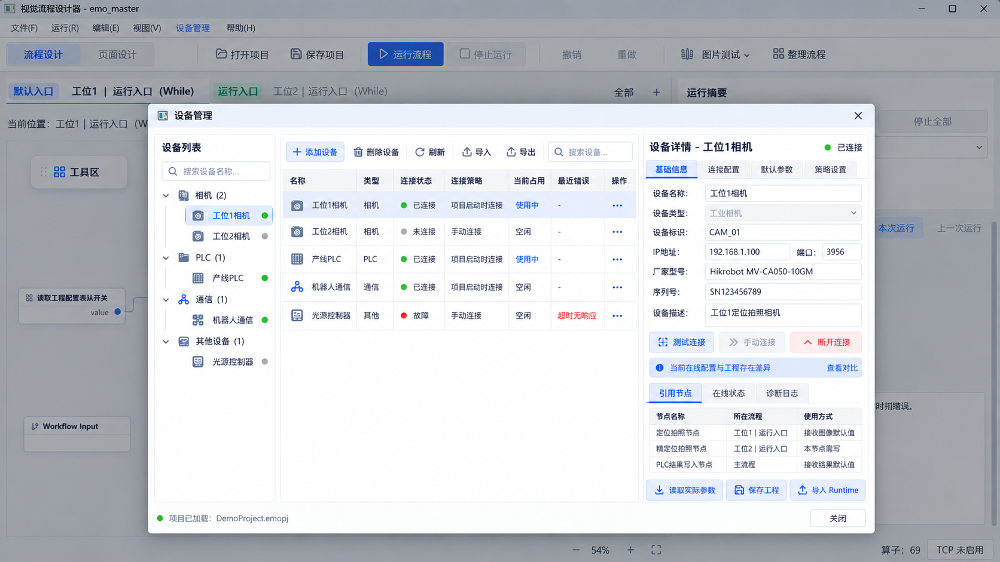

# emo_master：设备管理与工程／Runtime 在线配置读写完整实施方案（R2.1 图示版）

- 文档日期：2026-10-16
- 文档版本：R2.1；在 R2 完整正文中加入用户界面参考图及落地说明。单独使用本版，不需与旧版叠加。
- 修订依据：R2 正文、既有审查报告及用户本次提供的设备管理参考图；R2 审查项映射和本次补图记录见同包 `REVISION_NOTES.md`。
- 状态：文档修订完成；尚未实施，不代表软件、模拟设备或真实硬件验收通过。本次未重新核对远端 HEAD，也未修改仓库。
- 仓库：`jsdfhasuh/emo_master`
- 目标分支：`agent/runtime-workflow-architecture-v1`
- 沿用上轮源码核对基线：`096d021c3cf48516fc60289878f94b031a1c602c`
- 建议入库位置：`docs/plans/2026-10-16-device-management-online-config-plan.md`
- 技术边界：Windows、Python 3.10、PySide2 5.15.2.1、Qt QWidget；保留现有 Linux 软件验证路径，不切换 Qt6/QML/Web UI。
- 交付边界：完整实现本方案的交互、插件契约、运行端、兼容迁移与功能测试。分阶段提交只用于控制开发依赖，不把核心能力推迟成“以后版本”。性能专项验收、节拍指标和专项压测不列入本计划。

## 0. 结论与已确定原则

平台新增“设备管理”工作页面。算子插件声明设备类型、属性、能力及策略；用户从设备页或节点初始化向导创建设备；节点引用设备，并对允许的工作参数选择继承、常量覆写或动态绑定。

工程与 Runtime 各自保有配置。保存工程不改变生产；连接 Runtime 后读取在线配置并比较。用户选择从 Runtime 读取、选择写入，或保持差异继续监视。比较覆盖设备、普通参数、流程结构、运行设置、页面及依赖，不只覆盖曝光。

同一设备允许多个节点和独立任务引用。每台设备只有一个权威串行执行入口：占用时排队，参数应用与本次采集构成完整操作，图像安全取得后释放操作权。算法、显示、保存及下游等待不持相机锁。设备锁不要求一台设备必有一个进程。

同帧多流程通过显式分发／汇合实现。多个节点分别请求拍照仍是多次拍照。已经开始的周期固定使用旧计划，新周期在明确入口取得新计划；普通参数更新不额外等待所有旧周期或消费者结束。

### 0.1 产品边界与简化边界

| 项目 | 确定规则 |
|---|---|
| 设备页面 | 正式第三工作页面；不是仅集中填写 IP 的弹窗 |
| 设备归属 | 设备属于工程，不属于最初创建它的节点 |
| 参数 | 设备默认值＋节点明确来源；不强制命名采集配置集；MAC 优先发现／回读 |
| 设备竞争 | 按设备 FIFO 串行执行，不静态证明 Switch／父子互斥，不设采集主流程独占 |
| 连接 | 连接寿命与按次操作锁分离；策略默认值及允许值由插件声明 |
| 执行隔离 | 相机 SDK 可隔离进程，普通 SLMP 使用设备 IO 线程；不建设通用 Host 调度平台 |
| 配置写入 | 单写入通道；所选变更合成有效候选；软件配置整体提交，硬件结果单独报告 |
| 周期切换 | 旧周期保留旧计划；普通参数允许新旧周期并存，不默认全组排空 |
| 同帧分发 | 同 Runtime、显式目标、受管理消费者、明确汇合；不建设可靠消息中间件 |
| 预览 | 生产中默认订阅已有画面；主动试拍才申请采集 |
| 完整范围 | 分阶段只是提交顺序，不省略设备锁、共享连接、同帧独立流程和在线读写 |
| 性能 | 不列性能专项指标、节拍验收或专项压测；仍避免无界资源、逐帧全量检查 |

### 0.2 实施前固定的三份核心契约

本正文已经规定：配置写入提交及周期版本（§7—8）、设备一次操作及退出（§5—6）、同帧分发及完成（§9）。开发者只能按真实代码调整命名和接入位置，不得留下相反默认并存，例如“部分软件提交”和“软件整体提交”同时有效。

本方案中的新字段／模块是拟实施契约，不代表基线代码已有。源码事实沿用上轮固定 SHA 的核对资料；实施时核对实际 HEAD，不回退到该 SHA。

## 1. 沿用源码基线与改造理由

以下沿用上轮固定 SHA 的静态核对，不是本次重新审计当前分支，也不是对真实设备的测试结论。

| 现状 | 证据 | 实施含义 |
|---|---|---|
| 算子有统一 manifest、Registry、描述符与 UI／图标资源机制 | [S1]、[S2] | 扩展注册体系，不新建一套与算子系统脱节的插件加载器 |
| 工程已有 `devices.bindings`，当前仍为通用字典；项目模型支持到 2.5，并已有 `communication` | [S3] | 扩展为类型化设备目录和节点绑定；保留原字段兼容，不把已有 TCP 配置重复保存 |
| 相机节点包含连接选择、曝光等参数，实例内部持有 `CameraSession` | [S4] | 将真实会话移入统一设备运行层，算子保留动作与输出契约 |
| 正式 PLC 读写每次创建客户端；`Slmp3EClient._exchange` 每次打开／关闭 socket；另有调试 Session | [S5]、[S6] | 建立共享设备执行入口及可保持连接的 PLC 驱动，复用协议编码，不让调试和正式流程各开一套连接 |
| Runtime 已有相机预览、PLC 调试和 TCP CommunicationManager | [S7]、[S8] | 接入口应复用已有 UI、协议、回执和资源退休逻辑，移除绕过设备锁的直接硬件路径 |
| 正式 Job 使用 `multiprocessing.spawn`；Worker 已有 CommunicationProxy 模式 | [S9]、[S10] | 每个 Job 自建普通锁不能解决跨任务问题；设备句柄不发给 Job |
| `LoadProject` 当前会拒绝尚有运行任务／资源时重载 | [S7] | 不能通过删掉一个判断来实现热更新；新增配置快照读写和周期切换路径 |
| WorkflowStore 保存设备字段；RunContext、LoopRunner 已有调用和迭代身份 | [S11]、[S12] | 在既有状态和上下文上扩展，不另建 UI 真相源，不替换原执行身份 |

Python 文档说明 `spawn` 创建新的解释器进程，队列用于进程间消息传递而非自动广播，故本方案用一个设备连接所有者与显式同帧分发。[S13]

## 2. 目标与完整功能范围

### 2.1 本次必须实现

1. 独立设备管理页及节点初始化向导。
2. 可扩展的设备类型声明、驱动适配、参数 UI、能力／策略注册。
3. 类型化工程设备目录、稳定设备引用、默认参数与显式覆写。
4. Runtime 统一会话、跨 Job 每设备互斥、取消、连接保持与释放。
5. 华睿 IMV 相机、现有三菱 SLMP PLC 的真实适配；现有 TCP 管理入口整合而不重复连接。
6. 工程级在线读取、差异比较、选择写入、版本冲突检查、持久化与周期生效。
7. 同图在同一流程内分流、同 Runtime 跨独立流程显式分发／汇合及结果身份关联。
8. 设备页调试、相机预览、PLC 诊断与正式任务共用设备入口。
9. 旧工程、工作流导入导出、资源／现场参数绑定、部署文档和功能回归。
10. 用一个最小模拟设备扩展示例证明新增设备无需修改主窗口的品牌判断。

### 2.2 不包含

不新增用户未指定的西门子、机器人、扫码器等真实协议驱动；但设备框架必须容纳后续扩展。不做跨机器分布式锁、云端设备平台、权限审批系统、通用持久消息重放系统或自动设备身份合并系统。不把保存工程自动解释为下发、不默认恢复结果未知的外部写入。不做性能专项验收。

## 3. 界面和操作流程

### 3.1 设备页与在线操作

顶部为 `流程设计 | 页面设计 | 设备管理`。在线操作统一为 `连接 Runtime / 与 Runtime 比较 / 从 Runtime 读取 / 写入 Runtime`，不重复建设含义相近的“发布／同步／应用”入口。

设备页采用原生 Qt：左侧设备类型／实例树，右侧属性及专用配置，下方引用、当前请求、等待数量与诊断。工程设备与“添加设备”时搜索到的设备分开；实时连接状态、MAC、实际参数回读不让工程产生脏标记。查看页面不接管硬件。

### 3.1.1 用户提供的设备管理界面参考图



**图 1｜用户提供的界面参考，原图随包保留。** 本图用于对照设备管理内容区的布局、信息层级与浅色视觉风格，不是软件运行截图验收证据；图中设备、地址、品牌、在线状态和引用关系均按示例理解。浏览器阅读版已内嵌同一原图；Markdown 使用同包 `assets/` 相对路径。

**嵌入位置：** 将图中设备管理窗口的内部工作区嵌入 §3.1 的正式“设备管理”工作页面。左侧分类树、中间总览表、右侧详情保留；图中的独立窗口标题栏、背景遮罩和底部“关闭”属于参考图的弹窗外壳，不要求照搬成阻塞式模态窗口。顶部“设备管理”菜单可切换到同一工作页面，不创建第二套配置窗口或状态源。本次补图不更改已确定的第三工作页要求。

| 参考区域 | 实现映射 | 交互要求 |
|---|---|---|
| 左侧设备列表 | 类型分组、设备名称搜索、实例选择和状态标识 | 展示工程已定义设备；名称、分类、图标来自设备类型与工程定义。状态同时有文字说明，不仅依赖颜色。 |
| 中间工具栏与总览表 | 添加、删除、刷新、导入、导出、设备筛选；名称、类型、连接状态、连接策略、当前占用、最近错误、操作列 | 与左侧树共享同一选中设备 ID。工具栏搜索筛选已定义设备；真实硬件搜索另在“添加设备”的发现步骤中执行。默认刷新读取已知状态，不自动重新连接、拍照或写入。 |
| 右上设备详情 | 当前设备标题、连接状态、基础信息／连接配置／默认参数／策略设置四个标签 | 本地工程配置与 Runtime 在线状态、实际回读值分区显示，不把“已连接”当成本地修改已经生效。未连接 Runtime 时显示“未获取在线状态”，不用示例绿灯填充。 |
| 基础信息 | 名称、设备标识、类型、说明及驱动支持的型号／序列号／MAC | 名称与说明可按工程规则编辑；内部 ID 只读。发现信息按可用性显示，无依据时显示未获取，不伪造。 |
| 连接配置与默认参数 | 插件生成的连接字段和共享工作参数，例如 PLC IP／端口、相机选择器、曝光及增益 | IP／端口不在多个标签中各保存一份；基础信息可只读摘要。不是所有相机都有用户可配置端口，字段由真实插件声明。曝光等保留继承／覆写契约。 |
| 策略设置 | 连接、释放、故障和等待策略 | 仅展示插件允许值；固定值只读。图中“项目启动时连接”应按真实策略准确显示为“在线工程激活时”或“开始运行时”，不能合并两个不同的触发时机。 |
| 在线差异提示条 | “工程与在线配置有差异”及“查看对比”入口 | 进入 §3.4 的统一比较窗口，保持差异也可监视；不在设备页面额外实现第二套配置提交机制。 |
| 右下详情标签 | 引用节点／在线状态／诊断日志 | 引用节点来自真实设备绑定，支持跳转流程及节点；在线状态显示实际请求、等待数量和设备连接代次；日志复用现有事件来源，不再建独立历史数据库。 |
| 底部操作区 | 读取实际参数、保存工程、写入 Runtime | 三个操作含义分开：硬件回读属于显式诊断；保存只改本地工程；写入先比较、选择变更再通过统一提交通道处理。 |

三列采用 `QSplitter` 等原生布局调整宽度，表格和属性区可以滚动；窗口较窄时允许折叠左侧分类树，不固定按原图像素堆放控件。选中设备在树、表、详情之间同步，切换分类或搜索不能让详情继续显示另一台设备的可执行按钮。布局验证并入已有正常 Qt 界面检查，不新增性能专项。

### 3.1.2 图中示例与正式实现的校正

- **按钮术语：** 图中“导入 Runtime”统一为“写入 Runtime”；“从 Runtime 读取”是读回在线工程，“读取实际参数”是读取硬件，两者不得混用。工程配置导入／导出不等于硬件读写。测试连接复用统一设备入口，不能为测试再打开第二个生产连接。
- **驱动范围：** 图中的 Hikrobot 型号、示例端口、机器人通信和光源控制器用于展示布局与可扩展类别，不新增海康相机、机器人或光源真实驱动的交付要求。本次真实适配仍以 §2.1 的华睿 IMV、三菱 SLMP 和既有 TCP 能力为准；其他设备仅在相应插件真实注册时出现，演示数据不得混入正常工程。
- **引用关系：** 只列实际绑定到所选设备的节点。图中选中相机时出现的“PLC结果写入节点”不是强制需求；没有相机设备绑定就不列为该相机的直接引用，可另由原有流程关系界面查看下游关联。继承／覆写说明根据真实字段来源生成，不能按示例写死。
- **连接与断开：** 图中“已连接／使用中／断开连接”只是视觉示例。使用中是否允许断开按 §6.3 的手动暂停和维护规则处理；不要把按钮可见等同立即强制断线，也不增加额外审批层。
- **实现边界：** 原图不修改，代码不能把它作为背景图假装交互界面。实现原生控件、真实数据绑定和已有服务调用；图示与行为有冲突时按本节校正及 R2 核心契约执行，不撤回设备锁、配置隔离、周期版本或预览订阅规则。

本图对应已有 A04—A06、D01—D04、D15、D22、F07—F10 的正常界面验证；这是布局补充，不新增验收 ID，也不表示这些用例已经通过。

### 3.2 拖入设备算子

`拖入节点 → 选择兼容设备／新建设备 → 配置节点动作和参数来源 → 完成`。

没有兼容设备时打开新建表单；已有时不擅自选中第一台。填写名称、连接属性、共享默认值及插件允许的策略。无硬件、无 SDK 时仍可完成离线编辑；“测试连接”是显式动作。连接目标 IP 与改变硬件本身 IP 不是同一个保存动作。

向导中的新节点和新设备作为一次工程编辑提交；取消不留半成品。测试连接的临时使用关系由同一设备入口管理并释放，不关闭已有生产连接。已有设备未修改时只保存引用，不复制 IP。设备页添加与节点向导复用同一控制器。

### 3.3 节点参数来源

界面按字段显示 `继承设备：8000 μs`、`本节点覆写：12000 μs [恢复继承]`，或插件允许的 `动态绑定：变量／输入`。明确输入等于默认值仍是覆写；0、false、空值与未设置按类型区分。当前编辑值与在线实际采用值有差异时给出标记，不伪装已生效。

连接地址、设备身份和生命周期策略只能在设备定义中配置。曝光模式／数值等关联字段作为一个参数组校验。动态绑定与常量覆写不能对同一字段同时有效，详见 §4.4。

### 3.4 连接与差异窗口

连接先读取 Runtime 实例、工程身份、在线版本、配置与能力。不一致不是连接失败：用户可读回、选择写入、或保持差异继续监视。写入表列两端值、选中项及其必要依赖、生效类别和真正受影响对象。

从 Runtime 读取仅重建工程定义，不扫描所有硬件、不读取 PLC 当前寄存器，不把上一次相机曝光写回默认值。读回先按普通工程规则处理未保存内容，不自动覆盖本地文件。大资源另外传输或明确列出缺失项。

### 3.5 本地编辑图与在线监视图

在现有流程区域提供 `编辑工程 / 在线监视` 状态切换，不增加另一套可编辑工程。编辑状态使用 WorkflowStore；在线状态只读，基于 Runtime 的在线快照及所选任务／周期真正采用的计划。页面设计的在线结果也采用对应绑定版本。

本地改阈值、删节点或改连线后，在线结果不能强行投影到语义已经不同的本地图。结果详情显示 planRevision、实际有效参数和调用身份；所选旧周期可查看其旧图定义，不拿最新在线图解释旧结果。纯布局差异可以复用本地位置，不要求仅移动节点就退出监视。

设备页默认编辑工程配置，在线状态／实际回读独立标示。常规输入框保存不执行设备动作；“实际参数试调／手动拍照／PLC 手动写入”是明确诊断操作。没有任务数据时显示“无可用结果”，不为填满画面自动拍照。

## 4. 插件与工程数据契约

### 4.1 类型声明与注册

设备类型由现有插件包声明，例如 `device.camera.huaray_imv`、`device.plc.mitsubishi_slmp`。算子 manifest 的可选 `deviceRequirements` 引用类型及绑定槽。PLC 读写共用同一类型。无设备要求的普通算法保持原路径。

设备声明建议位于插件包的 `device_types/<name>.json`；扩展现有 Registry 扫描和描述符，不另造脱离算子的加载器。扫描只解析元数据、可信适配入口、UI 资源及纯校验，不连接硬件，不强制加载厂商 DLL，不自动添加工程设备。

相同类型 ID 的完全相同声明可去重；不兼容版本或内容冲突明确拒绝，不能最后加载者覆盖。冲突不阻断无关类型。设备声明可独立被设备页枚举，不要求工程先存在相机节点。

| 声明内容 | 约定 |
|---|---|
| 类型 | ID、版本、显示名、类别、图标、core 兼容范围、可运行平台 |
| 属性 | connectionSchema、defaultsSchema、只读信息、单位、字段组与校验 |
| 来源 | 可继承／覆写／动态绑定字段，关联字段组合和有效参数校验 |
| 操作 | 发现、连接、断开、采集、读、写等实际能力；不支持则不显示可执行入口 |
| 策略 | 默认值、允许值／固定值、超时及安全重试范围、合法组合 |
| 在线修改 | next_cycle、requires_idle、requires_reconnect、requires_stop 分类 |
| 驱动 | 资源键规范化、创建适配器、串行执行、取消、恢复、关闭、帧对应关系 |
| UI | 自动表单或可信 `.ui + Controller`；只通过 Runtime 操作硬件 |

线程／进程隔离是本次驱动适配决定，不作为用户的连接策略，也不要求注册一个可任意组合的执行调度插件。未知插件不授予热修改和硬件能力；缺插件允许保存其原始配置，实际执行时明确不可用。

### 4.2 工程结构

沿用基线暂定工程 schema `2.6`；若实施时该版本已占用，按实际演进分配新版本，并更新文档。只在显式采用新能力时迁移，不能打开旧工程即重写。

```json
{
  "devices": {
    "schemaVersion": "1.0",
    "definitions": {
      "dev_cam_01": {
        "name": "工位1相机",
        "deviceTypeId": "device.camera.huaray_imv",
        "driverVersion": "1.0.0",
        "enabled": true,
        "connection": {"selectionMode": "cameraKey", "cameraKey": "EXAMPLE-CAMERA-KEY"},
        "defaults": {"exposureMode": "manual", "exposureUs": 8000.0},
        "policies": {
          "connect": "on_first_use",
          "release": "on_project_close",
          "failure": "stop_affected",
          "deviceWaitTimeoutMs": 5000
        }
      }
    }
  },
  "nodeExample": {
    "nodeId": "capture_precision",
    "operatorId": "vision.io.huaray_camera",
    "deviceBindings": {"camera": {"deviceId": "dev_cam_01"}},
    "deviceOverrides": {"camera": {"exposureMode": "manual", "exposureUs": 12000.0}},
    "deviceValueBindings": {},
    "params": {"captureTimeoutMs": 5000}
  }
}
```

这是局部结构示例，不是完整可运行工程。槽名是引用契约，本次相机／PLC各一个槽；不实现跨设备原子操作或持有多设备锁的通用事务。后续多设备算子也只能经已有受管入口按次使用。

设备定义是配置；连接句柄、锁、排队状态、图像引用计数不能序列化进工程。稳定内部 ID 与名称／IP 分离。原 `devices.bindings` 必须先核对存量，迁移或原样保留在兼容结构，不能静默覆盖。

### 4.3 重复设备与身份

只实现驱动明确的连接资源键和确认后的硬件身份检查，不建立设备身份图。发现同一实际设备被重复配置时提示复用已有定义；不能自动合并默认值／策略、重写节点引用或猜跨品牌身份。

保存离线工程不依赖硬件发现。连接前后确认两个定义指向同一设备且会建立重复所有者时，第二个使用请求明确报冲突并指出已有设备；让用户合并引用后再用。已确认的同一设备选择器别名可指向既有入口，但不同策略冲突不得隐藏。修改 IP／标识使资源键变化时，按需退出旧请求并重新确认身份。

保证范围为同一 Runtime；外部厂商工具或其他 Runtime 的占用如实报错，不自动抢占，也不声称本机软件锁能够协调其他机器。

### 4.4 每字段唯一来源与动态值

| 来源 | 存储 | 执行 |
|---|---|---|
| 继承 | 覆写与动态绑定均无该路径 | 使用本周期设备默认定义 |
| 常量覆写 | `deviceOverrides[slot]` 的声明路径 | 常量覆盖该字段默认值 |
| 动态绑定 | `deviceValueBindings[slot]` 的声明路径，含变量／输入来源 | 按既有输入／全局变量语义在本次节点执行时解析 |

同一字段不能同时存在常量覆写与动态绑定；切换来源会替换其来源记录。UI 可保留未提交输入，但落盘与编译必须唯一。同值仍是常量覆写；“恢复继承”删除两类节点级来源。拒绝重叠的父子参数路径，以免容器覆写掩盖子字段绑定。

新设备参数绑定复用既有 VariableBinding／输入映射校验，扩大明确目标类型而不是建第二个求值引擎。原普通算子的 `globalVariableBindings` 语义保留；旧指向相机曝光的绑定显式迁移到设备工作参数目标，不保留两处同时生效。地址、身份、策略不接受运行变量覆写。

配置及绑定定义按周期冻结；PLC 实时值、计数器等运行数据不因此冻结。动态值在节点执行／请求建立时求值并验证，设备队列里不再重读动态源。常量在编译时验证；动态输入只验证受影响字段及其关联组，不逐帧全工程校验。

### 4.5 关联参数与旧 keep

曝光方式／数值、ROI 模式／尺寸、触发方式／输入线必须联合校验。覆写 exposureUs 时要有有效的手动曝光模式：设备默认已经 manual 可以继承模式，否则 UI 明示补上模式覆写；不得静默忽略数值，也不得后台偷偷把自动模式改为手动。

“继承设备”是采用设备定义，不是不设置硬件。A 用 12000 后，B 的明确默认是 8000，B 必须在本次操作中建立 8000 的有效采集条件。

旧 `keep` 表示保留硬件当时状态，不等于继承确定默认值。迁移保留原意和诊断；不能编造数值。若用户需要可重复默认，可填写或显式回读保存；“连接时读取基准”也必须是驱动声明的明确模式，基准按连接代次固定，不在每次取锁时重新读成最新值。

旧 keep 节点与其他覆写节点共享设备后，不能承诺原来的节点私有会话含义完全不变。迁移预览标明影响；存在依赖“保留当前值”的歧义时要求用户确认基准或明确保留该行为，而非静默改语义。打开／保存旧工程不因此受阻，实际转换和运行做有针对性的确认。

### 4.6 普通算子在线更新

普通算法只扩展参数更新能力，不注册成设备。纯参数可标 next_cycle，模型路径等依真实初始化过程标重新准备或 requires_stop。须逐类覆盖现有内置常用参数，不能全部标成不支持来规避开发，也不能全部宣称可热改。

执行计划不可变；只为实际变化的实例／资源创建新版本，不复制所有模型。旧周期／下游仍引用旧实例时不原地改参或提前 dispose。与配置无关的状态型算子状态继续按原生命周期持有；需要状态迁移而没有明确契约的变更列为 requires_stop，不通过新建实例静默重置计数／业务状态。初始化与清理不得重放相机触发或 PLC 写入。

## 5. 设备执行契约：唯一入口、按次串行、明确退出

### 5.1 最小运行结构

```text
Designer / Job DeviceProxy
    → Runtime DeviceRuntimeManager
        → 每设备一个 DeviceExecutor（权威 FIFO、连接、请求状态）
            → SLMP：Runtime 设备 IO 线程中的持久 Session
            → 华睿：受管理的相机 Host 进程中的固定 SDK 执行线程
        → FrameStore（生产原图及独立使用引用）
```

正式 Job 保留 spawn 隔离。设备锁的实现是一个权威串行队列与单执行者，不再叠加第二套跨进程大锁、独立占用注册表或通用 Host 调度器。内存状态更新的短锁可以存在，但不得锁住全工程等待硬件。

本次 SLMP 复用 `_slmp.py` 的编解码和 Slmp3ESession 取消／错误后退休基础，在专用 IO 线程执行；不增加每 PLC 进程。华睿为隔离原生 SDK 故障，使用惰性启动、可复用的相机 Host；本次只实现该适配所需的固定布置，不做多种部署后端供用户切换。其他未来驱动可有自己的固定执行位置。

排队顺序／状态权威只在 DeviceExecutor；相机 Host 接收当前获准执行的请求，不再维护另一套独立生产调度队列。取消与关闭有不会被 SDK 阻塞的控制通知，SDK 操作仍由固定线程按实际能力取消。Job 不取得 socket、SDK 句柄或自己新建锁。

### 5.2 请求与操作寿命

请求身份沿用 runtimeInstanceId、jobId／诊断会话、nodeRunId、requestId、deviceGeneration；附周期／计划引用、已解析的本次参数、排队及操作预算。FIFO 只承诺 Runtime 已受理的队列顺序，不推断产品顺序或各进程发出时间。

单设备队列有界。队列满或排队超时属于本请求失败，不使整个设备离线。等待可取消；取消后的请求不能后来补执行。复用现有会话序号＋有限回执去重；旧序号过窗报过期，不当新动作。每帧不新增持久化事务日志，不宣称跨崩溃恰好执行一次。

连接保持不等于 Job 长期持有独占操作权；任务结束只取消它自己的请求并释放使用引用。页面关闭不关闭生产连接。不同设备独立服务，不受一把全局设备锁约束。

### 5.3 相机按次采集操作

1. 请求受理前确认生产图像容量可用；必要的容量等待不持设备锁（§9.4）。
2. 排队取得操作权；确认连接／采集流可用，不在排队时提前改曝光。
3. 从该请求固定的有效参数建立采集条件；只更新需要变化的字段及依赖，不每次全量回读。
4. 触发或等待，按 §5.4 验证采集关联；应用参数与取得对应帧不能拆成两个排队动作。
5. 取得不会被后续采集覆盖的原图，完成必要的 SDK 帧释放，将原图发布给 FrameStore。
6. 立即释放操作权；下游算法、显示、图片保存、投递和等消费者不持锁。

若像素转换依赖 SDK 句柄，属于必要取图收尾；可脱离句柄的后处理不延长锁。IPC 消费者确认／下游队列满不能拖住已完成的采集。释放操作锁不等于断开连接。

### 5.4 必须实现的帧对应关系

平台 requestId 只是软件身份，不是硬件已证明的触发身份。驱动需实现以下状态处理并提供模拟与真实适配测试记录，不能仅将旧 capture 函数包一把锁。

| 模式／事件 | 受管驱动的固定责任 |
|---|---|
| 软件触发 | 同一设备仅一个在途采集；记录触发是否发出、当前流代次及采集基线，返回本请求可确认的帧 |
| 软件触发后超时／取消 | 区分未触发与已触发；已触发但图像未回的请求不可视为干净结束。保持设备为同步处理中，由驱动中止／清理／重新准备并确认旧采集不再污染下一次，再放行；不能自动再触发一次 |
| 自由运行 | 明确本次选择最新完整帧还是下一有效帧；参数切换后只能交付可归属于新采集条件的帧。回读参数成功不证明缓冲中的帧已使用该参数 |
| 硬件触发 | 连续队列语义保留已有合法触发帧；重新布防语义需显式能力／工程握手条件。两者不可混用，不在每次取锁时无条件清队列 |
| 硬件触发＋不同覆写 | 由驱动对参数生效点、排队帧和触发同步条件给出能力限制。无法证明新参数对应当前帧时报告需同步／重新准备；不伪称逐次覆写已生效，也不新增静态相机节点互斥检查 |
| 迟到帧／回调 | 已超时、取消或旧流代次的结果只能用于该旧请求的清理，不能给后续请求重新贴标签；仅帧号较大不足以证明是新请求 |
| 重连 | 递增 connection／stream 代次，旧响应不进入新请求；帧号重置不得导致平台帧 ID 重复 |
| 帧号连续检查 | 在实际采集流上跟踪，两个节点交替不按单节点跳号报缺帧；有意清理或重建流须记为同步边界，不伪装连续 |

无法确认清理完成时，当前操作返回明确失败／未知，设备保持暂不可采集并给出恢复入口；不能强行释放后让 B 读取 A 的迟到帧。该限制针对受损采集状态，不针对正常多个相机节点。

图像元数据区分：请求值、已确认应用／回读值、帧本身提供的实际值及其证据来源。保留既有 `actualExposureUs` 输出兼容，但标明其为参数回读或帧元数据，不凭名称宣称拥有逐帧曝光证明。厂商未提供的信息显式 unavailable，不编造。

### 5.5 PLC 与 TCP

PLC 操作权覆盖一条完整请求、对应响应校验和异常收尾；错误／超时后退休损坏的会话，丢失关联的迟到响应不能留给下一条事务。复用连接，不每次读写创建一个新所有者。不要把“读取—算法—写入”整轮生产都锁住。

写入已发出但结果未确认，返回 OUTCOME_UNKNOWN；只对确定未发出或协议明确可安全重试的请求按策略尝试。取消通知或 IPC 超时不等于 PLC 没收到。保留已有数值、地址跨度、数据类型与回执校验。

TCP CommunicationManager 保留现有服务／通道／回执所有权，设备页通过适配入口展示，不建立第二个监听 socket，不把 communication 与 devices 各存一份真实协议配置。一次性 TCP 算子的事务语义不静默改成长连接。

### 5.6 错误分层与退出

| 情况 | 本请求／任务 | 设备 |
|---|---|---|
| 参数无效、队列满、排队取消／超时 | 明确未执行 | 保持可用，不隔离 |
| 已完成清理的采集失败 | 按插件故障策略处理 | 确认状态有效后服务下一项 |
| 连接／协议损坏 | 当前请求失败或未知 | 退休连接，按有限恢复策略处理 |
| SDK 仍在运行、采集关联不确定 | 不伪报取消已完成 | 等实际退出或恢复，不能强行放行 |
| Host 崩溃 | 当前结果失败／未知，不自动重放 | 确认旧 Host 退出，换新代次和 IPC 再恢复 |
| Runtime 退出 | 封新请求、取消等待者 | 按真实退出顺序释放，失败如实记录 |

不因任意异常一律断连重建。保留现有 Supervisor／退休基础，不另造冗余心跳与无限恢复线程。需要终止不可恢复 Host 时，由既有受管关闭路径处理；不能杀掉进程后沿用可能已损坏的旧 IPC。

## 6. 生命周期与故障策略：小型规则表

### 6.1 插件默认值与允许值

设备实例每项只有一份有效策略。插件注册允许值和默认值；只有一个允许值时 UI 只读。读写算子不能各自替同一 PLC 定不同连接策略。合法组合在配置写入时纯校验，未知值拒绝而非静默回退。

### 6.2 连接与释放的确切含义

| 策略／动作 | 含义 |
|---|---|
| on_project_open | Runtime 激活在线工程的事件触发连接；Designer 离线打开或仅在线比较不触发 |
| on_project_run | 启动使用该设备的运行范围时连接；不自动触发拍照或执行 PLC 写入 |
| on_first_use | 首个获准操作需要时连接，后续复用 |
| manual | 显式连接后才可用，节点不偷偷连接 |
| on_project_close | 保留连接至该在线工程退出／被明确替换／Runtime 退出 |
| when_unused | 无正在执行／等待请求且无显式保活时可释放 |
| idle_timeout | 达到配置空闲时长且无活动请求／等待／显式保活时释放 |
| manual release | 用户明确断开；Runtime 退出仍需最终清理 |

工程静态引用及一个长期 Job 的存在本身不算保活，否则 idle_timeout 永远失效。显式硬件等待、确需持续接收的触发流或维护调试按驱动声明保活；释放相机流可能漏触发，不能默认假装空闲断开总是无副作用。

连接触发是事件，不是每次状态刷新都执行。插件拒绝无意义组合，或明确说明“工程激活连接一次、空闲后断开、下次使用再连接”的允许行为；禁止自动连接—立即断开循环。

### 6.3 手动断开和维护

空闲设备手动断开后进入“手动暂停连接”，自动首次使用不能立即连回；显式连接／恢复使用才解除。此状态为运行会话控制，不是偷偷修改工程默认策略；完整 Runtime 重启按已保存策略重新执行。

使用中断开先提示当前任务。普通断开不强行打断；用户明确选择“维护／暂停使用”后停止受理新操作，按确认范围取消或等待已有操作退出，再断开。无需停止无关设备任务。普通查看和回读不进入维护，只有无法按次安全处理的持续试调需要维护状态。

### 6.4 等待、重试和恢复

排队时限、单次操作时限、恢复等待总时限／总次数分别定义，设备页给默认值，节点仅在插件允许时覆写与本次动作相关的等待值。重试不能无限重置总预算。远端传相对预算，由 Runtime 使用本机单调时钟计算截止时间，不跨主机比较 monotonic。

恢复在设备执行入口统一处理；同一设备重连退避时，等待者仍可独立取消或到期，其他设备不受阻。只继续确定未执行的动作；已发出的未知写入／触发不得自动重放。可选策略包括停止受影响任务、等待恢复后继续未执行动作、结束当前周期后由工程明确重新开始。正常算法 NG 不作为设备故障，失败也不返回零值冒充成功。

无限硬件触发等待仅在驱动提供可取消实现时允许；持操作权等待期间其他请求排队，但它们自己的排队预算仍生效。软件超时／取消不能撤销已经发生的物理触发。

## 7. 在线配置写入契约：一个候选、一个提交点

### 7.1 两端配置与差异

Designer 保存本地编辑工程；Runtime 保存已提交在线配置及在途周期所需的旧计划引用。未保存内容仍是普通工程编辑，不建设草稿审批库。

| 类别 | 比较及生效 |
|---|---|
| 设备定义／策略 | 全量纳入；按驱动分类为周期生效、空闲、重连或停止 |
| 节点参数／覆写／动态绑定定义 | 全量纳入；动态运行值本身不计差异 |
| 流程结构／分发／周期边界 | 全量纳入；不兼容结构修改停止受影响任务后替换 |
| 运行／生产／TCP 服务 | 给出实际影响范围，不自动重启全 Runtime |
| 模型／资源／现场绑定／插件依赖 | 所选依赖就绪后才提交；不隐式安装 SDK 或执行网络代码 |
| 页面／布局 | 独立差异组；展示绑定保持版本身份，布局不使检测计划重建 |
| PLC 实时值、计数器当前值、MAC 发现信息 | 独立监视，不覆盖工程默认值 |

比较按稳定 ID、参数来源及语义规范化，忽略时间戳和字段排序。数值相同但继承／覆写不同仍是差异。纯布局可增加 documentRevision 而不增加 executionRevision（即 planRevision），避免布局让检测计划失效；写入并发仍使用权威 documentRevision。

### 7.2 候选只能来自用户选中的变更

`候选 = 预期在线基线 + 用户选择的变更 + 已确认的必要依赖`。

本地还有未完成节点或其他无关改动时，不要求将它们全部下发或全部修完。校验最终合成候选，而不是仅验证几项 patch 或上传整个本地工程。依赖闭包在差异 UI 展示；用户不接受必要依赖就取消这组写入，不自动扩大范围。

资源采用 manifest／摘要和显式传输：缺少模型等需要准备的资源就拒绝该候选，不假造远端本地路径。读回配置足以重建定义，但不假称模型二进制也已下载。私密值使用已有引用／脱敏机制，不把明文放进差异和日志。

### 7.3 单写入通道与原子提交

每个 Runtime 同时只受理一个配置变更写入。预检查和只读比较可并行；占用的是“写入操作名额”，不是持有全局运行锁。第二份写入明确返回忙，仍可监视、读状态和停止任务。旧 LoadProject、重载和其他改变在线工程的入口也经过这一通道；不留绕过版本检查的旧接口。

写入流程固定为：

1. 以 requestId／会话序号识别操作，确认 expectedRuntimeInstanceId 和 expectedRevision，取得写入名额。
2. 合成并校验候选，编译所需计划，准备非设备副作用资源。失败无在线配置变化。
3. 若有必须空闲／停止的条件，只等待受影响范围，不提前改变硬件连接目标或工作参数；普通 next_cycle 参数不等整个运行组排空。等待可取消。
4. 在权威提交步骤内再次核对 Runtime 身份和 expectedRevision，整体提交候选、版本和配置回执。此前若被兼容路径改变，拒绝并要求重新比较。
5. 发布已准备的计划引用；下一个明确新周期领取新版本，旧周期继续持有旧引用。仅此短提交／发布边界协调新周期受理，不占设备锁等待旧算法。
6. 释放写入名额。需要的硬件重连／状态报告走普通设备执行层，不给配置写入构造跨设备自动回滚事务。

本次选中的纯软件配置要么整体提交，要么保持原版。不允许“曝光配置提交了、同一次选中的增益配置没提交”形成半次软件版本。用户仍可在提交前仅选择某台设备或某组参数。

### 7.4 一个权威持久化存储

沿用 Runtime 的 SQLite 作为在线配置的权威存储：当前完整配置 JSON、documentRevision、executionRevision 和已提交写入回执在同一数据库事务更新。模型等大资源先准备到受管理位置，事务只引用准备完成的资源；未提交临时资源可清理。

在线工程导出文件／JSON 是可重建副本，不参与双写决定提交成功。进程内计划表是执行缓存，读回以权威在线版本为准。提交后不能发布执行计划时，保留“已提交”的事实并明确运行准备失败，阻止受影响的新周期采用不完整计划；原周期仍用原引用。不能回报“未写入”而诱导客户端重复下发。

崩溃后由已提交记录重建配置与计划；未提交候选不恢复为生产配置。不要在事件回调里重新执行硬件写入或重放采集。

### 7.5 状态、断线与硬件结果

配置操作状态固定为 `校验中 → 等待条件（可无） → 已提交`，或 `失败／已取消`。提交中属于不可撤销提交边界；取消晚到如实返回已提交。配置状态不使用泛化的“部分成功”。

连接／重连／实际参数应用另报逐设备状态，例如“配置已写入 R11；工位2相机重连失败”。配置包含将来使用的 PLC 值、曝光覆写时，不会因此执行节点、触发相机或向 PLC 写数据。初始化连接政策允许的连接事件仍按 §6 执行，不等于无条件连接所有设备。

客户端断线不撤销已受理写入，也不代表提交失败。重连后查询同一 requestId 回执和在线版本；不以新的 requestId 自动再提交。有限回执＋已提交版本足以处理结果确认，不建设无限版本库。过窗的旧会话序号报告过期，用户重新比较并明确确认后才能发起新写入。

需要重连的变更先取得必要空闲／停止条件再提交；提交后重连失败就报告故障，不启动不可用设备的相关新操作，不恢复成读取 Designer 最新文件。再次调整通过一次新的显式配置写入完成。提交后的连接／重连控制项绑定该设备的配置代次；后续写入已取代它时，尚未开始的旧控制项标记被替代，不再应用旧目标。正在执行的控制项先按设备退出规则处理。这只检查低频配置控制项，不把已受理旧周期的采集参数自动换成最新值。

### 7.6 RPC 与普通保存链路

建议增加：GetOnlineProjectSnapshot、ValidateProjectWrite、WriteProjectConfiguration、GetProjectWriteStatus／CancelProjectWrite；设备类型／状态／诊断有明确服务入口。本地 RuntimeClient 与 gRPC 行为一致。比较可在 Designer 计算，Runtime 只在接收配置时做权威验证，不提供逐帧 diff 服务。

普通保存不调用破坏性的 LoadProject，不改变在线配置。开始运行存在差异时，明确选择“运行在线版本”或“先写入再运行”；保持差异监视后不每轮弹窗。旧客户端不支持新 schema 时明确提示，不丢字段兼容。

生产控制由 Runtime 最后确认配置决定，断开 Designer 不停止生产。SDK 发现、连接、诊断以 Runtime 主机为准，不扫描 Designer 本机冒充现场状态。

## 8. 周期版本契约：旧周期不变，新周期取新版本

### 8.1 周期入口

连续顶层运行每次 workflow 调用是一个自然周期；单次运行整个调用是一周期。长期 While 可明确指定受支持的 Loop 迭代为周期边界：本次 condition 开始之前领取一次 cycle token，condition 与本次 body 使用同一计划；条件 false 则正常结束该迭代的 token。

不推理任意图结构，不允许任意嵌套中途换版本。循环外只求值一次的配置依赖不能假称已随迭代更新；在编辑器中限定可声明的完整周期范围。未能声明合法边界时仍可编辑／保存，只是该热修改需要等任务结束或明确停止相关任务。

结构修改、周期声明修改及不具备状态转移契约的修改按 requires_stop，不通过修改一个正在遍历的 CompiledNode 偷换图。

### 8.2 轻量 cycle token 与版本引用

在现有 RunContext 上增加 cycleId、planRevision 及必要 runGroupId，保留 jobId、workflowRunId、nodeRunId、iterationPath 和坐标身份。根周期经 Runtime 现有控制／IPC 路径取得小型 token，选择已发布的不可变计划；本地缓存已有计划不重新传整份工程。

每个根周期取得一次版本引用，同步子流程、分发和汇合沿用；独立消费者即使晚执行，也按投递携带的版本，不读“最新在线配置”。同周期两次拍照可产生两个 frameId。动态 PLC 值和变量仍按 §4.4 求值，冻结的不是所有运行数据。

提交点发布与新周期受理由同一本机控制路径协调；提交前已受理的周期属旧版，提交后新受理周期属新版。没有版本变化时不做重新编译、数据库查询或全量 diff。不要为此另建分布式版本协调协议。

### 8.3 不增加普遍的全组屏障

| 变更 | 处理 |
|---|---|
| 可独立变化的阈值、明确允许按次应用的工作参数 | 准备并提交新计划；旧周期及晚到消费者保留旧计划，新周期可用新计划，二者可重叠 |
| 同一相机的按次参数 A/B | 设备操作锁内按各请求自己的周期配置应用，不查当前默认值替换排队请求 |
| 连接地址、采集流模式、不能新旧并存的资源 | 等受影响操作／使用者退出，必要时停止相关任务，再提交并重新准备 |
| 业务明确要求所有分支完成后输出 | 按显式汇合等待；这是业务依赖，不是配置写入附加要求 |

不因一个旧消费者慢，就额外阻止所有新周期。也不为追求热更新强制复制全部模型、计数器或设备连接。只保留实际不同且在途需要的计划／资源；具备重用条件的共享资源维持原生命周期。

### 8.4 释放与连续更新

已受理的根周期、排队分发、正在执行的消费者都要持有对应计划引用；源流程结束不立即释放下游还会使用的旧计划。结果保留必要版本／参数摘要，不能因计划退役而用新值解释旧结果。

连续配置更新期间，未使用的旧计划可直接退休；有在途引用的不得强删。计划／资源的已有容量不足时拒绝或等待本次配置写入，不无限复制版本，也不停止生产来掩盖内存不足。这里是功能资源边界，不新增性能专项验收。

设备重连恢复当前在线设备连接配置，但已受理且仍合法的旧周期按次参数继续由请求携带；连接／流的不兼容变更必须先处理旧请求，不混用两代设备。Runtime 重启使用已提交配置，自动开始生产仍按既有显式 production 策略。

## 9. 同帧分发契约：同 Runtime 的结构化分发与汇合

### 9.1 两种用法与范围

同一流程 image 输出连到多个算法，或同步调用 Subflow，沿用原端口语义；同步不冒充并行。跨独立流程使用受管理的 Dispatch／Join 内置调度节点（或等价显式图连接），由 compiler、runner、supervisor 实现，不能普通插件私自 spawn。

只支持同一 Runtime 内分发，不新增消息主题、跨机器消费者、持久消息重放、自动任务补偿和通用恰好一次语义。各消费者需要自己的相机节点时仍按设备锁排队，不成为采集独占主流程。

### 9.2 目标、启动与调用身份

分发声明目标槽 targetSlotId、目标 workflowId 和类型化输入映射。本运行组按这些槽建立／复用独立 Job worker；不是向所有正在运行的同名 workflow 广播。一个槽每次处理一个调用并维护有界队列；同一流程需两个独立消费者时用不同槽明确声明。

开始采集运行组前确认目标可接收、端口与资源有效，并按现有 Job 并发上限预留生产者和消费者容量。容量不足在首次硬件动作前报告，不让生产者占满槽位后等待永远不能启动的消费者。分发依赖必须无隐式递归启动环，Loop 仍显式表达，不做相机竞争证明。

每次分发产生 dispatchId；每个目标产生 deliveryId／invocationId，并携带 cycleId、planRevision、输入 frameId 集合和来源映射。重复分发同一帧但业务上是不同调用，使用新的 dispatchId；传输层重试必须沿用原 deliveryId。

### 9.3 受理、完成、汇合与错误

| 事件 | 固定语义 |
|---|---|
| 分发受理 | 返回本次各目标的受理回执和 dispatch token；只表示输入已进入目标，不表示检测完成 |
| 目标完成 | 产生该 invocation 的类型化输出、执行状态和正常 OK/NG；携带原周期／帧／版本 |
| 显式 Join | 接收 dispatch token，等待该次声明的所有目标完成，输出按 targetSlotId 命名的工作流结果；超时／失败明确返回，不拿最新到达结果凑数 |
| 不设置 Join | 源流程可结束或进入下一周期；运行组继续管理已受理消费者，本周期跟踪到它们终态；不额外拦住新周期 |
| 部分投递 | 按目标记录已受理／未受理／失败；不得重发整批。已受理目标是否已发生副作用不能撤销；默认本次分发报错并保留回执 |
| 传输重复 | 当前运行组内按 deliveryId 去重，返回已有回执或过期信息，不重复执行同一次调用 |
| 消费者崩溃 | 当前调用失败或结果未知，不自动重跑；用户／故障策略可为后续明确周期重建消费者，不重放旧输入 |
| 一个分支取消／超时 | 解除它实际退出后的资源引用，其他已受理分支按既有任务控制继续；不能把上层超时当作工作线程已停止 |

Join 是本次正式功能，不写成“以后需要再加”。它按 runGroupId＋dispatchId＋targetSlotId 归集，并校验 cycleId／帧来源，不仅按 frameId 或“最后结果”汇合；一周期多次分发也不串配。需要多分支总结果后写 PLC 的流程必须显式 Join。

节点返回执行错误按现有 workflow 错误路径处理；算法 NG 仍是正常结果。运行组停止时统一取消本组待执行调用并等待实际退出，不广播停止别的运行组。源调用已经结束但仍有消费者时 UI 展示“源已结束／下游处理中”，不假称全部完成。

### 9.4 唯一生产图像存储方案

本轮采用 Runtime 管理的内存 FrameStore，跨本机 Job／相机 Host 使用 Python 共享内存；不同时实现落盘缓存、远端零拷贝和多种可选后端。共享内存不可用时明确报告环境错误，不静默降级为缩略图或每帧落盘。此为执行实现，不改算法仍接收 ndarray 的接口。

FrameRef 包含不透明 frameId／缓冲引用、dtype、shape、C 连续 strides、nbytes、像素／颜色语义、完整坐标空间及原图身份。非连续数组在进入 FrameStore 时规范化为独立连续原图；奇数宽度／灰度／BGR仍保留准确形状，不使用预览 JPEG。

Runtime 是分配与最终 unlink 的唯一所有者；Host／Job 只按授权映射、关闭本地映射，不自行删除共享段。生命周期为：预留容量 → 填入自有原图 → 标记只读可用 → 各消费者持有 → 最后真实使用者退出后释放。消费者在排队阶段即持引用，源节点结束不使图片失效。

相机 Host 将 SDK 图像转换／复制到受管的自有图像区域，释放 SDK 帧并发布就绪后交还操作权；后续消费者映射和投递不能延长相机锁。未知／可能原地改输入的插件在算法入口获得隔离副本，可信只读路径可映射使用，不能仅靠 writeable 标志假装任意插件不会改内存。

同时限定帧数量和总字节。容量按驱动已知尺寸／本次 ROI 上界在采集前预留；尚无法估计时先做不取图的连接／能力查询并退出设备操作，再等待容量，不能持采集锁等内存。消费者队列满时，可在采集前预留必要投递名额，或取图安全发布并释放设备后有界等待；默认选后者，保留清楚失败回执，不静默丢生产图。

### 9.5 身份、释放与结果显示

平台帧 ID 不能只用 blockId，需区分连接／采集流代次。元数据包括 deviceId／sourceId、设备时间戳（可用时）、cycleId、planRevision、采集 requestId 和参数证据来源；跨流程复制不是新一次拍照。

FrameStore 与计划引用分别管理：队列取消、消费者实际退出、进程已回收时分别释放对应持有关系；仅汇合超时但消费者仍在运行时不提前释放。共享内存生命期统一于同一 Runtime 管理域，关闭顺序与 Python 3.10／Windows 冻结运行需验证，不用私自注销资源跟踪的技巧掩盖所有权错误。

各分支结果可定位源帧与源周期。晚到结果可查看，但不覆盖当前新周期结果；独立观察窗口与生产消费者不是同一引用，关闭观察不结束生产。

## 10. 设备页诊断与预览：不抢生产帧、不恢复过时配置

生产中“看画面”默认订阅已有采集结果，不发取图请求，不把手动调试窗口当长期独占者。主动点击试拍才提交新的受管采集；当前硬触发／流模式不支持安全插入时，明确提示，不能切自由运行或消耗未分配的生产触发。

非生产情况下的实时预览可逐次请求，最多保留本会话一个待执行取图，不无限填队列。生产启动后转已有结果订阅；无法转换的预览先按正常退出释放自身操作，不建立多级优先级调度系统。

临时试拍携带自己的参数，不写工程默认值，也不改在线配置。可按次安全覆盖的曝光在本次采集及必要收尾内处理；若需要持续改变模式、清空流或不能按下一请求恢复，则进入显式设备维护状态。只读状态和普通诊断读取不要求维护。

参数恢复只能作用于仍由该临时操作拥有且未被新配置取代的字段。关闭窗口不能无条件把打开时 original 写回：要核对设备状态代次／在线版本；已出现合法新配置就放弃过时恢复，由当前有效运行配置决定后续准备。未知硬件状态按驱动恢复，不假称已还原。

“将试调值保存为默认”只产生工程编辑，仍需普通在线写入才改变 Runtime 配置。恢复本身也是受管设备操作；必要收尾属于试拍事务，不能拍完放锁后异步写回旧参数干扰下一请求。

PlcDebugManager／LivePreviewManager 可保留 UI 会话和结果机制，但真实连接和 SDK 调用统一转 DeviceExecutor；不得保留一条旧式直连绕过锁。PLC 手动写入保留现有解锁与确认，手动读取不叠加写权限审批。旧相机恢复能力保留，旧会话的独占假设不得原样移植。

## 11. 旧工程、复制、导入导出与部署

### 11.1 迁移规则

读取旧工程不自动落盘升级。提供迁移预览、原文件备份与显式保存。拆分旧节点参数为连接属性、设备默认工作参数、节点动作参数／覆写；不凭相等值推断继承意图。

已有显式工作参数优先保留为节点覆写，设备默认值可从用户选中的来源或显式回读建立。相同端点的旧节点只作为“可能共用设备”的候选，显示连接与路由差异后再合并；不同相机选择器不离线猜同一硬件。

保留已有算子 ID 与输出端口，迁移参数 schema 和运行上下文。旧兼容入口在进入 Runtime 时规范化为受管理设备请求；保留用户的迁移选择，不继续开私有连接绕过锁。若旧数据无法无损归并，要求显式选择，不能擅自改设备或悄悄回退到无锁执行。

### 11.2 图像身份与保存兼容

相机 image／frame／blockId／deviceTimestamp／actualExposureUs 等现有输出继续可用。新增 frameId／cycle 元数据使用兼容方式扩展，不破坏 ROI、坐标转换、显示／导出和旧模型输入。

奇数宽度、非连续内存、只读 BGR、RGB／灰度、坐标空间和完整原图输出纳入功能回归。改变连接所有者后，不因为 SDK 缓冲生命周期变化引入花图、串帧或悬空数组。

### 11.3 工程操作

节点复制默认继续引用设备；节点删除只解除引用。设备删除列出所有节点引用和运行占用，有依赖先解除或替换。设备改名不改变 ID；已确认重复物理设备要求显式复用，不自动改写引用。

跨工程导入流程必须携带设备依赖声明，并让用户映射到已有兼容设备或新建；保留显式覆写，不按相同 IP 自动合并。Subflow／分发目标也需随依赖闭包导入。缺驱动保留配置，展示不可用，不删除未知设备数据。

资源及现场绑定原先可能指向 node.params 的 IP／序列号，新契约应支持 device.connection／defaults 的明确目标。修正导入、导出、siteBindings、部署包、路径解析与缺失资源提示，不能只更新 Pydantic 模型后让打包静默丢字段。[S14]

### 11.4 部署

Runtime 设备驱动运行在设备所在的执行主机。Designer 连接远端时，设备发现、测试连接、SDK 可用性都以 Runtime 为准，不扫描 Designer 本机冒充现场结果。厂商 SDK 仍由现场安装，不由打开工程自动下载安装。

打包包含新 manifest、设备 schema、图标、`.ui` 与可信控制器资源。保留 Windows 冻结入口和 `spawn` 支持；相机采用隔离 Host 时不重复弹出 GUI，PLC 线程后端无需额外进程入口。不能只保证源码模式而遗漏安装包。相机 Host、Job 与 FrameStore 的映射／关闭／崩溃清理在 Windows 与可用 Linux 软件路径分别验证。

## 12. 代码改造与兼容路径清单

新增目录名是建议，入口按实际 HEAD 校准。`core` 只放契约／纯函数，不 import apps、Qt、SDK；`executeNode(inputs, params, runtimeContext)` 总接口保持，context 提供受控代理。

| 区域 | 既有入口／新增职责 |
|---|---|
| 插件注册 | `core/plugin/models.py`、registry、manifest；增加设备声明、能力和 UI 资源复用 |
| 工程模型 | `core/project/models.py`、migration、resources；设备目录、绑定、来源、siteBindings |
| 编译 | compiler、Loop 契约；设备引用／参数组、周期、Dispatch／Join，禁止采集互斥证明 |
| Designer | WorkflowStore／canvas 投影／controllers；设备页、向导、来源编辑、在线只读视图 |
| 在线配置 | 新 `apps/runtime/project_config/`；候选、单写入者、SQLite 权威提交、计划发布及读回 |
| Runtime 接口 | RuntimeClient、`proto/runtime.proto`、service 薄适配；旧 mutation 入口收口 |
| 设备执行 | 新 `apps/runtime/devices/`；manager、串行 executor、代理、驱动执行位置，有限请求状态 |
| 相机 | `_huaray_imv.py`、operator、configuration／editor；Host 适配、帧关联、共享原图及有归属的恢复 |
| PLC | `_slmp.py`、通信算子、PLC editor；线程执行的共享 Session、事务和结果未知 |
| 调试／TCP | preview/live、plc_debug、CommunicationManager；保留 UI／回执，硬件同一入口 |
| 周期与 Job | supervisor、worker_main、RunContext、runner／loop_runner／operator_executor；计划 token 和引用、实例生命周期 |
| 分发 | 新 `apps/runtime/frame_dispatch/` 与 FrameStore；目标运行组、投递／完成、Join、原图资源 |

字段定版后逐条审查并测试这些旧路径：节点参数纯校验、既有变量绑定目标、WorkflowStore 序列化、canvas 切换投影、复制粘贴、工作流导入导出、依赖闭包、siteBindings、部署包、LoadProject／旧 RPC、proto 生成和冻结 UI 资源。不能只改 Pydantic 模型，让其他路径静默丢新字段。

旧字段的迁移要可追溯，保留已有算子 ID、输出端口、ROI／坐标空间与节点执行身份。未知插件配置保留；执行能力不足明确报错，不回退到私有无锁设备连接。

## 13. 实施顺序：早接正常 UI，完整范围交付

所有阶段属于同一完整方案，不是允许删减的多个版本。M0 先固化三份契约，不继续建立更大的通用框架。

| 阶段 | 开发内容 | 交付条件 |
|---|---|---|
| M0 基线与契约 | 核对 HEAD／AGENTS／现有失败；对照 §5—9 固定数据、提交点、帧和分发契约 | 记录与原基线差异、真实接口映射；不连接现场 |
| M1 模型与早期 UI | 类型注册、设备定义／来源、策略、迁移基础、模拟驱动、设备页和节点向导骨架 | 正常 Designer 可拖入／创建设备／覆写／保存；不是只跑独立 demo |
| M2 设备锁与操作链 | 串行 executor、SLMP 线程／相机 Host 适配入口、Job proxy、取消、FrameStore 原图 | 正常 UI 的两个模拟 Job 共用设备，拍完即释放，断开窗口不影响其他任务 |
| M3 在线读写纵向闭环 | Runtime 在线快照、单写入候选／提交、周期 token、普通参数、在线视图 | 尽早验证保存不改运行、比较／读取／写入、旧周期保留、新周期采用；无需等后期才试 UI |
| M4 真实驱动与诊断 | 华睿／SLMP、迟到帧／恢复、预览订阅、TCP 管理适配 | 真实适配路径就绪；无硬件时明确模拟与 NOT_RUN，不留旧直连后门 |
| M5 分发／汇合 | 运行组、持久消费者、Dispatch／Join、图像引用、部分投递和崩溃语义 | 同帧至少两个独立流程，结果不串配，不建通用消息系统 |
| M6 全范围集成 | 普通算子更新分类、结构／资源／布局比较、所有策略、在线监视、迁移／导入导出 | 各功能在正常界面闭合；所有旧路径不丢字段 |
| M7 回归与交付 | 原生 Qt、功能／协议 mock、Windows 冻结资源、文档与测试证据 | 明确已实现／已测试／未测试；全范围完成定义满足 |

M1 开始正常界面交互，M2—M3 连续验证纵向链路；其余场景再沿相同入口扩展。Dispatch／Join 与 FrameStore 的契约在 M0 已确定，避免设备层写完才发现图片或周期无法传递。分阶段提交保留首次失败与修复记录，不用挑选绿色运行替代问题说明。

## 14. 功能验收清单（不含性能专项）

### A. 注册、设备页与初始化

- A01：只加载插件即可显示设备类型，但没有自动生成工程设备或连接硬件。
- A02：读取／写入算子复用同一 PLC 类型，冲突声明被拒绝且错误可读。
- A03：无 SDK、设备离线时仍可新建／保存设备与节点。
- A04：拖入新节点、选择已有设备、创建新设备、取消向导均不留半成品。
- A05：专用 UI 与通用表单使用同一配置源；MAC 发现／回读，连接 IP 与硬件改 IP 操作区分。
- A06：插件固定策略只读，可选策略只展示允许值；不支持字段和跨字段组合被拒绝。
- A07：模拟新增设备无需修改主窗口品牌判断；坏插件不阻断其他类型加载。

### B. 默认值、覆写与兼容参数

- B01：A 继承 8000、B 覆写 12000；设备默认改成 10000 后只有继承节点变化。
- B02：覆写数值等于设备默认仍保持覆写；恢复继承清除覆写项。
- B03：A 覆写后 B 继承不会残留 A 的实际曝光；零值／false 不被当缺失。
- B04：connection／policy 不允许从节点覆写；绑定改变通过工程写入明确生效。
- B05：现有全局变量与输入参数绑定不被破坏，无效动态参数不产生硬件动作。
- B06：旧 keep 值不被假定为继承，不在迁移时编造硬件参数。
- B07：设备工作参数同路径的常量覆写／动态绑定冲突被拒绝；来源切换及既有变量迁移不留两处生效。
- B08：设备 keep／自动模式下仅覆写曝光值必须明确模式组合；共享 keep 的迁移影响有提示，不捏造基准。

### C. 设备锁、线程／进程适配与退出

- C01：两个独立 Job 同时使用同一相机按 FIFO 执行，无重叠 SDK 采集。
- C02：A 取图后释放锁，A 算法尚未结束时 B 已可采集。
- C03：不同设备可以独立服务，不被全局锁串行化。
- C04：等待超时与取图超时区分，取消排队不补拍、不补写。
- C05：硬件等待持锁且能取消；原生调用未退出不能仅因上层超时放行后续操作。
- C06：一个 Job 停止不关闭其他 Job 使用的连接。
- C07：适用驱动的 Host 崩溃／连接恢复有新代次，旧响应不可误送；SLMP 线程后端同样验证会话退休，不强制每设备进程。
- C08：临时调试、正式流程和预览共用锁，重复设备定义不能绕过。
- C09：多个相机节点交替时帧号检查不误判单节点跳号为丢帧；真缺帧仍被识别。
- C10：锁持有期间取得图像独立所有权，后续采集不污染已有图像；释放失败如实报告。
- C11：A 软件触发后超时／取消，迟到帧在 B 前或 B 等待时到达，不能被标成 B 的图；未同步完成不放行。
- C12：自由运行改曝光后返回帧对应关系符合驱动能力；参数回读与帧自身证据明确区分。
- C13：正常硬件触发缓冲不因每次加锁被无条件清除；重新布防语义、同步失败和流代次明确。
- C14：原图容量／下游队列满时不能持相机锁等待；取图完成不等消费者确认才放锁。

### D. 在线读写与周期

- D01：连接读取配置，差异为零不多弹窗；有差异可保持监视。
- D02：本地保存／改节点参数／换工作页面均不写在线工程、不改硬件。
- D03：设备、普通参数、结构、资源与界面布局正确分类；覆写状态差异不丢失。
- D04：从 Runtime 读回不读 PLC 数据、不把实际瞬时曝光变成默认值。
- D05：部分选择写入包含完整依赖；引用缺失、资源缺失、插件不兼容被明确拒绝。
- D06：版本冲突／Runtime 重启后旧 write 请求拒绝，不覆盖其他用户修改。
- D07：周期中写入，旧周期／晚到消费者保持旧版本，新周期取新版；普通参数不额外等待全部旧消费者终态。
- D08：设备排队期间写入，排队请求仍按原周期参数执行。
- D09：连续顶层周期和显式 Loop 周期均可更新；没有合法边界不在任意节点间切换。
- D10：写入等待条件可取消；取消晚于原子提交如实返回已提交，不冒充撤销硬件动作。
- D11：仅停止／重连真正受影响的设备任务，无关任务继续。
- D12：Runtime 重启读取最后提交配置；设备重连不读取 Designer 本地最新保存内容。
- D13：选定软件配置整体提交；不执行 PLC 节点、不拍照；设备重连失败单独报告，不把软件版本标成部分完成或假称硬件已回滚。
- D14：内嵌和远端 Runtime 同样隔离本地工程；正常保存不复用破坏性的 LoadProject。
- D15：断开 Designer 不停止生产；旧显示结果仍按对应版本／节点身份解释。
- D16：两个 Designer 基于同版本写入，只一项受理；另一项仍可读状态／监视；提交点再次核对版本。
- D17：写入等待时旧 LoadProject 或其他 mutation 路径不能绕过单写入通道；不阻塞停止命令。
- D18：只选曝光而本地还有无效未完成节点／未选 PLC 地址时，合成在线候选不夹带未选修改。
- D19：提交完成响应丢失，查询原 requestId／读回版本确认；不以新请求自动重复提交。
- D20：SQLite 提交失败保持旧版；提交成功但导出副本写失败不抹掉已提交事实；重启读权威版本。
- D21：普通参数新版周期可在旧消费者仍运行时开始，旧消费者继续用旧版；不兼容连接变更才等待相关退出。
- D22：在线与本地图结构／阈值不同，在线只读图与结果使用相应快照；旧结果不套新参数，布局差异不阻监视。
- D23：长期 While 的 condition 与本次 body 使用同一 token；无合法边界不在任意节点中热切换。
- D24：实例／模型只按真实变化准备，状态型实例不被静默重置；旧计划还有排队消费者时不提前释放。
- D25：R11 配置连接控制项尚未执行而 R12 已取代它时，不再应用 R11 目标；旧周期合法按次采集仍保留原参数。

### E. 同帧分流

- E01：一个采集结果分给至少两个独立流程，frameId／cycleId 相同、执行 ID 独立。
- E02：独立流程不抢一个工作队列；每个声明目标都获得同帧完整数据。
- E03：某消费者修改／保存自己的副本不影响另一消费者。
- E04：一个消费者退出、超时或失败，不提前释放其他消费者图像。
- E05：慢消费者不被静默换成“最新图”；容量已满／投递不全有明确状态。
- E06：运行组内相同 deliveryId 重复传输不重复执行；跨崩溃不自动重放且不承诺恰好一次，结果不跨周期串配。
- E07：运行组资源不足在首次硬件动作前明确报错，不出现生产者等消费者而消费者等槽位的死锁。
- E08：一周期两张图片 ID 不同，周期相同；设备重连 blockId 重置不会造成平台 ID 重复。
- E09：Join 以 dispatchId／目标槽／周期归集，一周期多次分发不串结果；投递成功不等于检测完成。
- E10：部分目标已受理、部分失败时回执准确，不重发整批；已发生副作用不虚称撤销。
- E11：消费者写 PLC／计数后崩溃不自动重跑本次调用；恢复只服务新的明确周期。
- E12：FrameStore 同时限制条数和字节；排队／执行持引用，软件超时但消费者未退出时不提前 unlink。
- E13：相同 workflowId 的其他运行组不会误收本次图；槽位及 invocation 身份独立。
- E14：无 Join 时源结束不释放下游所需计划／图片，也不强加配置全组屏障；停止运行组取消未执行调用。

### F. 驱动、调试与回归

- F01：SLMP 连续事务共用连接、请求响应无串线，写入确认未知不自动重放。
- F02：现有 PLC 写入解锁／相机参数恢复与预览能力未被设备页绕过或删除。
- F03：TCP 服务仅一套真实所有者／监听；已有 session_send 回执语义保持。
- F04：图像奇数宽度、非连续数组、只读 BGR、灰度及 ROI／坐标契约保持。
- F05：正常算法 NG 不变成设备错误，不意外终止持续生产；执行错误也不冒充 NG。
- F06：stop、closeAll、Runtime 关闭、实际资源退休与共享显示释放逻辑不倒退。
- F07：生产设备页观看不新增采集；硬触发时手动试拍受能力约束，不偷偷切自由运行；预览不填满队列。
- F08：试调期间在线配置由 8000 更新到 10000，关闭旧试调不能恢复旧 8000；临时恢复只作用于仍属自己的状态。
- F09：长期 Job 静态引用不阻止合法 idle_timeout；显式硬触发保活与策略组合无连接／断开振荡。
- F10：手动断开保持暂停自动连接，恢复需明确操作；使用中维护不停止无关设备任务。
- F11：排队取消／参数错误不隔离设备；损坏连接／未退出原生操作才阻止后续请求。
- F12：排队、操作、恢复预算及重试次数独立且总量有界；重试不无限刷新时限，无限硬触发仍可取消。

### G. 迁移、导出、包与文档

- G01：旧工程打开不自动落盘；迁移备份／预览正确；原明确参数保留覆写。
- G02：复制、删除、重命名、跨工程导入与设备依赖映射正确。
- G03：未知插件设备数据保留，接口不兼容明确显示。
- G04：siteBindings 与资源目标能指向设备属性，部署包读回不丢新字段。
- G05：Windows 源码及冻结资源路径验证；实际隔离的相机 Host／Job 不重复启动 GUI，PLC 线程后端和共享内存生命周期均验证。
- G06：无硬件环境跑模拟功能测试，真实 Windows SDK 另列记录；未运行不算通过。
- G07：重复物理身份提示复用，不自动合并不同策略／默认值或重写引用；离线不猜别名。
- G08：canvas 切换、复制粘贴、变量目标、siteBindings、旧 RPC 和冻结资源全路径保留新字段，无私有直连回退。

## 15. 交付要求与执行边界

本轮仅修订计划，不授权在用户现场连接相机、写 PLC、重启生产任务或修改现场网络。后续实现需要按明确测试环境执行；配置读取和静态检查不等于真实硬件验收。

Codex 应先读取当前分支和仓库规范，记录实际 HEAD 与本计划基线差异。不重置工作区、不覆盖用户未提交修改、不退回本基线掩盖后续提交。每一阶段提交记录变更范围、测试命令及实际结果；保留第一次失败，不以挑选绿色运行替代问题说明。

建议交付：

- 完整源码与迁移工具，阶段性可审查提交。
- 更新本计划状态，区分已实现、已测试、未测试。
- `docs/testing/<date>-device-platform-validation.md`：软件／模拟设备／真实设备／GUI 分层结果。
- `docs/testing/<date>-device-platform-handoff.md`：正常 UI 操作步骤、固定 SHA、环境、未完成项。
- 更新 README、开发／部署指南、插件注册文档、项目 JSON 与工作流包规范。
- 图形验证截图与必要日志；不包含 PLC 凭证、私有模型和其他敏感数据。

功能 CI、协议 mock、原生 Qt 交互和资源生命周期测试仍在范围内。性能专项指标及节拍验收不列入本计划。不能声称未执行的 Windows／厂商 SDK 测试已通过；按实际情况标记 `NOT_RUN`／`UNSUPPORTED`。

## 16. 完成定义

用户能在正常 Designer 中拖入 PLC／相机算子、选择或创建设备；多个节点复用设备并明确继承／覆写参数；设备页可扩展新类型并查看占用；多个 Job 通过统一设备锁顺序执行且采集完即释放；同一次图像可完整传给多个独立流程；离线保存不影响在线运行；连接后可比较整个工程并读回／选择写入；正在进行的周期不混入新配置；既有工程、输出、调试、导入导出与部署能力保持或有明确迁移。

只有上述端到端闭环完成，并满足软件配置整体提交、按周期版本、可信取图、结构化分发／汇合和在线只读监视的 R2 契约，才称“设备管理与在线配置方案完成”。只有新增页面、只有参数共用、只有单进程锁，或仅生成 mock 示例，均不算整体交付。

## 17. 源码与文档依据

以下源码链接固定到上轮核对 SHA；本次沿用作为接入依据，没有重新宣称当前 HEAD 已核对。正文的新增 API／目录／schema 是设计，不是这些链接已实现的能力。

[S1]: https://github.com/jsdfhasuh/emo_master/blob/096d021c3cf48516fc60289878f94b031a1c602c/docs/plugin-registration-flow.md
[S2]: https://github.com/jsdfhasuh/emo_master/blob/096d021c3cf48516fc60289878f94b031a1c602c/src/emo_master/core/plugin/models.py
[S3]: https://github.com/jsdfhasuh/emo_master/blob/096d021c3cf48516fc60289878f94b031a1c602c/src/emo_master/core/project/models.py
[S4]: https://github.com/jsdfhasuh/emo_master/blob/096d021c3cf48516fc60289878f94b031a1c602c/src/emo_master/plugins/builtins/huaray_camera/operator.py
[S5]: https://github.com/jsdfhasuh/emo_master/blob/096d021c3cf48516fc60289878f94b031a1c602c/src/emo_master/plugins/builtins/_communication_operators.py
[S6]: https://github.com/jsdfhasuh/emo_master/blob/096d021c3cf48516fc60289878f94b031a1c602c/src/emo_master/plugins/builtins/_slmp.py
[S7]: https://github.com/jsdfhasuh/emo_master/blob/096d021c3cf48516fc60289878f94b031a1c602c/src/emo_master/apps/runtime/grpc_server/service.py
[S8]: https://github.com/jsdfhasuh/emo_master/blob/096d021c3cf48516fc60289878f94b031a1c602c/src/emo_master/apps/runtime/preview/plc_debug.py
[S9]: https://github.com/jsdfhasuh/emo_master/blob/096d021c3cf48516fc60289878f94b031a1c602c/src/emo_master/apps/runtime/jobs/supervisor.py
[S10]: https://github.com/jsdfhasuh/emo_master/blob/096d021c3cf48516fc60289878f94b031a1c602c/src/emo_master/apps/runtime/communication/ipc.py
[S11]: https://github.com/jsdfhasuh/emo_master/blob/096d021c3cf48516fc60289878f94b031a1c602c/src/emo_master/apps/designer/state/workflow_store.py
[S12]: https://github.com/jsdfhasuh/emo_master/blob/096d021c3cf48516fc60289878f94b031a1c602c/src/emo_master/apps/runtime/workflow/context.py
[S13]: https://docs.python.org/3.10/library/multiprocessing.html
[S14]: https://github.com/jsdfhasuh/emo_master/blob/096d021c3cf48516fc60289878f94b031a1c602c/src/emo_master/core/project/resources.py


## 18. 修订依据与文档关系

输入为上一版 634 行完整计划及独立审查报告 `2026-10-16-device-plan-review.md`。本 R2.1 是加入界面参考图后的完整执行正文，旧版仅供追溯；原审查的 F01—F08、S01—S04 修正保持不变，映射见 `REVISION_NOTES.md`。交接说明已同步补入图示指引，不得把旧 M0—M7 顺序、每设备进程或全组换版屏障带回实施。

本文件是设计修订，不是代码实现或测试完成记录。实施中的驱动 SDK 行为、Windows 冻结资源与现场触发时序必须据真实测试记录完成情况；未验证不得按设计文字直接宣称已通过。

R2.1 只新增 §3.1.1—§3.1.2 的用户原图、布局映射与示例校正；底层 R2 契约和 88 项待执行功能验收不变。图中弹窗内容作为正式设备工作页的布局参考，不代表软件已实现，也不新增真实驱动范围。
