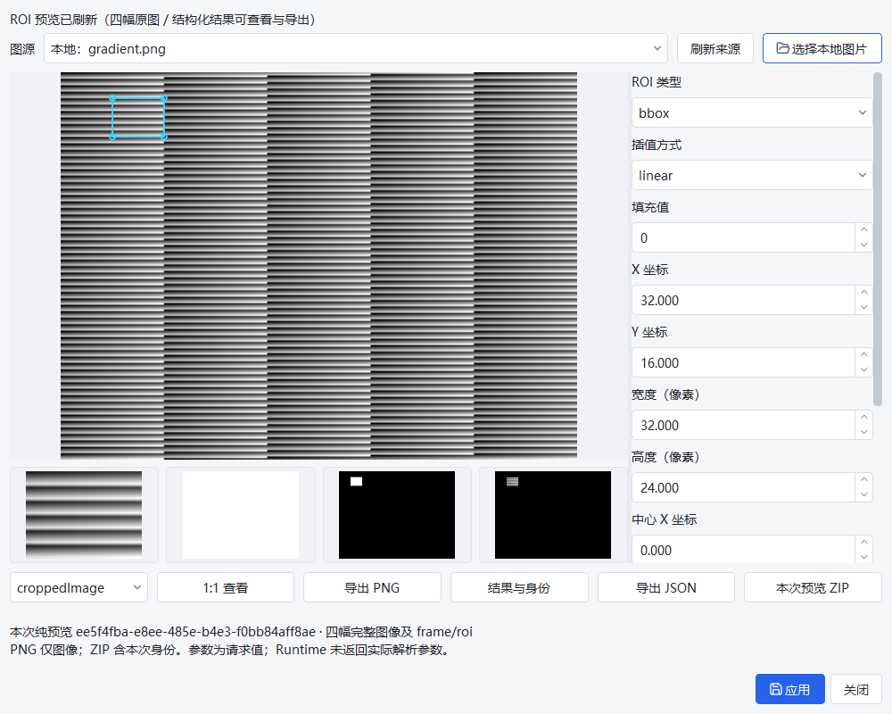
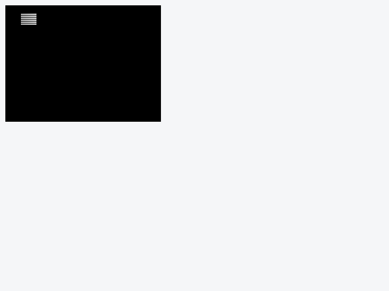
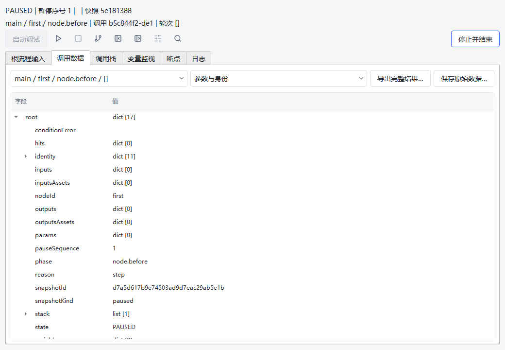
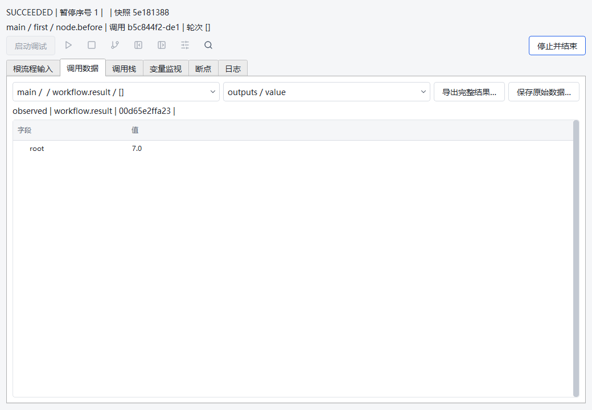
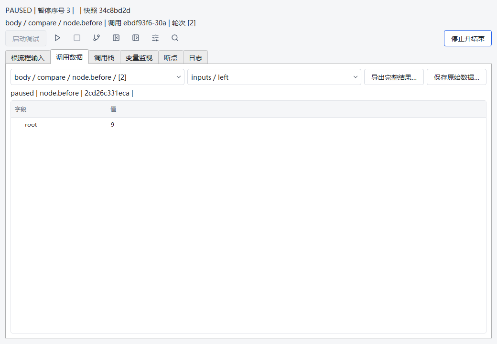
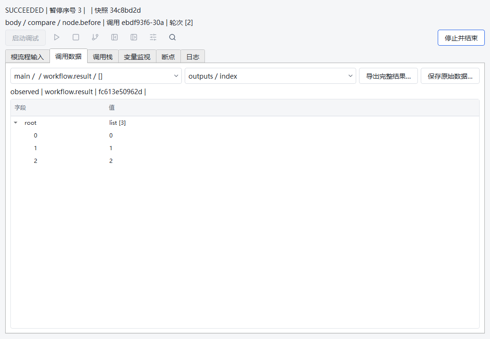

# abc7ae 验收后修复交付

- [修复与回归报告](REPORT.md)
- [机器验证账本](validation-summary.json)：不同平台/层级分别记录，不累加重叠数量。
- [dot 固定 SHA 复验提示词](DOT_HANDOFF_PROMPT.md)：复验 SHA 使用交付消息中的40位提交号。
- [最终冻结源文件 manifest](SOURCE_MANIFEST.json)：Windows 配置 checkout 的原始字节 SHA256；本文件的 SHA256 应为 `25eed17019f0ae13abea64c516ae6ad1957bd0e1e1d9b6134b29d9b380b7ade9`。它记录测试前5104文件，不包含测试后新增的本交付文档。
- [修改文件与 Git canonical blob](changed-source-manifest.json)：跨平台可能因 `core.autocrlf=true` 改变换行，比较 Git blob，不把 CRLF/LF 差异误当源码变化。
- [原工作区保留核验](workspace-preservation.json)：初始31个dirty文件，中途哈希全部一致；交付时并行工作更新6个并新增1个测试，当前32路径保留、原HEAD未移动。本轮未写原工作区，未把旧快照还原覆盖最新工作；原本地补丁不进入交付证据。
- [证据包索引](evidence-index.json)、[本轮证据 ZIP](repair-evidence.zip)：完整 final logs/JUnit、固定三轮各次结果和P0原始JSON、故障注入red/green、被中止候选及理由、原生截图/同预览ZIP、只读原首失败副本和辅助脚本。

本轮源码和隔离回归不等于包、发布、部署或 Debian13 人工桌面验收。原始68MB验收证据继续保留在 [abc7ae归档](../2026-10-11-abc7ae-acceptance/README.md) 的17分片内，不复制第二份、不覆盖首FAIL。

证据脚本包含当时环境绝对路径，只用于审计命令；不要无条件照搬或把历史操作当设备授权。对 ZIP 按索引验证 SHA256 后读取，不需要执行任何脚本。

## 最终 Windows 原生 Qt 渲染（自动化）

截图来自原生 `windows` Qt backend 和本地合成图像；文件选择/Discard 在测试中自动代答，不是人工 Debian/GTK 验收。

另有正式ForEach示例的D06条件断点长暂停（与上面的nested-workflow探针分开）：

