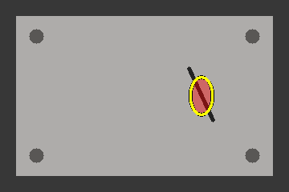

# PatchCore 疑似缺陷高亮验证记录

日期：2026-10-23，Asia/Shanghai。对应算子 `vision.inference.patchcore` **1.1.0**。
这是 [V1 验证](2026-10-23-patchcore-v1-validation.md)之后的显示扩展；不覆盖或改写原验证记录。
使用说明见 [PatchCore Inference](../patchcore-inference.md)。

## 实现范围

- 增加 `overlayMode=heatmap/highlight` 和仅用于显示的 `highlightThreshold`，默认分别为 `heatmap`、`0.7`。
- 高亮模式只在 NG 时绘制相对高响应区域，半透明红色填充、黑边黄色轮廓；其余位置保留原图。
- OK 输出原图副本；响应近似均匀时不强行生成位置，诊断为 `uniform_response`，不把 NG 改为 OK。
- 先去补边并还原，再在未量化的浮点响应上选取区域。原始 score、部署阈值、OK/NG、map、frame 不变。
- 复用 `overlay` 图像端口和通用参数表单；不新增 mask、缺陷坐标、缺陷数量或经校准的像素标签。
- 旧四参数节点打开后可切换新模式，未应用前不改写节点。默认整图 JET 与 0.6/0.4 叠加保持不变。
- 使用现有模式参数规则处理显示/校验与旧节点编辑，不新增 UI 框架或生命周期机制。

实际 HEAD：`577450fc19c60ac86989475d76838e952bcc3e86`。实现属于该 HEAD 上的未提交工作区，
不是此提交或已发布 EXE 已有功能。保留已有 YOLO、可选输出、编译器、设备和其他并行修改；
本轮只修改 PatchCore、模式表中的 PatchCore 条目及相关测试/说明。训练平台未修改。

环境：Python 3.10.21、PySide2 5.15.2.1、NumPy 1.26.4、OpenCV 4.10.0.84、
onnxruntime 1.23.2、onnx 1.16.0；使用现有 emo_master Conda 环境，未新增依赖。

## 最终验证

| 层次 | 结果 | 证据 |
| --- | --- | --- |
| PatchCore 专项 | **132 passed** | [patchcore-final.xml](patchcore-highlight-2026-10-23/patchcore-final.xml) |
| 插件/端口/YOLO/可选输出相关回归 | **176 passed，1 skipped** | [regression.xml](patchcore-highlight-2026-10-23/regression.xml) |
| Windows 原生 Qt 100% | **82 passed** | [native-100.xml](patchcore-highlight-2026-10-23/native-100.xml) |
| Windows 原生 Qt 150% | **82 passed** | [native-150.xml](patchcore-highlight-2026-10-23/native-150.xml) |
| Ruff | PASS | PatchCore 模块、模式表及本轮 Python 测试文件 |
| Mypy | PASS | PatchCore 6 个 Python 文件，`--follow-imports=silent`；非全仓检查 |
| `git diff --check` | PASS | 工作区已跟踪修改，仅出现既有 LF/CRLF 提示 |
| 实际业务模型及缺陷图片定位对照 | **NOT_RUN** | 未提供正式业务模型及对应图片，合成数据不能证明定位准确率 |
| 冻结 EXE、真实设备、提交/发布 | **NOT_RUN** | 不属于本次范围 |

各组有重复用例，不相加作为唯一测试数。跳过项为已有图标测试
`tests.core.plugin.test_icon_resources::testSymlinkCannotEscapeRoot`：当前环境不支持所需符号链接。

专项覆盖真实 CPU ORT 小型模型的定位显示、横竖/奇数尺寸、灰度及裁剪 frame、补边不参与定位、
多个区域/内部空洞/小响应点、原图不变、全常量 map 不造位置、未量化阈值边界、范围调节、
图像开关、原始 map 无损 JSON 往返、二进制 64 位相等及相邻阈值判定。
原 V1 加载、数值、取消和会话释放用例一并重跑，未用 mock 代替实际 ORT 推理。

工作流验证图片输入 → PatchCore → 布尔分支/数值写入/叠加图保存，确认保存图与历史图一致。
切换显示模式复用同一 Session。未启用的显示参数不阻断执行；重新启用后校验非法值。
工程沿用 2.7 默认创建链，完成校验、保存重读、编译及实际 Designer 打开；
兼容夹具只回退节点的四字段参数声明和算子依赖版本，不把新工程降级成旧 schema。

原生 Qt 两种缩放均检查 460/620 宽参数窗口、新旧节点保存重开、调试子进程的图像及历史结果。
截图已实际查看，参数文本/按钮无重叠，图像非空且高亮位置可见；这不是人工点击或冻结 EXE 验收。

## 显示示例

以下图像和响应都是测试构造的合成数据，仅展示显示样式，**不是实际缺陷检出效果或业务准确率证据**。

| 原整图热图叠加 | 疑似缺陷高亮叠加 |
| --- | --- |
|  |  |

界面截图：[100% 参数窗口](patchcore-highlight-2026-10-23/native-100/patchcore-highlight-parameters-460-legacy-True.png)、
[150% 参数窗口](patchcore-highlight-2026-10-23/native-150/patchcore-highlight-parameters-460-legacy-True.png)、
[原生调试高亮结果](patchcore-highlight-2026-10-23/native-100/patchcore-debug-overlay-highlight.png)。

## 中间失败记录

- 初次 Designer 兼容用例把依赖字典当对象访问，1 failed / 7 passed；修正测试为字典访问后通过。
- 首轮专项 [patchcore.xml](patchcore-highlight-2026-10-23/patchcore.xml) 为 130 passed / 2 failed。
  用例错误地从异常字符串查找错误码；修改为断言结构化 `issues[*].code == E_PARAM_INVALID`，保留强校验。
- [patchcore-concurrent-edit.xml](patchcore-highlight-2026-10-23/patchcore-concurrent-edit.xml) 为
  115 passed / 17 failed。运行中编译器与模式辅助模块发生并行更新，当前测试进程已缓存旧模块，
  导致导入 `requiredChoiceInput` 失败。确认磁盘两侧定义完整后重新启动测试，得到最终 132 passed；
  没有回退并行变更或通过 mock 绕开编译器。该轮失败记录保留，不计为通过。

## 复现入口

在仓库根目录的 Python 3.10 环境执行：

```powershell
python -m pytest -q tests/plugins/test_patchcore_inference_operator.py tests/plugins/test_patchcore_numeric.py tests/plugins/test_patchcore_highlight.py tests/runtime/test_patchcore_workflow.py tests/runtime/test_patchcore_debug.py tests/designer/test_patchcore_inference.py --timeout=60

python -m pytest -q tests/core/plugin tests/runtime/test_operator_registration.py tests/runtime/test_operator_port_specs.py tests/runtime/test_operator_output_contracts.py tests/plugins/test_yolo_inference_operator.py tests/runtime/test_optional_output_execution.py --timeout=60

$env:QT_QPA_PLATFORM = 'windows'
$env:QT_SCALE_FACTOR = '1'  # Repeat with 1.5.
python -m pytest -q tests/designer/test_patchcore_inference.py tests/designer/test_operator_modes.py tests/designer/test_yolo_parameter_presentation.py --timeout=60
```

设置 `EMO_PATCHCORE_SCREEN_DIR` 可输出截图和合成叠加 PNG，不指向旧 V1 证据目录。

最终关键文件 SHA-256（本机文件字节；模式表还包含其他任务保留的改动）：

| 文件 | SHA-256 |
| --- | --- |
| `patchcore_inference/operator.py` | `795B7CDEEA2C6334B2931DDE410EE89F35E40AAAC9F16A8E5603ECA79E654166` |
| `patchcore_inference/visualization.py` | `D0F9840CF0952D8A29D7994FB7008F9869139D314E392D700A1A941421716763` |
| `patchcore_inference/manifest.json` | `A23B131E144E2B3E3BEE595C2DADE0A745FAD132A04DA16D69B44095E80467B8` |
| `_operator_modes.py` | `0082CA135E8940E9C86B77690A38D561368769BAE134A50AD37F3864EA70A9E6` |
