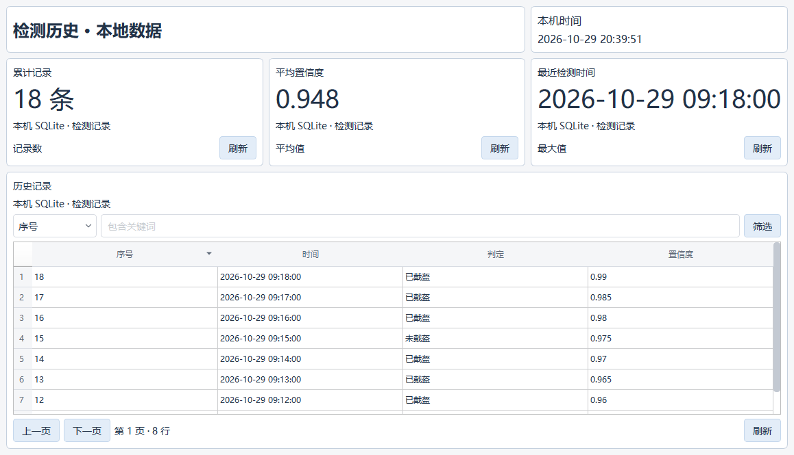

# 可选页面导航与本地 SQLite 组件验证

日期：2026-10-29。源码基点：`1d4a200f262bc2f15b14a555bf78f286930ba760`，
分支 `codex/logging-and-designer-improvements`；本次变更为该基点上的未提交工作区修改。
初始工作区干净，保留现存忽略的现场工程与历史测试材料，未提交、合并或发布。

## 完成范围

- 去掉 RuntimePages 的固定蓝色页面按钮横栏和预览中固定 54 px 导航占位。
- 单页直接显示内容；多页工具栏保留紧凑选择器，页面放置导航组件时隐藏重复入口。
- 组件库从 8 项增加到 13 项：新增页面标题、页面导航、日期时间、SQLite 历史表格、SQLite 统计。
- 数据库由用户选择已有文件、表或视图和字段；表格支持包含关键词筛选、排序、分页、刷新；
  统计支持记录数、求和、平均值、最小值、最大值。查询不写数据库。
- 设计/示例不读取数据库；“本地数据”预览不需要 Runtime Job，切换时恢复完整工程页面。
- SQLite 属性沿用草稿应用、撤销、重做、复制和保存；数据库文件不随工程打包。

## 已执行验证

Python 3.10.21 / PySide2 5.15.2.1。解释器：
`C:/Users/jsdfhasuh/.conda/envs/emo_master/python.exe`。

| 验证 | 结果与证据 |
| --- | --- |
| 初轮较大页面回归，Windows 原生 Qt，`tests/core/presentation tests/ui/presentation tests/ui/page_designer tests/ui/operator_view/test_view.py` | 564 passed、7 failed、4 errors；371.10 秒。[原始 JUnit](2026-10-29-page-local-components/regression-initial.xml)，不计为全绿。 |
| 本轮导航改动导致的交付探针失败 | `scripts/p5_view_probe.py` 仍访问旧 `.buttons`；修复，并同步 `p3_visual_check.py`。Windows 原生单独重跑 `testDesignerExportRelocatedStandalonePath`：1 passed，12.04 秒。 |
| 其余既有异常的固定源码复现 | 从上述 SHA 归档 `src`，同进程断言导入路径为隔离 baseline 后执行：6 failed、4 setup errors，与初轮其余异常一致。[JUnit](2026-10-29-page-local-components/baseline-existing-failures.xml)。本地 `.log` 沿既有忽略规则保留，不纳入 Git 交付。 |
| 最终针对性回归，offscreen Qt | 新组件模型、SQLite 查询及生命周期、标题/导航/时钟、SQLite 属性、当前任务/本地数据切换：51 passed，13.29 秒。[JUnit](2026-10-29-page-local-components/focused-final.xml)。 |
| 原生窗口与真实 Designer 打开入口 | 临时 2.7 工程由 WorkflowStore 创建，经 ProjectDocument 校验、saveProject 保存重读、WorkflowCompiler 编译及 MainWindow.loadProjectDirectory 打开；全部完成。 |
| 原生 SQLite 查阅 | 临时库 18 条；第一页 8 条；统计记录数 18、平均值 0.948；按判定筛选返回 3 条；切回示例禁用数据库读取。[记录](2026-10-29-page-local-components/native-check.json)。 |
| 静态检查 | 全部本轮变更的 Python 文件 Ruff 通过；`git diff --check` 通过。 |

初轮未解决的既有异常分别为：

1. `test_live_refresh.py` 的 4 个断言仍要求 tooltip 只等于 reason，但基点源码已经输出详细诊断。
2. `test_dispatch_live_page.py` 的 2 个正常运行测试在基点源码也进入配置 Runtime 的分支。
3. 本地现存 `test_migration_operator_pages.py` 的 4 个夹具在编译时缺少受管设备 Runtime 类型配置。
   该文件及其 two_station 工程是未跟踪/忽略的本地材料，不是 Git HEAD 自带测试；结论仅为
   同一现存夹具在 HEAD 源码下也发生初始化错误，未归因为本次组件改动。

上述 10 项保留为现存未通过记录，本轮没有改写这些测试或现场工程。

## 开发过程中的失败及修正

- 并行实现期间属性测试两项曾因 SQLite widget 文件尚未落地而报 ModuleNotFoundError；
  完整集成后已包含在最终通过测试中。
- 独立复查发现，从裁剪后的单流程观察切到本地数据时没有恢复其他页面；辅助反例在修复前失败。
  修复后专用测试验证完整页面恢复、切换期间零次数据库读取、点击刷新后才读取数据。
- 原生视觉脚本的前两次清理分别因造库连接未 close、测试窗口未 deleteLater 导致临时文件占用。
  修正脚本显式关闭连接和销毁窗口后，完整脚本退出码为 0；未把脚本清理失败当作产品查询失败。

## 视觉证据与边界

[完整预览窗口](2026-10-29-page-local-components/local-history-preview.png)；
[Designer 组件库与属性面板](2026-10-29-page-local-components/designer-sqlite-components.png)。
图中标题是主动添加的页面标题组件，不是固定横栏。

没有访问真实相机、PLC、现场数据库，也没有修改现场工程。没有执行完整仓库 CI、冻结 EXE
构建、安装升级或真实设备验收。源码修改需要重启源码版应用；已安装 EXE 需要重新构建/更新。
使用步骤见 [页面组件与 SQLite 历史查阅](../guides/page-local-sqlite.md)。
