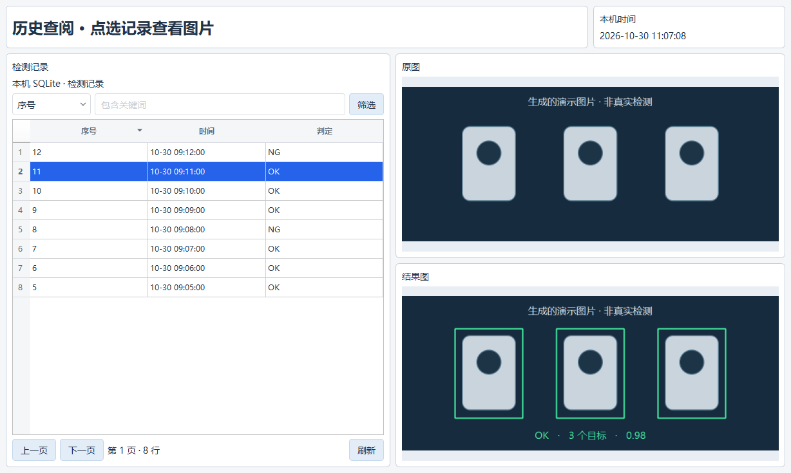
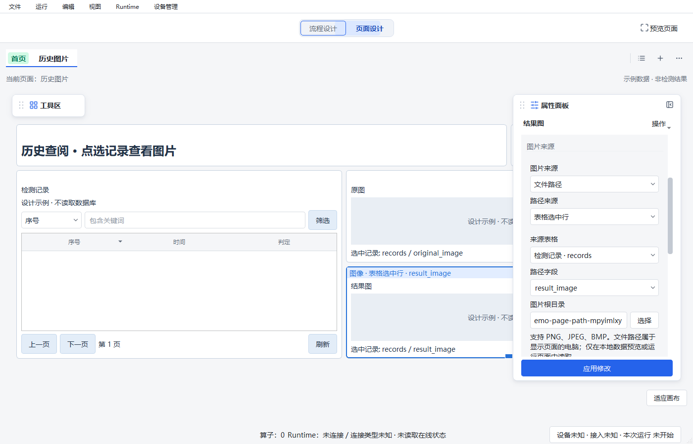

# 页面路径图片与 SQLite 选行联动验证

日期：2026-10-30。源码基线：`1d4a200f262bc2f15b14a555bf78f286930ba760` 加当前未提交工作区修改。
沿用现有 Qt QWidget 页面与后台查询机制；未提交、未构建 EXE、未部署。

## 实现范围

- 图像组件增加固定文件路径、同页 SQLite 表格选中行字段两种路径来源，保留流程结果和静态资源。
- 图像来源互斥；属性选择只修改表单，应用后进入工程草稿和撤销历史。
- 表格显式读取被图片引用的路径字段，可以不显示该字段；原图和结果图可分别绑定同一行。
- 本地路径在后台读取/解码，只采用最新请求；刷新、翻页、筛选、排序、切页清除选择和旧图。
- 路径图片复用 ImageView 和显示内存统计，不加入 Runtime 采集来源、结果身份或全局变量。
- 页面/容器复制重映射内部引用，单独复制图片保留原来源；删除表格可保存未完成草稿并在校验时报告。
- Image Saver 增加默认关闭的 `namingMode=unique`，输出路径带 UTC 时间和 UUID，独占创建文件；
  manifest/meta 为 1.2.0，固定命名和默认覆盖行为保持兼容。

## 验证环境和结果

解释器：`C:/Users/jsdfhasuh/.conda/envs/emo_master/python.exe`，Python 3.10.21 / PySide2 5.15.2.1。
数据库和图片均为测试临时生成；没有访问现场工程、已有业务数据库、相机或 PLC。

| 验证 | 结果 | 证据 / 范围 |
| --- | --- | --- |
| 核心 presentation、页面选行联动、SQLite/导航、属性、编辑命令、预览模式回归 | **289 passed** | [focused-final.xml](2026-10-30-page-path-images/focused-final.xml)，显式 `QT_QPA_PLATFORM=windows`。 |
| 路径图片、选行联动、图片属性最终定点回归 | **19 passed** | [latest-focused.xml](2026-10-30-page-path-images/latest-focused.xml)，含最后的解码限制与来源提示调整，显式 Windows Qt。与上一组部分重叠。 |
| Image Saver、Unicode I/O、Runtime、表单 | **50 passed** | 子任务工具输出；未另存 XML。 |
| Image Saver 保存后取消，fixed/unique | **2 passed** | 新增用例的定点执行；已保存文件保留且不重放写入。 |
| Archive、包构建/加载、ReleaseHost、隔离预览 | 首轮 **41 passed / 3 failed**，三项修正后 **3 passed** | 首轮在并行实现临时导入占位处失败；见下方保留记录。 |
| 实际 Windows Designer 打开、保存后重开、模型重读、编译与图片展示 | **通过** | [native-check.json](2026-10-30-page-path-images/native-check.json)、下方截图。 |
| Ruff、`git diff --check` | **通过** | 受影响文件检查，无格式错误；Git 提示 LF/CRLF 转换不计为失败。 |

主回归命令：

```powershell
$env:QT_QPA_PLATFORM='windows'
& 'C:/Users/jsdfhasuh/.conda/envs/emo_master/python.exe' -m pytest tests/core/presentation tests/ui/presentation/test_selected_row_images.py tests/ui/presentation/test_sqlite_components.py tests/ui/presentation/test_page_chrome.py tests/ui/page_designer/test_image_path_properties.py tests/ui/page_designer/test_editing.py tests/ui/page_designer/test_current_job_viewing.py tests/ui/page_designer/test_workspace_modes.py -q --junitxml=build/page-path-images/focused-final.xml
& 'C:/Users/jsdfhasuh/.conda/envs/emo_master/python.exe' -m pytest tests/ui/presentation/test_path_image.py tests/ui/presentation/test_selected_row_images.py tests/ui/page_designer/test_image_path_properties.py -q --junitxml=build/page-path-images/latest-focused.xml
```

Image Saver 相关命令（这些命令未显式设置 Windows Qt，不作为原生 UI 操作验收）：

```powershell
& 'C:/Users/jsdfhasuh/.conda/envs/emo_master/python.exe' -m pytest tests/plugins/test_image_saver_operator.py tests/plugins/test_unicode_image_io.py tests/runtime/test_image_saver_filename.py tests/designer/test_image_saver_form.py -q
& 'C:/Users/jsdfhasuh/.conda/envs/emo_master/python.exe' -m pytest tests/runtime/test_image_saver_filename.py::testCancellationAfterSaveKeepsFileAndDoesNotRepeatWrite -q
& 'C:/Users/jsdfhasuh/.conda/envs/emo_master/python.exe' -m pytest tests/plugins/test_detection_archive_operator.py tests/core/project/test_package_builder.py tests/core/project/test_delivery_store.py tests/runtime/test_release_host.py tests/ui/page_designer/test_preview.py -q
```

初次选行集成运行 **6 passed / 1 failed**：缺失来源的提示当时由下一次事件循环显示，测试立即断言。
保留 [integration-initial.xml](2026-10-30-page-path-images/integration-initial.xml)。后续路径无 I/O
校验改为同步显示，测试也明确等待目标诊断；最终集成测试包含在上述两组通过结果中。

Image Saver 关联测试的首次 3 个失败均为 `ModuleNotFoundError: sqlite_reader_placeholder`，
发生于并行实现的 renderer 临时占位导入。实际连接方法落地后定点补跑，以下三项均通过：

- `testDraftOnSameRuntimeReloadObserveAndAsyncExit`
- `testBorrowedJobClosingDesignerLeavesRuntimeAndOtherObserver`
- `testProjectSwitchWhileStartCompletesFencesLateAttach`

本次未重复全仓测试。[前一轮页面组件报告](2026-10-29-page-local-components.md)中已在 HEAD
复现的 6 个失败和 4 个 setup errors 保留为此前基线证据，本报告不把它们记为本次通过。

## Windows 原生界面检查

[复现脚本](2026-10-30-page-path-images/native_check.py) 使用 `WorkflowStore().toPayload()` 创建
完整 2.7 临时工程，经 ProjectDocument 校验、saveProject 保存、loadProjectDocument 重读及
WorkflowCompiler 编译后，通过实际 MainWindow 打开、保存并再次打开。

上述截图与 JSON 是当时 2.7 格式的历史结果。工作区整理时复现脚本的当前格式断言已随
WorkflowStore 默认值更新为 2.8；没有重新运行脚本覆盖这组历史证据。

预览切到“本地数据”后，表格只显示序号、时间、判定，点选记录时两个独立图像组件分别读取
隐藏字段 `original_image` 和 `result_image`。翻页立即清图；切回示例数据后不再读取图片。
检查未启动 Runtime 任务，图中的物体为脚本生成的示例图片，不代表真实视觉算法验收。





## 使用边界

- 文件位于显示页面的电脑，不随工程资源自动打包或通过 Runtime 远程读取。
- 支持 PNG/JPEG/BMP；编码文件不超过 8 MiB、源图最多 32 Mi 像素、单张保留图像不超过 8 MiB。
  JPEG 可在解码时缩小，PNG/BMP 的完整解码平面必须在可用预算内。
- 相对路径需要明确图片根目录；HTTP、UNC 和 SQLite BLOB 不作为此组件的路径来源。
- 本次是源码、自动化和原生 Qt 界面验证，未做冻结 EXE 验证或现场设备验收。

配置步骤见 [页面组件与 SQLite 历史查阅](../guides/page-local-sqlite.md)。
