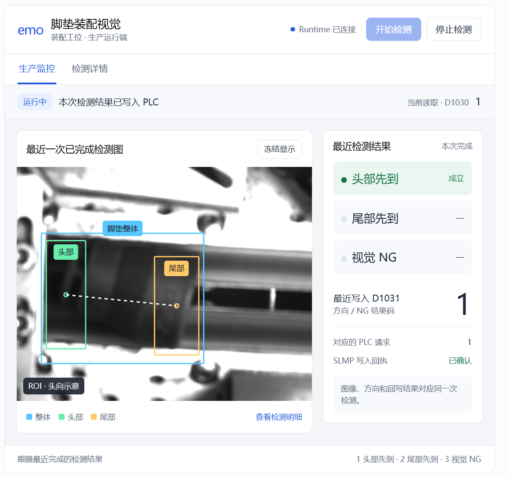
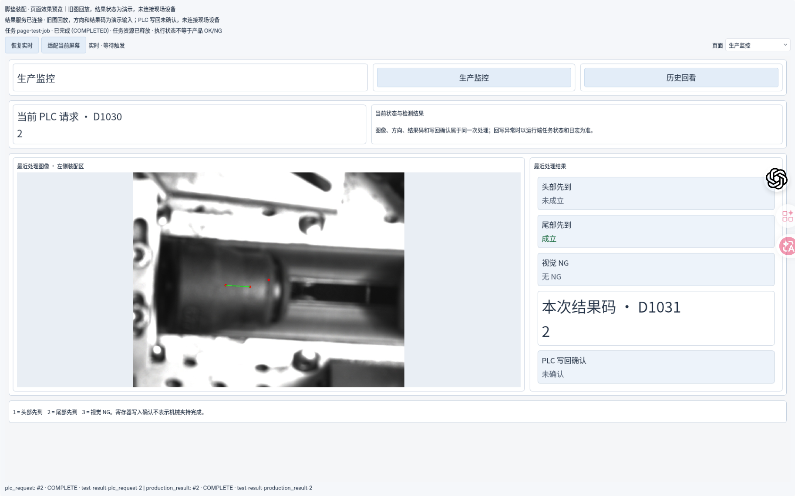
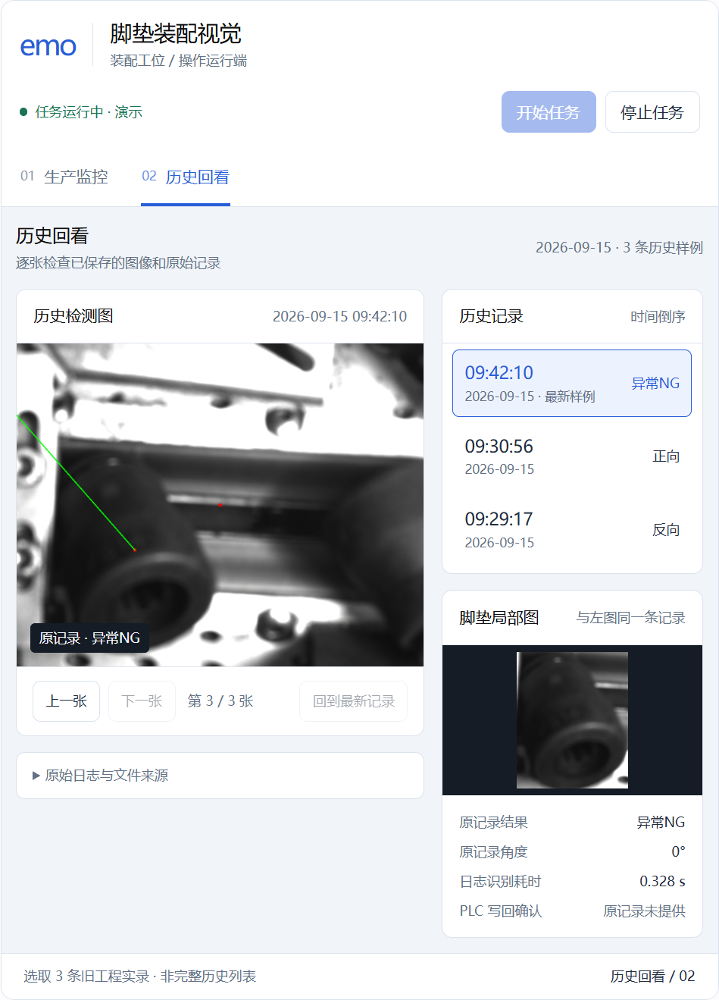

# 参考图与可编辑布局参数

**V1.2：直接使用当前2.10/1.3正式格式和统一外观默认，无旧工程迁移或旧样式兼容。**

三张图片由用户在本次讨论提供，原样保留。第一和第三张是结构与表现目标，第二张是现状。下述参数用于生成一个可继续编辑的双页工程；它们是工程配置，不是新的专用控件或写死在渲染器里的坐标。截图中的业务名称、寄存器地址和码值不作为平台默认或实际设备协议。

## 1. 共用外观与尺寸

生产监控和历史回看使用同一份 appearance、shell 和语义色。当前默认统一为紧凑页头、诊断收起、容器card、叶子none、主题字号和aspect图像；纯布局容器明确设为none。工程中填写下列起始参数，用户可以通过已有页面设置和组件属性继续调整。

| 范围 | 样例起始配置 | 目的 |
| --- | --- | --- |
| 页面内容 | `contentMaxWidth=1200`、`pagePadding=24`，居中；宿主页头内容与主内容对齐 | 大屏不把图像和侧栏无限拉开 |
| 主区域 | 水平 responsive，`spacing=24`、`alignment=start` | 两列顶端对齐，内容各自决定高度 |
| 普通卡片 | `surface.kind=card`、圆角 12、细边框；普通内容 padding 20 | 一个区域保留一层边界 |
| 图像卡外层 | padding 四侧为 0，`props.title` 留空 | 标题、图像、页脚分别组合，避免内外重复标题和内边距 |
| 图像卡标题/页脚 | 普通无装饰容器；左右 padding 20，上下 16 | 图像占满中段，文字和操作保留留白 |
| 无装饰文字、图例、计数 | `minWidth=0`、`minHeight=0`、`preferredWidth=0`、`preferredHeight=0`；padding 为 0；小型并排行使用 `width=content` | 由实际字体内容决定尺寸，避免默认 160×64 占位 |
| 页面标题 / 卡片标题 | 24 / 20 逻辑像素，适当加粗 | 区分页面与区域标题 |
| 正文 / 辅助说明 | 16 / 14 逻辑像素；辅助使用次文字色 | 正文可读，说明不抢占空间 |
| 大数值 | value 56、title 16、helper 14；horizontal valueLayout | 只突出主值，名称不随之放大 |
| 常规操作按钮 | 最小高度 36，主操作 44；行内间距 8–12 | 操作易点击，避免大块按钮充满整行 |
| 主检测图 | `imageView.sizing=aspect`、`aspectRatio=1.26`、contain | 保持接近参考图的主图区域比例 |
| 局部图 | `aspectRatio=16/9`，序列化为正数；contain、dark 背景 | 局部图完整显示，左右留白有明确背景 |
| 内容间距 | 一般纵向 16；同组字段 10–12；历史左右子卡 20 | 形成一致且紧凑的节奏 |

主列自身保留下一节的合理最小宽度，不能把所有容器都设为 minWidth=0。子字段的 content 宽度与主列的 fill 宽度分别使用已有 responsive 属性。`preferredWidth=0` 表示使用既有内容测量回退，不增加新的宽度语法。

这些尺寸需要真实进入 Qt 的 sizeHint、minimumSize 和 heightForWidth，以及 Designer 的候选测量。基线的 `ResponsiveItem` 默认 minHeight=64、minWidth=160，`ResponsiveWidgetLayout` 还有固定边距/尺寸加成；当前创建与测量直接采用紧凑规则，样例再明确配置主列宽度和控件尺寸；不保留旧卡片大小或旧外观分支。基线事实见 [models.py](https://github.com/jsdfhasuh/emo_master/blob/31afa5ecab8b7ddb53f0d6bdedc620f0a243e340/src/emo_panel_protocol/models.py) 与 [responsive_layout.py](https://github.com/jsdfhasuh/emo_master/blob/31afa5ecab8b7ddb53f0d6bdedc620f0a243e340/src/emo_master/ui/presentation/responsive_layout.py)。

Designer 的来源提示和选择辅助沿用现有提示/画布机制，不给业务内容额外添加顶部 28 像素或底部 bindingHint 行。选择前后、拖放预览与运行显示的业务内容区域应一致。

## 2. 生产监控目标

### 2.1 页面结构

页头由现有宿主承载 Logo、标题、副标题、实时连接和开始/停止；主导航使用正式 pageOrder/currentPage，名称为“生产监控 / 历史回看”。页面内有显式 page_navigation 时沿用既有规则隐藏宿主导航，否则使用宿主导航；导航类型按已有 navigation.mode 显示。

页面主体依次为紧凑状态行、左右主区、简短页脚。左侧是主图卡，右侧是结果卡；状态行和各卡内部的叶子组件都使用无装饰表面。

| 组件位置 | 普通组件组合与绑定 | 样例布局配置 |
| --- | --- | --- |
| 状态行 | 无装饰 container + runtime_status + text/number | horizontal，space-between，padding 16；宿主运行状态与本次结果摘要分别取值 |
| 左侧主图卡 | container → 标题操作行、image、图例操作行 | fill、`minWidth=560`、`weight=2`、顶部对齐；外层 padding 0 |
| 主图卡标题行 | text + navigation_button | horizontal、space-between；左标题 20，右侧冻结按钮 36 高 |
| 主图 | 无标题的 image，绑定同次 Annotate 输出 | 比例 1.26、contain、padding 0；不再套一层独立图像卡 |
| 主图卡页脚 | 图例小组 + link 外观的 navigation_button | horizontal、space-between；图例和链接使用 content 尺寸 |
| 右侧结果卡 | container → 标题行、三个 indicator、大数值、普通字段、辅助说明 | fill、`minWidth=320`、`weight=1`、顶部对齐，padding 20 |
| 三个判定行 | 三个 indicator(row) | 各自最小高度 64；名称 22、状态词 16；行间距 12，状态背景与映射一致 |
| 大结果值 | number，horizontal valueLayout | value 56、title 16、helper 14；按业务配置单位及精度 |
| 请求 / 回执等字段 | 普通 text、number 或 indicator 横排 | minHeight 0，组内间距 10–12；名称与值位于两端 |
| 辅助说明 | text 放入浅底无边框容器 | 14 号字、padding 12，自然换行 |

主区可用宽度不足 `560 + 320 + 24 = 904` 逻辑像素时，已有 responsive 按顺序把右栏换到下一行。2:1 是剩余空间的分配权重，结合上述最小宽度形成约 64:36 的宽屏结构，不宣称所有窗口都为精确比例。

三个判定行的名称和映射仍由工程配置，可表示方向、分类、尺寸或其他业务结果。图像、判定、本次请求和实际回执使用同一结果作用域；实时连接状态继续从宿主读取。只有明确的数据来源支持时才展示“当前请求”，不为示例标题增加寄存器轮询机制。

图框、中文标签、颜色和线条由 Annotate 生成到结果图，生产页显示这份图，ImageSaver 保存的也是这份图。图例颜色与样例中实际 classStyles 配置对应。

## 3. 现状对比

此次改进的重点是单层卡片、紧凑内容测量、独立文字层级和清楚的主次区域。页头只呈现必要状态与操作；技术身份、资源释放和原始诊断进入现有可展开区域。示例保留一个清楚的“演示”标识。

当前图中的“结果服务已连接”“任务完成”“PLC 回执未确认”表达不同事实。新外观按各自来源显示，缺少回执时使用普通中性占位，不把诊断文字统一改成成功状态。

## 4. 历史回看目标

### 4.1 页面结构

历史页继续使用同一宿主页头和页签。页面内先显示标题/简短说明，再显示左右主区。左列包含主图卡和日志折叠组；右列包含历史记录列表和局部图详情卡。

| 组件位置 | 普通组件组合与引用 | 样例布局配置 |
| --- | --- | --- |
| 左列 | 无装饰纵向 container → 历史主图卡、日志折叠组 | fill、`minWidth=520`、`weight=1.6`；纵向间距 20，顶部对齐 |
| 历史主图卡 | card → 标题时间行、image、浏览操作行 | 外层 padding 0；标题和页脚按共用参数留白 |
| 标题与时间 | 两个 text，时间使用 recordValue | horizontal、space-between；20 / 14 号字，绑定当前记录 |
| 主图 | imagePath.selected_row 指向记录组件 | 比例 1.26、contain，读取该条实际保存的主图 |
| 浏览操作行 | previous、next、位置/数量、first | 间距 8，按钮高 36，必要时自然换行；componentId 显式指向历史组件 |
| 位置与数量 | 两个 number(meta=position/count) 和分隔 text | decimals=0、minWidth/minHeight=0、content 宽度，显示 `1 / N`；无总数时保留普通占位 |
| 日志组 | collapse container + text | 初始折叠、minHeight 0；只剩标题入口的高度，展开读取该记录日志字段 |
| 右列 | 无装饰纵向 container → 列表卡、局部图详情卡 | fill、`minWidth=320`、`weight=1`；纵向间距 20，顶部对齐 |
| 历史列表 | sqlite_table 的 list 变体 | `pageSize=3`；时间为 title，日期为 subtitle，结果为 trailing；选中项使用主色浅底与边界 |
| 局部图详情卡 | card → 标题行、局部 image、字段组 | 外层 padding 0；局部图比例 16/9、contain、dark 背景；字段组 padding 20 |
| 原记录字段 | text/number/indicator，recordValue 指向相同记录组件 | 横排，名称和值分开；每行 minHeight 0，组内间距 10–12 |

主区可用宽度不足 `520 + 320 + 24 = 864` 逻辑像素时按原布局规则换行。1.6:1 为剩余空间分配权重，宽屏呈现约 62:38 的主次关系；右列自身是纵向布局，不用等高拉伸填满左图。

时间和日期可以来自声明 SQLite VIEW 的普通展示列。VIEW 投影原记录中的时间字段并保留稳定键；列表继续读取声明 columns，不增加日期格式 DSL 或页面任意 SQL。完整时间也可直接作为普通文字字段显示。

### 4.2 记录行为与文字

- 示例按时间倒序，首条最新记录的位置为 `1/N`；table/list统一在首次非空查询时选中首条，空集合无选择。
- “上一条 / 下一条”对应当前查询排序的前后记录；不混用“更早”与“上一条”的概念。
- “回到最新记录”在该倒序示例中使用 history_first，刷新当前筛选的首页；当前已在首条时也能取得后来写入的记录。
- 主图、局部图、结果、时间、日志均由同一条选择驱动。页面切换和生产新增记录不抢走当前历史选择。
- 未提供的回执、角度或原始字段使用配置的中性占位，不以任务完成或历史浏览动作推导新的业务结果。

## 5. 同一模拟生产写入同一历史

交付工程包含初始历史表结构以及需要的声明 VIEW。记录由实际模拟工作流产生，使用已有算子和正式运行入口：

1. 从允许使用的样例图像和明确模拟字段产生一次结果；以三个业务枚举值展示不同状态，页面清楚标注演示来源。
2. Annotate 形成主结果图，现有流程形成局部图；主图和局部图分别通过 ImageSaver 保存，使用其实际 `result.path` 输出。
3. SQLiteWriter 通过现有字段映射，将这两个 FILE_REFERENCE、结果码、时间、需要的测量/日志字段和同次流程身份写入声明表。写入依赖实际保存结果，不从约定文件名猜路径。
4. 历史页查询同一表或其声明 VIEW，使用稳定记录键选中这条记录；Qt 与 Web 经现有历史接口读取同一图片和标量。

示例先运行产生 5 条记录，list 每页 3 条，既能表现参考图的三条列表，也能实际跨一页。随后再运行产生第 6 条，用户可通过刷新查看刚完成的结果，同时使用原有记录继续演示邻条浏览；不以独立预置库冒充生产归档。

该链路复用基线 [ImageSaver](https://github.com/jsdfhasuh/emo_master/blob/31afa5ecab8b7ddb53f0d6bdedc620f0a243e340/src/emo_master/plugins/builtins/image_saver/operator.py) 的保存结果与 [SQLiteWriter](https://github.com/jsdfhasuh/emo_master/blob/31afa5ecab8b7ddb53f0d6bdedc620f0a243e340/src/emo_master/plugins/builtins/sqlite_writer/operator.py) 的同次输出映射。数据库记录写入确认与设备回执分别表达；这里不连接真实 PLC 或相机，也不改变原算法。

用户可以在这个双页工程里把一个字段改为测量值、修改单位和状态映射，再保存重开以检查通用性。无需创建第二个工程或新增 palette 组件树预设机制。

## 6. 正常编辑与展示范围

页面设置中可编辑 appearance、shell；组件面板可编辑各自样式、来源和动作。属性组明确显示“继承主题 / 自定义”，允许恢复当前默认；修改一个字段不会改变其他属性组的继承或显式配置选择。普通撤销、保存重开都针对当前格式，不包含版本迁移事务。

上述起始参数用于确保一次实际实现得到主次比例和紧凑层级，不要求复制参考图每个像素。两端保持相同区域顺序、绑定、状态色、选择和操作含义，允许字体渲染差异与正常滚动。

最终使用同一个正式工程完成 acceptance.md 的三个用户旅程，输出实际 Qt/Web 生产页与历史页截图。原始参考图片继续保留为对照，不作为实现结果；同一次编辑、保存、运行和发布可共同支撑多项要求，不重复建立验收链路。
