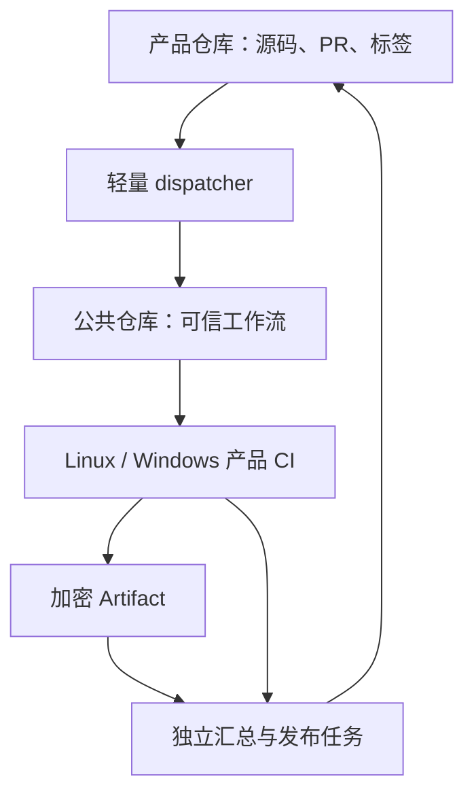

# 完整设计：公共仓库 Token 取源与全量产品 CI

## 1. 基线和决策

- 产品审查基线：`82a1aa6d8499ee203ea8e452c2f016db37ea7b3f`。
- 计划修订父提交：`39ac1bfb6fe606fa633ca565cb18e8b5f7550555`；PR #21。
- 产品 main 从 `b75df0a` 到 `82a1aa6` 的工作流、AGENTS.md、ci_scope.py 和 release workflow contract 未变；产品代码／测试有变化，旧测试数量不可直接沿用。
- 审查时产品仓库仍 Public，main 的 protected=false；目标 Private 和强制门禁属于迁移实施项，不能写成已有状态。
- 当前 12 个活动工作流、4 个历史归档工作流。外部 packager 固定 `91766f6d18ca9a333f64cf1c6030202457ec4a8a`。
- 用户最终要求：完整迁移，公共 Secrets 中 Token 直连取源，排除自托管 Runner。合成项目仅用于最早联调。

## 2. 最少组件



所有节点的执行环境都是 GitHub 托管服务；测试、诊断、构建、验证、汇总与发布 job 均归公共 `emo_master_ci`。产品端 dispatcher 只是短控制任务，会有少量私有 Actions 用量，不承诺零控制成本。

不增加 GitHub App、Webhook 服务、Workers、D1、R2、自建机器或常驻控制进程。原 `python_build_scripts` 继续作为受固定版本控制的公共打包工具仓库。

## 3. 凭据与权限

全部 fine-grained PAT 只选择所需目标仓库，设置有限有效期，记录到期日和轮换方式。不得将 Token 写入 Git、dispatch 输入、命令行 URL、日志或 Artifact，也不使用覆盖所有仓库的 classic PAT。

| 配置 | 保存位置 | 最小权限／用途 |
|---|---|---|
| `PUBLIC_CI_DISPATCH_TOKEN` | 产品仓库 Actions Secret | 只选 emo_master_ci；Actions: write；触发指定公共 workflow |
| `PRODUCT_READ_TOKEN` | 公共仓库受保护的 source-read、ci-control、release environment；配置同一限定只读 PAT | 只选 emo_master；Contents: read、Actions: read、Pull requests: read；产品 jobs 取源，控制 jobs 读取可信请求与核实 PR／标签 |
| `PRODUCT_STATUS_TOKEN` | 公共仓库 ci-control environment | 只选 emo_master；Commit statuses: write；独立控制 job 回写状态 |
| `PRODUCT_RELEASE_TOKEN` | 公共仓库 release environment | 只选产品发布仓库；Contents: write；仅独立 publisher 使用 |
| `CI_EVIDENCE_IDENTITY` | 公共仓库 ci-control / release environment，另有用户离线备份 | age 解密私钥，仅可信汇总／发布代码可读 |
| `CI_EVIDENCE_RECIPIENT` | 公共仓库变量／受审配置 | age 公钥，可公开，产品执行 job 只能取得公钥 |

产品 dispatcher 使用自身 `GITHUB_TOKEN` 的 contents: read / statuses: write；请求描述使用当前 run 的 Artifact。公共 job 的 `GITHUB_TOKEN` 默认 contents: read，控制任务按实际 API 增加 actions: read；不需要 id-token: write。

Environment 仅允许可信公共默认分支／批准的固定 tag；公共工作流及控制脚本通过代码审查，第三方 Action 固定真实完整 SHA。不能把环境名称当作不可绕过的身份认证：能修改并合入可信工作流的维护者处于信任边界内。

Contents: write 不仅限 Release；通过只在干净 publisher job 中使用来缩小暴露面。PAT 不是按某个 SHA 授权；固定 SHA 是可信控制逻辑的约束。Token 到期视为明确运行失败，不自动提升权限或改用其他凭据。

## 4. 产品事件如何触发公共 CI

### 4.1 产品端只留一个短工作流

新增 `.github/workflows/dispatch-public-ci.yml`，统一覆盖原 12 项的 push / PR / tag / 手动入口和各自过滤规则：

1. 使用固定可信控制代码读取事件元数据、确定套件与准确源身份，不安装产品依赖、不执行产品脚本。
2. PR 可使用 `pull_request_target` 做纯元数据调度，代码来自目标分支；此 job 不 checkout 或执行 PR 内容。未知 fork 不自动取得产品源码／权限，维护者批准具体 SHA 后才调度。
3. push 与标签按原分支／路径策略路由；原仅手动的 stop 诊断仍仅手动。手动入口保留 suite、source_ref、packager_ref 等现有参数能力，参数取白名单和合理范围。
4. 生成小型 `request.json`，上传到 `ci-request-<run_id>-<run_attempt>` Artifact；只含执行描述，不含源码或 Token。使用上传返回的 Artifact ID 调度，重跑创建新名称／ID，不覆盖旧 attempt 请求。
5. 将所需产品状态设为 pending，调用公共 `workflow_dispatch`，输入仅为产品 dispatcher run ID 和 request artifact ID。
6. 获取公共 run ID 后更新 pending 的 target_url，随即结束，不在私有 job 等待产品测试完成。

使用 GitHub REST API 版本 `2026-03-10`；当前官方 workflow dispatch 返回 200 与 workflow_run_id / URL，ref 为 branch 或 tag。实施时实测，不沿用旧版必然 204 的假设。[2]

### 4.2 请求描述与校验

请求至少包括：

```json
{
  "schema_version": 1,
  "request_id": "<product-run-id>-<attempt>",
  "source_repository_id": "<fixed-product-repository-id>",
  "source_event_name": "pull_request",
  "source_ref": "<original-product-ref>",
  "source_head_sha": "<40-hex>",
  "source_base_sha": "<40-hex-or-null>",
  "source_before_sha": "<40-hex-or-null>",
  "source_merge_sha": "<40-hex-or-null>",
  "check_sha": "<product-gate-sha>",
  "source_pr_number": 0,
  "source_tag": null,
  "ci_workflow_sha": "<approved-public-workflow-sha>",
  "packager_sha": "<approved-packager-sha>",
  "suites": ["source"],
  "manual_inputs": {}
}
```

这是协议示例，不是可直接使用的真实请求。

公共 preflight 固定产品 repository ID，使用只读 Token 读取该 run 与请求 Artifact；核实 dispatcher workflow ID、可信执行版本、事件类型、Artifact 所属 run／digest、PR／标签状态以及 suite 白名单。不能接受任意仓库／下载地址，不能把请求 Artifact 中自称的权限或 PASS 当可信结论。

公共 workflow 从受保护默认分支的批准版本运行；核实实际 workflow SHA 与请求一致，防止公共 ref 移动后执行未审版本。源事件文件仅留在私有工作目录；公开输出只提供通用请求标识和状态。

请求描述留在产品仓库 Artifact，使产品转为 Private 后元数据也受仓库权限保护；公共端不需要额外数据库或 HMAC 服务。

## 5. 直接 Token 取源与上下文适配

各产品执行 job 直接 checkout 固定 `jsdfhasuh/emo_master` 的完整 execution SHA，Token 仅传给取源步骤，使用 `persist-credentials: false`，放入独立 `product/` 路径。CI 工具仓库与产品工作目录不能混用。

在凭据清理前取得 scope 所需 before / base / merge 提交与必要历史；否则 ci_scope 后续 git fetch 可能失败。release 路由保留 fetch-depth: 0 和必要标签，供 HEAD、clean checkout、previous source 和发布说明生成使用。保留真实 .git 元数据与产品 HEAD，不以缺失 Git 身份的 tarball 替代。82a1aa6 未发现 .gitmodules 或 filter=lfs 声明；开工仍核对目标版本，不自动开启外部子仓库取源。

| 值 | 用法 |
|---|---|
| 公共 `github.sha` | CI 控制工作流的版本；不能当产品版本 |
| 产品 head SHA | PR 原始提交；冻结包路径保留原 head 构建语义 |
| 产品 merge SHA | 主源码 PR CI 原先测试的合并提交；核实其父提交对应 head / base |
| execution SHA | 每个 suite 实际 checkout 的提交，由原语义决定 |
| check SHA | 产品 PR 门禁的提交；与 execution SHA 分开记录 |
| 产品原事件 | 决定 scope、Web 手动全量、标签发布和并发语义 |

新增明确的 `--event-context` / `EMO_CI_CONTEXT` 输入，适配 `scripts/ci_scope.py`；保留原 GitHub 事件读取作为过渡期兼容入口。不全局伪造 `GITHUB_*`。未知路径仍走 full，不能因公共触发均为 workflow_dispatch 而把所有产品事件误判为手动。

具体修正包括 Web 的 FULL_WEB_LOGIC、credit 的 expected-sha、SQLite 控制的 repo 路径、构建 source_ref / release_repo / tag。逐项位置见迁移矩阵。

## 6. PR 状态和门禁

采用 Commit Status API，状态仅 pending / success / failure / error，fine-grained PAT 支持 Commit statuses: write。[3]

新 context 使用独立前缀，例如 `public-ci/source-linux`、`public-ci/source-windows`，不与旧 Actions Check Run 同名；同名 check 与 status 可能都被要求通过，不能留下永久 pending。[4]

PR 门禁使用经核实的 test-merge SHA；主源码执行该 merge，冻结包保留执行 head 的原语义，并在状态描述／私密证据中明确 execution SHA。两者均绑定同一个 head / base 组合。所有该 PR 的必需 context 都写入统一 check SHA，不能一部分写 head、一部分写 merge 导致 GitHub 选择 merge 后缺项。无可合并 SHA 时报告冲突，不伪造可放行的合并结果。

head 或 base 改变后旧组合不满足新门禁。按原触发和严格分支策略更新 PR／重新调度，避免无条件对所有 PR 反复全跑；至少实测一次新 head 和一次 base 更新后的阻断／重跑。

独立 reporter 在新 Runner 上运行，只执行公共仓库中固定、受审的解析与状态代码，不执行产品脚本或下载包内代码。它根据：

- 可信产品请求与当前 PR／标签身份；
- 公共 workflow ID / SHA、run ID / attempt 和 GitHub API 的预期 job 真实结果；
- 必需报告的存在性、完整性与原分片集合不变量；

决定状态，不能只相信报告里的 PASS。scope 合法跳过可按原策略报告“无需源码全测”的成功摘要；测试未执行、失败、取消、超时或缺少必需证据不能冒称通过。

保留原 concurrency：自动验证可取消过期运行，手动与诊断按原策略不取消。公共请求、汇总与 reporter 使用一致的并发分组，并检查当前 pending 请求标记与 run 关联，拒绝旧请求覆盖新请求。不同产品 SHA 的状态绝不串用；重跑按实际 attempt 取证。

reporter 使用 `if: always()` 处理正常失败，但不承诺整条 workflow 被取消后一定运行。全局取消留下 pending 时门禁仍阻断，交付记录明确“未完成／需重跑”；使用 GitHub 原生重跑处理，不新增通用对账平台。可在正常控制收尾机会将取消写为 error。

切换 required status 时检查 GitHub 账户支持 Private 分支保护；个人 Free 与 Pro 能力不同，不能把 ChatGPT Pro 当 GitHub Pro。PAT status 不提供独立 GitHub App 来源绑定；本版基于可信维护者权限，不能宣称 App 级来源保证。

## 7. 日志与 Artifact：保留完整证据，不公开明文

公共仓库日志和 Artifact 不作为私有空间。直接取源不会自动公开整个工作目录，但脚本输出、cache 和上传行为可能披露内容。[5][6]

采用一个成熟的加密工具 age，不自行设计密码协议：

1. 公共执行器把产品安装／测试／诊断／打包的 stdout、stderr 和原始报告收集到本地文件。关闭 shell trace；公开仅打印阶段、平台、计数和通用错误类别。
2. 产品子进程的 GITHUB_STEP_SUMMARY / OUTPUT 等文件指向局部文件，控制器只转出允许的字段，避免无意把诊断内容直接写进公开摘要；这只是常规输出治理，不是恶意进程沙箱。
3. 先打包日志、JUnit、节点清单、截图与必要产物，再用 `CI_EVIDENCE_RECIPIENT` 加密。文件名、内层路径及详细 manifest 放入密文包。
4. `upload-artifact` 仅允许明确的 `*.tar.age` 文件；不使用工作区通配符，不上传明文失败日志。不缓存产品源码或包含产品文件的虚拟环境。
5. Artifact 外部名称只含 run / attempt / 平台 / job 槽位，记录密文 digest、来源 job、size 和 key ID。保留期沿用原必要范围，通常 7–14 天，避免无依据延长。
6. 可信汇总／publisher 按确切 run / attempt / artifact ID 读取密文，解密后校验内层源 SHA、目标、文件 hash 与允许路径。安全解析归档，拒绝越界路径，不执行其中程序。
7. 管理员可下载密文后本地解密查阅完整错误；交付下载／解密命令与私钥离线备份说明。轮换密钥时保留对应旧私钥直到所需历史证据到期。

公钥只负责加密，测试 job 不持有解密私钥。密文 Artifact 仍是公开可下载的密文，其保密依赖私钥安全；加密不是上传者身份签名，报告来源必须用 GitHub run/job 绑定核实。加密失败时保留失败结论，不回退上传明文。

### 跨 job 包验证

为避免把解密私钥交给会执行产品程序的 job，将同一目标的“构建 → 解压／启动冻结包验证 → 采集证据”放在同一个 Windows job，完成后才加密上传。Designer 与 Runtime 可分别并行。保持原验证步骤和时限，实测确认合并后的正常运行低于 GitHub-hosted 单 job 限额。

测试分片之间只交换加密报告；可信汇总器解密 JSON / JUnit 并验证集合，不运行产品测试代码。它的实现与原 `ci_shard_summary.py` 的数据契约和断言保持等价。

## 8. 全量任务与外部打包改造

12 项全部迁移，具体表见 [workflow-migration.md](workflow-migration.md)。原 4 个归档 YAML 不恢复。

外部固定 `91766f6` 不可原样用于公共 caller：它会上传原始 build.log、请求、诊断和包，还使用 caller 的 repository / SHA 及 secrets: inherit。

在 `python_build_scripts` 新增受控版本／入口，保留其他项目原入口：

- 明确 source repository、execution SHA、source tag、release repository、packager SHA。
- build-only 路径不接受发布 Token；输出模式改为本地验证后 age 加密 Artifact。
- 同目标 build 与执行包验证同 job；可信 publisher 单独下载／解密／校验／上传。
- 不再向 build 传 RELEASE_REPO_TOKEN 或 secrets: inherit。
- 保留编排 Python 3.11 与产品 Python 3.10、PyInstaller 6.22.2、Inno Setup 6.7.3 的当前分工，不顺带升级工具链。
- 得到实际新 commit SHA 后同步所有 uses / packager_ref；不编造 SHA，不修改历史固定提交，不影响 VisionWorkshop 的既有构建。

publisher 在新的干净 job 上，只运行固定发布代码。验证两个目标均完成原校验、产品 tag / 版本 / SHA 一致、文件 digest 正确后，才取得发布 Token。它不执行产品二进制、安装脚本或产品提供的发布脚本。资产目标明确为产品 Private Release；不使用公共 caller 的 github.repository 默认值。

未切换 Private 前，发布验证使用私有替身目标的 draft Release，并清楚记录不会触发生产发布。正式 v* 标签路径保留既有发布语义，在已授权生产动作范围内执行。

## 9. 代码落点

| 仓库 | 修改点 |
|---|---|
| emo_master | 新 dispatch-public-ci.yml；ci_scope.py 显式上下文；原工作流内脚本调用的源 SHA／目录适配；tests/test_release_workflow_contract.py 及相关 scope 契约；迁移记录与回滚快照 |
| emo_master_ci | 12 项公共 workflow／受审可复用入口；preflight、取源、输出捕获、age 打包、可信集合汇总、status reporter、publisher；合成协议测试；Secrets 配置和证据读取说明 |
| python_build_scripts | 新公共安全输出与 build+verify / publisher 入口；显式产品上下文；固定新版本并保留其他产品兼容 |

不能删除 release workflow contract 测试以绕过迁移。原测试硬编码产品 YAML、jobs、github.sha、packager pin 与无发布权限等假设，应改为校验新 dispatcher、公共工作流固定版本／manifest 和私有发布目标，保留有意义的原断言。

## 10. 切换与费用

按 tasks 的阶段推进到全部完成，不能停在合成自测：

- 先搭最小取源／结果／加密链路，再真实接入全部 12 项。
- 新旧在同一个产品版本上对照必要路径；新逻辑尚未等价前不移除旧门禁。
- 新状态在产品 PR 实际出现并验证失败阻断后，切换 required contexts；旧工作流保存可恢复版本，再停用／移出活动目录，避免长期双跑。
- 最终产品目录只保留短 dispatcher；12 个产品计算工作流不再从产品仓库启动。
- 盘点公开历史／Release／副本、Private 权限与账户方案；在既有授权边界内完成可见性切换，切换后实际复验，不以切换前测试代替。
- 回滚为停用新 dispatcher、恢复原工作流和原门禁、停止重复任务；仓库若已 Private，仍可暂在 Private 的 GitHub 托管 Runner 执行。回滚可能消耗私有额度，但不是自托管 Runner，也不自动把仓库重新公开。

公共标准托管计算免费，reusable 归调用方计费；因此重任务必须是公共 workflow 的调用上下文。[1] 费用报告分别列：
公共标准计算、私有 dispatcher 实际用量、请求与加密 Artifact 存储、GitHub 账户方案费用。
当前产品 Public 不能虚构已有私有付费基线；未来 Private 原地运行的成本是预测，迁移后数据是实测。不承诺全部服务免费或固定节省百分比。

## 11. 安全边界与本次验证状态

现实边界：公共 Runner 会读取真实产品源码。可信维护者可以通过修改工作流使用 Secrets；恶意产品代码或被攻陷依赖也可能外传所读内容。最小权限、persist-credentials:false、日志捕获、加密 Artifact 都降低具体风险，不构成“任意恶意代码无外传”的保证。这不是停止全量迁移的理由，也不是可以省略的事实。

不执行未经审查的公共 fork 产品代码；批准绑定具体 SHA。正常提交和已获授权的工作无需逐阶段重复征求确认。仅真实缺少账户安装／Secret 配置权限、付费升级、可见性变更或生产发布授权时，给出已准备好的具体动作与影响，不能以泛泛安全担忧中断其余实施。

本次交付为完整计划与代码静态审计，尚未实际创建公共仓库、配置 Token、运行 12 项新链路或切换 Private。历史 dot 的 5e15f431 校验、本轮父提交 39ac1bfb 的合成计划校验，只属于各自版本；本版需重新 strict 校验。

## 12. 官方依据

1. [Billing and usage](https://docs.github.com/en/actions/concepts/billing-and-usage) 与 [GitHub Actions billing](https://docs.github.com/en/billing/concepts/product-billing/github-actions)。
2. [Workflow dispatch API](https://docs.github.com/en/rest/actions/workflows#create-a-workflow-dispatch-event)。
3. [Commit statuses API](https://docs.github.com/en/rest/commits/statuses#create-a-commit-status)。
4. [Required status checks 与 merge / head 规则](https://docs.github.com/en/pull-requests/how-tos/merge-and-close-pull-requests/troubleshooting-required-status-checks)。
5. [actions/checkout：跨私有仓库与凭据持久化](https://github.com/actions/checkout)。
6. [Secrets](https://docs.github.com/en/actions/how-tos/write-workflows/choose-what-workflows-do/use-secrets)、[Environment 保护](https://docs.github.com/en/actions/how-tos/deploy/configure-and-manage-deployments/manage-environments)、[Compromised runners](https://docs.github.com/en/actions/concepts/security/compromised-runners)。
7. [age 官方实现](https://github.com/FiloSottile/age)、[Actions Artifact](https://github.com/actions/upload-artifact)。
8. [Release API](https://docs.github.com/en/rest/releases/releases)、[Actions limits](https://docs.github.com/en/actions/reference/limits)。
9. [GitHub Additional Product Terms](https://docs.github.com/en/site-policy/github-terms/github-terms-for-additional-products-and-features)。本方案用于项目开发／测试／发布；未发现对正常公共 CI 授权取私有源码的普遍禁止，也没有该架构的专门免费背书，仍遵守平台规则。
