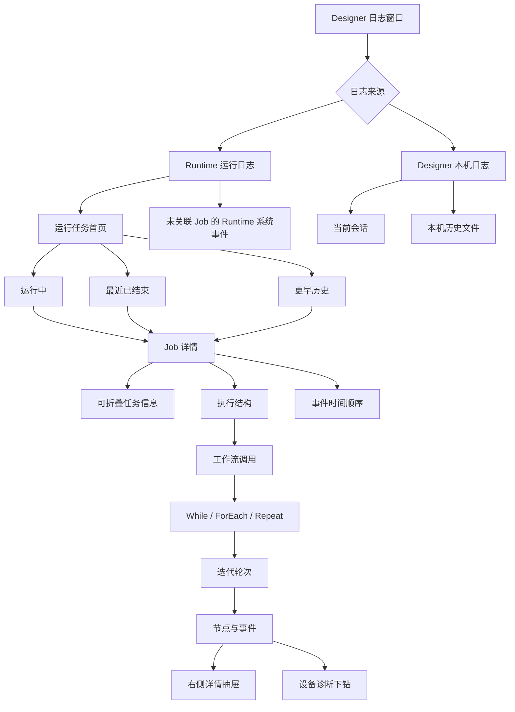
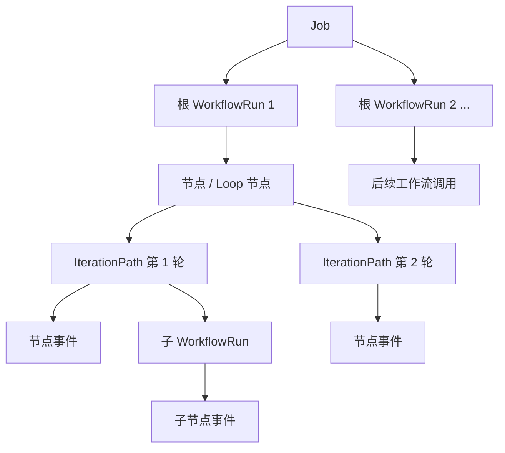

# Runtime 运行日志工作台完整设计 · V2.4

## 1. 基线、完成状态与本次执行范围

本文件是 `redesign-runtime-log-workbench` 的唯一完整设计，已把任务分组、关联任务、日期输入和信息简化直接合入对应章节。执行本包无需另读或应用旧版计划、补充 change 或 Patch 01。规范、任务清单、验收、原型和源码指南均采用同一口径。

当前核对基线为 `codex/runtime-log-workbench` 的 `fa4b72d751189c2689882a0a0d127fd280a35fde`，2026-11-22 查询仍指向该提交。技术栈沿用 Python 3.10、PySide2 5.15.2.1 / Qt Widgets 与已有 gRPC。正式实现保持原生窗口与现有主题，不引入 WebView、QML 或 Qt6，不把 HTML DOM 机械转换成大量 Qt 类。

### 1.1 已实现的基线

仓库中的原任务清单共有 38 项已勾选。原实施者在 [implementation-report.md](implementation-report.md) 记录了 Windows Qt + 软件 Runtime 的 Q1/Q2 及聚焦检查；本包保留该报告原文，作为旧实现证据，不把它计为 V2.4 新改动验证。

基线已提供：

- Runtime / Designer 来源区分、任务首页与系统事件去重，以及持久化终态目录 `ListJobHistory`。
- `QueryRuntimeLogs` 最近页 / 更早页、固定上界、唯一 `RuntimeGlobalLogs` 交付水位和有限缺口补取。
- 保留父调用身份的结构化事件、有界执行树、While / ForEach / Repeat / 连续根调用、时间与折叠阅读。
- 高级本地筛选和服务端历史查询、右侧详情、完整 Job 导出。
- 框架执行记录和主动日志的通用易读详情；既有单算子调试使用真实会话日志及结果复用同一组件。
- `executeDevice` / `captureDevice` 的执行上下文传递、设备诊断集中归一化，以及按匹配范围下钻和返回。

已有 EventStore、SQLite / JSONL、DesignerLogWriter、设备缓存、算子日志协议和结果组件继续复用。下文对这些能力的完整合同是保持标准，不是要求从头实现。

### 1.2 当前待改内容

当前 UI 仍直接以 `active` 归入“正在运行”，会使已完成但 Runtime 尚保留处理状态的任务出现在错误分区；“下游资源仍在收尾”也超出了现有字段能解释的范围。高级筛选仍有整数毫秒输入和集中展开的技术字段，结构主行及详情存在完整 UUID、较长缺失说明和部分内部英文值。

当前执行仅按 [tasks.md](tasks.md) 第 7 节的 11 个未完成任务推进。旧勾选项代表 V2.3 当时实现；特别是原 4.2 不代表本设计 D3 的新分组已经完成。发现目标 HEAD 已包含等价修正时保留现有实现，按实际行为核对，不机械重做。

### 1.3 原型、源码与证据

- [可点击界面](reference/prototype.html) 是确认交互的唯一原型，所有数据、任务和连接均为模拟。
- [图片和场景入口](reference/index.html) 区分当前目标图、保留结构参考和旧 Qt 基线图；正式产品不加入演示场景切换条。
- [source-map.md](source-map.md) 给出固定提交的源码与修改位置；[acceptance.md](acceptance.md) 是统一验收标准。
- [operator-coverage.md](operator-coverage.md) 保留 9d59fd16 时的 82 个内置算子静态盘点及数据边界。它不是 fa4b72d7 的全算子运行验收；没有主动 node.log 仍可读已存在的框架执行摘要。

本轮只整合计划、核对相关源码和交付资料，没有修改产品源码、运行新的原生 Qt / Runtime 验收或推送合并仓库。当前 `openspec/specs` 尚无正式 capability，因此本包保留同一个原 change，并提供一份完整 ADDED 规范。

## 2. 总体导航与归属

### D1. 只保留两个一级入口

1. **Runtime 运行日志**
   - 运行任务
   - 单次任务详情
   - Runtime 系统事件（只显示没有 Job 归属的 Runtime 事件）
2. **Designer 本机日志**
   - 当前会话
   - 本机历史日志文件
   - 流程设计、页面设计、工程编辑、Runtime 客户端连接与查询错误

“运行任务”是 Runtime 日志的任务视图，不是与 Runtime 日志并列的另一套日志来源。先按 `originApp` / 已确认的采集来源区分 Runtime 和 Designer；仅在 Runtime 来源内，再按真实 Job 归属分任务事件与系统事件。Designer 客户端错误即使携带 jobId / workflowId / nodeId，仍只属于 Designer 本机日志。旧记录缺少 originApp 时沿用已有可信来源，不凭 Job ID 猜来源。

任务关联的 Runtime 算子、设备、工作流、循环和页面运行事件在对应 Job 中查看；查看者所在机器不能改变生产者归属。

### D2. Runtime 系统事件不得重复展示 Job 事件

- Job 事件通过任务详情查询。保留记录原始 jobId；在同一个归属适配点计算有效 Job：Runtime 的普通 jobId 直接使用，`__runtime__` 才使用 payload 中明确的真实 Job ID。树分组用有效归属，原始详情/导出不重写来源字段，不再次持久化一份副本。
- `jobId='__runtime__'` 且 payload 没有真实 `jobId` 的记录，才进入 Runtime 系统事件视图。
- `__runtime__` 分区中 payload 明确携带真实 Job ID 的设备故障摘要或恢复摘要，仍归入对应 Job 的事件上下文；现有 `queryRuntimeLogs(jobId=...)` 已将这类摘要纳入 Job 查询。
- 系统事件页复用 `QueryRuntimeLogs` 查询 `jobId='__runtime__'`，再剔除 payload 中明确关联真实 Job 的记录；过滤后当前页为空但服务端 `hasMore=true` 时，继续读取后续页，不能把“本页无可见记录”当作“没有系统事件”。
- 系统事件筛选和分页使用固定 `upperEventId`；游标按服务端返回的 `nextEventId` 前进，不能按过滤后的可见记录数量推进。
- Designer 连接失败、日志查询失败属于 Designer 本机日志，不伪装成 Runtime 故障。
- Runtime 应用启动 JSONL 属于 Runtime 主机本机文件；本 change 不通过远程文件系统把它混入 Designer 本机日志。

## 2.1 页面结构示意

以下是交互层级，不要求按图中的名称机械拆成大量 Qt 类。





### 页面布局规则

| 页面 | 主体 | 次要信息 |
|---|---|---|
| Runtime 运行任务首页 | 运行中 + 最近已结束任务 | 工程、状态、开始时间、已运行时长、最近活动 |
| Job 详情 | 可折叠任务信息 + 执行结构 / 时间顺序 | 高级筛选默认收起；右侧详情按需打开 |
| Runtime 系统事件 | 未关联 Job 的 Runtime 事件列表 | 等级、模块、设备、时间筛选 |
| Designer 本机日志 | 当前会话或本机文件日志列表 | 流程设计、页面设计、连接诊断筛选 |
| 设备诊断 | 当前设备近期诊断缓存 | 通道、HEX / UTF-8、回执、缓存范围说明 |

详情抽屉不固定占用底部高度。关闭后主列表恢复宽度和滚动位置；窗口变窄时允许抽屉覆盖主内容，但不得丢失当前选择。

## 3. Runtime 运行任务首页

### D3. 首页分区、独立关联任务与操作

默认首页只有“运行中”和“最近已结束”两个区块；更早历史由既有入口查询，不增加第三个常驻状态区。按任务自身业务状态归组，最近活动只更新摘要；不因每条新日志到来让任务列表持续跳动。

**先区分同一任务里的子工作流与独立下游任务：**

| 实际执行关系 | 任务数量与完成含义 | 界面位置 |
| --- | --- | --- |
| 普通 Subflow 调用 | `RunContext.childWorkflow()` 仍使用相同 jobId；`SubflowRunner.run()` 同步等待子调用返回 | 同一 Job 的执行树中显示父子调用；正常子调用未返回时不把整个 Job 显示为完成 |
| While / ForEach / Repeat，或连续根调用 | 同一 Job 内的不同迭代 / 工作流调用，不是额外 Job | 展示真实调用、轮次和各自耗时，不增加首页任务数 |
| 托管 Dispatch 下游 | `_startRunGroup()` 创建独立 JobRecord 和新的 jobId，保留来源与运行组关系 | 每个 Job 有自己的状态、日志和耗时；源 Job 结束后，下游可以继续处理 |
| 终态任务的 Runtime 处理状态仍保留 | 可以没有任何未结束下游；现有字段未提供具体结束处理阶段 | 保留主结果，仅加准确的次要说明 |

Dispatch 提交返回不等于下游完成；如果流程使用既有 Join 等待目标结果，源任务可能先等待它。因此不能说“所有子流程都会独立继续运行”或“用了 Dispatch 主任务一定先结束”。本计划不改调度、同步调用或 Join 语义。依据见 [source-map.md](source-map.md)。

#### D3.1. 当前源码中的 active

`jobs/read_model.py::runState()` 的判断为：

```python
active = not record.isTerminal or owned or groupActive
```

源任务属于托管派发组时，`owned` 汇总组成员的 `ownsJobResources()`，`groupActive` 表示组内仍有非终态成员。因此，源任务已经完成而下游检测仍在处理，是正常情况；源任务业务结果和整个任务组是否结束是两个不同事实。

`JobSupervisor.ownsJobResources()` 检查进程句柄、事件桥、终态处理、待恢复的处理和退出处理记录。它不是“设备正在关闭”的同义词，也不保证某项结束处理此刻正在推进。

现有 `RunState` 提供 `status`、`active`、`owns_resources`、`run_group_id`、`source_job_id`、`target_slot_id`、`allowed_actions` 等字段，**不提供**具体结束处理阶段或独立 `groupActive` 字段。界面必须表达这些字段已经证明的事实。

#### D3.2. 首页合并与分组规则

**每次刷新以实际返回的快照为依据**

继续使用已有 `ListRuns` 和 `ListJobHistory` 请求。一次成功刷新得到：

- 当前连接 Runtime 的实时 `RunState` 集合。
- 常规最近历史页；仅首页需要时按现有策略读取。

同一 Runtime 连接范围内，相同工程和 Job 的实时 `RunState` 优先于历史摘要。若实时结果已变成 `COMPLETED`，不能被旧历史对象、旧选中对象或此前本地状态覆盖成 `RUNNING`。同样，历史摘要缺少 `allowed_actions` 或运行组关系时，不应覆盖实时对象里已有的字段。

沿用现有连接／Runtime 实例切换时清理旧界面数据的机制，不新增跨 Runtime 的运行状态缓存。关联匹配使用当前快照的 Runtime、工程、Job 身份；历史行没有充分的实时关系信息时，不从名称或旧界面选中状态补造关系。

**按业务状态分组**

| 任务事实 | 首页位置 | 主状态 |
| --- | --- | --- |
| `ACCEPTED`、`STARTING`、`RUNNING`、`STOPPING` | 运行中 | 沿用已受理、启动中、运行中、停止中 |
| `COMPLETED`、`FAILED`、`ABORTED`，且 `active=True` | 最近已结束 | 沿用已完成、失败、已停止，并按 D3.3 增加副提示 |
| 普通最近历史终态任务 | 最近已结束 | 沿用原执行结果 |

分组依据 `status`；`active` 只影响“是否还需要在首页保留”和副提示，不改写执行结果。不因 `active=True` 把失败显示成运行中，也不因源任务完成把下游任务显示成完成。

**终态但仍 active 的任务不能被最近页挤掉**

“最近已结束”的输入为以下集合的去重合并：

1. 常规最近历史页。
2. 本次 `ListRuns` 返回的所有终态且 `active=True` 的任务。

同一个 Job 只生成一条主目录记录，实时对象优先；继续按真实结束时间及稳定 Job 标识排序。不得在合并后再套用常规最近页条数上限，把仍有相关处理的任务裁掉。任务即使早于最近 50 条历史记录，只要当前仍 `active=True`，也必须留在首页的“最近已结束”。

当前基线的首页历史请求为 `limit=20`，历史 RPC 默认 `limit=50`；本约定适用于任何常规页大小，不要求把首页页大小改成 50。

该保留行为直接由**当前实时集合**决定，不新增永久置顶表、跨会话保留列表或第二份历史缓存。后续成功刷新不再返回这个终态 active 任务时，它恢复普通最近历史规则：仍在最近页内就正常显示，超出最近页就通过“更早历史”查找。不得为了继续留住所有曾经 active 的任务而使首页无限增长。

历史查询页面仍按用户请求的筛选和分页结果展示，不把首页保留项强行插入每一页历史结果。

#### D3.3. 状态文案与关联任务

**主状态和副提示分开**

主状态只表达这个 Job 的执行结果。副提示描述本次结果以外仍未结束的处理。列表和详情使用相同规则，正常已结束任务没有额外提示。

| 已知事实 | 主状态示例 | 副提示 |
| --- | --- | --- |
| 已完成，找到 2 个真实非终态关联任务 | 已完成 | 还有 2 个关联任务未结束 |
| 失败，找到 1 个真实非终态关联任务 | 失败 | 还有 1 个关联任务未结束 |
| 已停止，找到真实非终态关联任务 | 已停止 | 还有 N 个关联任务未结束 |
| 终态且 active，但未获得可说明原因的关联任务 | 保留已完成／失败／已停止 | 结束处理未完成 |
| 终态且不再 active | 保留原结果 | 无 |

“未结束”涵盖已受理、启动中、运行中和停止中；不能把这些状态全部写成“正在运行”。展开具体关联项后显示各自真实状态。

通用提示的说明文字为：

> 本次执行已结束，但 Runtime 尚未完成与本次任务有关的处理。当前接口未提供具体原因。

这里描述未完成的事实，不承诺自动恢复或即将完成。只有当前已有明确错误码或错误消息时，才同时展示真实错误。不要基于 `owns_resources=True` 编造“正在关闭相机”“正在断开 PLC”“正在保存结果”“设备被占用”等具体原因；不要增加模拟进度、倒计时或自动重试入口。

**关联关系必须有真实身份依据**

源任务的关联集合，只能从本次实时集合中按以下条件建立：

- 当前 Runtime 实例相同。
- `project_id` 相同。
- `run_group_id` 非空且相同。
- 成员 `source_job_id` 精确指向该源任务的 `job_id`。
- 排除源任务自身；按真实 Job 身份去重。

副提示中的数量，只统计该集合里已知非终态的成员。名称仅用于显示，不参与推断。`source_job_id` 或 `run_group_id` 缺失时不按工作流同名、开始时间接近或日志文字猜测归属。

While／ForEach／Repeat 的轮次、嵌套工作流调用和连续运行产生的调用实例仍属于任务详情的执行结构；不能把它们当成额外 Job，也不能计入“关联任务”数量。

现有 `GetDispatchQueueState` 可提供派发队列细节，但本次关联状态和数量用 `ListRuns` 已有结果完成。**不为当前修订增加其固定轮询，也不新增 RPC。** 如其他已存在页面已使用队列监控，本次保留其既有行为即可。

**一个 Job 只有一条主目录记录**

每个独立下游 Job 继续按自身状态出现在首页的一个区块中。源任务旁的“查看关联任务”只打开关联引用列表或已有详情快捷入口；不得把下游 Job 再复制成另一条可计数的主目录记录。

关联列表展示真实工作流名称、简短 Job 标识和真实状态，点击进入该 Job 原有详情。主页数量只统计主目录的唯一任务，不把快捷引用重复相加。

#### D3.4. 导航与返回

从源任务查看关联任务，再返回时，保留用户离开前的任务、筛选值及选中记录。至少包括当前来源、结构／时间模式、搜索词、等级／问题筛选、高级筛选值和选中的事件或执行结构条目标识；从目录进入时保留目录选中项。

实现采用一个局部的“返回来源”书签，保存已有界面状态和必要身份／事件锚点，复用 `openJob()`、已有有限事件窗口、事件定位和筛选逻辑。`home()` 当前会清空事件窗口；返回来源时根据轻量锚点重查并恢复选中即可，不保留两个各含 1 万事件的窗口。不得启动第二个全局日志读取器，不为每个关联任务建立长期事件缓存，也不将整个任务历史复制进导航状态。

当前 `openJob()` 会清空筛选、选中和展开状态。关联跳转的返回路径需要在恢复来源身份后恢复保存的筛选及事件锚点，不能直接调用这个默认清空路径就宣称“返回保持上下文”。复用已有选中、锚点和固定查询上界能力；不要求新增通用路由框架。

关联详情提供“返回来源任务”这一直接路径。原有“返回运行任务”、设备诊断返回、高级历史返回保持既有含义，不把每次普通导航都加入新的无限返回栈。

本次只要求在正常仍可查询的记录范围内恢复对应上下文；选中的事件或执行结构锚点已经超出可查询范围时，保留筛选并如实提示无法定位，不伪造原选中项。沿用现有未加载／不可查询提示，不为此新增跨重启导航恢复、持久化浏览历史或极端恢复系统。

#### D3.5. 停止操作与时间

**停止操作继续由 Runtime 授权**

沿用现有 `allowed_actions` 和执行前 `GetRunState` 身份重查，发送原有 `StopJob` 请求。**不能仅因任务已是终态就隐藏或禁止停止**：源任务已完成但组内仍有任务时，Runtime 可能仍允许停止关联执行。

- 当选中源任务且真实关系证明还有未结束的关联任务，同时 `allowed_actions` 包含 `stop` 时，按钮可显示“停止关联任务”。请求仍发送给该源 Job，沿用现有停止整个托管组的行为；不要逐个额外发送另一套停止请求。
- 没有明确关联任务列表但 Runtime 仍允许停止时，保留“停止任务”。用就近说明解释“可向 Runtime 发送停止请求；结果以返回信息为准”，不承诺该操作必然解决结束处理、释放某个设备或改写已记录结果。
- Runtime 不允许停止时，沿用已有不可操作显示。请求失败时展示真实返回信息，不自动重试停止。

用户点击既有停止按钮即执行现有停止流程，本次不新增二次确认。主任务的“已完成／失败／已停止”结果不能因为按钮改名而被本地改写；以之后实际返回的状态刷新。

**本任务运行时间在终态冻结**

继续使用 `jobExecutionTime()`：本 Job 进入终态后，运行时间按实际开始和结束时间固定。关联任务运行更久，不得继续增加源任务的执行时长，也不得把整个组耗时冒充源 Job 耗时。

下游 Job 展示自己的运行时间。原有未记录时间和 Runtime 重启确认时间语义保持不变，本次不新增估算结束时间或新的后台阶段计时器。

### D4. 历史任务目录

沿用已实现的只读 `ListJobHistory`，直接读取现有 SQLite `jobs` 表；不新增表、第二份任务账本或事件数聚合。

| 合同 | 明确定义 |
|---|---|
| 请求 | 当前查询目标 `runtime_instance_id`、可选 project_id、终态 statuses、可选结束时间区间、limit、cursor |
| 状态 | 仅 `COMPLETED / FAILED / ABORTED`；未指定 statuses 时查全部终态；ABORTED 显示“已停止” |
| 返回 | ok/code/message、查询目标 runtime_instance_id、Job 摘要列表、has_more、next_cursor |
| 摘要 | jobId、projectId、projectRevision、workflowId、status、acceptedAtMs、startedAtMs、endedAtMs、errorCode、message、stopMode；不存在的时间为未记录 |
| 排序 | `COALESCE(endAt, startAt) DESC, jobId DESC`；cursor 包含最后实际返回行的这两个原始排序值，由服务端编码/解析，客户端只透传 |
| 翻页 | 下一页严格小于上一页的排序键；默认 limit=50，上限 200；用一条 look-ahead 判断 has_more；空末页 has_more=false、next_cursor 为空 |
| 范围 | 开始时间包含、结束时间不包含；筛选的是实际 endAt。缺 endAt 的旧终态行仅在未限定结束时间时参与排序，并标“结束时间未记录” |

- `acceptedAt` 是受理时间；旧行没有 acceptedAt 时才可使用 `startAt` 作为受理时间回退。`startedAt` 才是实际执行开始时间。不得把 `startAt` 标成实际开始。
- 同一翻页链固定筛选；改条件、刷新或目标 Runtime 变化时重开第一页。新结束任务在刷新后出现；不承诺跨状态变更的数据库快照事务。
- 当前活动任务继续由 `ListRuns` / `GetRunState` 提供。实时列表与历史摘要按 Job ID 去重，当前有效 `RunState` 优先；是否可停止只认当前身份及 `allowed_actions`。纯历史行没有停止按钮；不能把终态但仍 active 的当前 RunState 行误当纯历史；其首页归组和副提示按 D3。
- jobs 行没有原始 Runtime 实例 ID，不虚构它。RPC 返回的 runtime_instance_id 是当前查询目标；每条历史事件的 runtimeInstanceId 是其原始生产实例，两者不同不代表事件无效。
- 工作流显示名只在工程版本对应时使用，否则显示 workflowId。`executionMode='runtime'` 不是连续模式标志；无可确认配置时不推断单次/连续。
- 使用现有实例切换校验；沿用 `RuntimeInfoReply.capabilities` 中的 `job_history_query_v1`。旧端未支持时保留当前进程的 ListRuns 目录和原历史日志查询，提示“跨重启任务目录不可用”，不造本地替代账本。
- 只有实际查询计划证明需要时才加索引；保留 ListRuns 原语义，不做首页成功率、全量计数或统计仪表盘。

## 4. 单次 Job 详情

### D5. 任务摘要与两种事件视图

详情头部以可折叠任务信息区承载概览：Job 状态、运行时长、开始时间、结束时间、最近活动、错误摘要、可确认的当前工作流调用。收起后保留任务名、状态和时间的紧凑摘要；概览沿用当前信息区，不新增第三个标签页。

事件区域提供两种查看方式：

1. **执行结构**：按工作流调用和循环层级组织事件，默认进入此视图。
2. **时间顺序**：按事件发生时间查看同一 Job 的事件。

执行结构与时间顺序使用同一批已加载原始事件和同一筛选状态。切换视图不重置游标、筛选、选中事件和滚动位置。

### D5.1. QueryRuntimeLogs 的最近页与翻页合同

沿用已实现的 `QueryRuntimeLogsRequest.latest_first`（默认 false）和可选 `before_event_id`。沿用全局 eventId、固定 upper_event_id、既有 SQL 筛选、回复条数及字节限制；不新建日志查询 RPC。

| 模式 | 请求与范围 | 回复游标 |
|---|---|---|
| 原前向模式 | latest_first=false，不能带 before；`after < eventId <= H`，eventId ASC | 完全保留原语义：还有页时指最后返回行；读完指 H |
| 最近第一页 | latest_first=true，after=0，无 before；未给 H 时取全局 MAX(eventId)，`eventId <= H`，DESC | 非空页 next_event_id=实际返回原始行的最小 eventId，包括末页 |
| 更早页 | latest_first=true，after=0，before>0；沿用 H，`eventId < before AND eventId <= H`，DESC | 同上；before 使用上一页的 next_event_id，而非 UI 可见行 |
| 降序空末页 | 没有匹配原始行 | has_more=false，next_event_id=0；客户端不得再拿 0 发起下一页 |
| 字节预算截断 | 先按既有预算撤回放不下的最后一条 | 返回已装入的原始行；next 指最后成功返回行，has_more=true；未装入行必须留给下一页 |

- 降序首条即超预算：沿用 `EVENT_TOO_LARGE`，不提交游标、不自动重复请求，不跳过该记录；沿用现有错误展示/手动重试。
- `latest_first=true` 与正向 after>0 互斥；before 仅在降序模式有效。沿用非负上界、时间范围、limit=默认200/最大1000 等现有输入校验；不加重复的多层校验框架。
- has_more 来自服务端原始结果的 look-ahead / 字节预算，和客户端筛选后有几行无关。过滤掉一整页仍按服务端 next 继续，直到命中或 has_more=false；查询保持异步可取消，不能在 UI 线程递归拉页。
- 同一历史链固定 H；新事件不会改变“加载更早”的历史边界。降序数据在客户端按 eventId 升序合并；时间视图可按原始 timestampMs、eventId 排序，但不能据显示顺序计算游标。
- 沿用 capabilities 的 `runtime_logs_recent_v1`，明确代表支持上述两字段及降序回复语义。未宣告能力时保留旧前向历史查询并说明最近页不可用；不让旧服务器忽略新字段后把最早页当最新页，不后台扫完整个 Job 模拟最近页。

### D5.2. 最近快照与唯一实时源的交接

所有实时事件继续由现有 `RuntimeGlobalLogs` 提供。禁止为每个 Job 再开 `StreamJobEvents` 或独立常驻轮询。最近页、更早页和必要补页只是有限 QueryRuntimeLogs 请求。

1. 先确认全局 reader 已完成初始定位，再登记 Job 详情消费者，然后发该 Job 的最近原始页请求；固定 project / 有效 Job，不预加等级、节点、设备或事件类型条件。初始化期间暂存对应实时记录，暂存也受 D5.3 上限约束。
2. 最近页得到历史上界 H；合并快照及暂存中 eventId>H 的事件。全局读取器的交付上界 W 必须是**当前目标中整页已处理的全局进度（服务端 next_event_id）**，不能用某个 Job 最后一条可见事件代替。
3. 如需补齐打开/切回期间未保留的区间，固定当时 W，以同一个 QueryRuntimeLogs 前向分页读取 `(H, W]`（只限该 Job），读完就结束补页；之后继续由唯一全局 reader 交付。W<=H 时无需补页，reader 自行继续。沿用现有 reader 的 progress 通知；消费端按顺序处理完该页事件并收到通知后确认 W，不另建进度服务。
4. 所有路径进入同一 Job 事件窗口；在当前查询目标/代次内按全局 eventId 去重，不按 Job-local sequence、消息或 timestamp 去重。旧 Runtime 生成的历史事件仍应保留，不用行内 runtimeInstanceId 过滤当前数据库历史。
5. 沿用现有查询 generation、Runtime target 校验与取消；打开其他 Job、改工程、Runtime 重启后拒收旧查询响应并重建窗口。不增加第二套 session token 或任意版本兼容体系。

事件不足/窗口退窗时如实标范围。“不重不漏”指所请求、仍可查询区间的分页和合并，不承诺保留策略已删除的记录可恢复。

### D5.3. 长时间运行的有界窗口

- 复用现有 `maximumEntries`（默认 10000）限制原始事件；树只由该窗口和必要祖先容器建立。不能靠保存所有展开分支、所有 Job 窗口或无限待追加队列绕开上限。
- 用户在最新位置时跟随新增，超上限从旧端退窗；主动阅读历史、展开旧轮次或选中旧事件时暂停自动跟随，固定当前阅读窗口。新事件仅显示数量/有新事件提示，不强行滚动，不无限保存新载荷。
- “加载更早”合并去重后，允许最新端的非阅读区域退窗；保留当前选中事件和阅读锚点，以及其最小祖先路径。若这次扩窗无法同时保住锚点和容量，保持当前窗口，提示已达窗口上限并提供切换到更早范围/返回最新的主动操作；不要悄悄把刚加载的早页裁掉。
- 用户主动“返回最新/切换范围”才可换阅读窗口。对应边界显示“部分事件已移出当前窗口，可重新加载”；展开状态仅保存当前窗口可用路径，不保证所有曾展开分支永久常驻。
- “有新事件”计数仅表示已观察到的新事件；重新连接期间未完整计数时显示提示，不伪称全量总数。无需为计数扫描数据库。

### D6. 执行树的分组规则

树形结构按真实执行身份构建，不按 workflowId / nodeId 名称猜测：

- Job 是根任务。
- 工作流调用以 `workflowRunId` 为身份。
- 子工作流通过 `parentWorkflowRunId` 挂到父调用；调用节点使用该子调用事件中的 `nodeId` / caller node 关联。
- 循环由 `loop.iteration.started` / `loop.iteration.completed` 识别；以 Job、workflowRunId、循环 nodeId 和 iterationPath 组合定位某一轮。
- 嵌套循环按 `iterationPath` 的前缀层级展示；Runtime 的 0-based 索引在 UI 显示为第 1 轮、第 2 轮。
- 节点事件通过 `nodeRunId` 归并开始与终态，通过 `workflowRunId` 和 `iterationPath` 放回正确的工作流调用与循环轮次。
- 连续运行的根工作流每次调用生成新的 `workflowRunId`；在同一 Job 下独立展示。仅统计当前已加载范围的不同根调用 ID，标“已加载 N 次调用”，不能把这一数量称为整个 Job 累计调用次数；未知历史编号以已知名称或真实 workflowId、可用开始时间区分；完整调用 ID 放在详情 / 提示中，不用 cycleId、可见行号或日志条数冒充全局次数。
- `cycleId` 是 Runtime 周期/配置边界标识，不是连续运行次数，也不是循环轮次。
- 已知 parentWorkflowRunId 但父事件未加载时，以该真实 ID 保留轻量父容器并标“父调用详情未加载”；确实没有关联字段时放入“未完整关联事件”，不得按相邻时间猜父子。普通非循环的空 iterationPath 合法；字段缺省与合法空值不要混为一谈。
- 结构仅呈现已有事件关系，不把页面树排列解释为执行调度；本基线不据未核实的异步或并行子工作流机制设计额外任务。

### D7. 循环事件元数据合同

- 循环类型复用 `loop.started.payload.mode`，不增加重复 loopType。总量精确已知的 ForEach / Repeat 才提供 `totalIterations`，每个循环调用只记录一次。
- 数量必须来自既有输入校验/执行路径，不为填写元数据复制参数校验。若现有 loop.started 早于数量确认，可局部调整为既有校验之后、首次迭代之前只发出一次，保留失败事件与调度语义；不得提前展开整个生成器、修改循环上限或为日志多执行一次输入。
- While 不显示未知总量或百分比；maxIterations 是限制，不是实际总量。
- 对 `_while` 和 `_whileV2` 两条现有路径，在 `loop.iteration.completed` 可选 payload 中写 `bodyExecuted`：true=循环体已执行并正常完成；false=条件为 false、未进入循环体；缺省=该记录未提供这个信息。不可用 `bool(payload.get(...))` 将旧历史误判为 false。
- 条件/循环体失败或取消，保留现有失败事件和未配对迭代，不伪造 completed，不写 false。false 检查仍独立可展开，显示“退出条件检查 · 未进入循环体”，保留条件工作流事件，不计入已完成循环体次数。
- 旧事件无 bodyExecuted 时仍显示“第 N 次迭代”，详情可注明执行情况未记录；不得仅靠工作流定义推断该次条件实际真假。mode / totalIterations 缺失时按未记录显示，不为补旧日志元数据新增工程定义查询或推断分支。

## 5. 执行时间

### D8. 统一时间口径

耗时是执行经过的墙钟时间，包含等待、调试暂停、框架开销，不声称是纯算子 CPU 时间。事件计时只使用原始 timestampMs；`StructuredLogEntry` 保留 timestamp 原始有效性，显示排序可回退，耗时不得使用接收时间回退值。

| 对象 | 开始 | 结束 | 关联键 |
|---|---|---|---|
| Job | startedAt | endedAt，重启确认另见下文 | jobId |
| 工作流调用 | workflow.started | workflow.completed / workflow.failed | jobId + workflowRunId |
| 循环检查/轮次 | loop.iteration.started | loop.iteration.completed | jobId + workflowRunId + loop nodeId + iterationPath |
| 节点 | node.started | node.completed / node.failed | jobId + workflowRunId + nodeRunId |

- Job 的 acceptedAt/startAt 是受理时间；实际执行时长使用有效 startedAt。保留数据库 durationMs 原语义（当前含受理等待），不直接拿它作为执行时长，也不改历史值。
- 有 startedAt、无 endedAt，且 Job 自身状态为 RUNNING 或 STOPPING 时继续显示估算已运行时间；ACCEPTED/STARTING 没有实际开始则显示等待。终态 COMPLETED/FAILED/ABORTED 停止动态计时，即使 RunState.active 因关联任务活动或 Runtime 仍持有处理记录而为 true。具体副提示按 D3，不改变本 Job 的执行结果和时间。
- `E_RUNTIME_RESTARTED` 的 endAt 是新 Runtime 确认中断的时间，不是旧进程实际结束时间：显示“执行中断；实际结束时间未记录”，可展示“重启确认时间”，不得把两者之差标成精确执行耗时。
- 内部节点/调用只有具备有效开始事件、确认该执行仍未终止的连续生命周期证据，并且 Job 自身仍运行时才动态估时。最近页里缺结束事件不等于仍在运行；分页/掉线有缺口且没有可用证据时显示“状态/时间信息不完整”。当前定位遵循 D9。
- Job 已终态时，未配对内部对象停止动态计时，显示中断或结束事件缺失；不以 Job endedAt 伪造每个内部节点终点。`workflow.started` 后输入校验失败可能确实缺少终态事件，不借 UI 改写生产者生命周期。
- 没有 started 的 skipped 节点不显示虚构 0 ms。结束早于开始或原始时间无效时不计算精确耗时。
- 原因提示必须有证据：已知仍有未加载页可说“尚未加载完整”；已读取记录缺字段可说“该记录未包含此字段”；只有接口/元数据明确证明清理时才说“已清理”。其余说“时间信息不完整，原因未确认”，不为区分原因新增清理账本。
- 默认紧凑显示耗时；缺少配对时列内用“时间信息不完整”等短标签，详情或提示保留具体证据和原因。详情可切换起止时间；实时数值注明估算，结束配对后用原始时间固定。连续两次根调用间的等待不计入任何单次 workflowRun 时长。
- 设备阶段时长仅展示现有 payload 的明确计时；设备聚合摘要 durationMs 另按 D11 解释，不从两条日志间隔推算驱动耗时。

## 6. 事件筛选与查看

### D9. 筛选范围、上下文与当前定位

高级筛选默认收起，收起后保留条件并显示摘要。概览信息也可收起，保留任务名、状态、运行时间等紧凑摘要。常驻关键字、等级快捷筛选、执行结构/时间顺序、定位当前；不删已有高级字段。

| 查看范围 | 行为与限制 |
|---|---|
| Job 执行结构 + 同范围时间顺序 | 共用未按等级裁剪的已加载原始窗口，再本地筛关键字、等级、模块、工作流、节点、设备、事件类型、调用 ID、循环路径、时间；标“筛选范围：已加载事件” |
| 既有历史查询 | 保留服务端 project/job/device/component/levels/workflow/node/start/end 条件，在固定上界的整个指定范围查询并分页；显示命中列表，不能当成完整执行树 |
| 新调用 ID / 循环路径 / 关键字 | 本期仅本地过滤；原服务端不支持这些字段，不伪称全库全文检索，也不因本期未加索引而删除原有历史查询 |

- Job 详情已有高级区域提供明确的范围选择/历史查询操作，不增加第三个日志来源。切换到历史命中列表时保留 Job 原窗口状态；返回恢复。当前 Job 范围中的 Job 条件固定，跨 Job 查询从原有历史查询入口进入。
- 两个本地视图的筛选、选中事件、游标共用，分别保留滚动锚点；历史查询是另一查询范围，单独保存状态，不能把它的分页游标传入 Job 窗口。
- 先从未裁剪原始事件建立结构，再投影筛选。命中的父调用/轮次/节点作为路径容器保留，无关兄弟可隐藏。WARN/ERROR 的服务端命中列表不能替代含 INFO 生命周期的结构源。
- “查看本轮上下文”临时去掉该轮内的本地条件，按真实调用/iterationPath 限定窗口，标题明确“本轮已加载上下文”。可沿 D5.1 加载更早页，每页重新投影；尚有未知区间就继续标范围，不承诺一键取得整轮。配对开始/结束及中间事件均已加载时才可说“该已知区间完整”；不存在的历史不能由 UI 补造。
- 从历史搜索命中项查看结构时，携带 Job 与事件 ID 回到 Job 窗口；为跳转建立新的查询代次，H 采用该历史搜索已确认上界（或重新取得且 H>=目标 eventId），不能沿用旧 Job 窗口较早的上界；在该固定 H 内使用 before=目标 eventId+1 取包含目标的原始降序页，再按需加载相邻页；无法立即取得祖先时保留真实身份容器和“上下文未加载”，不把稀疏命中当完整调用树。不新建按时间邻近关联算法。
- “定位当前”先核对当前 RunState 的 Job 身份和非终态；使用同 Job / 当前连接代次中连续观察的生命周期。既有 `NodeRunInspection` 只有在身份匹配且连续生命周期证据未中断时辅助定位；其中缓存的 RUNNING 本身不构成当前状态证明。`RunState` 本身没有当前 nodeRunId，最近一条日志也不能证明当前节点。
- 有可靠活动位置时展开并选中它；被 WARN 等筛选隐藏时临时展示目标及祖先，返回恢复原条件。缺少节点证据时回到最新活动区，提示“当前执行节点尚未确认”，不任意选最后日志当活动节点，不为此新增执行状态 RPC 或全量回放任务。
- 用户阅读旧记录时按 D5.3 暂停跟随；回最新是明确动作。上下文/抽屉/设备往返均恢复原筛选、选中、展开和阅读锚点。

#### D9.1. 可空日期时间筛选

**一个轻量入口，共用现有语义**

沿用 PySide2 / Qt Widgets。在已有同类控件可复用时直接复用；否则增加一个供相关页面共用的轻量可选时间范围控件或适配函数。它只负责可选起止值、日期时间显示、整数毫秒转换和行内有效性提示，不扩展成通用表单框架或新的时间服务。

日期输入采用 `QDateTimeEdit`，提供日期选择与键盘编辑。每个边界具有明确的“启用 / 不限”状态，可用复选框与日期控件组合。日期控件的内部初始值不代表已启用的筛选。

| 场景 | 界面含义 | 现有查询字段 |
| --- | --- | --- |
| Job 详情的本地筛选 | 事件发生时间 | `startTimestampMs` / `endTimestampMs` |
| Runtime 服务端高级历史查询，包括从 Job 进入的查询 | 事件发生时间 | `startTimestampMs` / `endTimestampMs` |
| 更早历史任务目录 | 任务结束时间，界面明确标注“结束时间范围” | `startEndedAtMs` / `endEndedAtMs` |

原有 Designer 本机历史使用共享 `StructuredLogView` 时，继续使用同一日期控件和本机文件查询语义，不另做一套毫秒输入界面。

**显示、空值和精度**

1. 初次打开时两端均为“不限”。不得自动添加最近一小时、当天、1970 年或其他默认查询边界。
2. 推荐显示格式为 `yyyy-MM-dd HH:mm:ss.zzz`，显示秒并保留毫秒；已有精确到毫秒的条件在进入、返回或折叠时不得被截成整秒。
3. 控件旁显示“本机时区”，并使用系统提供的时区名称或偏移补充说明。原型中展示的 UTC+08:00 只代表演示环境，不能硬编码为产品查询时区。
4. 输入和显示遵循 Designer 所在机器的本地时间；请求值为该时间对应的整数 Unix 毫秒。不得再手动加减固定八小时，也不把 Runtime 机器的时区当作输入时区。
5. 未启用的边界输出 `None` 或省略请求字段。内部控件保存的日期不得泄漏为默认参数；清空条件恢复“不限”。
6. 折叠高级筛选保留已启用的范围，并在已有条件摘要中用可读日期时间表示；不重新显示一串毫秒数字。

**边界与有效性**

- 所有入口统一为半开区间 `[开始, 结束)`：开始时刻包含，结束时刻不包含。控件标签或紧邻提示明确说明该口径。
- 允许仅启用起点或仅启用终点。
- 起点等于终点是合法空区间，结果可以为空；不得擅自加一毫秒或一天，也不得报“必须有正时长”。
- 起点晚于终点时，显示简短行内提示“开始时间不能晚于结束时间”。不弹确认框，不发送查询，不用无效范围重绘本地结果，不取消或清空已经显示的有效结果。
- 本地筛选仅提交完整且有效的时间条件；编辑过程中仍保留上次有效条件。服务端查询在开始新查询、切换历史页或重置游标前完成同样的有效性判断。
- 修改边界后重新查询使用新的查询范围和现有固定上界逻辑；“下一页”仍沿用已经提交的范围，不能混入尚未提交的控件值。

有效性检查集中在这个 UI 输入边界；保留现有服务端合同，不增加重复的多层校验、重试、时间容错或全局时区配置。

**事件、目录和导出范围互不混用**

Job 详情仍先保留同一 Job 的未被本地条件裁剪的原始窗口，再进行本地投影。改变日期显示方式不能把本地筛选变为稀疏结构数据源。

从任务进入服务端高级历史查询时，固定当前 Job 和工程，将可用的时间范围以整数毫秒传入。返回任务后恢复原本地筛选、展开、选择和阅读位置。

两个导出动作继续保留各自含义：

- “导出任务完整记录”沿用当前 Job 的完整可查询范围和既有固定上界；不自动附带本地时间、WARN、节点或关键字筛选。
- 高级历史页面的“导出完整选定范围”沿用该页面已提交的服务端查询条件。

任务目录中的结束时间条件不得误传为事件发生时间条件。无需为这些区别新增导出协议、存储或后台任务。

#### D9.2. 高级筛选布局

**保留能力，分两层展开**

保留目前的关键字、告警 / 错误快捷条件、结构 / 时间切换、定位当前及高级筛选入口。高级筛选默认收起，不添加新的常驻工具条。

展开后先显示常用条件：等级、工作流、节点、设备、事件时间范围，以及查询历史范围的既有动作。能按当前窗口宽度自然换行，避免所有字段固定排成长表。

需要直接检查执行身份时，再展开“技术条件”。完整工程 ID、模块、事件类型、工作流调用 ID、原始轮次路径等已有字段放在这里。目录和跨 Job 历史中原有工程、状态、Job 条件仍保留；任务内已经固定的 Job / 工程范围应明确显示，不能因隐藏字段而变为跨任务查询。

折叠任一层只改变显示，不清除条件。收起时摘要保留生效条件，并标明当前是“已加载事件”还是“历史查询范围”。不把后者误写成已经读取了全部历史。

**名称选择与精确 ID**

工作流、节点、设备的候选名称只来自当前已知的工程元数据、已加载事件及既有名称映射。可用可编辑下拉框，并在候选项中保留 ID 区分同名对象。

选择候选项按真实 ID 筛选；直接输入精确 ID 的能力必须保留。未知名称或 ID 不得自动匹配到名字相近的对象。历史任务没有当前工程元数据时，继续允许按 ID 查询，不为补全名称读取所有历史或新增目录 RPC。

**轮次显示**

主树继续显示便于阅读的第 1 轮、第 2 轮等标签。数值必须由该记录的真实零基轮次索引转换；嵌套轮次逐段转换。

例如真实 `iterationPath=[0,1]` 可显示“外层第 1 轮 / 内层第 2 轮”。若提供可选轮次标签，其选项值仍保存真实 `[0,1]`。技术条件保留原始路径精确输入 `0/1`，并注明“原始索引”。

连续运行的根调用并不等于循环轮次。不得从当前窗口可见行的位置构造“全任务第 N 次”，也不得根据名称或邻近时间推断父子关系。数据缺失继续按已有规则说明未记录或未加载。

### D10. 右侧详情抽屉

选中事件后在右侧展开详情，默认显示：

- 发生时间、等级、消息、日志代码（code 也可能是 INFO / WARN 业务代码，不一律称错误码）；
- Job、工作流、调用、循环路径、节点、设备；
- 有效开始/结束时间与耗时（可计算时）；
- 设备槽位、通道、请求回执（适用时）。

沿用“易读详情 / 原始 JSON”切换，默认易读详情。技术标识按需展开；关闭抽屉不丢失事件选择、筛选、树展开状态或阅读位置。以下规则仅改展示，不新增日志生产协议、专属存储、查询 RPC 或每个算子的渲染器注册框架。

#### D10.1. 通用执行记录与附加日志

- **通用执行信息是必需展示能力**，不以算子有没有主动 node.log 为前提。直接从当前选中的 `node.started / node.completed / node.failed / node.skipped` 读取实际 `payload.ioSummary`、`metrics`、`diagnostics` 及原因字段，按以下来源显示；不存在的字段给出简短未提供状态，不补造值。只因没有 node.log 就把整个详情做成空页，不满足本设计。

| 当前选中记录 | 易读内容与语义 |
|---|---|
| node.started | 节点开始记录及已有输入摘要；该条开始记录没有输出，不据此断言节点现在仍在运行 |
| node.completed | 当前记录的输入 / 输出摘要、实际返回的指标和诊断；按摘要类型显示标量、数量、shape / dtype 及缺省说明 |
| node.failed | 失败代码 / 消息、当前记录中的输入摘要、指标与诊断；不从其他轮次填入有效输出 |
| node.skipped | 跳过原因、已有输入摘要及 missingInputs / blockedByBranches 等实际字段；不伪造执行耗时或成功输出 |
| node.log | 消息与算子主动记录的日志字段；作为执行信息的补充，不是其他四类记录可读化的替代 |

- 输入 / 输出使用已有 `run_inspection.normalizeInspection` 和端口摘要语义，指标与诊断使用当前 payload 的真实字段。缺省、空对象和明确不可用不同：分别显示“本记录未提供”“无附加指标 / 诊断”或现有不可用原因。无需为显示缺省状态增加后端字段或追查缺失原因。
- 详情默认只解释选中记录。若提供已加载同一次执行的关联信息，使用实际 Job / workflowRunId / nodeRunId 匹配，并单列“关联记录”及其事件类型 / 标识；不能合成一条不存在的事件、改写其原始 JSON，或要求每次点击都跨事件查询和扫描历史。
- `node.log` 的既有 payload 结构为 `{operatorId, phase, data, deviceBindings?, truncated?}`；消息、level、code 与执行身份在事件层。其“日志数据”来自 `payload.data`，称“算子主动记录的字段”，不得改称完整输入、输出或运行参数。没有主动字段不影响同节点框架记录的通用展示。
- 直接显示当前返回的简单值；明确区分 `0`、`false`、`null`、空字符串、空数组、空对象与未提供字段。没有 data 或没有记录字段时显示相应空状态，不凭 `value || '—'` 抹掉有效值。
- 对象使用可展开字段层级；数组默认分段展示。仅当数组项均是结构一致、字段为简单值的对象时提供紧凑表格，混合项或嵌套结构继续用树。分页 / 展开只作用于当前返回的数据，不触发全量历史查询，不声称获得发布端已裁剪的内容。
- 保留原 key；没有既有明确字段契约时不猜中文含义、单位、阈值或成功失败。`phase=execute` 可显示执行阶段，`lifecycle` 仅显示生命周期阶段，不能猜是初始化还是销毁。未知 phase 保留原值。
- 长文本可展开和复制；支持复制选中值、当前返回的日志数据及当前记录。复制数据与当前记录的范围明确，不把折叠 / 分页展示当作后台取回全量数据，也不把这类复制称为完整 Job 导出。
- 已有 `truncated`、`<redacted>`、`<max-depth>`、`<bytes:N>` 等标志按其原意显示；外层未提供 truncated 不证明全部内容完整。原始 JSON 是“当前收到的记录”，不承诺脱敏前原文、未裁剪参数或未记录数据能恢复。

#### D10.2. 保留原始检查与结果边界

- 原始页复用现有 `LogJsonTree` 的字段 / 值 / 类型、惰性展开、长文本和复制；允许附加 JSON 文本查看，但不能以文本块替代已有树能力。易读页和原始页必须对应同一条选中事件，切换不会改写数据或改变过滤条件。
- `node.log.payload.data` 与生命周期记录的 `metrics / diagnostics / ioSummary` 是不同内容。当前选中的生命周期记录按 D10.1 必须可读化，无需先找到一条 node.log；跨记录关联仅是可选补充。`QueryRuntimeLogs` 对完成事件的投影不保留完整 outputs，不能从日志详情承诺完整端口值。
- `ioSummary` 中 collection 只有数量，image / array 主要是 shape 与 dtype；没有项目数据就不生成列表明细或缩略图。字段摘要有 omitted / truncated 时保留其说明。
- 当前节点结果面板每个节点只保留最近两次执行；图片还依赖有效检查会话、精确执行身份、端口和可用快照。此版不新增全轮次图片历史库，不承诺所有旧循环都能查看结果图，更不能用最新一次图片顶替所选旧轮次。没有已加载结果时说“该次执行结果未加载或不可用”，只有明确证据才能说已清理。

#### D10.3. 单算子调试与既有预览

- 正式 Job 日志详情与 `OperatorDebugWindow` 实际复用一个 Qt 详情组件或格式化适配点，分别输入各自真实数据。单算子调试继续在既有调试窗口展示，不增加日志窗口的第三个一级来源，也不把调试记录重复加入生产 Job / 系统事件。少量按来源区分的适配即可，不建立算子类型注册框架、额外统一日志协议或第二份缓存；不只复制两份相似 UI 就称为复用。保留已有调试结果、参数、PLC 文案与操作入口。
- 沿用 `DebugConnection.snapshot()` 的既有会话轮询。`ReadOperatorDebugEvents` 返回 `{events, nextSequence, gap}`；日志项 wrapper 为 `{sequence, type, generation, executionId?, event?}`。外层 type 为 node.log 时，内层 `event` 才携带 `eventType/message/level/code/payload`；读取内层实际类型，不把外层标签当作其内容一定是业务日志。会话状态、execution.started / finished、logs.dropped 和本地文本反馈按原类型显示。
- 调试日志以连接的 sessionId、generation 与记录的 executionId 归属；没有执行 ID 的会话通知保持会话级。原始查看和复制保留收到的 wrapper，不补造生产 Job、workflowRunId、事件时间或 node.completed。nextSequence / gap 继续沿用现有读取含义，不转成 Runtime eventId，也不重做会话恢复或重试机制。
- 单算子 worker 不经 WorkflowRunner。成功结果来自 `GetOperatorDebugExecution`，可含 status、已返回 outputs / outputAssets、metrics、diagnostics、elapsedMs，以及 manager 保存的 rawParams / effectiveParams / inputSources；失败时只显示实际返回的 code / message / diagnostics 等。将其明确放在“调试执行结果”，与选中的日志行分开，匹配 session / generation / executionId；没有该次结果就显示不可用，不拿最新结果替代。
- 调试的 inputSources 是来源说明，不冒充完整输入；outputAssets 继续沿用已有结果组件按需读取。worker 的 finishedAtMs 是单调时钟值，不作为日历发生时间；有实际 elapsedMs 时显示其执行耗时。结果读取与日志读取是已有两种来源，不为共用界面制造 node.started / completed 或 ioSummary，也不把结果再次追加到生产日志。
- 纯预览与实时预览仅兼容既有失败摘要和附带日志。纯预览失败若只有 message / recent-logs 文本，就显示文本；实时预览的 `node.preview.failed` 如有 `payload.logs`，按现有 BufferedOperatorLogger 记录的 level / message / code / payload 展示为“预览附带日志”，其中 payload 不是 Runtime node.log 的 data 包裹。保留其已知来源，不变成新的 Job，也不新增成功预览持久流、存储或 RPC。

原型中的算子主动日志、无主动日志的框架记录和调试数据均为演示输入；正式产品不增加这些演示切换按钮、不硬编码示例业务字段。只对实际演示和验证的场景作相应声明。

#### D10.4. 主行与共享详情的易读呈现

**保留真实键，压缩主行文字**

继续使用当前 `ExecutionTree` 的 Job、调用、父调用、节点执行和迭代路径身份作为分组与选择键。只调整呈现，不改树关联算法、历史游标或事件存储。

| 对象 | 主行优先信息 | 详情或悬停中的完整信息 |
| --- | --- | --- |
| 工作流调用 | 已知工作流名称或真实 workflowId、必要的开始时间、状态 / 耗时 | 完整调用 ID、父调用 ID、实际起止时间 |
| 循环 | 已知循环名称 / 类型、由真实索引得到的轮次信息 | 原始路径、已加载范围、已有总数及缺失说明 |
| 节点 | 已知节点名称或真实 nodeId、状态、耗时 | nodeRunId、所属调用、完整输入输出摘要等 |
| 事件 | 实际消息、等级、发生时间 | 原始事件类型、代码、完整记录身份和原始 JSON |

完整 UUID 不再反复占满树主行。若开始时间未记录，不补造时间；同名对象仍由真实身份区分，选择、定位、上下文与复制都使用原键。缩略显示不得改写实际 ID。

**时间状态短标签**

有可靠配对的耗时继续正常显示。仍在执行的估算耗时保留“估算”含义。对已有不完整时间证据，在列内使用“时间信息不完整”等短标签，把具体原因放到 tooltip 和右侧详情的时间说明中。

详细原因沿用已有证据：未加载完整、该记录缺字段、结束事件缺失、重启确认等不能互相替换。没有清理证据时不得写“日志已清理”。这只调整展示长度，不改变计时、终态冻结或当前节点定位条件。

**已知框架消息的中文显示**

在现有展示适配点补全已知框架生命周期消息，例如 `loop.started`、`loop.iteration.started`、`loop.iteration.completed`。优先依据明确事件类型及既有框架消息格式识别，不对所有字符串做猜测式翻译。

原始消息、原始事件类型、JSON 和导出逐项保留。算子作者主动写出的业务消息不翻译、不覆盖；无法识别的事件继续显示原文。无需新增翻译服务、协议字段或每算子映射注册表。

**共享易读详情的状态**

在 `LogRecordDetail` 的现有显示路径中，把已知的状态枚举转换为中文展示，例如 `RUNNING → 运行中`、`COMPLETED → 已完成`、`FAILED → 失败`、`ABORTED → 已停止`；仅对明确的状态字段生效。

未识别枚举保留原文，不自动归为失败或完成。该映射不递归改写算子任意业务数据中恰好名为 status 的字段。

正式任务与既有单算子调试继续复用同一组件。原始 JSON、复制原始值、复制当前记录和导出保持原始值；当前修订不新增 82 个算子渲染器，也不承诺自动产生原本没有的主动业务日志、图片或完整输出。

## 7. 设备诊断接入

### D11. 设备诊断的范围与身份

- Job 内的设备故障/恢复摘要、算子设备日志继续由 QueryRuntimeLogs 查看；有明确 deviceId 的事件提供“查看设备诊断”。复用 `GetDeviceDiagnostics`、RuntimeClient 和 `DeviceDiagnosticsView` 的通道、HEX / UTF-8、详情、缓存导出。
- 诊断缓存按 `runtimeInstanceId + projectId + projectLoadGeneration + deviceId` 校验；从事件中明确的绑定 scope/执行上下文取得目标，不拿当前打开工程替历史事件补造代次。范围匹配才查询；不匹配时仍可看持久化 Job/device 日志，不伪造历史设备缓存。
- 标“近期设备诊断缓存”。dropped/truncated 沿用现有返回含义；当前 dropped 是缓存整体累计淘汰信息，不说成所选设备/本 Job 精确丢失条数。设备缓存不重新追加到 Job 树。
- `executeDevice` 和 `captureDevice` 在现有 source 中传相同的可用执行字段（workflowId、nodeId、workflowRunId、parentWorkflowRunId、nodeRunId、iterationPath、slot 等）；jobId 等操作归属仍以可信 operationContext 为准，不新增设备执行协议。
- **归一化落点为 `DeviceDiagnostics.append()` 形成 row 之前**：只补齐允许的执行字段，缓存、故障摘要、持久事件复用这一份结果；保留原 source。不是只修改 `projectEvent()`——后者当前仅投影 node.log/node.failed，无法修复原生 device.action 回执。
- 可信顶层身份优先，source 不可覆盖 Manager 给出的 Job、scope 或设备归属；合法 `iterationPath=[]` 是已提供值，不作为缺失再补。workflow/node/run 字符串缺失时才从 source 的对应有效值补齐，不在 Manager、客户端、UI 各写一套兜底。
- 已有归一化作用于后续原生设备事件，旧持久事件不回填。旧事件身份不足时如实显示“已关联 Job，执行轮次未记录”；普通非循环合法空路径不误报。原始 source 仍可在详情查看。
- 设备取自明确 deviceId，或按现有 `diagnostics.deviceSlot + deviceBindings` 规则解析。多绑定且无法唯一确认时展示槽位供选择，不任取第一个设备；device 过滤不强制 component=device，因为算子记录同样可能绑定设备。
- 现有设备摘要聚合 key 不包含 Job/轮次。`occurrences` 展示为“设备同类问题累计次数”，`durationMs` 为聚合经过时间，累计范围可能跨任务/轮次；摘要挂在其携带的执行上下文，但不把计数归为本轮失败次数。恢复表示后续操作成功，不把先前失败节点改绿；本期不改聚合器或另建按 Job 聚合器。
- 诊断 cursor 是设备缓存游标，不是 Runtime eventId；返回原事件靠进入时保存的导航状态。不存在可证明的精确映射时不造“跳回这一条”的关联。
- `getDeviceLogger()` 是平台结构化设备操作日志，不代表采集厂商 SDK / PLC 固件全量日志；本期不新增厂商采集器。

## 8. Designer 本机日志

### D12. 独立来源与范围

- 保留 `DesignerLogWriter` 和现有本机目录。
- 支持当前会话和本机历史文件两种范围。
- 保留工程编辑、流程设计、页面设计、Runtime 客户端连接/查询失败等本机记录。
- 不把 Designer 的连接失败写成 Runtime Job 失败。
- Runtime 查询错误仍可作为 Designer 本机事件显示，但不重复写入 Runtime。
- Runtime 运行任务、Runtime 系统事件、Designer 当前会话和 Designer 本机历史文件分别保留各自的筛选、选中项和滚动位置；不共享会导致串扰的 Job / device 条件。

## 9. 导出、保留与性能边界

- 明确提供“导出此 Job 完整记录”：复用原完整历史导出器，使用所选 Job（及已确认 project）的整个可查询范围，导出开始时取得独立固定上界 H_export，从 after=0 以前向模式逐页读到结束。不能带 latest_first/before，不能复用旧 Job 的 `_historyFilters` 或旧查询上界；按原有语义覆盖 `__runtime__` 分区中关联此 Job 的摘要。
- 完整 Job 导出不受屏幕已加载页、WARN 等本地条件、临时上下文模式影响。若保留原“导出当前筛选结果”入口，必须明确范围；不能把缓存导出按钮改名为完整导出。
- 保留现有异步、取消、目标文件保全机制。设备导出仍标“已返回的近期诊断缓存”。不重写导出框架；新增入口需要验证传入的 Job、范围和上界正确。
- 完整指当前仍可查询的数据，不承诺恢复保留策略删除的记录。使用现有 retention 边界；未知缺失原因如实说明，不新增清理审计表。
- 原始事件、树、初始化缓存均有界；不后台全量扫描、不建第二份索引/缓存服务。正常切换、取消、断连恢复与多任务隔离沿用现有实现并验证受影响路径，不扩成极端故障矩阵。

## 10. 非目标

- 不重做 2026-11-03 日志整合已完成的 EventStore、SQLite、JSONL、全局查询、导出和日志生产者。
- 不增加第三个一级“Runtime 日志”入口，不重复显示已归属 Job 的 Runtime 事件。
- 不新建设备日志表或厂商 SDK 原始日志采集。
- 不改变 Job 生命周期、循环调度、设备执行、算子业务语义或停止行为。
- 算子覆盖补齐限定在已有数据的共享展示与调试接线；不批量给 78 个无直接 logger 调用的入口添加重复日志，不改现有限流 / 级别策略，不把单算子调试或成功预览并入生产 Job 事件流。
- 不重做 Web 日志 UI；只同步共享协议生成物。
- 不引入 WebView、前端框架、复杂图表或独立日志分析服务。
- 不把性能专项、所有极端故障排列或全量历史数据恢复作为本 change 的完成前提。


## 11. 实现顺序与完成口径

唯一进度清单是 [tasks.md](tasks.md)。原 1–6 节保留 fa4b72d7 的 38 条历史已完成任务；当前只执行 7.1–7.11。按 [codex-handoff.md](codex-handoff.md) 先核对已有实现，再改分组和关联往返、日期控件和筛选层次、主行与详情文字，最后进行受影响行为验证与真实 Qt 走查。不要重走旧版从零建立查询协议与事件模型的阶段。

字段、身份与范围以本文件 D1–D12 为完整设计，强制行为见 [specs/runtime-log-workbench/spec.md](specs/runtime-log-workbench/spec.md)，验收见 [acceptance.md](acceptance.md)。新改动未实施或未验证的事项保持未勾；原型、旧实施报告和旧 Qt 图都不能代替本轮实际结果。

执行者完成后新建 `implementation-report-v2_4.md`，记录实际改动、执行环境、真实检查、实际 Qt 图片和未验证项。保留原 `implementation-report.md` 与仓库既有证据。只有当前 change 的全部未完成事项和所需验收实际完成后，才按仓库既有流程考虑归档；本计划不要求先归档其他 change。


## 12. 验证范围控制

- 原 G1–G6 / Q1 / Q2 作为统一功能标准保留；原查询、窗口、循环元数据、设备归属及调试协议证据是已实施基线。当前只补改动触及的行为，不因整合文档就从头重建测试或重跑全部历史矩阵。
- 在已有 `test_job_log.py`、`test_runtime_job_workbench.py`、`test_log_dialog.py` 及 `test_operational_log_integration.py` 的适当用例中覆盖：status 分组和 terminal-active 保留、真实独立关联与返回、有效日期及空值 / 相等 / 倒置边界、常用 / 技术条件折叠、共享显示不改原值。
- 使用少量代表数据放入同名异工程 / 异组和普通同 Job 子调用反例，不把每个状态、每个字串、每个字段或每种排列变成单独镜像测试。
- 把关联往返、日期输入和紧凑阅读的实际原生 Qt 检查接入已有 Q1 / Q2；可控数据与真实软件 Runtime 明确区分。需要看画面的变化留修改后的 Qt 证据，不拿 HTML 图替代。
- 不要求全 82 算子 / 厂商硬件 / 全循环压力 / 极端故障组合。保留仓库必须的 CI 和相关静态检查；如果没有修改协议和生成物，不为本轮 UI 修订新增一套协议测试。
- 没有新的 RPC、状态枚举、数据表、设备采集器、第二个日志读取器或无限浏览缓存需求。日期有效性在既有输入边界处理；Runtime 的现有服务端校验、身份和 allowed_actions 保留。
